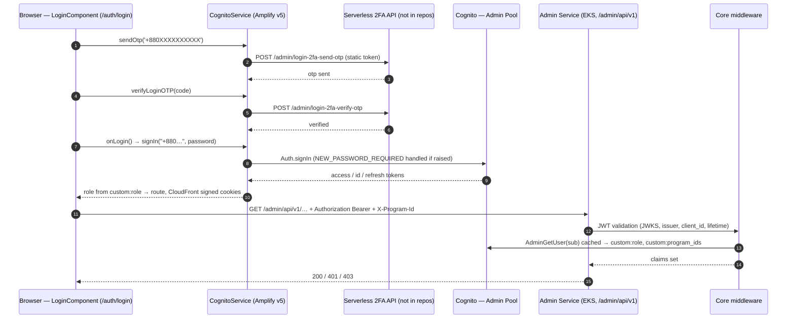

# Admin portal: authentication and authorization flow

How the admin portal (`rvl-gobcb-admin-portal`) authenticates users and how the
backend (`rvl-gobcb-backend`, Admin service) authorizes their API calls.
Written from source-code evidence; every claim cites its file. Unverified
items are marked **[UNCONFIRMED]** and belong to the bs23 open-questions list
(see [gobcb-aws-architecture.md](architecture/gobcb-aws-architecture.md) §9).

For local setup and running the portal against Floci, see
[admin-portal-local.md](admin-portal-local.md). This document explains the
flows themselves; that one explains how to run them on your PC.

## Contents

1. [Background: what AWS Cognito is and how we use it](#1-background-aws-cognito)
2. [Components in the flow](#2-components)
3. [Login flow (authentication)](#3-login-flow)
4. [Token lifecycle after login](#4-token-lifecycle)
5. [Authorization: who may call what](#5-authorization)
6. [Password reset and change](#6-password-reset)
7. [What is deliberately NOT in this flow](#7-not-in-this-flow)
8. [Configuration values for testing](#8-configuration-values)
9. [Logging and traceability gaps](#9-logging-gaps)
10. [Open questions](#10-open-questions)

---

## 1. Background: AWS Cognito

### 1.1 User pools

Cognito's **user pool** is a managed directory of end users plus fenced
authentication. A pool stores the user account (identifier, email, phone,
verified-flag, *and custom attributes*), and it issues signed JWTs after a
successful sign-in. Applications never talk to the pool's data store
directly; they talk to it through the sign-in API, and a backend validates
the resulting tokens.

This platform runs **four** pools, by audience:

| Pool | Audience | Where referenced |
|---|---|---|
| `Admin` | admin-portal staff | frontend `environment.aws.userPoolId`, backend `AWS:CognitoPool:Admin:*` |
| `User` | customers (user portal, user app) | backend `AWS:CognitoPool:User:*` |
| `TicketChecker` | gate checker app | `AWS:CognitoPool:TicketChecker:*` |
| `Agent` | offline ticket sales | `AWS:CognitoPool:Agent:*` (no client found in the repos) |

Evidence: `rvl-gobcb-backend/Services/Admin/ETP.Admin.Service/appsettings.json:66–91`
defines all four with `PoolId / Authority / ClientId / Metadata` placeholders;
the values come from the mounted k8s secret `admin-service-appsettings`
(`deployment/k8s/production/admin_service.yaml:82–90`).

`Platform` and `UserAuth` services exist as near-empty stubs (WeatherForecast
and an empty controller respectively) and take no part in authentication.

### 1.2 App clients

Each pool signs in applications through an **app client** (an audience id,
26 characters, e.g. `3je4dnasabcdef...`). Tokens carry the client id in the
`client_id` claim. The Admin-pool backend validation checks exactly that
claim against a comma-separated configured list
(`Core/ETP.Core/Configuration/DefaultAuthenticationConfig.cs:87–95`), so one
pool can serve several app clients. The admin portal's client id is the
frontend value `environment.aws.userPoolWebClientId`
(`src/app/core/config/aws-exports.ts:7`).

### 1.3 Tokens

A successful sign-in returns three tokens:

- **Access token** — what the portal sends as `Authorization: Bearer <token>`
  on every API call. Carries the issuer (the pool), `client_id`, expiry (1 h
  by AWS default), and platform-specific custom claims after enrichment.
- **ID token** — identity claims; not forwarded by this codebase.
- **Refresh token** — used by the SDK to obtain a fresh access token without
  re-entering credentials (30 days by AWS default).

In the admin portal the Amplify v5 SDK keeps them in **localStorage** (its
default), with the app adding a 55-minute in-memory access-token guard
(`cognito.service.ts:261–302`).

### 1.4 Challenges and MFA

Sign-in is multi-round: Cognito may answer a password with a **challenge**
instead of tokens, e.g. `NEW_PASSWORD_REQUIRED` (user has a temporary
password) or `SMS_MFA` (code required). The client answers the challenge and
gets tokens. The admin portal handles `NEW_PASSWORD_REQUIRED` via
`Auth.completeNewPassword` (`cognito.service.ts:213–246`) and keeps a legacy
`SMS_MFA` → `Auth.confirmSignIn` branch that the main UI flow no longer uses
(§3).

### 1.5 Token verification on a backend

A backend does not call Cognito to check a token. It fetches the pool's
**OIDC metadata / JWKS** (public signing keys, referenced by the config key
`AWS:CognitoPool:<Pool>:Metadata`) and verifies signature, issuer
(`Authority`), audience (`client_id`) and expiry locally
(`DefaultAuthenticationConfig.cs:76–97`).

### 1.6 Custom attributes

A pool can define custom attributes. This platform uses two on the Admin
pool, read from Cognito by the backend and mirrored into claims:

- `custom:role` — comma-separated role list (`admin`, `event_manager`,
  `ticket_manager`, `ticket_operator`, `customer_support`),
  `CognitoUserAttributesMiddleware.cs:132–139`.
- `custom:program_ids` — program ids the user may access, mirrored to
  `program_id` claims.

They are set when an admin creates a staff user
(`AdminUserProvider.cs:46–86`).

### 1.7 OneID SSO — not for admins

OneID Wallet is federated through Cognito for the **user** portal and user
app only. A search of the admin portal for `federatedSignIn`,
`signInWithRedirect`, or any SSO code finds nothing (`grep` over `src/`,
zero real matches). Admin staff use profile-and-password sign-in only.

### 1.8 Staff types on the Admin pool

The Admin pool's staff are differentiated **only by the `custom:role`
attribute** (there are no separate staff categories or permission tables).
The five values are constants in
`rvl-gobcb-backend/Core/ETP.Core/Constant/AppConstant.cs:49–62`
(`admin`, `event_manager`, `ticket_manager`, `ticket_operator` (code name
`BCBPersonnel`), `customer_support`); a user may carry several, comma
separated in `custom:role` (`cognito.service.ts:386`,
`role-change.service.ts:152`), and each becomes a role claim via the
mapping middleware (§1.6).

How they map to actual API surface — the `[Authorize(Roles = …)]` lists
across the Admin service controllers (`Services/Admin/ETP.Admin.Service/Api/*`):

| Staff type (`custom:role`) | Backend endpoints (roles-accepting controllers) | Notes |
|---|---|---|
| `admin` | **everything below, plus** admin-user management (`AdminUsersController`), system settings, social-media settings, promo codes, discounts, gallery, block-level entry gates | full administrator; also bypasses program scope (§5.1 step 4) |
| `event_manager` | activity log, general notices, landing-page images, program + program settings, program venues (+ details), raffle draw, teams, venues, gate manage (`TicketCheckerGateController`, `TicketCheckerController:28`) | owns the "program content" side |
| `ticket_manager` | events, event-venue details, ticket attributes, ticket checkers, ticket-layout configs | the events/attributes group is `admin + event_manager + ticket_manager + ticket_operator` |
| `ticket_operator` (`BCBPersonnel`) | dashboard, events, event-venue details, ticket attributes, ticket checkers, ticket-layout configs | BCB operator; redirect target also `/home` |
| `customer_support` | **user issues only** (`UserIssueController:18` — `admin + customer_support`) | narrowest surface |

Provisioning: all staff types are created through the same flow —
`AdminCreateUser` with phone as username, generated temporary password, and
`custom:role` + `custom:program_ids` attributes set up front
(`AdminUserProvider.cs:46–86`), credentials then SMSed (SES path for email,
SMS via notification client).

Other people-types managed *through* the Admin service but **not** Admin
pool staff: portal users (`PortalUsersController` — lookup of User-pool
customers), agent users (`AgentUserController` — Agent pool), and ticket
checkers (`TicketCheckerController` — TicketChecker pool). Each has its own
pool, policy and token scheme (§5.1 step 1).

Two mismatches worth knowing:

- **Frontend navigation is narrower than the backend surface.** The portal's
  route allow-list for `ticket_manager` (`role-change.service.ts:151–201`)
  exposes `/home` + event-ticket pages only, whereas the backend accepts
  `ticket_manager` on events, venue details, ticket attributes, checkers and
  layout configs. Deliberate UX restriction vs. API surface — verify intent
  with the team before assuming either.
- **Multi-role users**: `custom:role` lists stack (e.g.
  `event_manager,ticket_manager` routes like `/program-management` in the
  login router, `login.component.ts:132–154`), and backend authorization
  succeeds if *any* listed role matches the controller's list.

---

## 2. Components

| Component | Repo / location | Role in the flow |
|---|---|---|
| Login page | `rvl-gobcb-admin-portal/src/app/modules/auth/login/` | collects phone + OTP + password |
| CognitoService | `src/app/core/services/cognito.service.ts` | OTP calls, Amplify sign-in, token cache/refresh |
| Serverless 2FA API | **none of the repos** (reached via `environment.serverless.baseUrl`) | sends/verifies login OTP |
| Cognito Admin pool | AWS | issues the JWTs |
| Route 53 → API Gateway → NLB | AWS edge | routes `/admin/...` into EKS (**gateway-side token check [UNCONFIRMED]**, Q1b) |
| Admin service | `rvl-gobcb-backend/Services/Admin/` | validates tokens, enriches claims, enforces roles/program |
| Core auth middleware | `Core/ETP.Core/**` | JWT validation, claim enrichment, CORS |
| Portal guards/interceptors | `src/app/core/guard/`, interceptors | route protection, header injection |

---

## 3. Login flow

Three steps on `src/app/modules/auth/login/login.component.ts` (route
`/auth/login`):

### Step 1 — OTP send (serverless API, *before* Cognito)

User enters a 10-digit phone (validated `^\d{10}$`, rendered with `+880`).
`sendOtp()` → POST `{"{serverless.baseUrl}"}/admin/login-2fa-send-otp` with a **static
`Authorization` header from `environment.serverless.authorization`**
(`cognito.service.ts:28–29, 450–472`). The AuthInterceptor deliberately
bypasses token attach for the 2FA/forget-password URLs
(`auth.interceptor.ts:19–29`) because none exists yet.
The serverless API is not part of any repo — its internals are unknown (Q1).

### Step 2 — OTP verify

`confirmMFA()` → POST `.../admin/login-2fa-verify-otp`. On
`sms_otp_verified_successfully` the password field is enabled
(`login.component.ts:222+`). Only after the OTP, something that knows
Cognito's real password protocol is ever presented.

### Step 3 — Cognito sign-in

`onLogin()` → `Auth.signIn("+880" + phone, password)` with phone as the
**username** (`login.component.ts:124+`). Cognito may return a
`NEW_PASSWORD_REQUIRED` challenge (first login on an admin-issued temporary
password) → `Auth.completeNewPassword`. Then all three tokens arrive.
Legacy `SMS_MFA` handling exists but is dead code in the current UI flow;
the `reSentOtp()` path still uses the legacy Amplify forgot-password API.

Post-login (`login.component.ts:132–154`):

1. Role list read from the token claim `custom:role`
   (cached `sessionStorage['lastKnownUserRole']`).
2. CloudFront signed cookies set via `eventService.setSignedCookie()`
   (`CloudFront-Policy/Signature/Key-Pair-Id`, domain
   `environment.cloudFront.mainDomain`, `event.service.ts:248`) for S3
   content access.
3. Routing: `admin` / `event_manager(+ticket_manager)` → `/program-management`;
   `customer_support` / `ticket_manager` / `ticket_operator` → `/home`.
   Roles outside the allow-list `['admin','ticket_manager','ticket_operator']`
   are not routed anywhere by the login handler.

### Diagram

### File & method trail (end to end)

| Stage | File | Method / member |
|---|---|---|
| OTP send (UI) | `modules/auth/login/login.component.ts` | `sendOtp()` (L177) → `cognitoService.sendLoginOtp()` |
| OTP send (HTTP) | `core/services/cognito.service.ts` | `sendLoginOtp()` → POST `{serverless.baseUrl}/admin/login-2fa-send-otp` (L450–472) |
| OTP verify (UI) | `login.component.ts` | `confirmMFA()` (L222) → `verifyLoginOTP()` |
| Password sign-in (UI) | `login.component.ts` | `onLogin()` (L124; phone = `'+880' + input`) |
| Amplify sign-in | `cognito.service.ts` | `signIn()` (L213–246; `NEW_PASSWORD_REQUIRED` → `completeNewPassword`; legacy `SMS_MFA` branch `confirmMFA` L247) |
| Access token cache | `cognito.service.ts` | `getAccessToken()` (L261–302, 55-min guard) |
| Refresh | `cognito.service.ts` | `refreshAccessToken()` (L124–175), `handleRefreshFailure()` (L189), `signOut()` (L303) |
| Attach headers | `core/interceptors/auth.interceptor.ts` | bypass URLs (L19–29), Bearer attach (L56–65), 401 refresh-retry (L71–101) |
| Program id header | `src/app/interceptors/program-id.interceptor.ts` | `intercept()` (L20–26) |
| Route protection | `core/guard/auth.guard.ts` + `core/services/role-change.service.ts` | guard → `handleRoleTransition()` → `isRouteAllowedForRole()` (L151–201) |
| Post-login routing | `login.component.ts` | role switch (L132–154; allow-list `['admin','ticket_manager','ticket_operator']`) |
| CloudFront cookies | `features/events/services/event.service.ts` | `setSignedCookie()` / `clearSignedCookie()` (topbar:111–119) — cookie line `event.service.ts:248` |
| Bearer claim preservation | `Configurations/DefaultAuthenticationConfig.cs` | `OnTokenValidated` (L101–115) stores raw token as `AppClaimTypes.AccessToken` |
| Hub token (query string) | `DefaultAuthenticationConfig.cs` | `OnMessageReceived` (L116–128): `?access_token=` for `/admin/chathub`, `/userissue/chathub` |
| JWT validation | `DefaultAuthenticationConfig.cs` | Admin scheme (L76–97): JWKS `MetadataAddress`, `ValidIssuer`, `client_id` AudienceValidator |
| Claim enrichment | `Core/ETP.Core/Middleware/CognitoUserAttributesMiddleware.cs` | pool select by `scope` claim (L85–96) → `AdminGetUser` (cached) → map `custom:role`/`custom:program_ids` (L132–139) |
| Program header read | `Services/Admin/.../Middleware/ProgramIdMiddleware.cs` | L16–24 → `context.Items["ProgramId"]` (+ `ProgramIdAccessor`, `Program.cs:43`) |
| Program enforcement | `Services/Admin/.../Attributes/AuthorizeProgramAttribute.cs` | L12–42 (`admin` bypass; `program_id` claim match) |
| Role allow-list | controllers, e.g. `Api/DashboardController.cs:17` | `[Authorize(Roles = Role.Admin + "," + Role.BCBPersonnel)]` |
| Forgot password (UI) | `modules/auth/forgot-password/forgot-password.component.ts` | L166–209: OTP resend (legacy Amplify), `submitPassword()` → `set-forget-password` |
| Forgot password (backend) | `Api/AdminUsersController.cs:185–196`, `Integration/Services/AdminUserProvider.cs:508–539, 541` | `set-forget-password` → `AdminSetUserPassword`; `forget-password` → `AdminResetUserPassword` |
| Admin user provisioning | `Integration/Services/AdminUserProvider.cs:46–86` | `AdminCreateUser`(phone username, temp pwd) → `AdminSetUserPassword(Permanent)` → SMS credentials |
| Downstream token forward | `Core/ETP.Core.Web/Security/DelegatedBearerAuthenticationHandler.cs` | copies `AppClaimTypes.AccessToken` onto outgoing service calls (§5.3) |

Line numbers are 1-based from the audited source; treat as approximate anchors approx.

---

## 4. Token lifecycle

| Concern | Behaviour | Evidence |
|---|---|---|
| Storage | Amplify v5 default (**localStorage**) + in-memory cache with 55-min guard | `cognito.service.ts:261–302` |
| Proactive refresh | forced `Auth.currentSession()` within a 2-min expiry buffer | `refreshAccessToken()`, `cognito.service.ts:124–175` |
| Reactive refresh | AuthInterceptor catches 401 → single-flight refresh → retry once | `auth.interceptor.ts:71–101` |
| Refresh failure | `Auth.signOut()`, clear caches and role, redirect `/auth/login` | `handleRefreshFailure()` `:189` |
| Sign-out | topbar → `Auth.signOut()`, reset caches + program id, **expire CloudFront cookies**, navigate to login | `app.topbar.component.ts:90–97, 111–119` |
| Role cache | `sessionStorage['lastKnownUserRole']`; program id in `localStorage['globalProgramId']` | `role-change.service.ts`, `program.service.ts:15–22` |

Every API request gets two headers from the interceptors registered in
`app.module.ts:22–32` (order matters: Auth → Loader → ProgramId):

- `Authorization: Bearer <access token>` — `auth.interceptor.ts:56–65`
- `X-Program-Id: <globalProgramId>` — `program-id.interceptor.ts:20–26`
  (skipped for the 2FA endpoints)

---

## 5. Authorization

### 5.1 Backend layers

A request to the Admin service passes up to four checks
(`docs/architecture/gobcb-aws-architecture.md` §2.4; all evidenced in code):

1. **Pool policy** — the JWT must be from the Admin pool and pass signature /
   issuer / `client_id` / lifetime checks (`DefaultAuthenticationConfig.cs:76–97`).
   The `admin` policy only requires an authenticated Admin-pool principal
   (`AuthorizationConfig.cs:13–38`).
2. **Role claims** — `CognitoUserAttributesMiddleware` (registered
   `Program.cs:90`) looks up the user with cached `AdminGetUser` and maps
   `custom:role` → `ClaimTypes.Role`, `custom:program_ids` → `program_id`
   claims. Role constants live in `Core/ETP.Core/Constant/AppConstant.cs:49–62`.
3. **Role allow-list per controller** — `[Authorize(Roles = ...)]`, e.g.
   `DashboardController.cs:17` (admin, ticket_operator),
   `ProgramController.cs:16–19` (all five roles).
4. **Program scope** — `AuthorizeProgramAttribute` (`Program.cs` wires
   `ProgramIdMiddleware` first, `Program.cs:89`): reads `X-Program-Id`;
   `admin` bypasses; everyone else must present an id matching one of their
   `program_id` claims → 400 missing / 403 not allowed
   (currently applied to `DashboardController` only; commented on
   `EventsController`).

Role → some Admin-service endpoints:

| Role | Example endpoints (evidence path) |
|---|---|
| `admin` | admin users CRUD, disable/enable, set-password (`AdminUsersController.cs`), plus everything other roles see |
| `event_manager`, `ticket_manager`, `ticket_operator`, `customer_support` | program/events/venues per attribute lists (`ProgramController.cs:16–19`); support sees issues |

### 5.2 Frontend mirrors (UX only, not security)

Route guards (`src/app/core/guard/`, registered in `app-routing.module.ts:12–38`):

- `AuthGuard` — `isAuthenticated()`, then role-transition handling
  (`auth.guard.ts`, `role-change.service.ts:130–146`).
- `RoleChangeService` route allow-list (`:151–201`): `admin` = all;
  `customer_support` = `/home`, `/issues`; `event_manager`+`ticket_manager` =
  program/venue/media/content/events; `ticket_manager` =
  `/home`, event tickets; `ticket_operator` adds `/report`.
- `ProgramMenuGuard` (program id > 0) and `LimitedMenuGuard` (program id = 0)
  steer the workspace views.

The backend never trusts these; they only shape navigation.

Role/program switching in the topbar follows the same rules: changing role
resets `programService.setProgramId(0)`, broadcasts a notification, and
reroutes to the default route (`role-change.service.ts:130–146`).

### 5.3 Features that ride the same session

- **Admin SignalR chat hub** (`/admin/chathub`, mapped `Program.cs:116`):
  authenticated with the same Cognito access token passed as
  `?access_token=…` query string, accepted only on hub paths by
  `OnMessageReceived` (`DefaultAuthenticationConfig.cs:116–128`).
- **Service-to-service calls forward the user token:** server-ejected HTTP
  clients (Event, Booking, Ticketing, UserIssue — `DependencyConfig.cs:123–195`)
  wrap in `DelegatedBearerAuthenticationHandler`, which copies the user's
  access token (claim `AppClaimTypes.AccessToken`, set at `OnTokenValidated`)
  onto the outgoing request. The downstream service re-validates the same
  Cognito JWT. Note per `docs/architecture/gobcb-aws-architecture.md` §2.5:
  Booking/Ticketing/UserIssue check only that the token is from the Admin
  pool — role enforcement with the claims middleware runs in Admin and
  UserIssue services only.
- **CloudFront signed cookies** (post-login `setSignedCookie()`) give the SPA
  direct S3/CDN content access, independent of Bearer APIs (§3).
- **Activity Log page** (`global-activity-log`) renders the backend
  `ActivityLogController` data — the DB audit trail of entity changes and
  admin user-management actions, *not* of logins (§9).

---

## 6. Password reset

Same serverless-OTP shape as login (`forgot-password.component.ts`,
`CognitoService`):

1. `sendLoginOtp` → `verifyLoginOTP` (serverless API) → returns a `userId`.
2. `submitPassword({userId, password})` → POST
   `{admin base}/admin/api/v1/admin-users/set-forget-password`
   (`AdminUsersController.cs:185–196`, `[AllowAnonymous]`) → Cognito
   `AdminSetUserPassword` (`AdminUserProvider.cs:541`).
3. Redirect to `/auth/login`.

Backend-initiated alternatives: `GET admin-users/forget-password` triggers
Cognito `AdminResetUserPassword` after a phone-number lookup
(`AdminUserProvider.cs:508–539`); admins can `set-password` for other users
(password SMSed to the user). Self-service change-password uses Cognito
`ChangePassword` in the SDK, with a backend route existing for the
ticket-checker accounts (`TicketCheckerController.cs:139–148`).

---

## 7. What is deliberately NOT in this flow

- **No OneID SSO** for admins (§1.7).
- **No backend login/refresh/me endpoints.** Login is entirely
  client-side against Cognito; the Admin service only validates tokens.
  `TokenIssuerController` (`/admin/api/v1/token`) issues service-to-service
  JWTs from a `ServiceApiKey` header and appears unused by the portal.
- **No social/federated sign-in.**
- **No MFA configured in the backend** — MFA/2FA is either the serverless
  OTP or pool-side configuration [not confirmable from repos].

---

## 8. Configuration values

### 8.1 Frontend — `rvl-gobcb-admin-portal/src/environments/environment*.ts`

Committed as **0-byte files**; CI overwrites them at build time from SSM
(`/rvl/<env>/admin-portal/environment.prod.ts`, `buildspec-dev.yml:7,28–29`).
Key inventory from code usage:

| Key | Used by | Login-flow critical? |
|---|---|---|
| `production` | `main.ts:5` | no |
| `aws.region` | `aws-exports.ts:5` | yes |
| `aws.userPoolId` | `aws-exports.ts:6` | yes |
| `aws.userPoolWebClientId` | `aws-exports.ts:7` | yes |
| `serverless.baseUrl` | `cognito.service.ts:28` | yes |
| `serverless.authorization` | `cognito.service.ts:29` | yes |
| `services.admin` | `application-config.service.ts:9` | yes (API validation) |
| `services.booking`, `services.ticketing`, `services.userissue`, `services.userissuehub` | feature services | no |
| `cloudFront.mainDomain` | `event.service.ts:248` | post-login only |
| `cloudFront.cloudFrontUrl` | gallery features | no |

Local development should not hand-edit these; use the throw-away-copy script
described in [admin-portal-local.md](admin-portal-local.md), which also
proxies Cognito to Floci and stubs the OTP (local OTP is always `123456`).

### 8.2 Backend — Admin service (appsettings / mounted secret)

Tier 1 — required for the auth chain:

| Key | Notes |
|---|---|
| `AWS:CognitoPool:Admin:Authority` | JWT `ValidIssuer`; must equal `https://cognito-idp.<region>.amazonaws.com/<pool-id>` of the same pool the portal signs in to |
| `AWS:CognitoPool:Admin:Metadata` | OIDC metadata URL (JWKS source) |
| `AWS:CognitoPool:Admin:ClientId` | comma-separated list; **must include the portal's `userPoolWebClientId`** or every request 401s |
| `AWS:CognitoPool:Admin:PoolId` | middleware picks the pool for `AdminGetUser` |
| `AWS:Region`, `AWS:AccessKey`, `AWS:SecretAccessKey` | Cognito SDK client (`DependencyConfig.cs:197–207`); without valid creds the role-claim enrichment fails and role-guarded routes 403 |
| `ConnectionStrings:Admin` | Admin **and** Logging DB contexts share it (`AdminStorageExtensions.cs:19–21`); migrations run at boot (`Program.cs:100`) |
| `CORS:AllowedOrigins` | `DefaultCorsConfig.cs:15–26`; committed default already includes `localhost:4200/4201` for local dev (`appsettings.json:13–20`) |

Tier 2 — needed for a clean boot (dummy-shaped OK for a login smoke test):
`Cache:Redis:*`, `DistributedLock:Redis:*`, `Services:*` client base URLs
(lazily bound; hosted workers at `DependencyConfig.cs:101–108` may call out).
Note two keys are read but missing from the committed appsettings JSON and
exist only in the deployed secret: `Services:PushNotification` (line 142)
and `AWS:Ticket:Bucket:Name` (line 225).

Tier 3 — not needed for this flow: `Serverless:*`, `Notification:*`,
`AWS:Bucket:Name`, `PaymentSettings:DgePay:*`.

### 8.3 Cross-checks before testing

- Frontend pool id/client id == backend `AWS:CognitoPool:Admin:*` values,
  same app client included in the backend's comma list.
- Test user: real password set (or expect `NEW_PASSWORD_REQUIRED`),
  verified `phone_number`, `custom:role` and `custom:program_ids` set
  (backend create-user flow does this: `AdminUserProvider.cs:46–86`).
- Username format is the phone with `+880` prefix.

---

## 9. Logging gaps

There is **no correlatable trace** across the login flow today:

- Portal: no telemetry SDK; errors surface only as PrimeNG toasts
  (`login.component.ts`).
- Serverless 2FA API: source not in repos; logging unknown (Q1).
- Cognito: sign-in analytics require advanced-security CloudWatch settings
  that live outside the repos [UNCONFIRMED].
- Admin service: Serilog console sink with `MinimumLevel.Information()` and
  the `Microsoft` category capped at `Error`
  (`Core/ETP.Core/Logging/SerilogExtension.cs:9–23`) filters out the JWT
  bearer failure chatter — failed token validation returns 401 with no log
  line. `JwtBearerEvents` registers only `OnTokenValidated` /
  `OnMessageReceived`, no failure logging
  (`DefaultAuthenticationConfig.cs:99–129`).
- ActivityLog DB audit (`ActivityLogInterceptor`) records data changes and
  admin-user management actions, **not** logins. Its `TransactionId`
  correlation is never populated (`SetTransactionId` has no callers).

---

## 10. Open questions

Extending the bs23 list in
[architecture/gobcb-aws-architecture.md](architecture/gobcb-aws-architecture.md) §9:

- Q1 (existing): what is the serverless 2FA API (Lambda?), where does it log,
  and who rotates `Serverless:Authorization` (portal) and
  `environment.serverless.authorization` (same value)?
- New: does the pool run advanced security features / CloudWatch log export
  for sign-in events?
- New: is [AuthorizeProgram] intended to stay on `DashboardController` only,
  and is the commented-out state on `EventsController` deliberate?
- New: confirm one App-Client-per-portal mapping in API Gateway (Q1b)
  applies to the Admin pool tokens as well.
