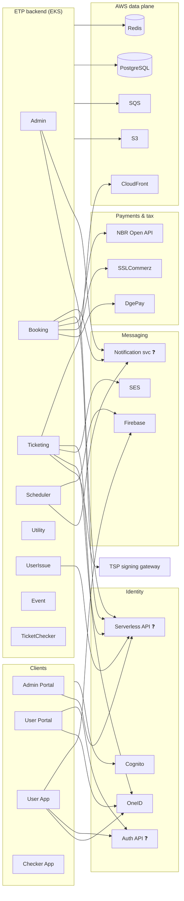

# ETP external systems

Every system outside the ETP code that the platform depends on, with who calls it and why. Companion to [`gobcb-aws-architecture.md`](gobcb-aws-architecture.md) (AWS hosting view).

**Method.** Submodule code first, architecture docs second. Where they disagree, the discrepancy is listed in [section 6](#6-code-vs-docs-discrepancies). Nothing here is assumed.

**Verified against** (2026-10-24): admin-portal `f62d275`, backend `430ec16`, checker-app `e919c54`, user-app `365b8be`, user-portal `36aaf58`.

**Status tags:** ✅ active in code · ⚠️ dormant / partly wired · ❓ called by code but the other side is not in any repo.

**Rules for this doc:** config *key names* only, never values. Real values live in user secrets or SSM Parameter Store (`/rvl/<env>/<service>-appsettings`).

---

## 1. Map

## 2. Who uses what

| System | Admin | Booking | Event | Ticketing | Scheduler | Utility | UserIssue | TicketChecker | User Portal | Admin Portal | User App | Checker App |
|---|---|---|---|---|---|---|---|---|---|---|---|---|
| Cognito | ✅ | ✅ | ✅ | ✅ | ✅ | ✅ | ✅ | ✅ | ✅ | ✅ | ✅ | ✅ |
| OneID (SSO) | | | | | | | | | ✅ | | ✅ | |
| OneID (API) | | | | ✅ | | | | | | | | |
| Serverless API | ✅ | ✅ | | ✅ | | | ✅ | | | ✅ | | |
| Auth API | | | | | | | | | ✅ | | ✅ | ✅ |
| DgePay / SSLCommerz | | ✅ | | | | | | | ✅ | | ✅ | |
| NBR Open API | | ✅ | | | | | | | | | | |
| TSP | | | | ✅ | | | | | | | | |
| Notification svc | ✅ | ✅ | | | ✅ | | | | | | | |
| Firebase | | | | | ✅ | | | | | | ✅ | |
| SES | ✅¹ | | | ✅ | | | | | | | | |
| S3 / CloudFront | ✅ | ✅ | ✅ | ✅ | ✅ | ✅ | | ✅ | | ✅ | | |
| SQS | | ✅ | ✅ | ✅ | ✅ | ✅ | | | | | | |
| Redis | ✅ | ✅ | ✅ | ✅ | ✅ | ✅ | | ✅ | | | | |

¹ Admin registers the SES client; no send call found there. Blank means not found in code. UserIssue, Platform and UserAuth were not traced for every row.

---

## 3. Identity & sign-in

| System | Status | Purpose | Called by | Config keys |
|---|---|---|---|---|
| **Amazon Cognito** | ✅ | Authentication for all four clients. Four user pools: User, Admin, TicketChecker, Agent. Backend validates JWTs against each pool's OIDC metadata and manages users via admin SDK calls (create, disable, delete, set password, list). | All services; all clients (Amplify) | `AWS:CognitoPool:<Pool>:{PoolId,Authority,ClientId,Metadata}` |
| **OneID, SSO** | ✅ | Federated login through Cognito (custom provider `oneid`). | User Portal, User App | `environment.aws.oauth`, `oneIdRegisterUrl`, `oneIdLogoutUrl` (portal); `AMPLIFY_CONFIG` (app) |
| **OneID, API** | ✅ | Backend pushes the ticket PDF (plus VDS QR data) into a user's OneID wallet. OAuth client-credentials token, cached in Redis. | Ticketing (`OneIdManager`) | `OneIdSettings:{TokenUrl,DocumentSyncUrl,AuthorizationToken}` |
| **"Serverless" API** | ❓ | HTTP API (source not in any repo, static auth header). Cognito user lookup `user/get-bulk-users`; admin login 2FA `admin/login-2fa-send-otp` and `-verify-otp` (SMS). | Admin, Booking, Ticketing, UserIssue; Admin Portal | `Serverless:{BaseUrl,Authorization}` (backend); `environment.serverless.*` (portal) |
| **"Auth" API** | ❓ | HTTP API (source not in any repo, static auth header). Sign-up/phone/email OTP (`otp/send-otp`, `verify-otp`), password reset, `user/my-profile`, `register-sso`, app-version check. Not shown to be the same service as the Serverless API. | User Portal (`services.identity`), User App, Checker App | `AUTH_API_BASE_URL`, `AUTH_API_TOKEN` (apps); `environment.services.identity`, `headerkey` (portal) |

**Who sends the OTP SMS?** Not determinable from code. Sign-in MFA is a Cognito `SMS_MFA` challenge (delivery config not in repos). Every other OTP goes through the two ❓ APIs above.

## 4. Payments, tax & ticket signing

| System | Status | Purpose | Called by | Config keys |
|---|---|---|---|---|
| **DgePay** | ✅ | Payment gateway (default, enum `= 1`). Initiate checkout, decrypt callback, check status. Token cached in Redis. | Booking | `PaymentSettings:DgePay:{BaseUrl,MerchantClientId,MerchantClientSecret,MerchantApiKey,CallbackUrl,RedirectUrl}` |
| **SSLCommerz** | ✅ | Second payment gateway (`= 2`), sandbox/live switch. Includes wallets such as bKash and Nagad as SSLCommerz methods. Gateway is chosen per program. | Booking | `PaymentSettings:SSLCommerz:{BaseUrl,StoreId,StorePassword,Success/Fail/Cancel/IpnUrl,IsSandbox}` |
| **NBR Open API** | ✅ | Bangladesh tax authority: authenticate, record VAT invoice, download S-Challan. Driven by the `VatChallanProcessing` queue. | Booking (`NBROpenApiManager`) | `PaymentSettings:NBROpenApi:{BaseUrl,ClientId,ClientSecret,CompanyId,RetailerId,ServiceTypeId}` |
| **TSP signing gateway** | ✅ | Digitally signs the ticket PDF. Mutual TLS with a client cert (`Cert/tspgw_client.pfx`, from k8s secret `tspgw-client`). "TSP" is never expanded in code. | Ticketing | `TSP:{AuthUrl,SignUrl,UserId,DigitalIdentityId}` |

Checker App verifies the signed VDS QR **offline** on the device with a PEM cert (`VDS_CERTIFICATE`). Whether that cert comes from the TSP is not shown in code.

## 5. Messaging, storage, platform

### Messaging

| System | Status | Purpose | Called by | Config keys |
|---|---|---|---|---|
| **Notification service** | ❓ | HTTP service for SMS (`/notification/send-message`) and event notifications (`/notification/request`). Admin uses it to SMS credentials to new admin/agent/checker users. SMS provider behind it unknown. `ETP.Core.SMS` is an empty project. | Admin, Booking, Scheduler | `Notification:{Endpoint,Authorization}` |
| **Firebase (FCM)** | ✅ | Mobile push. Server sends via FirebaseAdmin; app registers for pushes. Queue `FirebaseNotification` feeds it. | Scheduler (send); User App | `FirebasePushNotificationConfig:*`; `FIREBASE_*` (app `.env`) |
| **Firebase Analytics** | ✅ | App usage analytics. | User App | `FIREBASE_*` |
| **Amazon SES** | ✅ | Ticket emails (`SendEmail`, `SendRawEmail`). | Ticketing (`TicketManager`) | `AWS:Ticket:EmailSender` |
| **SendGrid** | ⚠️ | Class exists, never registered, config unused. | none | `EmailOptions` (unused) |

### AWS data plane

| System | Status | Purpose | Notes |
|---|---|---|---|
| **S3** | ✅ | Media and ticket files. | `AWS:Bucket:*`, `AWS:Ticket:*` |
| **CloudFront** | ✅ | CDN for media; backend issues **signed cookies** for protected ticket content. Also fronts both portals' static builds (S3 sync + invalidation). | Hard-coded CF host in `GallerySettings` and ticket layouts |
| **SQS** | ✅ | Async work via `SqsPublisher` and polling workers. Queues: `OrderSuccess`, `EventCapacity`, `VatChallanProcessing`, `FirebaseNotification`, `TicketSigning`, `TicketProcessing`. Messages are unsigned. | `AWS:Queue:*`; access via one static IAM key pair |
| **PostgreSQL** | ✅ | Only relational store (Npgsql/EF Core). | `ConnectionStrings:*` |
| **Redis** | ✅ | Cache, distributed locks, NBR/OneID/DgePay tokens, data-protection keys. | `Cache:Redis:*`, `DistributedLock:Redis:*` |
| **DynamoDB** | ⚠️ | Registered only in Ticketing with `ServiceURL` hard-coded to `localhost:8000`; only consumer is `TestTicketGeneratorController`. Effectively unused. | |

### Platform & delivery

| System | Status | Purpose |
|---|---|---|
| **GitHub** | ✅ | Source (org `Relief-Validation`). |
| **CodeBuild, ECR, EKS** | ✅ | Build images, push to ECR, `kubectl apply` to EKS. Portals: SPA builds go to S3 + CloudFront; user-portal also has container builds. |
| **SSM Parameter Store** | ✅ | Per-service appsettings and each portal's `environment.ts`, injected at build. |
| **cert-manager / Let's Encrypt** | ✅ | TLS for the chat host (`ClusterIssuer letsencrypt-prod`). Dev/test ALB ingress use ACM certs instead. |
| **CodePipeline** | ❓ | Not referenced in any repo. |

### Client-side extras

| System | Status | Purpose |
|---|---|---|
| **Google Analytics** | ✅ | User Portal page/event tracking (`environment.googleAnalyticsId`). |
| **Google Fonts, unpkg** | ✅ | CDN assets in portals (fonts; Quill CSS in Admin Portal). |
| **Innovatrics DOT** | ⚠️ | Face/document capture packages declared in User Portal `package.json`; no use in `src`. |
| **Application Insights** | ⚠️ | Packages and a `HealthFilter` in Admin/UserIssue; no registration or key config found. |

---

## 6. Code vs docs discrepancies

| # | Claim | Source | What the code shows |
|---|---|---|---|
| 1 | OneID is SSO via Cognito only; Q5 asks if the backend calls OneID | AWS doc §0, Q5 | Ticketing calls OneID directly (token + document sync). |
| 2 | DynamoDB "actual use not verified" | AWS doc §5 | Registered in Ticketing against `localhost:8000`; only a test controller uses it. |
| 3 | Admin portal `environment` file sets `aws.region = ap-southeast-1` | AWS doc §0 | Repo file is 0 bytes; real file is injected from SSM at build. Region is still supported by the dev ingress ACM certificate (`ap-southeast-1`). |
| 4 | Entry is NLB + API Gateway + nginx | AWS doc §1, §4 | Prod uses `nginx-second`; staging `nginx`; **dev/test use AWS ALB**. No NLB/API Gateway/Lambda/Route 53/WAF/bastion appears in any code. |
| 5 | Aurora PostgreSQL, ElastiCache | AWS doc §5 | Code proves PostgreSQL and Redis clients only. |
| 6 | CloudWatch for observability | AWS doc §7 | Not in code. Serilog is console-only; App Insights is half-wired. |
| 7 | Inventory omits payments/tax/signing | AWS doc §8 | DgePay, SSLCommerz, NBR, TSP, Notification svc, FCM and Google Analytics are active in code but not in the component inventory. |
| 8 | SendGrid and Imgix are active third parties | Backend `ETP-Architecture-Diagram.md` | Both dormant (SendGrid unregistered; Imgix is an unregistered purge client). |
| 9 | SQL Server and Azure Redis | Backend `README.md` | Code uses PostgreSQL and AWS. |
| 10 | Backend diagram lists services without SSLCommerz, NBR, OneID | Backend `ETP-Architecture-Diagram.md` | All three active in code. |

## 7. Open questions for the vendor (bs23)

1. What sends OTP SMS behind the Serverless API (`admin/login-2fa-*`) and the Auth API (`otp/*`): Lambda, Cognito trigger, SNS, or an SMS provider?
2. Are the Serverless API and Auth API the same deployment? Where is their source?
3. What is behind the Notification service (SMS provider, email, push)?
4. What does TSP stand for, and who operates it? Is the checker app's `VDS_CERTIFICATE` issued by it?
5. What triggers CodePipeline and what stages does it have?
6. Is the Cognito SMS MFA delivered via SNS, and in which region?
7. Why is the TSP HTTP client built with server-certificate validation disabled?
