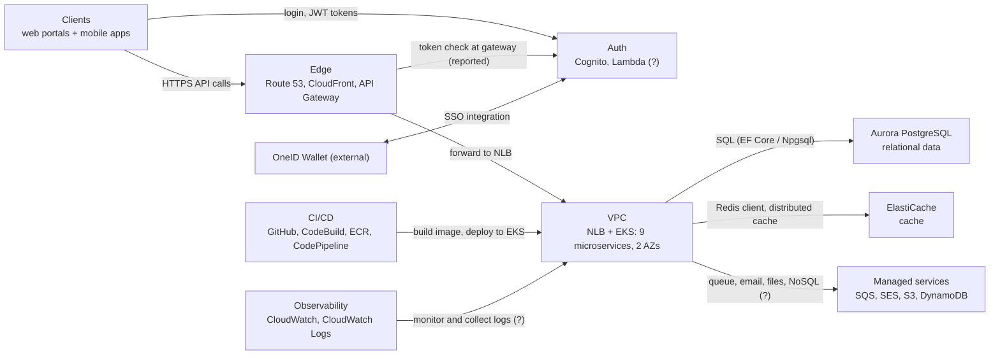
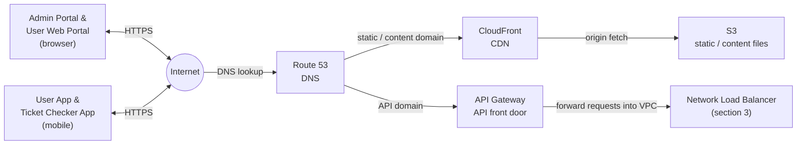
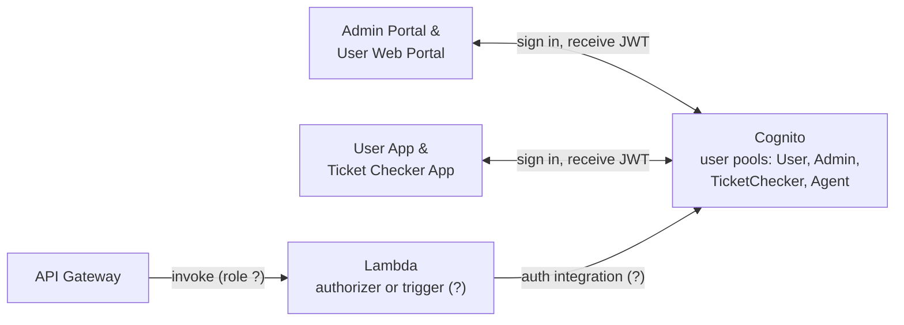
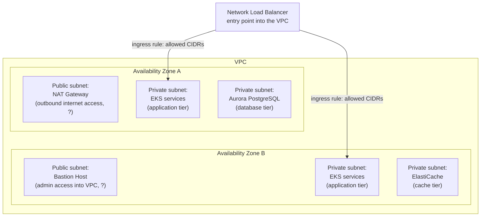
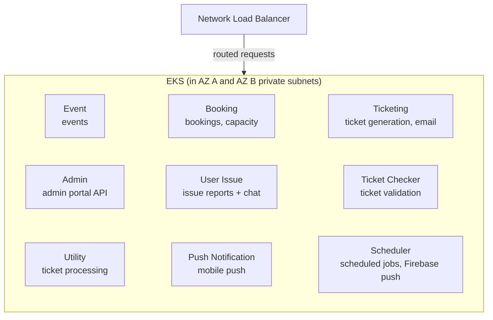
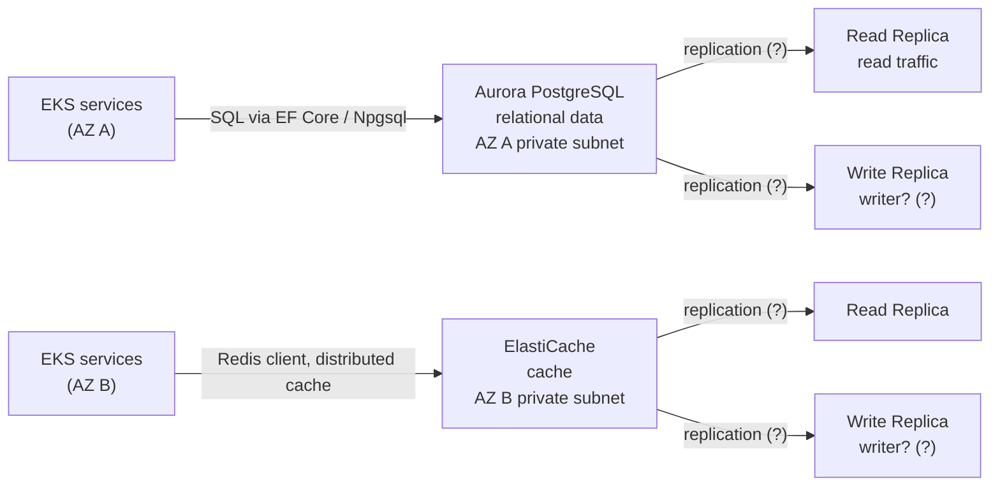
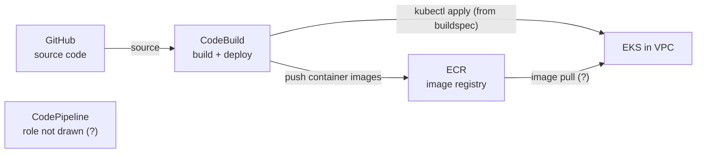
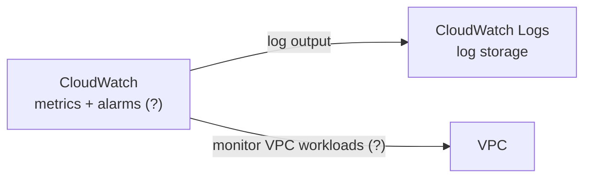

# GoBCB AWS Hosting Architecture

Text representation of `gobcb_architecture_diagram.png` (source: bs23). **Agents: read this file, not the PNG.** The PNG is the vendor's original; if they disagree, correct this file.

`[UNCONFIRMED]` marks an interpretation of ambiguous drawing. See [Open questions](#9-open-questions-for-bs23).

## Contents

0. [High-level overview](#0-high-level-overview) (start here)
1. [Clients and edge (request entry)](#1-clients-and-edge)
2. [Authentication](#2-authentication)
3. [Network layout: VPC, AZs, subnets](#3-network-layout)
4. [Application: EKS services](#4-application-eks-services)
5. [Data stores](#5-data-stores)
6. [CI/CD](#6-cicd)
7. [Observability](#7-observability)
8. [Component inventory](#8-component-inventory)
9. [Open questions for bs23](#9-open-questions-for-bs23)

---

## 0. High-level overview

Hosted on AWS, Singapore region (the image gives no region code), one VPC across two Availability Zones.

Label convention: labels are drawn from the image or confirmed in the code. A trailing `(?)` means an unconfirmed interpretation (see [Open questions](#9-open-questions-for-bs23)).

| Block | Detail section |
|-------|----------------|
| Clients, Edge | [1](#1-clients-and-edge) |
| Auth | [2](#2-authentication) |
| VPC | [3](#3-network-layout), [4](#4-application-eks-services) |
| Data, Managed services | [5](#5-data-stores) |
| CI/CD | [6](#6-cicd) |
| Observability | [7](#7-observability) |

Note: the SSO arrow in the image runs between the AWS boundary and OneID Wallet, not specifically Cognito. Attaching it to Auth is `[UNCONFIRMED]`.

---

## 1. Clients and edge

- Route 53 splits traffic: static/content via CloudFront to S3, API traffic via API Gateway.
- API Gateway forwards to the NLB inside the VPC.
- API Gateway also connects to Lambda (see [2](#2-authentication)).
- A CloudFront arrow also points into the VPC top edge `[UNCONFIRMED]`.

## 2. Authentication

- Both client types talk to Cognito directly (the mobile arrow loops around the top of the image).
- Lambda sits between API Gateway and Cognito. Whether it is an authorizer or a trigger is `[UNCONFIRMED]`.
- Codebase evidence (searched the workspace and all submodules): no Lambda source, no API Gateway or Cognito trigger configuration, and no IaC for them exist in any repo, so the Lambda's role cannot be determined from code. The backend validates Cognito JWTs itself (`rvl-gobcb-backend/Core/ETP.Core/Configuration/DefaultAuthenticationConfig.cs`, one JwtBearer scheme per Cognito pool: User, Admin, TicketChecker, Agent). That shows services do not rely on API Gateway for token validation, but it does not rule out a Lambda authorizer or trigger in front.
- Reported, **unverified** (verbal, from the implementation team's DevOps, not seen in any repo): every client API call goes through API Gateway, which validates tokens with a Cognito authorizer. If true, a native Cognito authorizer needs no Lambda, so the Lambda's role is then not token validation. Not reflected in the diagram until confirmed.
- OneID Wallet SSO integration: see [overview](#0-high-level-overview).

## 3. Network layout

One VPC, two AZs, each with one public subnet and two private subnets. Both AZs are drawn symmetrically except for the public-subnet contents and the lower private subnet.

- Ingress rule icons show CIDRs 172.16.0.0, 172.16.1.0, 172.16.2.0 (read from small text; verify against the PNG).
- NAT Gateway and Bastion Host have no arrows in the image; their purposes in the labels are the usual roles of those services, not stated in the image.
- Managed services (SES, SQS, DynamoDB, CloudFront, CloudWatch) have arrows into the VPC top edge. See [5](#5-data-stores) and [7](#7-observability).

## 4. Application: EKS services

One EKS cluster, drawn as a single dashed box crossing both AZs. The same nine services appear in each AZ.

Service purposes in the diagram are inferred from service names and the worker/controller classes in `rvl-gobcb-backend/Services/*`; the image itself gives only the names. Verify before relying on them.

| Row | Services |
|-----|----------|
| 1 | Event Service, Booking Service, Ticketing Service |
| 2 | Admin Service, User Issue Service, Ticket Checker Service |
| 3 | Utility Service, Push Notification Service, Scheduler Service |

The image shows no arrows between individual services.

## 5. Data stores

Also in the image, outside the VPC and each with an arrow into the VPC top edge: DynamoDB, SQS, SES `[UNCONFIRMED]` (likely endpoints or service access, not in-VPC resources).

What the code says each is used for:

| Store | Used for (from code) |
|-------|----------------------|
| Aurora PostgreSQL | Every service's data (`Npgsql.EntityFrameworkCore.PostgreSQL`) |
| ElastiCache | Distributed cache through a Redis client (`StackExchange.Redis`) |
| SQS | Message queue (`SqsPublisher`, ticket generation queue) |
| SES | Sending email (Ticketing service, `ETP.Core.Email`) |
| S3 | File/blob storage (`ETP.Core.BlobStorage`, `ETP.Core.Storage`) |
| DynamoDB | SDK referenced in `ETP.Core.Storage`; actual use not verified |

## 6. CI/CD

- CodePipeline, CodeBuild and ECR sit in one dashed box. CodePipeline has no arrows, so its role is `[UNCONFIRMED]`.
- CodeBuild and ECR each have a plain arrow into the VPC left edge (meaning not labelled).
- Codebase evidence (`rvl-gobcb-backend/buildspec-{dev,test,stage,prod}.y*ml`): CodeBuild logs in to ECR and pushes images, runs `aws eks update-kubeconfig`, creates Kubernetes secrets, and runs `kubectl apply` on `deployment/k8s/<env>/*.yaml`. So CodeBuild performs the EKS deployment, which is the likely meaning of the arrows into the VPC. Per-service appsettings are read from SSM Parameter Store (`/rvl/<env>/<service>-appsettings`), which is not drawn in the image. What triggers CodePipeline, and what CodePipeline itself does, is not in the repo.

## 7. Observability

---

## 8. Component inventory

| # | Component | AWS service / type | Location | Section |
|---|-----------|--------------------|----------|---------|
| 1 | Admin Portal & User Web Portal | Web client | Outside AWS | [1](#1-clients-and-edge) |
| 2 | User App & Ticket Checker App | Mobile client | Outside AWS | [1](#1-clients-and-edge) |
| 3 | Internet | Public network | Outside AWS | [1](#1-clients-and-edge) |
| 4 | Route 53 | DNS | Region | [1](#1-clients-and-edge) |
| 5 | CloudFront | CDN | Region | [1](#1-clients-and-edge) |
| 6 | S3 | Object storage | Region | [1](#1-clients-and-edge) |
| 7 | API Gateway | Managed API | Region | [1](#1-clients-and-edge) |
| 8 | Lambda | Function | Region | [2](#2-authentication) |
| 9 | Cognito | Identity | Region | [2](#2-authentication) |
| 10 | Network Load Balancer | NLB | VPC, between AZs | [3](#3-network-layout) |
| 11 | Ingress Rule (x2) | Ingress rule | NLB to each AZ | [3](#3-network-layout) |
| 12 | NAT Gateway | NAT | AZ A public subnet | [3](#3-network-layout) |
| 13 | Bastion Host | EC2 | AZ B public subnet | [3](#3-network-layout) |
| 14 | EKS + 9 services | Kubernetes | AZ A and AZ B private subnets | [4](#4-application-eks-services) |
| 15 | Aurora PostgreSQL (+ read/write replica) | RDS Aurora | AZ A private subnet | [5](#5-data-stores) |
| 16 | ElastiCache (+ read/write replica) | Cache | AZ B private subnet | [5](#5-data-stores) |
| 17 | DynamoDB | NoSQL DB | Region | [5](#5-data-stores) |
| 18 | SQS | Queue | Region | [5](#5-data-stores) |
| 19 | SES | Email | Region | [5](#5-data-stores) |
| 20 | GitHub | Source control | Outside AWS | [6](#6-cicd) |
| 21 | CodePipeline | CI/CD | AWS, left of VPC | [6](#6-cicd) |
| 22 | CodeBuild | CI | AWS, left of VPC | [6](#6-cicd) |
| 23 | ECR | Container registry | AWS, left of VPC | [6](#6-cicd) |
| 24 | CloudWatch | Monitoring | Region | [7](#7-observability) |
| 25 | CloudWatch Logs | Logging | Region | [7](#7-observability) |
| 26 | OneID Wallet | External | Outside AWS | [0](#0-high-level-overview) |

## 9. Open questions for bs23

Written to be sent as-is. Each question names where it is in the diagram, what we see, what we assume, and options, so a one-line reply is enough. Reply format: question number + option letter (or a short correction).

Internal status: none of these can be answered from the codebase (no Lambda, API Gateway, Cognito trigger or infrastructure code exists in any repo). We searched all five repos.

### Q1. Lambda between API Gateway and Cognito, and how tokens are validated
- **Where:** top centre of the diagram. API Gateway has an arrow to the Lambda icon, and the Lambda has an arrow to Amazon Cognito.
- **What we see:** only the two arrows, no label.
- **What we were told:** your DevOps said every API call goes through API Gateway, which validates tokens with a Cognito authorizer.
- **We assume:** if it is a native Cognito authorizer, it does not need a Lambda, so the Lambda does something else.
- **What is the Lambda's role?**
  - (a) A Lambda authorizer (custom token check). In that case, is the "Cognito authorizer" wording informal?
  - (b) A Cognito Lambda trigger (e.g. pre-sign-up, post-confirmation, pre-token-generation).
  - (c) Something else (please describe).
- **Also please confirm:** which API Gateway authorizer type validates tokens (Cognito user pool authorizer, JWT authorizer, or Lambda authorizer)?
- **Why we ask:** our services also validate Cognito JWTs themselves. We need to know what the gateway enforces and where login/token behaviour is customised.

### Q1b. One authorizer per Cognito pool, and chat hubs
- **What we see in code:** the backend uses four Cognito pools (User, Admin, TicketChecker, Agent), and the SignalR chat hubs (`/userissue/chathub`, `/admin/chathub`) send the token in the query string.
- **Please confirm:**
  - Does API Gateway have a separate authorizer for each of the four pools, or how are they mapped to routes?
  - Do the chat hub (WebSocket/SignalR) connections also go through API Gateway, or directly to the load balancer?
  - Do service-to-service calls inside EKS bypass API Gateway?
- **Why we ask:** to document the real auth path per client type and to know which calls are not covered by the gateway.

### Q2. "Write Replica" under Aurora PostgreSQL and ElastiCache
- **Where:** the two lower private subnets. Aurora (left AZ) and ElastiCache (right AZ) each show a "Read Replica" and a "Write Replica".
- **We assume:** "Write Replica" means the writer (primary) instance, since replicas are normally read-only.
- **Is that right?**
  - (a) Yes, it is the primary/writer instance.
  - (b) No, it is a genuinely separate replica (please say what it replicates and why it is writable).
- **Why we ask:** it decides which endpoint services must use for writes versus reads.

### Q3. Aurora only in the left AZ, ElastiCache only in the right AZ
- **Where:** same two lower private subnets.
- **What we see:** Aurora appears only in the left AZ and ElastiCache only in the right AZ.
- **We assume:** this is a simplification of the drawing and both run across both AZs.
- **Which is true?**
  - (a) Both are multi-AZ in reality.
  - (b) Single-AZ exactly as drawn.
  - (c) Other (please describe).
- **Why we ask:** failover and availability assumptions.

### Q4. SES, SQS, DynamoDB and CloudFront arrows into the VPC
- **Where:** the row of four icons above the VPC. Each has an arrow pointing at the top edge of the VPC box.
- **We assume:** these are regional AWS services the EKS services call, possibly through VPC endpoints, and they are not hosted inside the VPC.
- **How do the services reach them?**
  - (a) Through VPC endpoints (gateway or interface).
  - (b) Through the NAT Gateway to the public service endpoints.
  - (c) Other (please describe).
- **Why we ask:** network and security-group configuration, and which dependencies fail if the NAT Gateway is unavailable.

### Q5. OneID Wallet SSO integration
- **Where:** right edge. A bidirectional arrow labelled "SSO Integration" runs from the AWS boundary to OneID Wallet.
- **What we see:** the arrow ends at the outer AWS box, not at a specific service.
- **Which component terminates the integration?**
  - (a) Cognito (federated identity provider).
  - (b) A backend service (please name it, e.g. the User Auth service).
  - (c) Other (please describe).
- **Why we ask:** to document the login flow and know what must change if OneID's configuration changes.

### Q6. CodePipeline: trigger and role
- **Where:** left side. CodePipeline, CodeBuild and ECR are inside one dashed box. GitHub points to CodeBuild, CodeBuild points to ECR, and CodeBuild and ECR each have an arrow into the VPC. CodePipeline has no arrows.
- **What we already know from the repo:** the `buildspec-*.yaml` files show CodeBuild pushing images to ECR and deploying to EKS with `kubectl apply`. We do not need an answer on that part.
- **What we still need:**
  - What triggers the pipeline (push to a branch, manual approval, other)?
  - What does CodePipeline do between GitHub and CodeBuild (source stage only, approvals, per-environment stages)?
- **Why we ask:** to document the release process and which branch maps to which environment.
