# GoBCB AWS Hosting Architecture

Text representation of `gobcb_architecture_diagram.png` (source: bs23). **Agents: read this file, not the PNG.** The PNG is the vendor's original; if they disagree, correct this file.

`[UNCONFIRMED]` marks an interpretation of ambiguous drawing. See [Open questions](#9-open-questions-for-bs23).

## Contents

0. [High-level overview](#0-high-level-overview) (start here)
1. [Clients and edge (request entry)](#1-clients-and-edge)
2. [Authentication and authorization](#2-authentication-and-authorization)
3. [Network layout: VPC, AZs, subnets](#3-network-layout)
4. [Application: EKS services and service communication](#4-application-eks-services)
5. [Data stores](#5-data-stores)
6. [CI/CD](#6-cicd)
7. [Observability](#7-observability)
8. [Component inventory](#8-component-inventory)
9. [Open questions for bs23](#9-open-questions-for-bs23)

---

## 0. High-level overview

Hosted on AWS, Singapore region (`ap-southeast-1`: the image gives no region code, but the admin portal environment file sets `aws.region` to `ap-southeast-1`), one VPC across two Availability Zones.

Label convention: labels are drawn from the image or confirmed in the code. A trailing `(?)` means an unconfirmed interpretation (see [Open questions](#9-open-questions-for-bs23)).

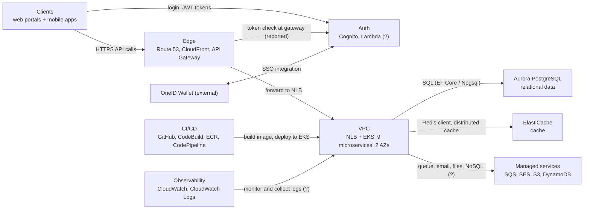

| Block | Detail section |
|-------|----------------|
| Clients, Edge | [1](#1-clients-and-edge) |
| Auth | [2](#2-authentication-and-authorization) |
| VPC | [3](#3-network-layout), [4](#4-application-eks-services) |
| Data, Managed services | [5](#5-data-stores) |
| CI/CD | [6](#6-cicd) |
| Observability | [7](#7-observability) |

Note: the SSO arrow in the image runs between the AWS boundary and OneID Wallet, not to a specific service. The client code signs in to OneID through Cognito (custom identity provider `oneid`), which is why the overview attaches it to Auth. See [2.1](#21-authentication-sign-in).

---

## 1. Clients and edge

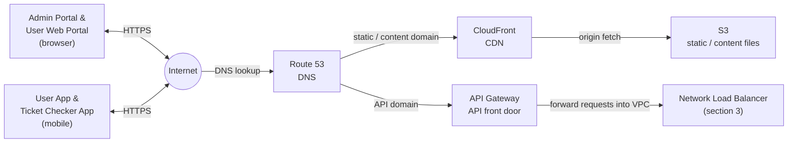

- Route 53 splits traffic: static/content via CloudFront to S3, API traffic via API Gateway.
- API Gateway forwards to the NLB inside the VPC.
- API Gateway also connects to Lambda (see [2](#2-authentication-and-authorization)).
- A CloudFront arrow also points into the VPC top edge `[UNCONFIRMED]`.

## 2. Authentication and authorization

Short version:
- **Authentication (who are you):** Amazon Cognito. Four user pools (User, Admin, TicketChecker, Agent). OneID Wallet signs in through Cognito as an external identity provider. Clients get Cognito JWTs and send the access token as `Authorization: Bearer`.
- **Authorization (what may you do):** done inside each backend service, in layers: pool, then role, then (for admin routes) program. API Gateway may add a first token check (reported, unverified).

Sources: `rvl-gobcb-backend/Core/ETP.Core/Configuration/{DefaultAuthenticationConfig,AuthorizationConfig}.cs`, `Core/ETP.Core/Middleware/CognitoUserAttributesMiddleware.cs`, `Services/Admin/**`, and the Amplify code in the portals and apps.

### 2.1 Authentication: sign-in

Two ways to sign in, both end with Cognito issuing tokens.

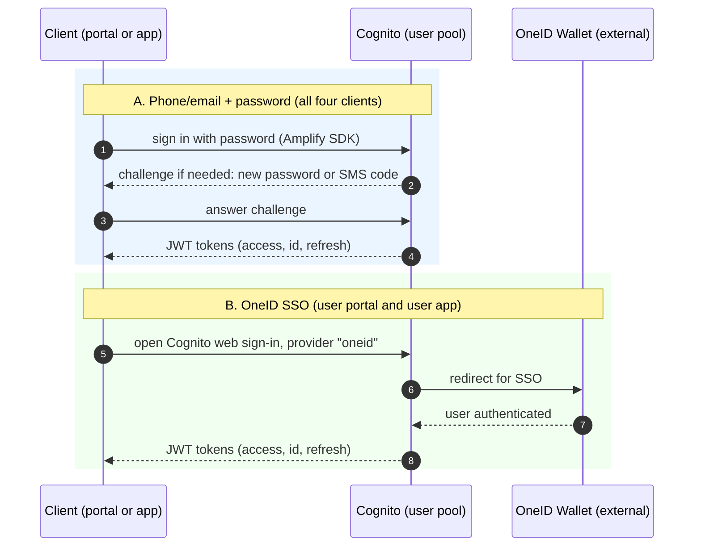

| Client | Pool (by role) | Password login | OneID login | Evidence |
|--------|----------------|----------------|-------------|----------|
| Admin Portal | Admin | Yes, with new-password and SMS MFA challenges | Not found | `rvl-gobcb-admin-portal/src/app/core/services/cognito.service.ts` |
| User Web Portal | User | Yes, with SMS MFA | Yes (popup "OneID Login") | `rvl-gobcb-user-portal/.../cognito.service.ts` |
| User App (mobile) | User | Yes | Yes (`signInWithWebUI`, provider `oneid`) | `rvl-gobcb-user-app/data/lib/service/aws_amplify_service.dart` |
| Ticket Checker App (mobile) | TicketChecker | Yes | Not checked | `rvl-gobcb-checker-app/data/lib/service/aws_amplify_service.dart` |

The Agent pool (offline ticket sales) exists in the backend; which client signs in with it was not found in the repos.

### 2.2 Authentication: calling an API

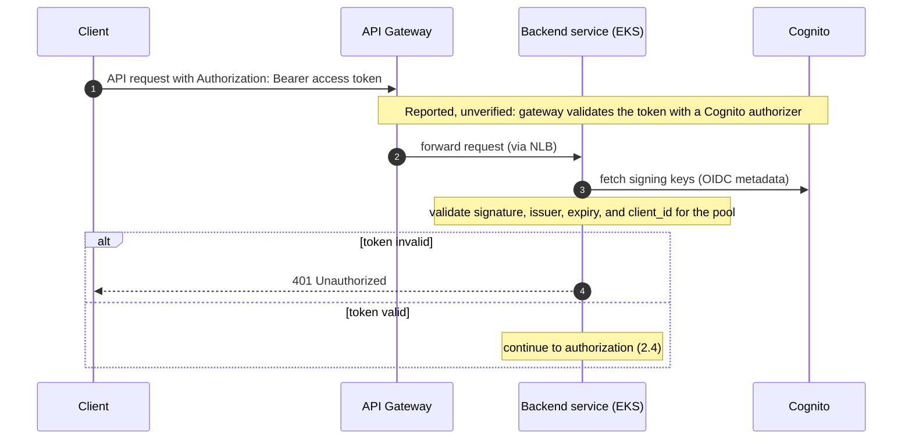

- The services validate the token themselves regardless of any gateway check.
- Signing keys come from each pool's OIDC metadata URL (`AWS:CognitoPool:<Pool>:Metadata`).
- Which pool a token belongs to is decided by the route's policy (2.4), not by the gateway.

### 2.3 Service-to-service communication

The image shows no service-to-service arrows. The code shows three separate mechanisms.

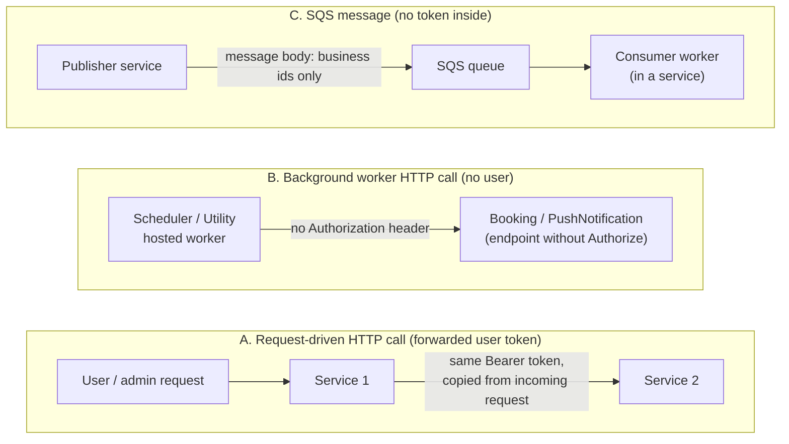

**A. Request-driven HTTP calls forward the caller's token.**
- Typed HTTP clients (`ETP.*.Client` projects and `Core/ETP.Core/ServiceClient/*`) call other services at `Services:<Name>` base URLs (values are in user secrets/SSM, not in the repo), with 3 retries and exponential backoff.
- `DelegatedBearerAuthenticationHandler` copies the current user's access token from the incoming request onto the outgoing call. So the downstream service validates the end user's Cognito token with its own pool policy (2.4).
- If that token expires mid-request, the downstream call fails with 401. The services do not refresh tokens; the code has no refresh logic on the service side.

**B. Background workers have no user token.**
- Scheduler and Utility run hosted workers (for example: notify users after ticket generation, cancel pending bookings, clean old device tokens). The token accessor reads the HTTP context, which does not exist in a worker, so the handler adds no `Authorization` header.
- The endpoints these workers call have no `[Authorize]` attribute. Example: Booking `GET api/v1/user-booking-order/not-notified-list` and `PUT .../update-notification-status`, and PushNotification `DELETE .../cleanup` (PushNotification also has `UseAuthentication`/`UseAuthorization` commented out). `BaseController` has `// [Authorize]` commented out.
- So these internal calls are protected by network placement (cluster-internal), not by tokens. Whether those endpoints are reachable from outside depends on API Gateway and NLB routing, which is not visible in the repo.

**C. SQS messages carry no tokens.**
- `SqsPublisher` sends `JsonSerializer.Serialize(message)` only. Message classes (`TicketProcessingRequest`, `SignedTicketGeneration`, `LevelCapacityUpdate`, `EventLiveCapacityUpdate`, `VatChallanProcessing`, `FirebaseNotificationRequest`, `FirebaseBulkNotificationRequest`) hold business ids, URLs and Firebase device tokens, not auth tokens.
- So there is no token expiry problem in the queue. Consumers are hosted workers inside the services and authenticate to SQS with AWS IAM credentials (see below). When they need another service they make the same internal HTTP calls as in B.

**How SQS access is authenticated (from code):**
- Every SQS client is built with `BasicAWSCredentials(AWS:AccessKey, AWS:SecretAccessKey)` (`Core/ETP.Core/Queue/Extensions/ServiceExtension.cs`), and the MassTransit event bus (`Core/ETP.Core.EventBus`, used by Utility, TicketChecker and others) is configured with the same `AWS:AccessKey` and `AWS:SecretAccessKey`. AWS then verifies each SQS call with a SigV4 signature from that static key pair. This is IAM authentication, not a JWT.
- The key pair is a long-lived key (no session token). It reaches the pods through the per-service appsettings stored in SSM Parameter Store (`/rvl/<env>/<service>-appsettings`), which the CodeBuild buildspec turns into Kubernetes secrets.
- No IAM-role mechanism was found: no `AssumeRole`, no EKS pod identity/IRSA setup, and the pod specs set `automountServiceAccountToken: false`. Whether the same key pair is shared by all services, and what the IAM policy allows, is not in the repo.
- Authorization is whatever the IAM policy on that key allows (queue send/receive/delete). The messages themselves are not signed or verified: consumers deserialize the JSON body and trust it, so any principal allowed to `SendMessage` on a queue can enqueue work (for example a ticket-signing request).
- Consumers receive in a loop, delete after successful processing, and skip work if already done (for example `IsTicketSigned` check before signing).

**How a service that processes an SQS message verifies it (from code):** it does not authenticate the sender. Six workers read queues directly with `ReceiveMessageAsync` (Ticketing `TicketGenerationTaskManager`, Utility `TicketProcessingTaskManager`, Scheduler `FirebaseNotificationTaskManager`, Booking `VatChallanProcessing`, `LevelCapacityUpdate` and `EventLiveCapacityUpdate`). The checks they do are about the message content and duplicates, not about who sent it:

| Check | What the code does |
|-------|--------------------|
| Sender identity | None. No message signature, no `MessageAttributes` check, no sender id. Trust comes only from IAM permission to read the queue. |
| Format | Deserialize the JSON body; if it is null, log a warning and (in Utility) delete the message. |
| Duplicates (idempotency) | Skip if already done (Ticketing: `IsTicketSigned`; Utility: `ShouldSkipProcessing` status check). |
| Concurrency | Utility takes a Redis distributed lock per reservation (`ticket_processing_service_<id>`). |
| Failure handling | Delete the message only on success; otherwise leave it so it is retried and eventually reaches the dead-letter queue (as the code comment says; the queue settings are not in the repo). |
| Calls to other services | Typed HTTP clients with no user token (a worker has no HTTP context). Example: Utility calls Booking `PATCH /booking/api/v1/seat-reservation/update-merge-status/{id}`, which has no `[Authorize]`. |

So the security boundary for queue-driven work is: IAM permissions on the queue, plus network access to the internal endpoints. A message from any principal with `SendMessage` is processed as legitimate.
- Queue publishing is used for ticket generation, capacity updates, VAT challan processing and push notifications (FIFO queues use `GroupId` and `OrderId` for ordering and de-duplication).

**Unused: the shared-key service token.**
- `Admin /api/v1/token` issues a 1-day HS256 JWT in exchange for a `ServiceApiKey` header, and `ServiceApiKeyTokenProvider`, `ClientCredentialsTokenProvider` and `ServiceAccountPrincipalProvider` exist. No DI registration for them and no controller using `Policy = service` were found, so this path appears to be unused today. The endpoint itself is reachable and has a TODO for client id/secret validation.

**Other outbound calls with static credentials (not user tokens):**
- Notification service: `Notification:Endpoint` with a static `Authorization` value from configuration.
- "Serverless" API (`Serverless:BaseUrl`, static `Authorization` value): `user/get-bulk-users` returns Cognito users (used by Booking, Ticketing, Admin, UserIssue). The admin portal calls the same base URL for `admin/login-2fa-send-otp` and `admin/login-2fa-verify-otp`. See 2.6 for what this may mean for the Lambda.

### 2.4 Authorization: layers

After the token is valid, a request passes up to four checks. Layers 3 and 4 apply only to admin-portal routes.

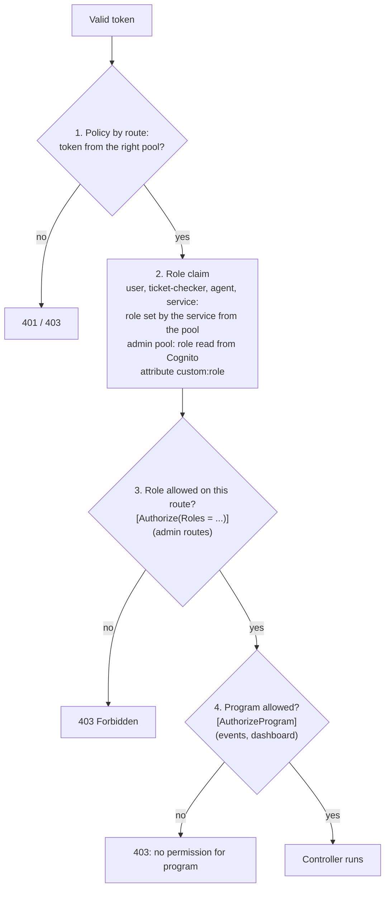

**Layer 1: pool policy** (`AuthorizationConfig.cs`, used as `[Authorize(Policy = AuthScheme.X)]`)

| Policy | Token must come from | Extra requirement |
|--------|----------------------|-------------------|
| `user` | User pool | role claim `user` (added by the service) |
| `admin` | Admin pool | authenticated only (no role check) |
| `ticket-checker` | TicketChecker pool | role claim `ticket-checker` |
| `agent` | Agent pool | role claim `agent` |
| `service` | shared-key JWT | role claim `service` |

**Layers 2 and 3: roles on admin routes** (`Role` in `Core/ETP.Core/Constant/AppConstant.cs`)

For admin-pool users the role comes from the Cognito user attribute `custom:role` (comma-separated), loaded by `CognitoUserAttributesMiddleware` with a cached Cognito `AdminGetUser` call. That middleware runs only in the Admin and UserIssue services.

| Role value | Meaning | Examples of routes it unlocks (Admin service) |
|------------|---------|-----------------------------------------------|
| `admin` | Full administrator | everything, including admin users, system settings, promo codes, discounts, gallery |
| `event_manager` | Event manager | events, programs, venues, teams, notices, raffle draw, ticket checker gates, activity log |
| `ticket_manager` | Ticket manager | events, ticket attributes, ticket layout, ticket checkers |
| `ticket_operator` (code name `BCBPersonnel`) | BCB personnel | events, dashboard, ticket attributes, ticket layout, event venue details |
| `customer_support` | Customer support | user issues |

**Layer 4: program scope** (`AuthorizeProgramAttribute`, on events and dashboard in the Admin service)
- `admin` role: passes for every program.
- `user` role: passes (the code notes that portal-user program authorization is not defined yet).
- Everyone else: must send header `X-Program-Id` (the admin portal adds it from local storage) and the id must be in the user's `program_id` claims, loaded from the Cognito attribute `custom:program_ids`. Otherwise: 400 if the header is missing or invalid, 403 if not allowed.

**Where the checks run:** in the backend services, not in the diagram's gateway. Per service, the `Authorize` attributes live in controllers under `Services/*/Api`.

### 2.5 Observations from the code (verify, may be intentional)

1. The `Policy = admin` routes in Booking, Ticketing and UserIssue check only that the token is from the Admin pool. Role-based rules (2.4 layer 3) are used in the Admin service. The claims middleware is not registered in Booking or Ticketing.
2. `CognitoUserAttributesMiddleware` chooses the pool by the token's `scope` claim. `aws.cognito.signin.user.admin` is a standard scope on Cognito access tokens from SDK sign-in, so this check may always pick the Admin pool. Worth confirming for User and Agent tokens.
3. Platform, PushNotification and UserAuth services have `UseAuthentication` and `UseAuthorization` commented out in `Program.cs`.
4. A permission model (`Permission`, `Policy`, `IPolicyService`, resource:action.scope) exists in `Core/ETP.Core/Security/Authorization`, but no implementation or usage was found. Authorization today uses roles and program ids only.
5. The service token endpoint validates only a shared API key (TODO in code for client id/secret), and the service-token path appears unused (see 2.3).
6. Internal endpoints called by background workers (Booking `not-notified-list`, `update-notification-status`, PushNotification `cleanup`) have no `[Authorize]`; `BaseController` has `[Authorize]` commented out. If they are reachable through API Gateway or the NLB from outside, they would be open. Every service also has an Ingress path under `nginx-second` (see 4.1), so whether these endpoints are reachable from outside depends on what sits in front of that ingress.
7. SQS access uses one static IAM key pair from configuration, with no role-based access found, and queue messages are not signed or verified (see 2.3 C). Key rotation and the IAM policy scope are not visible in the repo.

### 2.6 Still open (API Gateway, Lambda)

- Codebase evidence (searched the workspace and all submodules): no Lambda source, no API Gateway or Cognito trigger configuration, and no IaC for them exist in any repo, so the Lambda's role cannot be determined from code. The Lambda stays unlabelled in the diagrams (see [Q1](#q1-lambda-between-api-gateway-and-cognito-and-how-tokens-are-validated)).
- A "serverless" API exists in the code: `Serverless:BaseUrl` with a static `Authorization` header, serving Cognito-related functions (`user/get-bulk-users`, `admin/login-2fa-send-otp`, `admin/login-2fa-verify-otp`). It is a plausible candidate for what the Lambda in the diagram does (custom Cognito user and 2FA functions behind API Gateway), but nothing in the repos connects the two. Unconfirmed; included in Q1.
- Reported, **unverified** (verbal, from the implementation team's DevOps, not seen in any repo): every client API call goes through API Gateway, which validates tokens with a Cognito authorizer. If true, a native Cognito authorizer needs no Lambda, so the Lambda's role is then not token validation. Shown in 2.2 as a note only.

---

## 3. Network layout

One VPC, two AZs, each with one public subnet and two private subnets. Both AZs are drawn symmetrically except for the public-subnet contents and the lower private subnet.

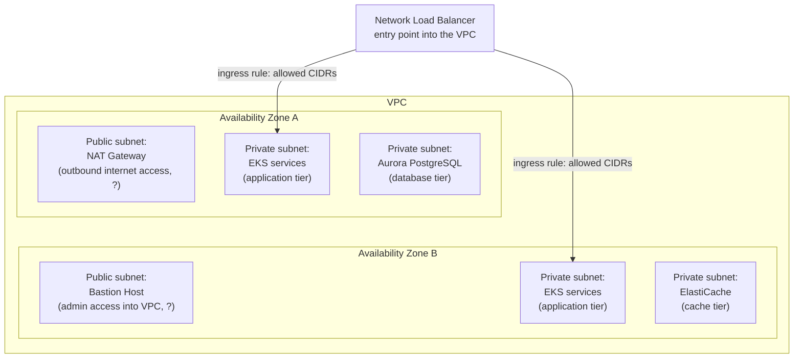

- Ingress rule icons show CIDRs 172.16.0.0, 172.16.1.0, 172.16.2.0 (read from small text; verify against the PNG).
- NAT Gateway and Bastion Host have no arrows in the image; their purposes in the labels are the usual roles of those services, not stated in the image.
- Managed services (SES, SQS, DynamoDB, CloudFront, CloudWatch) have arrows into the VPC top edge. See [5](#5-data-stores) and [7](#7-observability).

## 4. Application: EKS services

One EKS cluster, drawn as a single dashed box crossing both AZs. The same nine services appear in each AZ.

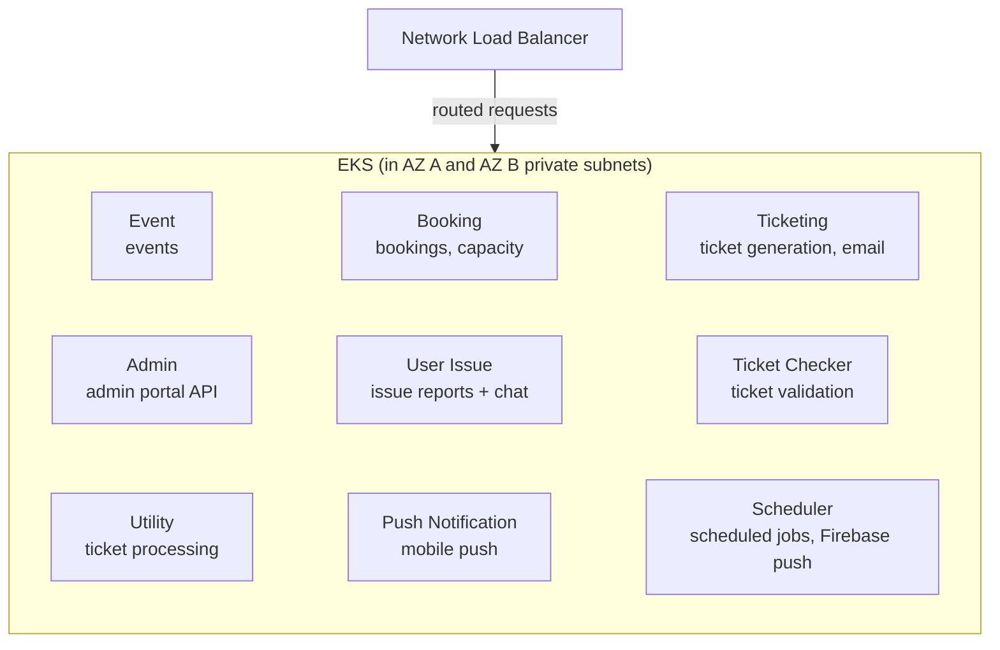

Service purposes in the diagram are inferred from service names and the worker/controller classes in `rvl-gobcb-backend/Services/*`; the image itself gives only the names. Verify before relying on them.

| Row | Services |
|-----|----------|
| 1 | Event Service, Booking Service, Ticketing Service |
| 2 | Admin Service, User Issue Service, Ticket Checker Service |
| 3 | Utility Service, Push Notification Service, Scheduler Service |

The image shows no arrows between individual services.

### 4.1 How services talk to each other and how they are exposed

Direct service-to-service communication is **HTTP only** (REST with JSON). Asynchronous work goes through SQS queues instead (see [2.3](#23-service-to-service-communication)). No gRPC or other RPC library is used.

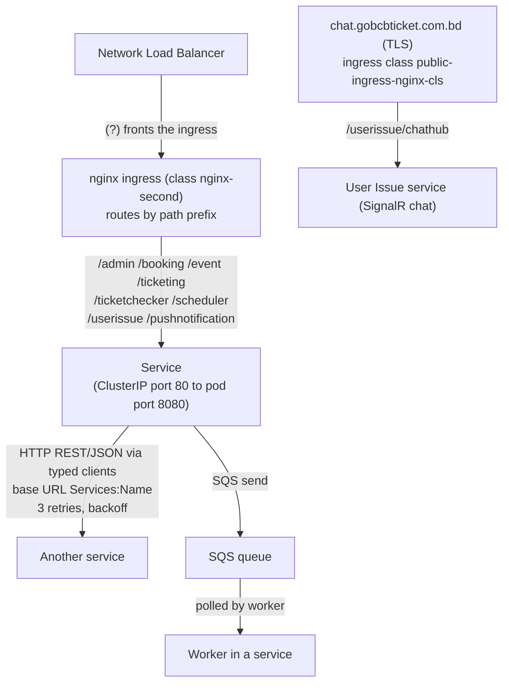

| Question | Answer from code |
|----------|------------------|
| Protocol between services | HTTP/REST with JSON. Typed `HttpClient`s in `Core/ETP.Core/ServiceClient/*` and `ETP.*.Client` projects (Admin, Booking, Event, Scheduler, TicketChecker, Ticketing, UserAuth). Calls are retried 3 times with exponential backoff (Polly). |
| gRPC, Dapr, other RPC | None found in any `.csproj`. |
| Event bus | MassTransit with Amazon SQS is registered (`AddEventBus`) in Booking, Scheduler, TicketChecker and Utility, but no `IConsumer` implementation and no `IPublishEndpoint` usage was found. It appears unused. Real async work uses `SqsPublisher` and polling workers. |
| Shared state | Redis is used for distributed cache and distributed locks, not for messaging between services. |
| SignalR | Only for chat between browsers/apps and the User Issue and Admin services, not between services. |
| How a service is addressed | Base URL from configuration key `Services:<Name>` (values are in secrets, not in the repo). Locally Aspire sets fixed ports: Admin 5101, Booking 5102, Event 5103, Platform 5104, PushNotification 5105, Scheduler 5106, TicketChecker 5107, Ticketing 5108, UserAuth 5109, UserIssue 5110, Utility 5111. |
| Exposure in the cluster | Every service is a `ClusterIP` Service (port 80 to pod port 8080) plus its own nginx Ingress with a path prefix (`/admin`, `/booking`, `/event`, `/ticketing`, `/ticketchecker`, `/scheduler`, `/userissue`, `/pushnotification`) on ingress class `nginx-second`. Client code calls paths such as `/booking/api/v1/...`, which matches those prefixes. |
| Chat | A second Ingress (`public-ingress-nginx-cls`, TLS) exposes only `/userissue/chathub` on the public host `chat.gobcbticket.com.bd`. So SignalR chat has its own public entry and does not need to go through API Gateway. |

Not visible in the repo: the production values of `Services:<Name>` (cluster DNS such as `booking-service.etp-production` versus the ingress path), and how the NLB, API Gateway and `nginx-second` connect.

## 5. Data stores

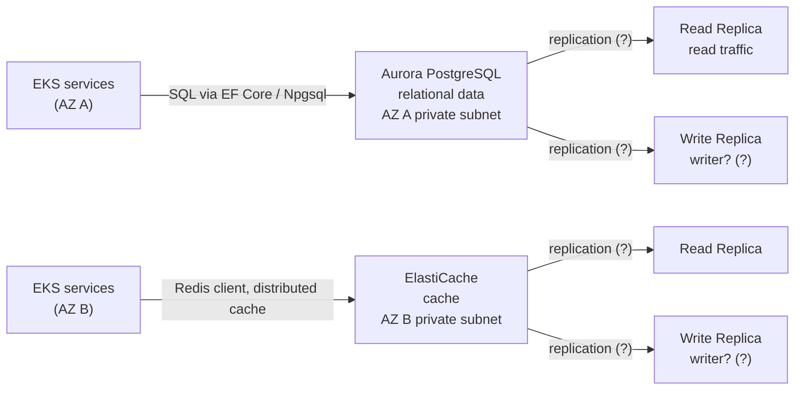

Also in the image, outside the VPC and each with an arrow into the VPC top edge: DynamoDB, SQS, SES `[UNCONFIRMED]` (likely endpoints or service access, not in-VPC resources).

What the code says each is used for:

| Store | Used for (from code) |
|-------|----------------------|
| Aurora PostgreSQL | Every service's data (`Npgsql.EntityFrameworkCore.PostgreSQL`) |
| ElastiCache | Distributed cache through a Redis client (`StackExchange.Redis`) |
| SQS | Message queue (`SqsPublisher`, ticket generation queue) |
| SES | Sending email (Ticketing service, `ETP.Core.Email`) |
| S3 | File/blob storage (`ETP.Core.BlobStorage`, `ETP.Core.Storage`) |
| DynamoDB | SDK referenced in `ETP.Core.Storage`; actual use not verified |

## 6. CI/CD

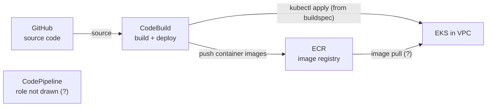

- CodePipeline, CodeBuild and ECR sit in one dashed box. CodePipeline has no arrows, so its role is `[UNCONFIRMED]`.
- CodeBuild and ECR each have a plain arrow into the VPC left edge (meaning not labelled).
- Codebase evidence (`rvl-gobcb-backend/buildspec-{dev,test,stage,prod}.y*ml`): CodeBuild logs in to ECR and pushes images, runs `aws eks update-kubeconfig`, creates Kubernetes secrets, and runs `kubectl apply` on `deployment/k8s/<env>/*.yaml`. So CodeBuild performs the EKS deployment, which is the likely meaning of the arrows into the VPC. Per-service appsettings are read from SSM Parameter Store (`/rvl/<env>/<service>-appsettings`), which is not drawn in the image. What triggers CodePipeline, and what CodePipeline itself does, is not in the repo.

## 7. Observability

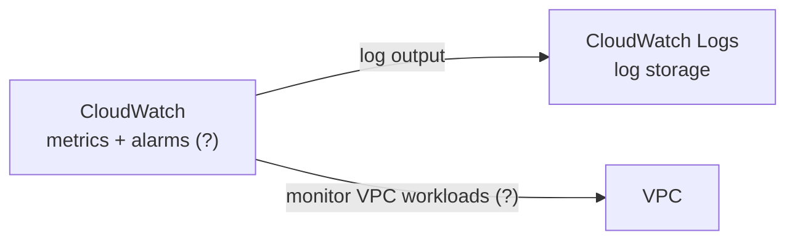

---

## 8. Component inventory

| # | Component | AWS service / type | Location | Section |
|---|-----------|--------------------|----------|---------|
| 1 | Admin Portal & User Web Portal | Web client | Outside AWS | [1](#1-clients-and-edge) |
| 2 | User App & Ticket Checker App | Mobile client | Outside AWS | [1](#1-clients-and-edge) |
| 3 | Internet | Public network | Outside AWS | [1](#1-clients-and-edge) |
| 4 | Route 53 | DNS | Region | [1](#1-clients-and-edge) |
| 5 | CloudFront | CDN | Region | [1](#1-clients-and-edge) |
| 6 | S3 | Object storage | Region | [1](#1-clients-and-edge) |
| 7 | API Gateway | Managed API | Region | [1](#1-clients-and-edge) |
| 8 | Lambda | Function | Region | [2](#2-authentication-and-authorization) |
| 9 | Cognito | Identity | Region | [2](#2-authentication-and-authorization) |
| 10 | Network Load Balancer | NLB | VPC, between AZs | [3](#3-network-layout) |
| 11 | Ingress Rule (x2) | Ingress rule | NLB to each AZ | [3](#3-network-layout) |
| 12 | NAT Gateway | NAT | AZ A public subnet | [3](#3-network-layout) |
| 13 | Bastion Host | EC2 | AZ B public subnet | [3](#3-network-layout) |
| 14 | EKS + 9 services | Kubernetes | AZ A and AZ B private subnets | [4](#4-application-eks-services) |
| 15 | Aurora PostgreSQL (+ read/write replica) | RDS Aurora | AZ A private subnet | [5](#5-data-stores) |
| 16 | ElastiCache (+ read/write replica) | Cache | AZ B private subnet | [5](#5-data-stores) |
| 17 | DynamoDB | NoSQL DB | Region | [5](#5-data-stores) |
| 18 | SQS | Queue | Region | [5](#5-data-stores) |
| 19 | SES | Email | Region | [5](#5-data-stores) |
| 20 | GitHub | Source control | Outside AWS | [6](#6-cicd) |
| 21 | CodePipeline | CI/CD | AWS, left of VPC | [6](#6-cicd) |
| 22 | CodeBuild | CI | AWS, left of VPC | [6](#6-cicd) |
| 23 | ECR | Container registry | AWS, left of VPC | [6](#6-cicd) |
| 24 | CloudWatch | Monitoring | Region | [7](#7-observability) |
| 25 | CloudWatch Logs | Logging | Region | [7](#7-observability) |
| 26 | OneID Wallet | External | Outside AWS | [0](#0-high-level-overview) |

## 9. Open questions for bs23

Written to be sent as-is. Each question names where it is in the diagram, what we see, what we assume, and options, so a one-line reply is enough. Reply format: question number + option letter (or a short correction).

Internal status: none of these can be answered from the codebase (no Lambda, API Gateway, Cognito trigger or infrastructure code exists in any repo). We searched all five repos.

### Q1. Lambda between API Gateway and Cognito, and how tokens are validated
- **Where:** top centre of the diagram. API Gateway has an arrow to the Lambda icon, and the Lambda has an arrow to Amazon Cognito.
- **What we see:** only the two arrows, no label.
- **What we were told:** your DevOps said every API call goes through API Gateway, which validates tokens with a Cognito authorizer.
- **We assume:** if it is a native Cognito authorizer, it does not need a Lambda, so the Lambda does something else.
- **What we see in code:** a "serverless" API (`Serverless:BaseUrl`) that looks up Cognito users in bulk and sends and verifies admin login 2FA codes. Is that API the Lambda (or Lambdas) behind API Gateway in the diagram?
- **What is the Lambda's role?**
  - (a) A Lambda authorizer (custom token check). In that case, is the "Cognito authorizer" wording informal?
  - (b) A Cognito Lambda trigger (e.g. pre-sign-up, post-confirmation, pre-token-generation).
  - (c) Something else (please describe).
- **Also please confirm:** which API Gateway authorizer type validates tokens (Cognito user pool authorizer, JWT authorizer, or Lambda authorizer)?
- **Why we ask:** our services also validate Cognito JWTs themselves. We need to know what the gateway enforces and where login/token behaviour is customised.

### Q1b. One authorizer per Cognito pool, and chat hubs
- **What we see in code:** the backend uses four Cognito pools (User, Admin, TicketChecker, Agent), and the SignalR chat hubs (`/userissue/chathub`, `/admin/chathub`) send the token in the query string.
- **Please confirm:**
  - Does API Gateway have a separate authorizer for each of the four pools, or how are they mapped to routes?
  - Do the chat hub (WebSocket/SignalR) connections also go through API Gateway, or directly to the load balancer? (Code shows a separate public Ingress `chat.gobcbticket.com.bd` for `/userissue/chathub`, which suggests chat bypasses API Gateway. Please confirm.)
  - Do service-to-service calls inside EKS bypass API Gateway? (Code shows they call each other at `Services:<Name>` URLs and forward the user token; background workers call endpoints with no authentication, see 2.3.)
  - Are the internal endpoints used by background workers (for example Booking `not-notified-list`) reachable from the internet through API Gateway or the NLB?
- **Why we ask:** to document the real auth path per client type and to know which calls are not covered by the gateway.

### Q2. "Write Replica" under Aurora PostgreSQL and ElastiCache
- **Where:** the two lower private subnets. Aurora (left AZ) and ElastiCache (right AZ) each show a "Read Replica" and a "Write Replica".
- **We assume:** "Write Replica" means the writer (primary) instance, since replicas are normally read-only.
- **Is that right?**
  - (a) Yes, it is the primary/writer instance.
  - (b) No, it is a genuinely separate replica (please say what it replicates and why it is writable).
- **Why we ask:** it decides which endpoint services must use for writes versus reads.

### Q3. Aurora only in the left AZ, ElastiCache only in the right AZ
- **Where:** same two lower private subnets.
- **What we see:** Aurora appears only in the left AZ and ElastiCache only in the right AZ.
- **We assume:** this is a simplification of the drawing and both run across both AZs.
- **Which is true?**
  - (a) Both are multi-AZ in reality.
  - (b) Single-AZ exactly as drawn.
  - (c) Other (please describe).
- **Why we ask:** failover and availability assumptions.

### Q4. SES, SQS, DynamoDB and CloudFront arrows into the VPC
- **Where:** the row of four icons above the VPC. Each has an arrow pointing at the top edge of the VPC box.
- **We assume:** these are regional AWS services the EKS services call, possibly through VPC endpoints, and they are not hosted inside the VPC.
- **How do the services reach them?**
  - (a) Through VPC endpoints (gateway or interface).
  - (b) Through the NAT Gateway to the public service endpoints.
  - (c) Other (please describe).
- **Why we ask:** network and security-group configuration, and which dependencies fail if the NAT Gateway is unavailable.

### Q5. OneID Wallet SSO integration
- **Where:** right edge. A bidirectional arrow labelled "SSO Integration" runs from the AWS boundary to OneID Wallet.
- **What we see in code:** the user portal and user app start OneID sign-in through Cognito's web sign-in with a custom identity provider named `oneid`, then receive Cognito tokens. So OneID appears to be federated through Cognito. The identity provider configuration itself (OIDC settings, attribute mapping) is not in the repos.
- **Please confirm:**
  - Is OneID configured as an OIDC identity provider in the User pool (only that pool)?
  - How are OneID attributes mapped to Cognito user attributes, and is there any backend call to OneID (for example the "OneID sync" shown in the booking screens)?
- **Why we ask:** to document the login flow fully and know what changes if OneID's configuration changes.

### Q6. CodePipeline: trigger and role
- **Where:** left side. CodePipeline, CodeBuild and ECR are inside one dashed box. GitHub points to CodeBuild, CodeBuild points to ECR, and CodeBuild and ECR each have an arrow into the VPC. CodePipeline has no arrows.
- **What we already know from the repo:** the `buildspec-*.yaml` files show CodeBuild pushing images to ECR and deploying to EKS with `kubectl apply`. We do not need an answer on that part.
- **What we still need:**
  - What triggers the pipeline (push to a branch, manual approval, other)?
  - What does CodePipeline do between GitHub and CodeBuild (source stage only, approvals, per-environment stages)?
- **Why we ask:** to document the release process and which branch maps to which environment.
