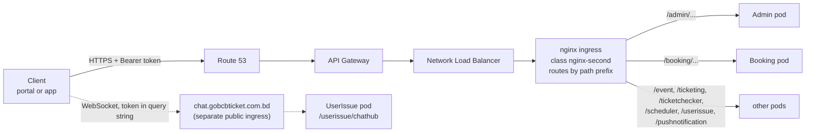

# 00 · প্ল্যাটফর্ম প্রাইমার

[সূচিপত্রে ফিরে যান](README.md)

এই পৃষ্ঠায় প্রতিটি ফিচার ফাইল যে পটভূমি ধরে নেয় তা দেওয়া আছে: service-গুলো কী, একটি request কীভাবে service-এ পৌঁছায়, error দেখতে কেমন হয়, এবং কোড যে microservice-ধারণাগুলোর উপর নির্ভর করে সেগুলো। ধারণাগুলো নিচে **explainer box** (📦)-তে ব্যাখ্যা করা হয়েছে; ফিচার ফাইলগুলো সেগুলো পুনরাবৃত্ত না করে এখানে লিঙ্ক দেয়।

## 1. এক বাক্যে প্ল্যাটফর্ম

GoBCB বাংলাদেশ ক্রিকেট বোর্ডের ইভেন্টের টিকিট বিক্রি ও যাচাই করে। কর্মকর্তারা **admin portal**-এ **program** (একটি সিরিজ বা টুর্নামেন্ট), **venue** (স্টেডিয়াম → গ্যালারি → ব্লক → লেভেল), দাম ও ক্যাপাসিটিসহ **event** (ম্যাচ), প্রমোশন ও টিকিট লেআউট সেট করেন। গ্রাহকরা **user web portal** বা **user app**-এ ঘুরে দেখেন ও কেনেন, **DgePay**-এর মাধ্যমে টাকা দেন, এবং QR কোডসহ ডিজিটালি সই করা PDF টিকিট পান। Gate-এর কর্মকর্তারা **checker app** দিয়ে অফলাইনে QR কোড স্ক্যান করেন। Backend হলো একটি repository-তে থাকা ASP.NET Core 8 web API-এর ("service") সংগ্রহ, যা Amazon EKS-এ API Gateway-এর পিছনে চলে (দেখুন [`gobcb-aws-architecture.md`](../../../architecture/gobcb-aws-architecture.md) §0–§4)।

## 2. Backend service

সব service `rvl-gobcb-backend/Services/<Name>/`-এ আছে, প্রতিটি ভাগ করা `ETP.<Name>.Service` (controller, `Program.cs`, worker), `.Domain` (manager = ব্যবসায়িক লজিক), `.Storage` (EF Core `DbContext`, repository) এবং কয়েকটির জন্য `.Client` (টাইপ করা HTTP client, অন্য service ব্যবহার করে) ও `.Integration`। সাধারণ কোড `rvl-gobcb-backend/Core/`-এ (`ETP.Core`, `ETP.Core.Web`, …)।

| Service | Path prefix | Local port | এটি কী করে (controller ও worker থেকে) | DB connection key | Background worker |
|---|---|---|---|---|---|
| Admin | `/admin` | 5101 | মূল ডেটা ও back office: program, venue, event, settings, promo code, discount, ticket layout, কর্মকর্তা ব্যবহারকারী (Cognito), gate assignment, raffle, notice, সাইট কনটেন্ট, activity log। `/admin/chathub` রাখে (legacy, দেখুন Appendix A) | `ConnectionStrings:Admin` | `CheckedTicketService`, `PromoCodeStatusUpdateService`, `SystemDiscountStatusUpdateService`, `GateCheckerDownloadStatusCleanupService` |
| Booking | `/booking` | 5102 | ক্যাপাসিটি ও আসন, booking order, payment (DgePay), promo code প্রয়োগ, আসন সংরক্ষণ, ক্যাপাসিটি সমন্বয়, বিক্রয় রিপোর্ট, VAT challan | `ConnectionStrings:Booking` | `BookingStatusUpdateService`, `InitiateUserTicketGenerationService`, `LevelCapacityUpdateService`, `RefreshLockedCapacityService`, `EventLiveCapacityUpdateService`, `VatChallanProcessingService` |
| Event | `/event` | 5103 | portal ও app-এর জন্য program, event, venue detail, landing image, header/footer ও ticket pricing-এর public, read-only দৃশ্য | `ConnectionStrings:Event` | none |
| Ticketing | `/ticketing` | 5108 | টিকিট: generation, signing (TSP), PDF, download, share, invoice, reserved ticket, OneID sync, offline-sold ticket | `ConnectionStrings:Booking` (sic) | `TicketGenerationService` |
| TicketChecker | `/ticketChecker` | 5107 | checker app-এর sync endpoint (scan আসে, scan যায়) | `ConnectionStrings:TicketChecker` | none |
| UserIssue | `/userissue` | 5110 | গ্রাহকের সমস্যা ও support chat; SignalR hub `/userissue/chathub` রাখে | `ConnectionStrings:UserIssue` | none |
| PushNotification | `/PushNotification` | 5105 | device token ও push send API (queue-তে লেখে) | `ConnectionStrings:PushNotification` | none |
| Scheduler | `/scheduler` | 5106 | শুধু worker: Firebase-এ push delivery, payment revalidation, ticket-generated notice, capacity reconcile, device-token cleanup | none | `FirebaseNotificationService`, `PendingOrFailedBookingStatusUpdateService`, `SendNotificationAfterGeneratedTicketService`, `CapacityUpdateService`, `DeviceTokenCleanupService` |
| Utility | `/utility` | 5111 | শুধু worker: reserved ticket merge/zip করে | none | `TicketProcessingService` |
| Platform | `/platform` | 5104 | Stub (শুধু একটি টেমপ্লেট `WeatherForecastController`) | none | none |
| UserAuth | `/userAuth` | 5109 | Stub (কোনো controller নেই; শুধু `/health`) | none | none |

উৎস: `Services/*/ETP.*.Service/Program.cs` ও `Configuration(s)/DependencyConfig.cs` (hosted service ও connection string), `Services/*/ETP.*.Service/appsettings.json` (`Application:ServiceName`, যা path prefix; UserIssue-এর কোনো `appsettings.json` নেই এবং তার prefix `userissue` আসে hub mapping ও client থেকে)। Local port আসে `aspire/README.md` থেকে।

## 3. Client

| Client | Repository | Tech | যেভাবে sign in করে | কাকে কল করে |
|---|---|---|---|---|
| Admin portal | `rvl-gobcb-admin-portal` | Angular | Admin pool (Serverless API থেকে SMS OTP-এর পর) | Admin, Booking, Ticketing, UserIssue; OTP-এর জন্য Serverless API |
| User web portal | `rvl-gobcb-user-portal/ETP-Web` | Angular 19 | User pool, অথবা Cognito-র মাধ্যমে OneID | Event, Booking, Ticketing, Admin (public endpoint), UserIssue; identity API |
| User app | `rvl-gobcb-user-app` | Flutter | User pool, অথবা Cognito-র মাধ্যমে OneID | Event, Booking, Ticketing, UserIssue, PushNotification, Admin; identity API |
| Checker app | `rvl-gobcb-checker-app` | Flutter | TicketChecker pool | Admin (`ticket-checker-gate/event-info`), TicketChecker (`tickets/sync-tickets`); app version-এর জন্য identity API |

**Identity API** (user portal-এ `services.identity`, app-গুলোতে `AUTH_API_BASE_URL`) গ্রাহকের registration, OTP, profile ও app version সামলায়। এর source পাঁচটি repository-র কোনোটিতেই নেই `[UNCONFIRMED: Q-01]`।

## 4. একটি request কীভাবে service-এ পৌঁছায়



এই চিত্রের hosting অংশ (API Gateway, NLB, ingress) আসে architecture document §1 ও §4.1 থেকে। API Gateway token-ও যাচাই করে কি না, সেটি সেখানে জানানো আছে কিন্তু যাচাই করা হয়নি (architecture Q1/Q1b)। Service-গুলো সবসময় নিজেরাই token যাচাই করে।

<a id="explainer-path-prefix-routing"></a>
> 📦 **Explainer: path-prefix routing**
>
> Monolith-এ প্রতিটি controller একটি host-এর নিচে থাকে। এখানে প্রতিটি service আলাদা process, কিন্তু client এখনো **একটি API host** ব্যবহার করে। Path-এর প্রথম segment ঠিক করে কোন service request পাবে: `/booking/api/v1/user-booking-order` যায় Booking-এর কাছে, `/event/api/v1/events/list` যায় Event-এর কাছে।
>
> কাজ করার জন্য দুটি জিনিস:
> 1. **কোডে**, `Core/ETP.Core/Conventions/GlobalRoutePrefixConvention.cs` প্রতিটি controller route-এর আগে `Application:ServiceName` যোগ করে (প্রতিটি `Program.cs`-এ registered, যেমন `Services/Booking/ETP.Booking.Service/Program.cs:51`)। তাই Booking controller-এর `[Route("api/v1/user-booking-order")]` আসলে `/booking/api/v1/user-booking-order`-এ serve হয়, এমনকি service-কে সরাসরি তার নিজের port-এ কল করলেও।
> 2. **Cluster-এ**, প্রতি service-এর জন্য একটি nginx ingress `/<prefix>/...` অপরিবর্তিত সেই service-এ পাঠায় (architecture §4.1)।
>
> আপনার জন্য পরিণতি: service স্থানীয়ভাবে কল করলে (`http://localhost:5102`) prefix রাখতেই হবে: `http://localhost:5102/booking/api/v1/...`। Swagger `/<prefix>/swagger`-এ আছে।

## 5. Request ও response-এর রীতি

| বিষয় | কোড কী করে | উৎস |
|---|---|---|
| JSON property-এর নাম | প্রতিটি service-এ camelCase। Booking, Event, Ticketing, TicketChecker, Scheduler, Utility, PushNotification, Platform ও UserAuth স্পষ্টভাবে `PropertyNamingPolicy = CamelCase` দেয়; Admin ও UserIssue ASP.NET Core-এর default ব্যবহার করে, যেটিও camelCase | `Services/*/ETP.*.Service/Program.cs` (`AddJsonOptions`) |
| Enum | যেসব service `AddJsonOptions` কল করে সেখানে string (`JsonStringEnumConverter`); **সংখ্যা** Admin ও UserIssue-এ, যারা converter register করে না | একই |
| Null | Response থেকে বাদ (`WhenWritingNull`) যেসব service `AddJsonOptions` কল করে সেখানে; Admin ও UserIssue সেগুলো রাখে | একই |
| Error | `ErrorResponseExceptionFilter` exception-কে `ProblemDetails`-এ রূপান্তর করে (নিচে দেখুন) | `Core/ETP.Core.Web/Filters/ErrorResponseExceptionFilter.cs` |
| Id | বেশিরভাগ table-এ `long Id`। অনেকের সাথে public string/Guid id-ও আছে (যেমন `Event.EventId`, order-এর `PublicId`), এবং endpoint একটি বা অন্যটি গ্রহণ করে — এ কারণেই `events/{eventId}` ও `events/EventLongId/{id}`-এর মতো জোড়া রয়েছে | `Services/Admin/ETP.Admin.Storage/Models/Event.cs` |
| সময় | Server-side তুলনায় `DateTime.UtcNow` ব্যবহার করা হয় | যেমন `UserBookingOrderManager.cs:1135-1193` |

**Error response।** Controller exception ছুঁড়ে; filter exception-এর ধরনকে একটি status code ও `ProblemDetails` body-তে মানচিত্র করে:

| Exception | Status | Body |
|---|---|---|
| `ArgumentException` (ও subclass) | 400 | `{ "status": 400, "title": "<exception message>" }` |
| `ApiException` | 400 | exception-এর নিজের `Details` (`ProblemDetails`) |
| `UnauthorizedAccessException` | 403 | `{ "status": 403, "title": "Unauthorized access", "detail": "<message>" }` |
| যেকোনো অন্য | 500 | `{ "status": 500, "title": "An unexpected error occurred." }` (Development-এ আসল message) |

Development environment-এ একটি `stackTrace` field যোগ হয়। Authentication ব্যর্থতা (token না থাকা বা invalid) কখনো filter-এ পৌঁছায় না: JWT handler খালি body সহ **401** দেয়; ভুল pool-এর বা role-এর বিপরীতে একটি valid token **403** দেয়।

```json
{
  "status": 400,
  "title": "Invalid promo code. Please enter a valid code."
}
```

## 6. Explainer box

<a id="explainer-token-forwarding"></a>
> 📦 **Explainer: token forwarding (একটি service কীভাবে কারো জন্য অন্যকে কল করে)**
>
> গ্রাহকের request যখন Booking-এ পৌঁছায় এবং Booking-কে Event থেকে ডেটা দরকার, তখন Booking HTTP-তে Event কে কল করে। এই code base-এ সেই কল **গ্রাহকের নিজের Cognito access token** বহন করে, কোনো service identity নয়।
>
> - প্রতিটি service টাইপ করা `HttpClient` register করে (যেমন `Services/Admin/ETP.Admin.Service/Configurations/DependencyConfig.cs:123`-এ `services.AddHttpClient<IEventClient, EventClient>`) `Services:<Name>` থেকে একটি base URL সহ।
> - Client pipeline-এ `DelegatedBearerAuthenticationHandler` আছে (`Core/ETP.Core.Web/Security/DelegatedBearerAuthenticationHandler.cs`)। এটি সেই access token পড়ে যা JWT handler বর্তমান ব্যবহারকারীর claim হিসেবে রেখেছে (`Core/ETP.Core/Configuration/DefaultAuthenticationConfig.cs`-এ `OnTokenValidated`) এবং outgoing request-এর `Authorization: Bearer`-এ কপি করে।
> - Downstream service সেই token নিজের **নিজস্ব** policy দিয়ে আবার যাচাই করে। Booking যদি এমন Admin endpoint কল করে যা Admin pool চায়, কিন্তু caller একজন গ্রাহক, তাহলে downstream কল 401/403 দিয়ে ব্যর্থ হয়।
> - Retry: বেশিরভাগ client Polly ব্যবহার করে exponential backoff-এ ৩ বার retry করে।
> - **কোনো ব্যবহারকারী নেই, তাই token নেই।** একটি background worker-এর কোনো HTTP request নেই, তাই handler কোনো token পায় না এবং কিছু পাঠায়ও না। তাই worker যে endpoint কল করে সেগুলোতে `[Authorize]` নেই (দেখুন [X-18](60-cross-cutting/X-18-endpoints-without-auth.md))।
>
> Hop ট্যাগ: **[HTTP + user token]** ও **[HTTP, no token]**। বিস্তারিত: [X-19](60-cross-cutting/X-19-service-to-service.md)।

<a id="explainer-queue-driven"></a>
> 📦 **Explainer: queue-driven processing (SQS)**
>
> কিছু কাজ ব্যবহারকারীর request-এর ভেতরে করতে খুব ধীর বা খুব গুরুত্বপূর্ণ: TSP দিয়ে টিকিট সই করা, শত শত PDF merge করা, NBR-এর কাছে VAT রেকর্ড করা, push message পাঠানো, ক্যাপাসিটি পুনরায় হিসাব। Request একটি Amazon SQS queue-তে **message publish** করে ফিরে আসে; কোনো service-এর একটি **worker** পরে queue পড়ে কাজটি করে।
>
> - Publish করা: `Core/ETP.Core/Queue/Services/SqsPublisher.cs` queue-এর URL তার **নাম** থেকে বের করে (`AWS:Queue:<Key>` হিসেবে configured), message-কে JSON হিসেবে serialize করে ও পাঠায়। যদি queue নাম `fifo` দিয়ে শেষ হয়, তবে message থেকে `MessageGroupId` ও `MessageDeduplicationId`-ও দেয়।
> - Consume করা: একটি `BackgroundService` লুপ চালায়, `ReceiveMessageAsync` কল করে, কাজ করে, এবং শুধু সফল হলে message মুছে ফেলে। ব্যর্থ message আবার দৃশ্যমান হয় ও পুনরায় চেষ্টা হয়।
> - Message-এ শুধু business id থাকে। কোনো user token নেই এবং কোনো sender check নেই: queue-তে পাঠানোর IAM permission যার আছে, সে যে কোনো কাজ enqueue করতে পারে (architecture §2.3 C)।
> - ব্যবহৃত queue key: `OrderSuccess`, `EventCapacity`, `VatChallanProcessing` (Booking), `TicketSigning` (Ticketing), `TicketProcessing` (Utility), `FirebaseNotification` (Scheduler)।
> - কিছু service-এ MassTransit registered আছে কিন্তু কোনো consumer বা publisher সেটি ব্যবহার করে না (দেখুন [Appendix A](90-appendix-a-legacy.md))।
>
> Hop ট্যাগ: **[SQS: Key]**। [50-system-initiated](50-system-initiated/README.md)-এর ফিচার ফাইলগুলো প্রতিটি consumer বর্ণনা করে।

<a id="explainer-background-workers"></a>
> 📦 **Explainer: background worker (service-এর ভেতরে timer)**
>
> HTTP request-এর উত্তর দেওয়ার পাশাপাশি কয়েকটি service timer-এর উপর **hosted service** (`BackgroundService`) চালায়, যা `services.AddHostedService<...>()` দিয়ে registered। প্যাটার্ন সব জায়গায় এক (`Services/Admin/ETP.Admin.Service/Workers/BackgroundServices/CheckedTicketService.cs`):
>
> 1. start-up-এর প্রায় এক মিনিট পরে অপেক্ষা;
> 2. চিরকাল লুপ: Redis lock নিতে চেষ্টা করে, আর lock পেলে একটি DI scope তৈরি করে একটি **TaskManager** (`Workers/TaskManagers/*`) চালায় যেটি আসল লজিক ধারণ করে;
> 3. একটি **hard-coded** interval-এ ঘুমায় (৩০ সেকেন্ড থেকে ১ দিন), error-এর পরে আরও বেশি।
>
> Interval কোডের constant, configuration নয়। কোনো service-এর প্রতিটি replica (pod) একই worker চালায়, তাই lock-টি গুরুত্বপূর্ণ (পরের box)। Hop ট্যাগ: **[Worker: interval, lock]**।

<a id="explainer-distributed-locks"></a>
> 📦 **Explainer: distributed lock (RedLock)**
>
> Production-এ প্রতিটি service কয়েকটি pod হিসেবে চলতে পারে। সমন্বয় ছাড়া প্রতিটি pod-এর worker একই সময়ে একই order নিয়োগ করত। কোড Redis-এ **RedLock** (`RedLockNet`) ব্যবহার করে: কোনো কাজ চালানোর আগে worker একটি নামকরা lock চায় (যেমন `checked_ticket`, মেয়াদ ২০ মিনিট)। কেবল lock যে pod পায় সেই কাজ করে; বাকিরা cycle এড়িয়ে লগ করে `Could NOT acquire lock ... Skipping this cycle` (এটি স্বাভাবিক message, স্থানীয়ভাবেও দেখা যায়)।
>
> একই ব্যবস্থা সেই ব্যবসায়িক কাজগুলো রক্ষা করে যেগুলো ওভারল্যাপ হতে পারে না, যেমন প্রতি গ্রাহকে একসময়ে একটি booking (`UserBookingOrderManager.cs:68`-এ `user_booking:{userId}`) এবং প্রতি level-এ ক্যাপাসিটি পরিবর্তন।
>
> সেটআপ: `Core/ETP.Core/Configuration/DistributedLockConfig.cs` (key `DistributedLock:Redis:*`)। Lock-এর নাম ও মেয়াদ [X-25](60-cross-cutting/X-25-redis.md)-এ তালিকাভুক্ত।

<a id="explainer-shared-database"></a>
> 📦 **Explainer: একটি database, shared table ও read model**
>
> পাঠ্যবিদ্যার microservice-এর একটি private database থাকে। এই code base এমনভাবে কাজ করে না:
>
> - প্রতিটি `DbContext` একই **schema `etp`** ব্যবহার করে (প্রতিটি `*DbContext.cs`-এ `DefaultSchema = "etp"`), এবং প্রতিটি service-এর নিজস্ব connection-string key আছে (`ConnectionStrings:Admin`, `:Booking`, …)। Ticketing `ConnectionStrings:Booking` ব্যবহার করে। স্থানীয়ভাবে সব key একটি database-এর দিকে ইঙ্গিত করে, `etp_local` (`scripts/user-secrets.example.json`)।
> - একটি table সেই service-এর **owned**, যার migration সেটি তৈরি করে। অন্য service-গুলো একই table নিজের `DbContext`-এ `ExcludeFromMigrations` দিয়ে আবার map করে ও সরাসরি পড়ে (কখনো লেখেও)। উদাহরণ: Booking, Admin-এর `PromoCodes`, `Discounts`, `EventVenueDetails`, `Events` excluded table হিসেবে map করে (`Services/Booking/ETP.Booking.Storage/DbContexts/BookingDbContext.cs:86-140`)।
> - **Event** service প্রায় কিছুই own করে না: এটি Admin ও Booking-এর table-গুলোর উপর একটি public, read-only দৃশ্য (`Services/Event/ETP.Event.Storage/DbContexts/EventDbContext.cs`)।
>
> আপনার জন্য এর অর্থ: Admin-এ কোনো column বদলালে Booking, Ticketing বা Event ভাঙতে পারে, যদিও সেগুলো আলাদা করে compile হয়। কোনো table বদলানোর আগে সব `*DbContext.cs` ফাইলে সেই নাম খুঁজুন। আমরা যে brief পেয়েছি তাতে লেখা "one schema per service"; কোড বলছে সবার জন্য এক schema। Production layout এখনো খোলা: `[UNCONFIRMED: Q-02]`।
>
> Hop ট্যাগ: **[Shared table]**।

<a id="explainer-redis-live-capacity"></a>
> 📦 **Explainer: live আসন গণনা হিসেবে Redis**
>
> বিক্রির সময় আসনের availability প্রতি সেকেন্ডে বদলায়, তাই Booking Redis-এ **live গণনা** রাখে (`level_live`, `level_locked`, `event_live`, `level_live_seats`-এর মতো key family; `Core/ETP.Core/Constant/AppConstant.cs:64-104`-এ constant) এবং database-কে ধীর, durable copy হিসেবে দেখে। Order আগে Redis-এ ক্যাপাসিটি lock করে; queue worker ([S-01](50-system-initiated/S-01-level-capacity-update.md), [S-02](50-system-initiated/S-02-event-live-capacity.md)) ও timer ([S-03](50-system-initiated/S-03-locked-capacity-refresh.md)) database ও Redis-কে আবার মেলান। checker app-এর gate-scan গণনাও একইভাবে কাজ করে ([C-05](40-checker-app/C-05-ticket-sync.md), [S-14](50-system-initiated/S-14-checked-ticket-sync.md))।
>
> পরিণতি: বিক্রির সময় Redis flush হলে live সংখ্যা পরবর্তী worker cycle থেকে database থেকে পুনরায় তৈরি হয়; স্থানীয়ভাবে `scripts/Seed-EtpData.ps1` এই কারণেই cache মুছে দেয়। বিস্তারিত: [X-25](60-cross-cutting/X-25-redis.md)।

## 7. Explainer index

| ধারণা | Box | যে ফিচারগুলো প্রথমে এর উপর নির্ভর করে |
|---|---|---|
| Path-prefix routing | [link](#explainer-path-prefix-routing) | প্রতিটি ফিচার |
| Token forwarding | [link](#explainer-token-forwarding) | [P-06](20-user-portal/P-06-booking-payment.md), [A-07](10-admin-portal/A-07-events.md), [X-19](60-cross-cutting/X-19-service-to-service.md) |
| Queue-driven processing | [link](#explainer-queue-driven) | [P-06](20-user-portal/P-06-booking-payment.md), [A-12](10-admin-portal/A-12-reserved-tickets.md), সব `S-xx` |
| Background worker | [link](#explainer-background-workers) | সব `S-xx` |
| Distributed lock | [link](#explainer-distributed-locks) | [P-06](20-user-portal/P-06-booking-payment.md), [A-10](10-admin-portal/A-10-capacity-adjustment.md), সব `S-xx` |
| একটি database, shared table | [link](#explainer-shared-database) | [P-05](20-user-portal/P-05-apply-promo-code.md), [P-02](20-user-portal/P-02-browse-events.md), [A-15](10-admin-portal/A-15-promo-codes.md) |
| Redis live আসন গণনা | [link](#explainer-redis-live-capacity) | [P-04](20-user-portal/P-04-seat-selection.md), [P-06](20-user-portal/P-06-booking-payment.md), [C-05](40-checker-app/C-05-ticket-sync.md) |