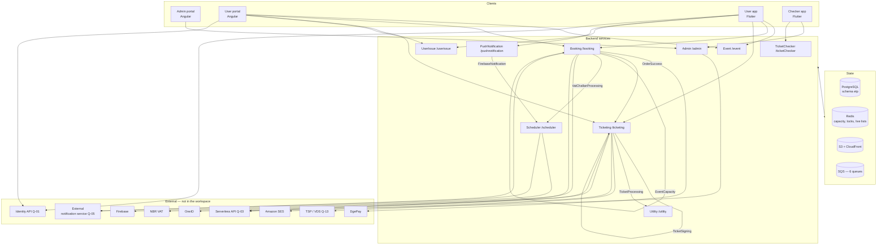

# 01 · সিস্টেম ম্যাপ

> **Bangla name:** সিস্টেম ম্যাপ
>
> [← সূচিপত্র](README.md)

এটিই সেই এক পাতা যেখানে দেখা যায় একজন গ্রাহক, কর্মী বা একটি ব্যাকগ্রাউন্ড ওয়ার্কার GoBCB-এর ভেতর দিয়ে কীভাবে চলে যায়। এই ডকুমেন্টেশনের প্রতিটি ফিচার ফাইল এই ম্যাপের একটি বাক্সের ভেতরে গভীরভাবে নেমে যায়। প্ল্যাটফর্মে নতুন হলে প্রথমে এটি পড়ুন; ইতিমধ্যে জানা থাকলে সঠিক ফিচার ফাইল খুঁজে বের করার সূচক হিসেবে ব্যবহার করুন।

## 1. তিনটি ক্লায়েন্ট

| ক্লায়েন্ট | প্রযুক্তি | কে ব্যবহার করে | কোথায় থাকে | ফিচার ফাইল |
|---|---|---|---|---|
| **অ্যাডমিন পোর্টাল** | Angular (standalone components, signals) | GoBCB কর্মী — ইভেন্ট ম্যানেজার, অ্যাডমিন | `rvl-gobcb-admin-portal/` | [10 · অ্যাডমিন পোর্টাল](10-admin-portal/README.md) (A-01…A-31) |
| **ইউজার পোর্টাল** | Angular, SSR-capable | ওয়েবে কেনাকাটা করা গ্রাহকরা | `rvl-gobcb-user-portal/` | [20 · ইউজার পোর্টাল](20-user-portal/README.md) (P-01…P-13) |
| **ইউজার অ্যাপ** | Flutter, 3টি প্যাকেজ | Android / iOS ব্যবহারকারী গ্রাহকরা | `rvl-gobcb-user-app/` | [30 · ইউজার অ্যাপ](30-user-app/README.md) (U-01…U-10) |
| **চেকার অ্যাপ** | Flutter, monorepo + vendored scanner | গেট কর্মী | `rvl-gobcb-checker-app/` | [40 · চেকার অ্যাপ](40-checker-app/README.md) (C-01…C-06) |

**ব্যাকএন্ড** হলো পঞ্চম রিপোজিটরি, `rvl-gobcb-backend/`, যেখানে নয়টি ASP.NET Core 8 সার্ভিস এবং দুটি স্টাব রয়েছে। এটি কোনো "ক্লায়েন্ট" নয়, তবে প্রতিটি ফিচারের প্রকৃত আচরণ এখানেই থাকে।

> ওয়ার্কস্পেসের পাঁচটি রিপোজিটরি হলো `rvl-gobcb-backend`, `rvl-gobcb-admin-portal`, `rvl-gobcb-user-portal`, `rvl-gobcb-user-app` এবং `rvl-gobcb-checker-app`। এগুলো git submodule এবং এই ডকুমেন্টেশনে read-only হিসেবে বিবেচিত হয়।

## 2. ব্যাকএন্ড সার্ভিসগুলো

| সার্ভিস | প্রিফিক্স | পোর্ট | যা এর মালিকানা | ফিচার ফাইল |
|---|---|---|---|---|
| **Admin** | `/admin` | 5101 | সব মাস্টার ডেটা — প্রোগ্রাম, ভেন্যু, ইভেন্ট, মূল্য, লেআউট, প্রোমো কোড, ছাড়, কর্মী ব্যবহারকারী, গেট অ্যাসাইনমেন্ট, কনটেন্ট, অ্যাক্টিভিটি লগ | [A-01](10-admin-portal/A-01-program-selection.md) … [A-31](10-admin-portal/A-31-general-notices.md) |
| **Booking** | `/booking` | 5102 | ক্যাপাসিটি, আসন, বুকিং অর্ডার, DgePay পেমেন্ট, প্রোমো প্রয়োগ, রিজার্ভেশন, VAT চালান | [P-04](20-user-portal/P-04-seat-selection.md), [P-06](20-user-portal/P-06-booking-payment.md), [S-05](50-system-initiated/S-05-pending-failed-revalidation.md) |
| **Event** | `/event` | 5103 | পোর্টাল ও অ্যাপ যে public read-only ভিউ পড়ে | [P-01](20-user-portal/P-01-home-content.md), [U-02](30-user-app/U-02-home-browse-events.md) |
| **Ticketing** | `/ticketing` | 5108 | টিকিট জেনারেশন, TSP সাইনিং, PDF, ডাউনলোড, OneID সিঙ্ক, অফলাইনে বিক্রীত টিকিট | [P-09](20-user-portal/P-09-ticket-details-downloads.md), [S-08](50-system-initiated/S-08-ticket-signing.md) |
| **TicketChecker** | `/ticketChecker` | 5107 | চেকারের স্ক্যান সিঙ্ক | [C-02](40-checker-app/C-02-offline-ticket-download.md), [C-05](40-checker-app/C-05-ticket-sync.md) |
| **UserIssue** | `/userissue` | 5110 | গ্রাহকের সমস্যা এবং সাপোর্ট চ্যাট হাব | [P-12](20-user-portal/P-12-issues-chat.md), [U-08](30-user-app/U-08-issues-chat.md) |
| **PushNotification** | `/pushnotification` | 5105 | ডিভাইস টোকেন এবং পুশ পাঠানো | [U-09](30-user-app/U-09-device-token.md), [X-23](60-cross-cutting/X-23-push-firebase.md) |
| **Scheduler** | `/scheduler` | 5106 | শুধু ওয়ার্কার — কোনো কন্ট্রোলার নেই | [S-11](50-system-initiated/S-11-firebase-notification.md) … [S-15](50-system-initiated/S-15-gate-download-status-cleanup.md) |
| **Utility** | `/utility` | 5111 | শুধু ওয়ার্কার — রিজার্ভড টিকিট মার্জ ও জিপ করে | [S-09](50-system-initiated/S-09-ticket-merge-zip.md) |
| Platform | `/platform` | 5104 | **স্টাব** — শুধু একটি টেমপ্লেট `WeatherForecastController` | — |
| UserAuth | `/userAuth` | 5109 | **স্টাব** — শুধু `/health` | — |

প্রতিটি সার্ভিসে যাওয়া হয় তার **পাথ প্রিফিক্স** দিয়ে, যা `GlobalRoutePrefixConvention` (`appsettings.json`-এ `Application:ServiceName`) যোগ করে এবং nginx ingress-এ শেষ হয়। তাই TicketChecker-এর একটি কন্ট্রোলার রুট `tickets/sync-tickets` বাইরে থেকে হয় `/ticketchecker/api/v1/tickets/sync-tickets`।

প্রতিটি সার্ভিসের **নিজস্ব `DbContext` ও কানেকশন স্ট্রিং` আছে**, তবে সবগুলোই PostgreSQL স্কিমা `etp` ব্যবহার করে। কোনো সার্ভিস শুধু পড়ে এমন টেবিলগুলো `ExcludeFromMigrations` দিয়ে ম্যাপ করা হয়, যাতে সেটি তাদের স্কিমার মালিকানা নিতে না চায় — দেখুন [X-19](60-cross-cutting/X-19-service-to-service.md) এবং [Q-02](99-open-queries.md)।

## 3. তিনটি অ্যাক্টর

| অ্যাক্টর | Cognito পুল | যা পৌঁছায় | টোকেন | ফিচার ফাইল |
|---|---|---|---|---|
| **কর্মী** | Admin pool (`admin`) | `/admin`, এবং গেটের কাজের জন্য `/ticketchecker` | admin JWT, policy- ও role-scoped | [X-01](60-cross-cutting/X-01-admin-login.md), [X-14](60-cross-cutting/X-14-authz-pool-policies.md), [X-15](60-cross-cutting/X-15-authz-roles.md), [X-16](60-cross-cutting/X-16-authz-program-scope.md) |
| **গ্রাহক** | User pool (`user`) | `/event`, `/booking`, `/ticketing`, `/userissue`, `/pushnotification`, সাথে external identity API ও OneID | user JWT | [X-06](60-cross-cutting/X-06-user-registration.md), [X-07](60-cross-cutting/X-07-user-password-login.md), [X-10](60-cross-cutting/X-10-user-session.md) |
| **চেকার** | Ticket-checker pool (`ticket-checker`) | `/admin/ticket-checker-gate/event-info`, `/ticketchecker` | checker JWT | [X-12](60-cross-cutting/X-12-checker-login.md), [C-01](40-checker-app/C-01-assigned-event-gate.md) |
| **এজেন্ট** | Agent pool (`agent`) | `POST /ticketing/api/v1/offline-sold-ticket` | agent JWT | [X-13](60-cross-cutting/X-13-agent-pool.md) — **ওয়ার্কস্পেসে কোনো ক্লায়েন্ট নেই** ([Q-07](99-open-queries.md)) |

ক্লায়েন্টরা টোকেন পাঠায় `Authorization: Bearer`-এ; Angular ইন্টারসেপ্টর কিছু নির্দিষ্ট রুটের allow-list-এ একটি static API-key হেডার যোগ করে, আর Flutter ক্লায়েন্টরা প্রতিটি সার্ভিসের জন্য নিজস্বটি যোগ করে ([X-19](60-cross-cutting/X-19-service-to-service.md))।

## 4. বাহ্যিক সিস্টেমগুলো

এগুলোর কোনোটিই ওয়ার্কস্পেসে নেই। প্রতিটিকে মালিকানা অজানা একটি নির্ভরতা হিসেবে বিবেচনা করুন — দেখুন [99 · ওপেন কোয়ারি](99-open-queries.md)।

| সিস্টেম | কী কাজে | কোথা থেকে কোড একে কল করে | কোয়ারি |
|---|---|---|---|
| **Identity API** | রেজিস্ট্রেশন, OTP, `my-profile`, `register-sso`, `allowed-app-version`, `delete-my-profile` | Angular `IdentityApiService`; Flutter `auth_api_client.dart` | [Q-01](99-open-queries.md) |
| **Serverless / Lambda identity API** | অ্যাডমিন লগইন লুকআপ (নাম, আইডি দিয়ে ফোন) | `environment.serverless.baseUrl` | [Q-03](99-open-queries.md) |
| **DgePay** | পেমেন্ট | `Booking`, callback + `payment-status-bypass` | [P-06](20-user-portal/P-06-booking-payment.md) |
| **SSLCommerz** | পেমেন্ট — ফর্মে সমর্থিত, **callback নিষ্ক্রিয়** | `Booking` | [Q-19](99-open-queries.md) |
| **TSP (VDS)** | টিকিটের QR-এ ডিজিটাল সাইনেচার | `Ticketing`, `Cert/tspgw_client.pfx` | [S-08](50-system-initiated/S-08-ticket-signing.md), [Q-13](99-open-queries.md) |
| **OneID** | জাতীয় পরিচয়ে লগইন, ওয়ালেটে টিকিট সিঙ্ক | `Ticketing`, `environment.aws.oneId*` | [P-10](20-user-portal/P-10-oneid-ticket-sync.md) |
| **NBR VAT** | স্মার্ট চালান | `Booking` → SQS → Scheduler | [S-10](50-system-initiated/S-10-vat-challan.md) |
| **Firebase (FCM/APNs)** | পুশ নোটিফিকেশন | Scheduler → Firebase, টোকেন `PushNotification`-এ | [X-23](60-cross-cutting/X-23-push-firebase.md) |
| **External notification service** | সব SMS | `INotificationClient` → `Notification:Endpoint` | [X-22](60-cross-cutting/X-22-sms-notification.md), [Q-05](99-open-queries.md) |
| **Amazon SES** | ইমেইল, টিকিট ZIP | `Ticketing` | [X-21](60-cross-cutting/X-21-email-ses.md) |
| **S3 + CloudFront** | PDF, ছবি, অ্যাডমিন-পোর্টাল ডাউনলোড সুরক্ষা | `X-20` | [X-20](60-cross-cutting/X-20-file-storage.md) |

## 5. মেসেজিং ব্যাকবোন

ছয়টি SQS কিউ অ্যাসাইনক্রোনাস কাজ বহন করে। প্রতিটির একটি producer এবং একটি consumer আছে, আর সেই জোড়াই বেশিরভাগ "এটা এখনো হয়নি কেন" উত্তরের উৎস।

| কিউ | কে তৈরি করে | কে পড়ে | ফিচার |
|---|---|---|---|
| `OrderSuccess` | Booking, নিশ্চিত পেমেন্টের ওপর | Ticketing `TicketGenerationService` | [S-07](50-system-initiated/S-07-initiate-user-ticket-generation.md) |
| `EventCapacity` | Booking, আসন লক বদলালে | Booking `LevelCapacityUpdateService`, `EventLiveCapacityUpdateService` | [S-01](50-system-initiated/S-01-level-capacity-update.md), [S-02](50-system-initiated/S-02-event-live-capacity.md) |
| `VatChallanProcessing` | Booking, `Paid` callback-এ | Scheduler `VatChallanProcessingService` | [S-10](50-system-initiated/S-10-vat-challan.md) |
| `TicketSigning` | Ticketing, কোনো PDF-এ সাইনিং দরকার হলে | Ticketing | [S-08](50-system-initiated/S-08-ticket-signing.md) |
| `TicketProcessing` | Ticketing, রিজার্ভড-টিকিট মার্জের জন্য | Utility `TicketProcessingService` | [S-09](50-system-initiated/S-09-ticket-merge-zip.md) |
| `FirebaseNotification` | PushNotification | Scheduler `FirebaseNotificationService` | [S-11](50-system-initiated/S-11-firebase-notification.md) |

ছয়টিই [50 · সিস্টেম-ইনিসিয়েটেড](50-system-initiated/README.md)-এ (S-01…S-17) নথিভুক্ত। দুটি আচরণ সবগুলোর জন্য সাধারণ এবং ডিবাগ করার আগে জানা দরকার: **কোডে কোনো dead-letter হ্যান্ডলিং নেই**, এবং **রিট্রাই কাউন্টার একটি deserialize-করা কপিতে বাড়ানো হয় এবং কখনো আবার publish করা হয় না**, তাই স্থায়ীভাবে ব্যর্থ মেসেজ চিরকাল রিট্রাই করে ([Q-09](99-open-queries.md))।

## 6. অনুরোধের যাত্রাপথ

নিচের চারটি যাত্রাপথই সেগুলো যা একজন নতুন ইঞ্জিনিয়ার বর্ণনা দিতে পারা উচিত। প্রতিটি সংশ্লিষ্ট ফাইলে বিস্তারিত আছে।

### 6.1 একজন গ্রাহক টিকিট কেনেন — দীর্ঘতম পথ

```
User portal / App
  → Event service      browse programs, events, prices        P-01, P-02
  → Booking service    lock seats in Redis, create order     P-04, P-06
  → DgePay             redirect, pay, callback               P-06
  → (OrderSuccess queue)
  → Ticketing          generate PDFs, sign with TSP, ZIP     S-07, S-08, S-09
  → (FirebaseNotification queue) → Scheduler → FCM          S-11, S-12
  → Customer           download or view the signed PDF       P-09, U-06
```

ক্যাপাসিটি **Redis-first** (`level_live`, `level_locked`, ১২ মিনিটের লক), আর ডেটাবেসে থাকে ওয়ার্কারদের দ্বারা reconcile করা টেকসই কপি — [X-25](60-cross-cutting/X-25-redis.md), [S-03](50-system-initiated/S-03-locked-capacity-refresh.md)।

### 6.2 একজন চেকার গেটে টিকিট যাচাই করেন — অফলাইন পথ

```
Checker app
  → Admin service     GET ticket-checker-gate/event-info     C-01
  → TicketChecker     POST sync-tickets  (download)         C-02
  → (local SQLite)    every scan is decided offline         C-03
  → TicketChecker     POST sync-tickets  (every 90 s)       C-05
```

এটিই একমাত্র যাত্রাপথ যেখানে সঠিক থাকার জন্য **কোনো নেটওয়ার্কের দরকার নেই** — এটাই ডিজাইনের উদ্দেশ্য, এবং এ কারণেই [C-06](40-checker-app/C-06-manual-ticket-validation.md) ও [C-04](40-checker-app/C-04-manual-entry.md) এত গুরুত্বপূর্ণ: এগুলো সেই পথ যেখানে আরও দুর্বল প্রমাণের ভিত্তিতে সিদ্ধান্ত নেওয়া হয়।

### 6.3 কর্মী একটি ইভেন্ট সেটআপ করেন

```
Admin portal
  → Admin service      programs, venues, layouts, pricing    A-01…A-14
  → Admin service      events, capacity, publishing          A-07…A-10
  → Event service      the published result becomes public   P-01, U-02
```

একটি অর্ডারিং শর্ত আছে যা শুধু UI-তে প্রয়োগ করা হয়: **ইভেন্ট প্রকাশের আগে লেআউট প্রকাশ করতে হবে** ([Q-23](99-open-queries.md), [A-13](10-admin-portal/A-13-ticket-layouts.md))।

### 6.4 একজন গ্রাহক একটি সমস্যা জানান

```
User portal / App
  → UserIssue service  POST /user-issue (the issue)         P-12, U-08
  → SignalR hub        /userissue/chathub  (authorised)     P-12, U-08
  → UserIssue service  REST fallback (NOT authorised)       Q-46
  → Admin portal       A-24 reads and resolves the issue     A-24
```

## 7. ক্রস-কাটিং বিষয়সমূহ

ছাব্বিশটি বিষয় একাধিক ফিচারের জন্য প্রযোজ্য। সেগুলো [60 · ক্রস-কাটিং](60-cross-cutting/README.md)-এ আছে।

| ক্ষেত্র | ফাইল | কখন পড়বেন |
|---|---|---|
| **প্রমাণীকরণ** | [X-01](60-cross-cutting/X-01-admin-login.md) … [X-04](60-cross-cutting/X-04-admin-session.md), [X-06](60-cross-cutting/X-06-user-registration.md) … [X-10](60-cross-cutting/X-10-user-session.md), [X-12](60-cross-cutting/X-12-checker-login.md) | কে কল করছে তা জানতে হবে, বা কীভাবে লগইন কাজ করে |
| **অনুমোদন** | [X-14](60-cross-cutting/X-14-authz-pool-policies.md) … [X-17](60-cross-cutting/X-17-authz-client-side.md), [X-18](60-cross-cutting/X-18-endpoints-without-auth.md) | আপনি ঠিক করছেন যে কোনো স্ক্রিনে যাওয়া **উচিত** কি না। **এন্ডপয়েন্ট সুরক্ষিত মনে করার আগে X-18 পড়ুন।** |
| **অবকাঠামো** | [X-19](60-cross-cutting/X-19-service-to-service.md), [X-20](60-cross-cutting/X-20-file-storage.md), [X-25](60-cross-cutting/X-25-redis.md), [X-26](60-cross-cutting/X-26-configuration.md) | আপনি কানেকশন স্ট্রিং, ফাইল পাথ, Redis key বা config key বদলাচ্ছেন |
| **মেসেজিং ও নোটিফিকেশন** | [X-22](60-cross-cutting/X-22-sms-notification.md), [X-23](60-cross-cutting/X-23-push-firebase.md), [X-24](60-cross-cutting/X-24-activity-logging.md) | আপনি একটি নোটিফিকেশন বা অডিট ট্রেইল যোগ করছেন |
| **ফিচার-নির্দিষ্ট auth** | [X-05](60-cross-cutting/X-05-admin-provisioning.md), [X-08](60-cross-cutting/X-08-oneid-sso.md), [X-09](60-cross-cutting/X-09-user-forgot-password.md), [X-11](60-cross-cutting/X-11-delete-account-force-update.md), [X-13](60-cross-cutting/X-13-agent-pool.md) | নির্দিষ্ট ফ্লো, সাধারণ নিয়ম নয় |

<a id="8-where-the-risk-is"></a>
## 8. ঝুঁকি কোথায়

এই হ্যান্ডওভারের মধ্যে মাত্র একটি অংশ পড়লেন, সেটি এই অংশটিই পড়ুন। যেসব জায়গায় কোড এমন কিছু করছে যা একজন যুক্তিসঙ্গত মানুষ আশা করতেন না, সেগুলো পরিণতির ভিত্তিতে সাজানো।

| ঝুঁকি | কোথায় | কোয়ারি |
|---|---|---|
| **অপ্রমাণীকৃত এন্ডপয়েন্ট যেকোনোকে অ্যাডমিন হিসেবে সাপোর্ট মেসেজ পাঠাতে দেয়** | `UserIssue` চ্যাট REST কন্ট্রোলার | [Q-46](99-open-queries.md) |
| **PushNotification-এ কোনো প্রমাণীকরণই নেই** | পুরো সার্ভিসে | [Q-04](99-open-queries.md), [Q-62](99-open-queries.md) |
| **অ্যাডমিন-লেখা HTML sanitize ছাড়াই সংরক্ষিত ও রেন্ডার হয়** | কনটেন্ট এডিটর, নোটিস এবং দুটি অ্যাপ উইজেট | [Q-33](99-open-queries.md), [Q-55](99-open-queries.md) |
| **ম্যানুয়াল টিকিট এন্ট্রি সাইনেচার যাচাই এড়িয়ে যায়** এবং অজানা আইডির জন্যও রো লেখে | চেকার অ্যাপ | [Q-75](99-open-queries.md) |
| **একই গেটে ডুপ্লিকেট টিকিট ঢুকতে পারে** — শুধুমাত্র স্থানীয়ভাবে শনাক্তকরণ হয় | চেকার অ্যাপ | [Q-74](99-open-queries.md) |
| **টাকা নিয়েও দেরিতে পরিশোধিত অর্ডার বাতিল করা যায়** | Booking re-check worker | [Q-11](99-open-queries.md) |
| **দেরিতে আসা পেমেন্ট callback অপরিশোধিত থাকা অর্ডারের জন্য VAT রেকর্ড করে** | Booking callback | [Q-15](99-open-queries.md) |
| **`-1` ম্যানুয়াল-এন্ট্রি কনভেনশন সার্ভারে নথিভুক্ত নয়** | চেকার সিঙ্ক | [Q-68](99-open-queries.md) |
| **iOS কোনো QR যাচাই করতে পারে না** — আসল যাচাইয়ের জন্য চেকার অ্যাপ শুধু Android-এ চলে | `AppDelegate.swift` | [Q-72](99-open-queries.md) |
| **ডেটাবেসের কনটেন্ট কখনো অনুবাদ হয় না** — শুধু পোর্টালের চেহারা ভাষা বদলায় | ইউজার পোর্টাল | [Q-44](99-open-queries.md) |
| **ব্যর্থ সিঙ্কের পরেও "last sync time" দেখায়** | চেকার অ্যাপ | [Q-76](99-open-queries.md) |
| **Identity API — গ্রাহক-সম্পর্কিত আচরণের একটি বড় অংশ — ওয়ার্কস্পেসে কোনো সোর্স নেই** | বাহ্যিক | [Q-01](99-open-queries.md) |

## 9. এই ডকুমেন্টেশনের বাকি অংশ কীভাবে ব্যবহার করবেন

| আপনি কী জানতে চান | কোথায় যাবেন |
|---|---|
| গ্রাহক-সম্পর্কিত একটি স্ক্রিন বোঝা | [20 · ইউজার পোর্টাল](20-user-portal/README.md) বা [30 · ইউজার অ্যাপ](30-user-app/README.md) |
| কর্মী-সম্পর্কিত একটি স্ক্রিন বোঝা | [10 · অ্যাডমিন পোর্টাল](10-admin-portal/README.md) |
| কেউ না দেখলেও যা ঘটে তা বোঝা | [50 · সিস্টেম-ইনিসিয়েটেড](50-system-initiated/README.md) |
| auth, storage, Redis, config, নোটিফিকেশন বোঝা | [60 · ক্রস-কাটিং](60-cross-cutting/README.md) |
| কোন ফিচারের মালিকানা কোন এন্ডপয়েন্ট জানা | [91 · এন্ডপয়েন্ট ইনডেক্স](91-appendix-b-endpoint-index.md) |
| কোন ফিচার কোন টেবিল, কিউ, Redis key ব্যবহার করে জানা | [03 · কম্পোনেন্ট রিভার্স ইনডেক্স](03-component-reverse-index.md) |
| এখনো কী অজানা তা জানা | [99 · ওপেন কোয়ারি](99-open-queries.md) |
| BS23 কী বানিয়েছিল যা আমরা ব্যবহার করি না জানা | [90 · লেগ্যাসি ও অব্যবহৃত](90-appendix-a-legacy.md) |

প্রতিটি ফিচার ফাইল একই এগারোটি প্রশ্ন একই ক্রমেের সমাধান দেয় — উদ্দেশ্য, ট্রিগার, ব্যবসায়িক প্রবাহ, প্রযুক্তিগত প্রবাহ, কম্পোনেন্ট, API কন্ট্রাক্ট, ডেটা ও পার্শ্বপ্রতিক্রিয়া, কোড রেফারেন্স, হ্যান্ডওভার নোট, কম্পোনেন্ট সম্পর্ক এবং স্থানীয়ভাবে কীভাবে পরীক্ষা করবেন — তাই পুরো ফাইল না পড়েই আপনি প্রয়োজনীয় অংশে সরাসরি যেতে পারেন।

## 10. কম্পোনেন্ট সম্পর্ক



**নির্ভর করে:** পাঁচটি রিপোজিটরি এবং [`gobcb-aws-architecture.md`](../../../architecture/gobcb-aws-architecture.md)। **প্রভাব ফেলে:** অন্য সব পাতা — এটিই সূচক।