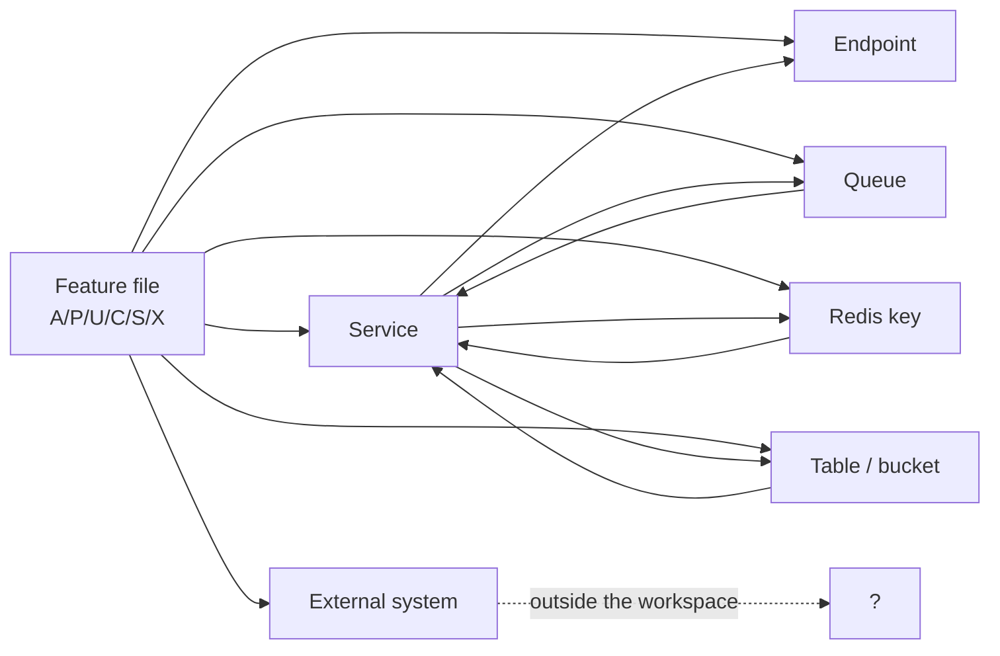

# 02 · ট্রেসেবিলিটি ম্যাট্রিক্স

> **Bangla name:** ট্রেসেবিলিটি ম্যাট্রিক্স
>
> [← সূচিপত্র](README.md) · [এন্ডপয়েন্ট ইনডেক্স](91-appendix-b-endpoint-index.md) · [রিভার্স ইনডেক্স](03-component-reverse-index.md)

প্রতিটি ব্যবসায়িক ফিচার, এবং সেটি যে প্রযুক্তিগত জিনিসগুলো স্পর্শ করে। তিনটি টেবিল:

1. **§2 ফিচার → সার্ভিস** — কোন ব্যাকএন্ড সার্ভিস প্রতিটি ফিচার বাস্তবায়ন করে
2. **§3 ফিচার → এন্ডপয়েন্ট** — প্রতিটি স্ক্রিন কোন HTTP এন্ডপয়েন্ট কল করে
3. **§4 ফিচার → স্টেট** — প্রতিটি ফিচার কোন কিউ, Redis key, টেবিল ও বাহ্যিক সিস্টেম স্পর্শ করে

আপনার কাছে একটি স্ক্রিন থেকে কোথায় তার আচরণ বাস করে জানতে চাইলে §2 ও §3 ব্যবহার করুন। আপনার কাছে একটি টেবিল, কিউ বা Redis key থেকে কে তা লেখে জানতে চাইলে §4 ও [রিভার্স ইনডেক্স](03-component-reverse-index.md) ব্যবহার করুন।

## 1. রীতি

| কলাম | অর্থ |
|---|---|
| **সার্ভিস** | সেই ব্যাকএন্ড সার্ভিস যার মালিকানায় আচরণটি রয়েছে |
| **এন্ডপয়েন্ট** | প্রধান বাহ্যিক পথ; `—` মানে ফিচারটি কোনো HTTP কল করে না |
| **কিউ** | SQS কিউ যেটাতে এটি মেসেজ তৈরি করে বা পড়ে; `—` মানে কিউ নেই |
| **Redis** | key যেগুলো এটি পড়ে বা লেখে; `—` মানে কোনো key নেই |
| **স্টোর** | টেবিল, বাকেট বা বাহ্যিক স্টোর যেখানে এটি লেখে |
| **Ext** | একটি বাহ্যিক সিস্টেম যার উপর এটি নির্ভর করে |

সত্যিই যখন একটি ফিচার কয়েকটি সারিতে ছড়িয়ে থাকে, তখন সেটি একাধিক সারি ব্যবহার করতে পারে। কোনো সেলে *same as above* লেখা থাকলে বুঝবেন দুটি ফিচার একই কম্পোনেন্ট ব্যবহার করে।

## 2. ফিচার → সার্ভিস

### 2.1 অ্যাডমিন পোর্টাল (৩১টি ফিচার)

| Id | ফিচার | সার্ভিস | অতিরিক্তভাবে স্পর্শ করে |
|---|---|---|---|
| [A-01](10-admin-portal/A-01-program-selection.md) | প্রোগ্রাম নির্বাচন | Admin | Cognito (সেশন), localStorage |
| [A-02](10-admin-portal/A-02-programs.md) | প্রোগ্রামসমূহ | Admin | Cognito |
| [A-03](10-admin-portal/A-03-program-settings.md) | প্রোগ্রাম সেটিংস | Admin | — |
| [A-04](10-admin-portal/A-04-teams.md) | টিম | Admin | — |
| [A-05](10-admin-portal/A-05-venues.md) | ভেন্যু | Admin | S3 (ভেন্যু মিডিয়া) |
| [A-06](10-admin-portal/A-06-program-venue-mapping.md) | প্রোগ্রাম–ভেন্যু ম্যাপিং | Admin | — |
| [A-07](10-admin-portal/A-07-events.md) | ইভেন্ট | Admin | — |
| [A-08](10-admin-portal/A-08-event-settings.md) | ইভেন্ট সেটিংস ওভাররাইড | Admin | — |
| [A-09](10-admin-portal/A-09-event-level-pricing.md) | ইভেন্ট ভেন্যু বিবরণী ও মূল্য | Admin | — |
| [A-10](10-admin-portal/A-10-capacity-adjustment.md) | ক্যাপাসিটি সমন্বয় | **Booking** | Redis |
| [A-11](10-admin-portal/A-11-seat-reservation.md) | আসন সংরক্ষণ | **Booking** | — |
| [A-12](10-admin-portal/A-12-reserved-tickets.md) | রিজার্ভড টিকিট তৈরি | **Booking**, Ticketing | `TicketProcessing` কিউ |
| [A-13](10-admin-portal/A-13-ticket-layouts.md) | টিকিট লেআউট | Admin | S3 (লেআউট ফাইল) |
| [A-14](10-admin-portal/A-14-ticket-pricing-content.md) | টিকিট-মূল্য কনটেন্ট | Admin | **গ্রাহকের মূল্য পাতা এটি পড়ে না** |
| [A-15](10-admin-portal/A-15-promo-codes.md) | প্রোমো কোড | Admin | Scheduler ([S-16](50-system-initiated/S-16-promo-code-status.md)) |
| [A-16](10-admin-portal/A-16-discounts.md) | সিস্টেম ছাড় | Admin | Scheduler ([S-17](50-system-initiated/S-17-discount-status.md)) |
| [A-17](10-admin-portal/A-17-ticket-checker-users.md) | চেকার অ্যাকাউন্ট | Admin | Cognito (চেকার পুল) |
| [A-18](10-admin-portal/A-18-gate-assignment.md) | গেট অ্যাসাইনমেন্ট | Admin | Redis (`TicketCheckerLevelGateMap`) |
| [A-19](10-admin-portal/A-19-gate-reports.md) | গেট রিপোর্ট | Admin, Booking | Scheduler ([S-14](50-system-initiated/S-14-checked-ticket-sync.md)) |
| [A-20](10-admin-portal/A-20-raffle-draw.md) | র‍্যাফল ড্র | Admin | — |
| [A-21](10-admin-portal/A-21-dashboard.md) | ড্যাশবোর্ড | Admin, Booking | Redis (লাইভ ক্যাপাসিটি) |
| [A-22](10-admin-portal/A-22-reports.md) | রিপোর্ট | Booking | — |
| [A-23](10-admin-portal/A-23-reconciliation.md) | রিকনসিলিয়েশন | Booking, Ticketing | — |
| [A-24](10-admin-portal/A-24-user-issues-admin.md) | ইউজার ইস্যু (অ্যাডমিন) | Admin, UserIssue | SignalR, বাহ্যিক নোটিফিকেশন ([Q-05](99-open-queries.md)) |
| [A-25](10-admin-portal/A-25-admin-users.md) | অ্যাডমিন ব্যবহারকারী | Admin | Cognito (admin পুল) |
| [A-26](10-admin-portal/A-26-agent-users.md) | এজেন্ট ব্যবহারকারী | Admin | Cognito (agent পুল) |
| [A-27](10-admin-portal/A-27-activity-log.md) | অ্যাক্টিভিটি লগ | Admin | — |
| [A-28](10-admin-portal/A-28-media-configuration.md) | মিডিয়া কনফিগারেশন | Admin | S3 |
| [A-29](10-admin-portal/A-29-content-editor.md) | কনটেন্ট এডিটর | Admin | **HTML অস্যানিটাইজড অবস্থায় সংরক্ষিত** ([Q-33](99-open-queries.md)) |
| [A-30](10-admin-portal/A-30-header-footer-social.md) | হেডার/ফুটার ও সোশ্যাল | Admin | — |
| [A-31](10-admin-portal/A-31-general-notices.md) | সাধারণ নোটিস | Admin | **পোর্টাল এটি পড়ে না** ([Q-35](99-open-queries.md)) |

### 2.2 ইউজার পোর্টাল (১৩টি ফিচার)

| Id | ফিচার | সার্ভিস | অতিরিক্তভাবে স্পর্শ করে |
|---|---|---|---|
| [P-01](20-user-portal/P-01-home-content.md) | হোম কনটেন্ট | Event, Admin | Redis (প্রকাশিত তালিকা) |
| [P-02](20-user-portal/P-02-browse-events.md) | ইভেন্ট ব্রাউজ | Event | — |
| [P-03](20-user-portal/P-03-info-pages.md) | তথ্য পাতা | Event | — |
| [P-04](20-user-portal/P-04-seat-selection.md) | আসন নির্বাচন | Booking | Redis (লাইভ আসন) |
| [P-05](20-user-portal/P-05-apply-promo-code.md) | প্রোমো কোড | Booking | Redis (আসন লক) |
| [P-06](20-user-portal/P-06-booking-payment.md) | বুকিং ও পেমেন্ট | Booking | **DgePay**, Redis |
| [P-07](20-user-portal/P-07-my-bookings.md) | আমার বুকিং | Booking | — |
| [P-08](20-user-portal/P-08-ticket-generation-request.md) | টিকিট জেনারেশন অনুরোধ | Ticketing | — |
| [P-09](20-user-portal/P-09-ticket-details-downloads.md) | টিকিটের বিবরণী ও ডাউনলোড | Ticketing | S3, SES |
| [P-10](20-user-portal/P-10-oneid-ticket-sync.md) | OneID টিকিট সিঙ্ক | Ticketing | **OneID** |
| [P-11](20-user-portal/P-11-profile.md) | প্রোফাইল | **Identity API** (বাহ্যিক) | — ([Q-01](99-open-queries.md)) |
| [P-12](20-user-portal/P-12-issues-chat.md) | ইস্যু ও চ্যাট | UserIssue | SignalR; **REST ফলব্যাকে কোনো auth নেই** ([Q-46](99-open-queries.md)) |
| [P-13](20-user-portal/P-13-language-switch.md) | ভাষা পরিবর্তন | — (শুধু ক্লায়েন্ট) | localStorage; **DB-র কনটেন্ট কখনো অনুবাদ হয় না** ([Q-44](99-open-queries.md)) |

### 2.3 ইউজার অ্যাপ (১০টি ফিচার)

| Id | ফিচার | সার্ভিস | অতিরিক্তভাবে স্পর্শ করে |
|---|---|---|---|
| [U-01](30-user-app/U-01-splash-onboarding.md) | স্প্ল্যাশ ও ভার্সন গেট | **Identity API** (বাহ্যিক) | — ([Q-51](99-open-queries.md), [Q-52](99-open-queries.md)) |
| [U-02](30-user-app/U-02-home-browse-events.md) | হোম ও ব্রাউজ | Event | — |
| [U-03](30-user-app/U-03-info-pages.md) | তথ্য পাতা | Event | — |
| [U-04](30-user-app/U-04-seat-selection-promo.md) | আসন নির্বাচন ও প্রোমো | Booking, **Admin** (ছাড়) | Redis; **কোনো polling নেই** ([Q-56](99-open-queries.md)) |
| [U-05](30-user-app/U-05-booking-webview-payment.md) | বুকিং ও WebView পেমেন্ট | Booking | WebView-এর মাধ্যমে **DgePay**; **সাফল্য URL থেকে অনুমান করা হয়** ([Q-58](99-open-queries.md)) |
| [U-06](30-user-app/U-06-my-bookings-tickets.md) | আমার বুকিং ও টিকিট | Booking, Ticketing | S3, **কোনো polling নেই** ([Q-54](99-open-queries.md)) |
| [U-07](30-user-app/U-07-profile-settings.md) | প্রোফাইল ও সেটিংস | **Identity API** (বাহ্যিক) | `delete-my-profile` **অপ্রাপ্য** ([Q-61](99-open-queries.md)) |
| [U-08](30-user-app/U-08-issues-chat.md) | ইস্যু ও চ্যাট | UserIssue | আগে SignalR, পরে REST ফলব্যাক |
| [U-09](30-user-app/U-09-device-token.md) | ডিভাইস টোকেন | PushNotification | **সার্ভিসে কোনো auth নেই** ([Q-62](99-open-queries.md)) |
| [U-10](30-user-app/U-10-push-receipt.md) | পুশ গ্রহণ | — (Firebase SDK) | **ট্যাপে নেভিগেশন নেই, রসিদও নেই** ([Q-64](99-open-queries.md), [Q-65](99-open-queries.md)) |

### 2.4 চেকার অ্যাপ (৬টি ফিচার)

| Id | ফিচার | সার্ভিস | অতিরিক্তভাবে স্পর্শ করে |
|---|---|---|---|
| [C-01](40-checker-app/C-01-assigned-event-gate.md) | নির্ধারিত ইভেন্ট ও গেট | **Admin** | SharedPreferences ক্যাশে |
| [C-02](40-checker-app/C-02-offline-ticket-download.md) | টিকিট ডাউনলোড | TicketChecker | লোকাল SQLite (drift) |
| [C-03](40-checker-app/C-03-qr-scan-validation.md) | QR স্ক্যান যাচাই | **কোনোটিই নয়** (লোকাল ক্রিপ্টো) | মেথড চ্যানেল; **শুধু Android** ([Q-72](99-open-queries.md)) |
| [C-04](40-checker-app/C-04-manual-entry.md) | ম্যানুয়াল এন্ট্রি | **কোনোটিই নয়** | লোকাল SQLite; **সাইনেচার যাচাই নেই** ([Q-75](99-open-queries.md)) |
| [C-05](40-checker-app/C-05-ticket-sync.md) | স্ক্যান সিঙ্ক | TicketChecker | Redis `ticketCheckerDbSync` ([Q-17](99-open-queries.md)) |
| [C-06](40-checker-app/C-06-manual-ticket-validation.md) | শুধু সাইনেচারভিত্তিক যাচাই | **কোনোটিই নয়** | মেথড চ্যানেল; শুধু ডায়াগনস্টিক ([Q-77](99-open-queries.md)) |

### 2.5 সিস্টেম-ইনিসিয়েটেড (১৭টি ফিচার)

| Id | ফিচার | সার্ভিস | ট্রিগার |
|---|---|---|---|
| [S-01](50-system-initiated/S-01-level-capacity-update.md) | লেভেল ক্যাপাসিটি আপডেট | Booking | `OrderSuccess` কিউ |
| [S-02](50-system-initiated/S-02-event-live-capacity.md) | ইভেন্ট লাইভ ক্যাপাসিটি | Booking | `EventCapacity` কিউ |
| [S-03](50-system-initiated/S-03-locked-capacity-refresh.md) | লক করা ক্যাপাসিটি রিফ্রেশ | Booking | টাইমার + RedLock |
| [S-04](50-system-initiated/S-04-scheduler-capacity-update.md) | শিডিউলার ক্যাপাসিটি রিকনসিলিয়েশন | Scheduler | টাইমার |
| [S-05](50-system-initiated/S-05-pending-failed-revalidation.md) | পেমেন্ট পুনর্যাচাই | Scheduler | টাইমার (৭–১০ মিনিট) |
| [S-06](50-system-initiated/S-06-booking-status-generated.md) | বুকিং → জেনারেটেড | Ticketing | টাইমার |
| [S-07](50-system-initiated/S-07-initiate-user-ticket-generation.md) | টিকিট জেনারেশন শুরু করা | Booking | টাইমার (১৫ মিনিট লুপ) |
| [S-08](50-system-initiated/S-08-ticket-signing.md) | টিকিট সাইনিং (TSP) | Ticketing | `TicketSigning` কিউ |
| [S-09](50-system-initiated/S-09-ticket-merge-zip.md) | রিজার্ভড টিকিট মার্জ/জিপ | Utility | `TicketProcessing` কিউ |
| [S-10](50-system-initiated/S-10-vat-challan.md) | VAT চালান (NBR) | Scheduler | `VatChallanProcessing` কিউ |
| [S-11](50-system-initiated/S-11-firebase-notification.md) | FCM-এ পুশ ডেলিভারি | Scheduler | `FirebaseNotification` কিউ |
| [S-12](50-system-initiated/S-12-ticket-generated-notification.md) | টিকিট-জেনারেটেড নোটিফিকেশন | Scheduler | টাইমার |
| [S-13](50-system-initiated/S-13-device-token-cleanup.md) | ডিভাইস-টোকেন পরিষ্কার | Scheduler | দৈনিক টাইমার — **লক্ষ্যবস্তু বাদ পড়তে পারে** ([Q-16](99-open-queries.md)) |
| [S-14](50-system-initiated/S-14-checked-ticket-sync.md) | যাচাই করা টিকিট সিঙ্ক | Admin | টাইমার + Redis ফ্ল্যাগ ([Q-17](99-open-queries.md)) |
| [S-15](50-system-initiated/S-15-gate-download-status-cleanup.md) | গেট ডাউনলোড পরিষ্কার | Admin | টাইমার |
| [S-16](50-system-initiated/S-16-promo-code-status.md) | প্রোমো কোডের স্ট্যাটাস | Admin | টাইমার |
| [S-17](50-system-initiated/S-17-discount-status.md) | ছাড়ের স্ট্যাটাস | Admin | টাইমার, HTTP-তে Booking পড়ে |

### 2.6 ক্রস-কাটিং (২৬টি ফিচার)

| Id | ফিচার | সার্ভিস | নোট |
|---|---|---|---|
| [X-01](60-cross-cutting/X-01-admin-login.md) | অ্যাডমিন লগইন | Cognito + Serverless API | [Q-03](99-open-queries.md) |
| [X-02](60-cross-cutting/X-02-admin-forgot-password.md) | অ্যাডমিন পাসওয়ার্ড ভুলে গেছেন | Cognito + নোটিফিকেশন | [Q-05](99-open-queries.md) |
| [X-03](60-cross-cutting/X-03-admin-change-password-logout.md) | অ্যাডমিন পাসওয়ার্ড পরিবর্তন | Admin | — |
| [X-04](60-cross-cutting/X-04-admin-session.md) | অ্যাডমিন সেশন | Admin, Cognito | — |
| [X-05](60-cross-cutting/X-05-admin-provisioning.md) | কর্মী প্রভিশনিং | Admin, Cognito | [X-13](60-cross-cutting/X-13-agent-pool.md) |
| [X-06](60-cross-cutting/X-06-user-registration.md) | গ্রাহক রেজিস্ট্রেশন | **Identity API** | [Q-01](99-open-queries.md) |
| [X-07](60-cross-cutting/X-07-user-password-login.md) | গ্রাহক লগইন | **Identity API**, Cognito | — |
| [X-08](60-cross-cutting/X-08-oneid-sso.md) | OneID SSO | **Identity API**, OneID | — |
| [X-09](60-cross-cutting/X-09-user-forgot-password.md) | গ্রাহকের পাসওয়ার্ড রিসেট | **Identity API** | — |
| [X-10](60-cross-cutting/X-10-user-session.md) | গ্রাহক সেশন | Cognito, identity API | — |
| [X-11](60-cross-cutting/X-11-delete-account-force-update.md) | অ্যাকাউন্ট মুছুন, ফোরস আপডেট | **Identity API** | **অ্যাপে ডিলিটের কোনো UI নেই** ([Q-61](99-open-queries.md)) |
| [X-12](60-cross-cutting/X-12-checker-login.md) | চেকার লগইন | Cognito | — |
| [X-13](60-cross-cutting/X-13-agent-pool.md) | এজেন্ট পুল | Ticketing, Cognito | **কোনো ক্লায়েন্ট নেই** ([Q-07](99-open-queries.md)) |
| [X-14](60-cross-cutting/X-14-authz-pool-policies.md) | পুল স্কিম ও পলিসি | সব সার্ভিস | — |
| [X-15](60-cross-cutting/X-15-authz-roles.md) | কর্মী রোল | সব সার্ভিস | ~২ মিনিট ক্যাশে ([Q-32](99-open-queries.md)) |
| [X-16](60-cross-cutting/X-16-authz-program-scope.md) | প্রোগ্রাম স্কোপ | সব সার্ভিস | — |
| [X-17](60-cross-cutting/X-17-authz-client-side.md) | ক্লায়েন্ট-সাইড অনুমোদন | পোর্টাল | — |
| [X-18](60-cross-cutting/X-18-endpoints-without-auth.md) | **auth ছাড়া এন্ডপয়েন্ট** | কয়েকটি | সুরক্ষিত মনে করার আগে পড়ুন ([Q-04](99-open-queries.md)) |
| [X-19](60-cross-cutting/X-19-service-to-service.md) | সার্ভিস-টু-সার্ভিস | সব | [Q-02](99-open-queries.md) |
| [X-20](60-cross-cutting/X-20-file-storage.md) | S3, CloudFront | সব | [Q-06](99-open-queries.md), [Q-50](99-open-queries.md) |
| [X-21](60-cross-cutting/X-21-email-ses.md) | ইমেইল (SES) | Ticketing | — |
| [X-22](60-cross-cutting/X-22-sms-notification.md) | SMS | বাহ্যিক সার্ভিস | [Q-05](99-open-queries.md) |
| [X-23](60-cross-cutting/X-23-push-firebase.md) | পুশ (Firebase) | PushNotification, Scheduler | **কোনো auth নেই** ([Q-62](99-open-queries.md)) |
| [X-24](60-cross-cutting/X-24-activity-logging.md) | অ্যাক্টিভিটি লগিং | সব | [Q-02](99-open-queries.md) |
| [X-25](60-cross-cutting/X-25-redis.md) | Redis | সব | [Q-03](99-open-queries.md) |
| [X-26](60-cross-cutting/X-26-configuration.md) | কনফিগারেশন ও সিক্রেট | সব | [Q-07](99-open-queries.md) |

## 3. ফিচার → এন্ডপয়েন্ট

প্রতিটি স্ক্রিনের প্রধান এন্ডপয়েন্ট। পূর্ণ তালিকা [এন্ডপয়েন্ট ইনডেক্স](91-appendix-b-endpoint-index.md)-এ।

| Id | এন্ডপয়েন্ট | Auth |
|---|---|---|
| [A-01](10-admin-portal/A-01-program-selection.md) | `GET /admin/api/v1/program` | admin |
| [A-02](10-admin-portal/A-02-programs.md) | `POST /admin/api/v1/program` | admin |
| [A-03](10-admin-portal/A-03-program-settings.md) | `/admin/api/v1/program-settings` | admin |
| [A-04](10-admin-portal/A-04-teams.md) | `/admin/api/v1/teams` | admin |
| [A-05](10-admin-portal/A-05-venues.md) | `/admin/api/v1/venues` | admin |
| [A-06](10-admin-portal/A-06-program-venue-mapping.md) | `/admin/api/v1/programVenueDetails` | admin |
| [A-07](10-admin-portal/A-07-events.md) | `/admin/api/v1/events` | admin |
| [A-08](10-admin-portal/A-08-event-settings.md) | `/admin/api/v1/event-settings` | admin |
| [A-09](10-admin-portal/A-09-event-level-pricing.md) | `/admin/api/v1/eventsVenueDetails` | admin |
| [A-10](10-admin-portal/A-10-capacity-adjustment.md) | `/booking/api/v1/event-capacity-adjustment` | admin |
| [A-11](10-admin-portal/A-11-seat-reservation.md) | `/booking/api/v1/seat-reservation` | admin |
| [A-12](10-admin-portal/A-12-reserved-tickets.md) | `/booking/api/v1/seat-reservation` | admin |
| [A-13](10-admin-portal/A-13-ticket-layouts.md) | `/admin/api/v1/ticket-layout` | admin |
| [A-14](10-admin-portal/A-14-ticket-pricing-content.md) | `POST /admin/api/v1/ticket-pricing` | admin |
| [A-15](10-admin-portal/A-15-promo-codes.md) | `/admin/api/v1/promo-codes` | admin |
| [A-16](10-admin-portal/A-16-discounts.md) | `/admin/api/v1/discount` | admin |
| [A-17](10-admin-portal/A-17-ticket-checker-users.md) | `/admin/api/v1/ticket-checker` | admin |
| [A-18](10-admin-portal/A-18-gate-assignment.md) | `/admin/api/v1/ticket-checker-gate` | admin |
| [A-19](10-admin-portal/A-19-gate-reports.md) | `/booking/api/v1/report` | admin |
| [A-20](10-admin-portal/A-20-raffle-draw.md) | `/admin/api/v1/raffle-draw` | admin |
| [A-21](10-admin-portal/A-21-dashboard.md) | `/admin/api/v1/dashboard`, `/booking/api/v1/dashboard` | admin |
| [A-22](10-admin-portal/A-22-reports.md) | `/booking/api/v1/report` | admin |
| [A-23](10-admin-portal/A-23-reconciliation.md) | `GET /booking/api/v1/user-booking-order/admin/reconciliation/…` | admin |
| [A-24](10-admin-portal/A-24-user-issues-admin.md) | `/userissue/api/v1/user-issue`, `/admin/api/v1/user-issue` | admin |
| [A-25](10-admin-portal/A-25-admin-users.md) | `/admin/api/v1/admin-users` | admin |
| [A-26](10-admin-portal/A-26-agent-users.md) | `/admin/api/v1/agent-users` | admin |
| [A-27](10-admin-portal/A-27-activity-log.md) | `/admin/api/v1/activity-log` | admin |
| [A-28](10-admin-portal/A-28-media-configuration.md) | `/admin/api/v1/landing-page-image` | admin |
| [A-29](10-admin-portal/A-29-content-editor.md) | Redis-প্রকাশিত কনটেন্ট (কোনো এন্ডপয়েন্ট নেই) | admin |
| [A-30](10-admin-portal/A-30-header-footer-social.md) | `/admin/api/v1/header-footer` | admin |
| [A-31](10-admin-portal/A-31-general-notices.md) | `/admin/api/v1/general-notice` | admin |
| [P-01](20-user-portal/P-01-home-content.md) | `GET /event/api/v1/landing-page-image/public` | **কোনোটিই নয়** |
| [P-02](20-user-portal/P-02-browse-events.md) | `GET /event/api/v1/events/list` | **কোনোটিই নয়** |
| [P-03](20-user-portal/P-03-info-pages.md) | `GET /event/api/v1/ticket-pricing/program-pricing` | **কোনোটিই নয়** |
| [P-04](20-user-portal/P-04-seat-selection.md) | `GET /booking/api/v1/capacity/level-user-portal-seats` | user |
| [P-05](20-user-portal/P-05-apply-promo-code.md) | `/booking/api/v1/user-booking-order` (প্রয়োগের ধাপ) | user |
| [P-06](20-user-portal/P-06-booking-payment.md) | `POST /booking/api/v1/user-booking-order` | user |
| [P-07](20-user-portal/P-07-my-bookings.md) | `/booking/api/v1/user-booking-order` (তালিকা) | user |
| [P-08](20-user-portal/P-08-ticket-generation-request.md) | `PATCH /ticketing/api/v1/booking-order-ticket/generate-request/{id}` | user |
| [P-09](20-user-portal/P-09-ticket-details-downloads.md) | `/ticketing/api/v1/booking-order-ticket` | user |
| [P-10](20-user-portal/P-10-oneid-ticket-sync.md) | `…/sync-order-to-oneid` | user; **ওনার যাচাই নেই** ([Q-41](99-open-queries.md)) |
| [P-11](20-user-portal/P-11-profile.md) | `GET`/`PUT user/my-profile` | identity API ([Q-01](99-open-queries.md)) |
| [P-12](20-user-portal/P-12-issues-chat.md) | `POST /userissue/api/v1/user-issue`, SignalR hub | user |
| [P-13](20-user-portal/P-13-language-switch.md) | — | — |
| [U-01](30-user-app/U-01-splash-onboarding.md) | `GET user/allowed-app-version` | identity API |
| [U-02](30-user-app/U-02-home-browse-events.md) | `/event/api/v1/…` | **কোনোটিই নয়** |
| [U-03](30-user-app/U-03-info-pages.md) | `/event/api/v1/…` | **কোনোটিই নয়** |
| [U-04](30-user-app/U-04-seat-selection-promo.md) | `/booking/api/v1/capacity/…`, `/admin/api/v1/discount/program/…` | user |
| [U-05](30-user-app/U-05-booking-webview-payment.md) | `POST /booking/api/v1/user-booking-order`, DgePay WebView | user |
| [U-06](30-user-app/U-06-my-bookings-tickets.md) | `/booking/api/v1/user-booking-order/…`, `/ticketing/api/v1/booking-order-ticket` | user |
| [U-07](30-user-app/U-07-profile-settings.md) | `GET user/my-profile?user_id=…` | identity API ([Q-59](99-open-queries.md)) |
| [U-08](30-user-app/U-08-issues-chat.md) | `/userissue/api/v1/user-issue`, SignalR + REST ফলব্যাক | user |
| [U-09](30-user-app/U-09-device-token.md) | `/pushnotification/api/v1/device-token` | **কোনোটিই নেই** ([Q-62](99-open-queries.md)) |
| [U-10](30-user-app/U-10-push-receipt.md) | — (শুধু Firebase SDK) | — |
| [C-01](40-checker-app/C-01-assigned-event-gate.md) | `GET /admin/api/v1/ticket-checker-gate/event-info` | checker |
| [C-02](40-checker-app/C-02-offline-ticket-download.md) | `POST /ticketChecker/api/v1/tickets/sync-tickets` | checker |
| [C-03](40-checker-app/C-03-qr-scan-validation.md) | — (মেথড চ্যানেল `certificate/methods`) | লোকাল |
| [C-04](40-checker-app/C-04-manual-entry.md) | — | লোকাল |
| [C-05](40-checker-app/C-05-ticket-sync.md) | `POST /ticketChecker/api/v1/tickets/sync-tickets` | checker |
| [C-06](40-checker-app/C-06-manual-ticket-validation.md) | — (মেথড চ্যানেল) | লোকাল |

## 4. ফিচার → স্টেট

### 4.1 কিউয়ের মালিকানা

প্রতিটি মেসেজ, এর producer ও consumer। **এদের কোনোটির জন্যই কোডে dead-letter হ্যান্ডলিং নেই**, আর রিট্রাই কাউন্টার কখনো এগোয় না ([Q-09](99-open-queries.md))।

| কিউ | কে তৈরি করে | কে পড়ে | ফিচার |
|---|---|---|---|
| `OrderSuccess` | Booking (পেমেন্ট হওয়া অর্ডার) | Ticketing `TicketGenerationService` | [P-06](20-user-portal/P-06-booking-payment.md), [S-07](50-system-initiated/S-07-initiate-user-ticket-generation.md) |
| `EventCapacity` | Booking (আসন পরিবর্তন) | Booking `LevelCapacityUpdateService`, `EventLiveCapacityUpdateService` | [S-01](50-system-initiated/S-01-level-capacity-update.md), [S-02](50-system-initiated/S-02-event-live-capacity.md) |
| `VatChallanProcessing` | Booking (`Paid` callback) | Scheduler `VatChallanProcessingService` | [S-10](50-system-initiated/S-10-vat-challan.md), [P-06](20-user-portal/P-06-booking-payment.md) |
| `TicketSigning` | Ticketing (PDF তৈরি) | Ticketing | [S-08](50-system-initiated/S-08-ticket-signing.md) |
| `TicketProcessing` | Ticketing (রিজার্ভড) | Utility `TicketProcessingService` | [S-09](50-system-initiated/S-09-ticket-merge-zip.md), [A-12](10-admin-portal/A-12-reserved-tickets.md) |
| `FirebaseNotification` | PushNotification | Scheduler `FirebaseNotificationService` | [S-11](50-system-initiated/S-11-firebase-notification.md), [X-23](60-cross-cutting/X-23-push-firebase.md) |

### 4.2 Redis key-এর মালিকানা

| key | কে লেখে | কে পড়ে | ফিচার |
|---|---|---|---|
| `level_live:{e}_{g}_{b}_{l}` | Booking (আসন লক) | Booking, Event (পাবলিক ভিউ) | [P-04](20-user-portal/P-04-seat-selection.md), [S-02](50-system-initiated/S-02-event-live-capacity.md) |
| `level_live_seats:{e}_{g}_{b}_{l}` | Booking | Booking | [P-04](20-user-portal/P-04-seat-selection.md), [U-04](30-user-app/U-04-seat-selection-promo.md) |
| `level_locked:{e}_{g}_{b}_{l}` | Booking (১২ মিনিটের লক) | Booking, রিফ্রেশ ওয়ার্কার | [P-05](20-user-portal/P-05-apply-promo-code.md), [S-03](50-system-initiated/S-03-locked-capacity-refresh.md), [S-05](50-system-initiated/S-05-pending-failed-revalidation.md) |
| `capacity` (hash) | Booking | Booking, Event | [A-21](10-admin-portal/A-21-dashboard.md), [X-25](60-cross-cutting/X-25-redis.md) |
| `refresh` (set) | Booking | রিফ্রেশ ওয়ার্কার — **key মিসম্যাচ** ([Q-10](99-open-queries.md)) | [S-03](50-system-initiated/S-03-locked-capacity-refresh.md) |
| `capacity/*`, `capacityAction` | Admin (সমন্বয়) | Booking, Event | [A-10](10-admin-portal/A-10-capacity-adjustment.md) |
| `TicketCheckerLevelGateMap` | Admin (গেট অ্যাসাইনমেন্ট) | TicketChecker (সিঙ্ক) | [A-18](10-admin-portal/A-18-gate-assignment.md), [C-05](40-checker-app/C-05-ticket-sync.md) |
| `ticketCheckerDbSync` | Admin ([S-14](50-system-initiated/S-14-checked-ticket-sync.md)) | TicketChecker | **কোনো expiry নেই** ([Q-17](99-open-queries.md)) |
| প্রকাশিত কনটেন্টের key | Admin (কনটেন্ট প্রকাশ) | Event (পাবলিক রিড) | [P-01](20-user-portal/P-01-home-content.md), [A-29](10-admin-portal/A-29-content-editor.md) |
| `signedToken` (CloudFront) | Admin (`generate-signed-token`) | **ব্যাকএন্ডে কিছুই নয়** | [X-20](60-cross-cutting/X-20-file-storage.md), [Q-50](99-open-queries.md) |

### 4.3 লোকাল (ক্লায়েন্ট) স্টেট

| স্টোর | ক্লায়েন্ট | কে লেখে | ফিচার |
|---|---|---|---|
| drift `qrTable` (SQLite) | চেকার অ্যাপ | [C-02](40-checker-app/C-02-offline-ticket-download.md) ডাউনলোড; [C-03](40-checker-app/C-03-qr-scan-validation.md)/[C-04](40-checker-app/C-04-manual-entry.md) স্ক্যান | কোনো migration-এর বিবরণ নেই ([Q-70](99-open-queries.md)) |
| SharedPreferences `event-list` | চেকার অ্যাপ | [C-01](40-checker-app/C-01-assigned-event-gate.md) | — |
| SharedPreferences `selectedLanguage` | ইউজার পোর্টাল | [P-13](20-user-portal/P-13-language-switch.md) | পেমেন্ট রিডাইরেক্ট সরাসরি পড়ে |
| localStorage `globalProgramId` | অ্যাডমিন পোর্টাল | [A-01](10-admin-portal/A-01-program-selection.md) | প্রোগ্রাম স্কোপ ([X-16](60-cross-cutting/X-16-authz-program-scope.md)) |
| `.env` `VDS_CERTIFICATE` | চেকার অ্যাপ | — (build-time) | [C-03](40-checker-app/C-03-qr-scan-validation.md), [C-06](40-checker-app/C-06-manual-ticket-validation.md) — রোটেশন মানে অ্যাপ রিলিজ ([Q-73](99-open-queries.md)) |
| `.env` `PAYMENT_SUCCESS_URL` | ইউজার অ্যাপ | — (build-time) | [U-05](30-user-app/U-05-booking-webview-payment.md) — **production-এ ফিরে যায়** ([Q-58](99-open-queries.md)) |

### 4.4 ফিচার অনুযায়ী বাহ্যিক সিস্টেম

| বাহ্যিক | কে ব্যবহার করে | কোয়ারি |
|---|---|---|
| **Identity API** | [X-06](60-cross-cutting/X-06-user-registration.md), [X-07](60-cross-cutting/X-07-user-password-login.md), [X-08](60-cross-cutting/X-08-oneid-sso.md), [X-09](60-cross-cutting/X-09-user-forgot-password.md), [X-11](60-cross-cutting/X-11-delete-account-force-update.md), [P-11](20-user-portal/P-11-profile.md), [U-01](30-user-app/U-01-splash-onboarding.md), [U-07](30-user-app/U-07-profile-settings.md) | [Q-01](99-open-queries.md) |
| **DgePay** | [P-06](20-user-portal/P-06-booking-payment.md), [U-05](30-user-app/U-05-booking-webview-payment.md), [S-05](50-system-initiated/S-05-pending-failed-revalidation.md), [S-10](50-system-initiated/S-10-vat-challan.md) | — |
| **TSP (VDS)** | [S-08](50-system-initiated/S-08-ticket-signing.md), [C-03](40-checker-app/C-03-qr-scan-validation.md), [C-06](40-checker-app/C-06-manual-ticket-validation.md) | [Q-06](99-open-queries.md), [Q-13](99-open-queries.md) |
| **OneID** | [X-08](60-cross-cutting/X-08-oneid-sso.md), [P-10](20-user-portal/P-10-oneid-ticket-sync.md) | [Q-06](99-open-queries.md) |
| **NBR VAT** | [S-10](50-system-initiated/S-10-vat-challan.md) | [Q-06](99-open-queries.md) |
| **Firebase** | [U-09](30-user-app/U-09-device-token.md), [U-10](30-user-app/U-10-push-receipt.md), [S-11](50-system-initiated/S-11-firebase-notification.md) | — |
| **বাহ্যিক নোটিফিকেশন সার্ভিস** | [X-02](60-cross-cutting/X-02-admin-forgot-password.md), [X-05](60-cross-cutting/X-05-admin-provisioning.md), [X-22](60-cross-cutting/X-22-sms-notification.md), [S-12](50-system-initiated/S-12-ticket-generated-notification.md), [A-24](10-admin-portal/A-24-user-issues-admin.md) | [Q-05](99-open-queries.md) |
| **SES** | [X-21](60-cross-cutting/X-21-email-ses.md), [S-09](50-system-initiated/S-09-ticket-merge-zip.md) | — |
| **S3 / CloudFront** | [X-20](60-cross-cutting/X-20-file-storage.md), [A-05](10-admin-portal/A-05-venues.md), [A-13](10-admin-portal/A-13-ticket-layouts.md), [A-28](10-admin-portal/A-28-media-configuration.md), [P-09](20-user-portal/P-09-ticket-details-downloads.md), [U-06](30-user-app/U-06-my-bookings-tickets.md) | [Q-50](99-open-queries.md) |

## 5. ম্যাট্রিক্সের ফাঁক

| ফাঁক | কী নেই | কোয়ারি |
|---|---|---|
| **Identity API এন্ডপয়েন্ট** | রিপোজিটরিতে নেই, তাই কোনো সার্ভিসের রুট টেবিলেও দেখা যায় না | [Q-01](99-open-queries.md) |
| **OneID এন্ডপয়েন্ট** | `[see User Secrets]`-এ কনফিগার করা; স্থানীয়ভাবে একটি dummy | [Q-06](99-open-queries.md) |
| **এজেন্ট ক্লায়েন্ট** | এন্ডপয়েন্ট আছে, ক্লায়েন্ট নেই | [Q-07](99-open-queries.md) |
| **নোটিফিকেশন টেমপ্লেট** | লেখা ও চ্যানেল বাছাই বাহ্যিক সার্ভিসের কাছে | [Q-05](99-open-queries.md) |
| **CloudFront টোকেন কনজিউমার** | ব্যাকএন্ডে `signedToken` পড়ে এমন কিছুই নেই | [Q-50](99-open-queries.md) |
| **টেবিলের মালিকানা** | কয়েকটি টেবিল একাধিক সার্ভিস দ্বারা `ExcludeFromMigrations` হিসেবে ম্যাপ করা, তাই "কোন সার্ভিস এই টেবিলের মালিক" সবসময় উত্তরযোগ্য নয় | [Q-02](99-open-queries.md) |

## 6. কম্পোনেন্ট সম্পর্ক

**নির্ভর করে:** [01 · সিস্টেম ম্যাপ](01-system-map.md), [91 · এন্ডপয়েন্ট ইনডেক্স](91-appendix-b-endpoint-index.md)। **প্রভাব ফেলে:** [03 · কম্পোনেন্ট রিভার্স ইনডেক্স](03-component-reverse-index.md), [92 · কভারেজ](92-appendix-c-coverage.md)।