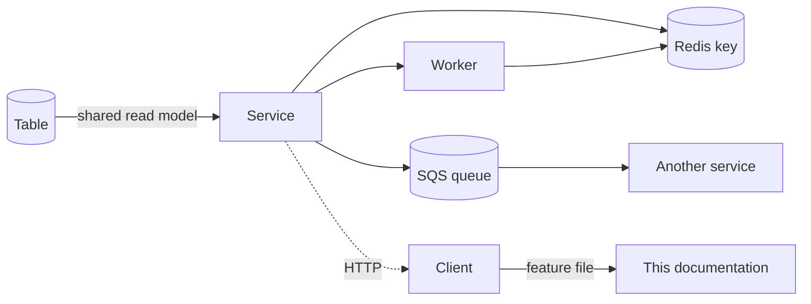

# 03 · কম্পোনেন্ট রিভার্স ইনডেক্স

> **Bangla name:** কম্পোনেন্ট রিভার্স ইনডেক্স
>
> [← সূচিপত্র](README.md) · [ট্রেসেবিলিটি ম্যাট্রিক্স](02-traceability-matrix.md)

ম্যাট্রিক্স ([02](02-traceability-matrix.md)) যায় **ফিচার → কম্পোনেন্ট**। এই পাতা যায় উল্টো দিকে: **কম্পোনেন্ট → ফিচার**। আপনার হাতে যখন একটি table, queue, Redis key, worker বা endpoint আছে এবং কী কী তার উপর নির্ভর করে তা জানতে চান — সেটির নাম বদলানো, বাদ দেওয়া বা তার গঠন বদলানোর আগে — এই পাতাটি ব্যবহার করুন।

## 1. এই পাতা কীভাবে ব্যবহার করবেন

| আপনি যা করতে চলেছেন | দেখুন |
|---|---|
| কোনো table-এর column বদলানো | §3 — আর কারা সেটি map করে |
| কোনো Redis key-এর নাম বদলানো | §4 — কারা সেটি পড়ে |
| কোনো queue-এর message shape বদলানো | §5 — কারা produce এবং consume করে |
| কোনো controller মুছে ফেলা | [91 · এন্ডপয়েন্ট ইনডেক্স](91-appendix-b-endpoint-index.md), তারপর §2 |
| কোনো worker মুছে ফেলা | §6 |

**shared** হিসেবে চিহ্নিত যেকোনো জিনিস একাধিক service map করে। এমন পরিবর্তনই চুপচাপ কিছু ভেঙে দেয়।

## 2. Service → সে কী owned করে

| Service | Owned (এর migration তৈরি করে) | পড়ে (read model) | ফিচার ফাইল |
|---|---|---|---|
| **Admin** | ৩৩টি `DbSet` — master data | — (এটিই master) | [A-01](10-admin-portal/A-01-program-selection.md) … [A-31](10-admin-portal/A-31-general-notices.md) |
| **Booking** | `Capacity`, `SeatReservation`, `EventCapacityAdjustment`, `UserBookingOrder`, `BookedUserRecord` | **১৪টি table** (§3.2) | [P-04](20-user-portal/P-04-seat-selection.md) … [P-08](20-user-portal/P-08-ticket-generation-request.md) |
| **Ticketing** | `Ticket`, `OfflineSoldTicket` | **১৬টি table** (§3.3) | [P-09](20-user-portal/P-09-ticket-details-downloads.md), [P-10](20-user-portal/P-10-oneid-ticket-sync.md), [S-06](50-system-initiated/S-06-booking-status-generated.md) … [S-09](50-system-initiated/S-09-ticket-merge-zip.md) |
| **TicketChecker** | *(কোনোটি নয় — শুধু Redis-এ লেখে)* | `Events`, `TicketCheckerGates`, `TicketCheckerGateUsers`, `BlockLevelEntryGates` | [C-02](40-checker-app/C-02-offline-ticket-download.md), [C-05](40-checker-app/C-05-ticket-sync.md) |
| **UserIssue** | `ReportedIssue`, `ReportedIssueChatMessage` | `Ticket`, `UserBookingOrder` | [P-12](20-user-portal/P-12-issues-chat.md), [U-08](30-user-app/U-08-issues-chat.md) |
| **PushNotification** | `UserDeviceToken` | — | [U-09](30-user-app/U-09-device-token.md), [S-13](50-system-initiated/S-13-device-token-cleanup.md) |
| **Scheduler**, **Utility**, **Platform**, **UserAuth** | কোনোটি নয় | কোনোটি নয় | [S-11](50-system-initiated/S-11-firebase-notification.md) … [S-17](50-system-initiated/S-17-discount-status.md) |

## 3. Table রিভার্স ইনডেক্স

### 3.1 Admin-এর owned table

অন্য কোনো service এগুলো migrate করে না, তবে কয়েকটি অন্য service-ও এগুলো **পড়ে** — সেগুলো চিহ্নিত করা আছে।

| Table | আরও কে পড়ে | কে ব্যবহার করে (ফিচার) |
|---|---|---|
| `Program` | Booking, Ticketing | [A-02](10-admin-portal/A-02-programs.md), [A-07](10-admin-portal/A-07-events.md) |
| `ProgramVenue`, `ProgramVenueDetails` | — | [A-06](10-admin-portal/A-06-program-venue-mapping.md) |
| `ProgramTeam` | Ticketing | [A-04](10-admin-portal/A-04-teams.md) |
| `ProgramSettings` | — | [A-03](10-admin-portal/A-03-program-settings.md) |
| `Venue`, `VenueGallery`, `GalleryBlock`, `BlockLevel` | **Booking, Ticketing** | [A-05](10-admin-portal/A-05-venues.md), [P-04](20-user-portal/P-04-seat-selection.md) |
| `BlockLevelEntryGates` | **TicketChecker** | [A-09](10-admin-portal/A-09-event-level-pricing.md), [C-03](40-checker-app/C-03-qr-scan-validation.md) |
| `BlockLevelMiniGates` | — | [A-09](10-admin-portal/A-09-event-level-pricing.md), [S-12](50-system-initiated/S-12-ticket-generated-notification.md) |
| `Event` | **Booking, Ticketing, TicketChecker** | [A-07](10-admin-portal/A-07-events.md) |
| `EventSettings` | Ticketing | [A-08](10-admin-portal/A-08-event-settings.md) |
| `EventVenueDetails` | **Booking, Ticketing** | [A-09](10-admin-portal/A-09-event-level-pricing.md), [P-03](20-user-portal/P-03-info-pages.md) |
| `EventSegment` | Ticketing | [A-07](10-admin-portal/A-07-events.md), [P-02](20-user-portal/P-02-browse-events.md) |
| `TicketLayoutConfig`, `TicketAttributes` | **Ticketing** | [A-13](10-admin-portal/A-13-ticket-layouts.md), [S-08](50-system-initiated/S-08-ticket-signing.md) |
| `TicketPricing`, `TicketPricingAttribute` | — | [A-14](10-admin-portal/A-14-ticket-pricing-content.md) — **গ্রাহকের pricing page ব্যবহার করে `program-pricing`, এটি নয়** |
| `PromoCode`, `PromoCodeAssign` | **Booking** | [A-15](10-admin-portal/A-15-promo-codes.md), [P-05](20-user-portal/P-05-apply-promo-code.md), [S-16](50-system-initiated/S-16-promo-code-status.md) |
| `Discount`, `DiscountAssign` | **Booking, Ticketing** | [A-16](10-admin-portal/A-16-discounts.md), [U-04](30-user-app/U-04-seat-selection-promo.md), [S-17](50-system-initiated/S-17-discount-status.md) |
| `TicketCheckerGate`, `TicketCheckerGateUser` | **TicketChecker** | [A-18](10-admin-portal/A-18-gate-assignment.md), [C-01](40-checker-app/C-01-assigned-event-gate.md), [S-14](50-system-initiated/S-14-checked-ticket-sync.md) |
| `CheckedTicket` | — | [S-14](50-system-initiated/S-14-checked-ticket-sync.md), [A-19](10-admin-portal/A-19-gate-reports.md) |
| `UserIssue`, `UserIssueChatMessage` | *(Admin-এর কপি — legacy, দেখুন [Appendix A §2.1](90-appendix-a-legacy.md))* | [A-24](10-admin-portal/A-24-user-issues-admin.md) |
| `RaffleDraw` | — | [A-20](10-admin-portal/A-20-raffle-draw.md) |
| `Currency` | **Booking, Ticketing** | [A-09](10-admin-portal/A-09-event-level-pricing.md) |
| `SystemSettings` | — | [X-26](60-cross-cutting/X-26-configuration.md) |
| `LandingPageImage` | Event (public read) | [A-28](10-admin-portal/A-28-media-configuration.md), [P-01](20-user-portal/P-01-home-content.md), [U-02](30-user-app/U-02-home-browse-events.md) |
| `HeaderFooter` | Event (public read) | [A-30](10-admin-portal/A-30-header-footer-social.md), [P-01](20-user-portal/P-01-home-content.md) |
| `GeneralNotice` | *(কেউ পড়ে না)* | [A-31](10-admin-portal/A-31-general-notices.md), [Q-35](99-open-queries.md) |
| `SocialMediaSettings` | *(কেউ পড়ে না — legacy)* | [A-30](10-admin-portal/A-30-header-footer-social.md), [Q-34](99-open-queries.md) |
| `Gallery` | — | [A-28](10-admin-portal/A-28-media-configuration.md) |

### 3.2 Booking-এর owned table

| Table | কে ব্যবহার করে (ফিচার) |
|---|---|
| `Capacity` | [P-04](20-user-portal/P-04-seat-selection.md), [U-04](30-user-app/U-04-seat-selection-promo.md), [S-01](50-system-initiated/S-01-level-capacity-update.md) |
| `SeatReservation` | [A-11](10-admin-portal/A-11-seat-reservation.md), [A-12](10-admin-portal/A-12-reserved-tickets.md), [S-09](50-system-initiated/S-09-ticket-merge-zip.md) |
| `EventCapacityAdjustment` | [A-10](10-admin-portal/A-10-capacity-adjustment.md) |
| `UserBookingOrder` | [P-06](20-user-portal/P-06-booking-payment.md), [P-07](20-user-portal/P-07-my-bookings.md), [P-08](20-user-portal/P-08-ticket-generation-request.md), [S-05](50-system-initiated/S-05-pending-failed-revalidation.md), [A-22](10-admin-portal/A-22-reports.md), [A-23](10-admin-portal/A-23-reconciliation.md) |
| `BookedUserRecord` | Ticketing পড়ে; [X-13](60-cross-cutting/X-13-agent-pool.md) |

### 3.3 Ticketing-এর owned table

| Table | কে ব্যবহার করে (ফিচার) |
|---|---|
| `Ticket` | [P-09](20-user-portal/P-09-ticket-details-downloads.md), [U-06](30-user-app/U-06-my-bookings-tickets.md), [C-03](40-checker-app/C-03-qr-scan-validation.md), [S-06](50-system-initiated/S-06-booking-status-generated.md), [S-08](50-system-initiated/S-08-ticket-signing.md), **UserIssue পড়ে** |
| `OfflineSoldTicket` | [X-13](60-cross-cutting/X-13-agent-pool.md) — **লেখা হয়, কখনো পড়া হয় না** ([Q-07](99-open-queries.md)) |

### 3.4 অন্য service-গুলোর owned table

| Table | মালিক | কে পড়ে | কে ব্যবহার করে |
|---|---|---|---|
| `ReportedIssue`, `ReportedIssueChatMessage` | UserIssue | *(শুধু UserIssue)* | [P-12](20-user-portal/P-12-issues-chat.md), [U-08](30-user-app/U-08-issues-chat.md), [A-24](10-admin-portal/A-24-user-issues-admin.md) |
| `UserDeviceToken` | PushNotification | Scheduler, Admin | [U-09](30-user-app/U-09-device-token.md), [S-13](50-system-initiated/S-13-device-token-cleanup.md) |

### 3.5 shared-table সমস্যা

এই tableগুলো একাধিক service `ExcludeFromMigrations` দিয়ে map করে, তাই **কোনো একক service-ও এদের schema owned করে না**:

```
Discounts · DiscountAssigns · DiscountAssignEvent · DiscountAssignVenueGallery
VenueGalleries · GalleryBlocks · BlockLevels · EventVenueDetails
PromoCodes · PromoCodeAssigns · EventPromoCodeAssign · PromoCodeAssignVenueGallery
Currencies · Events · PromoCodeVenueEventGallery
TicketLayoutConfigs · BookedUserRecords · ProgramTeams · Venues · EventSegments · EventSettings
TicketCheckerGates · TicketCheckerGateUsers · BlockLevelEntryGates
UserBookingOrders
```

**পরিণতি।** Admin-এ কোনো column-এর নাম বদলালে Booking বা Ticketing-এর build fail করবে না — mapping-গুলো read-only view, তাই ভাঙাটা runtime-এ missing column হিসেবে দেখা যায়। এটি প্ল্যাটফর্মের সবচেয়ে বড় schema-change ঝুঁকি, এবং এটি নির্ভর করে সমাধানহীন database-layout প্রশ্নের উপর ([Q-02](99-open-queries.md))।

দেখুন [X-19](60-cross-cutting/X-19-service-to-service.md), [S-17](50-system-initiated/S-17-discount-status.md) এবং [X-24](60-cross-cutting/X-24-activity-logging.md)।

## 4. Redis key রিভার্স ইনডেক্স

| Key | ধরন | কে লেখে | কে পড়ে | ফিচার |
|---|---|---|---|---|
| `level_live:{e}_{g}_{b}_{l}` | hash/string | Booking | Booking, Event | [P-04](20-user-portal/P-04-seat-selection.md), [S-02](50-system-initiated/S-02-event-live-capacity.md), [X-25](60-cross-cutting/X-25-redis.md) |
| `level_live_seats:{e}_{g}_{b}_{l}` | hash/set | Booking | Booking | [P-04](20-user-portal/P-04-seat-selection.md), [U-04](30-user-app/U-04-seat-selection-promo.md) |
| `level_locked:{e}_{g}_{b}_{l}` | hash | Booking | Booking, refresh worker | [P-05](20-user-portal/P-05-apply-promo-code.md), [S-03](50-system-initiated/S-03-locked-capacity-refresh.md), [S-05](50-system-initiated/S-05-pending-failed-revalidation.md) |
| `capacity` | hash | Booking | Booking, Event, Admin | [A-21](10-admin-portal/A-21-dashboard.md), [X-25](60-cross-cutting/X-25-redis.md) |
| `refresh` | set | Booking | Refresh worker — **key mismatch**, দেখুন [Q-10](99-open-queries.md) | [S-03](50-system-initiated/S-03-locked-capacity-refresh.md) |
| `capacity/*`, `capacityAction` | hash | Admin | Booking, Event | [A-10](10-admin-portal/A-10-capacity-adjustment.md) |
| `TicketCheckerLevelGateMap` | hash | Admin | TicketChecker | [A-18](10-admin-portal/A-18-gate-assignment.md), [C-05](40-checker-app/C-05-ticket-sync.md) |
| `ticketCheckerDbSync` | flag | Admin ([S-14](50-system-initiated/S-14-checked-ticket-sync.md)) | TicketChecker | **কোনো expiry নেই** ([Q-17](99-open-queries.md)) |
| Published-content key | hash | Admin | Event | [P-01](20-user-portal/P-01-home-content.md), [A-29](10-admin-portal/A-29-content-editor.md) |
| `signedToken` | string, 60 s | Admin `generate-signed-token` | **backend-এ কিছুই নয়** | [X-20](60-cross-cutting/X-20-file-storage.md), [Q-50](99-open-queries.md) |

Refresh worker-এর distributed lock-এর জন্য **RedLock** ব্যবহৃত হয় — [S-03](50-system-initiated/S-03-locked-capacity-refresh.md), [X-25](60-cross-cutting/X-25-redis.md)।

## 5. Queue রিভার্স ইনডেক্স

| Queue | Message shape | Producer | Consumer | ফিচার |
|---|---|---|---|---|
| `OrderSuccess` | booking order id | Booking | Ticketing `TicketGenerationService` | [S-07](50-system-initiated/S-07-initiate-user-ticket-generation.md) |
| `EventCapacity` | capacity event | Booking | Booking `LevelCapacityUpdateService`, `EventLiveCapacityUpdateService` | [S-01](50-system-initiated/S-01-level-capacity-update.md), [S-02](50-system-initiated/S-02-event-live-capacity.md) |
| `VatChallanProcessing` | order id | Booking | Scheduler `VatChallanProcessingService` | [S-10](50-system-initiated/S-10-vat-challan.md) |
| `TicketSigning` | `TicketSigningPayload` | Ticketing | Ticketing | [S-08](50-system-initiated/S-08-ticket-signing.md) |
| `TicketProcessing` | `TicketProcessingRequest { ReservationId, ProcessingType = Merge\|Zip, GroupId, OrderId }` | Ticketing | Utility `TicketProcessingService` | [S-09](50-system-initiated/S-09-ticket-merge-zip.md) |
| `FirebaseNotification` | `FirebaseNotificationRequest { Title, Body, Data, DeviceTokens, CreatedAt, GroupId, OrderId }` | PushNotification | Scheduler `FirebaseNotificationService` | [S-11](50-system-initiated/S-11-firebase-notification.md) |

**যেকোনো message shape বদলানোর আগে** [Q-09](99-open-queries.md) পড়ুন: কোনো dead-letter queue নেই এবং retry counter কখনো এগোয় না, তাই shape mismatch হলে সেটি দৃশ্যমানভাবে fail না হয়ে চিরকাল retry করে।

## 6. Worker রিভার্স ইনডেক্স

প্রতিটি background worker, তার service এবং তার interval। প্রতিটির বিস্তারিত ব্যাখ্যা [50 · সিস্টেম-ইনিসিয়েটেড](50-system-initiated/README.md)-এ আছে।

| Worker | Service | Interval | ফিচার |
|---|---|---|---|
| `LevelCapacityUpdateService` | Booking | `EventCapacity` message এলে | [S-01](50-system-initiated/S-01-level-capacity-update.md) |
| `EventLiveCapacityUpdateService` | Booking | `EventCapacity` message এলে | [S-02](50-system-initiated/S-02-event-live-capacity.md) |
| `RefreshLockedCapacityService` | Booking | timer + RedLock | [S-03](50-system-initiated/S-03-locked-capacity-refresh.md) |
| `CapacityUpdateService` | Scheduler | timer | [S-04](50-system-initiated/S-04-scheduler-capacity-update.md) |
| `PendingOrFailedBookingStatusUpdateService` | Scheduler | timer (7–10 min) | [S-05](50-system-initiated/S-05-pending-failed-revalidation.md) |
| `BookingStatusUpdateService` | Booking | timer | [S-06](50-system-initiated/S-06-booking-status-generated.md) |
| `InitiateUserTicketGenerationService` | Booking | 15-minute loop — **কিছুই যোগ্য না হলে busy loop** ([Q-12](99-open-queries.md)) | [S-07](50-system-initiated/S-07-initiate-user-ticket-generation.md) |
| `TicketGenerationService` | Ticketing | `OrderSuccess` message এলে | [S-07](50-system-initiated/S-07-initiate-user-ticket-generation.md), [S-08](50-system-initiated/S-08-ticket-signing.md) |
| `TicketProcessingService` | Utility | `TicketProcessing` message এলে | [S-09](50-system-initiated/S-09-ticket-merge-zip.md) |
| `VatChallanProcessingService` | Scheduler | `VatChallanProcessing` message এলে | [S-10](50-system-initiated/S-10-vat-challan.md) |
| `FirebaseNotificationService` | Scheduler | `FirebaseNotification` message এলে | [S-11](50-system-initiated/S-11-firebase-notification.md) |
| `SendNotificationAfterGeneratedTicketService` | Scheduler | timer | [S-12](50-system-initiated/S-12-ticket-generated-notification.md) |
| `DeviceTokenCleanupService` | Scheduler | প্রতিদিন — **404 দিতে পারে** ([Q-16](99-open-queries.md)) | [S-13](50-system-initiated/S-13-device-token-cleanup.md) |
| `CheckedTicketService` | Admin | timer | [S-14](50-system-initiated/S-14-checked-ticket-sync.md) |
| `GateCheckerDownloadStatusCleanupService` | Admin | timer | [S-15](50-system-initiated/S-15-gate-download-status-cleanup.md) |
| `PromoCodeStatusUpdateService` | Admin | timer | [S-16](50-system-initiated/S-16-promo-code-status.md) |
| `SystemDiscountStatusUpdateService` | Admin | timer | [S-17](50-system-initiated/S-17-discount-status.md) |

## 7. Code file রিভার্স ইনডেক্স

নতুন আসা কারযে সবচেয়ে বেশি যেসব file দরকার হতে পারে, role অনুযায়ী।

### 7.1 Backend entry point

| কী | কোথায় |
|---|---|
| Service bootstrap, prefix, auth, DI | `Services/<Name>/ETP.<Name>.Service/Program.cs` |
| Hosted service ও connection string | `Services/<Name>/ETP.<Name>.Service/Configurations/DependencyConfig.cs` |
| Service name (URL prefix) | `Services/<Name>/ETP.<Name>.Service/appsettings.json` → `Application:ServiceName` |
| Shared DI registration | `Configuration(s)/DependencyConfig.cs` |
| Path-prefix convention | `Core/ETP.Core.Web` — `GlobalRoutePrefixConvention` |
| Auth scheme | `Core/ETP.Core.Web` — `AuthScheme.User` / `.Admin` / `.Agent` |

### 7.2 প্রতি service-এর গঠন

প্রতিটি service একই ভাগাভাগি অনুসরণ করে:

| স্তর | কী থাকে |
|---|---|
| `ETP.<Name>.Service/Api/` | Controller — পাতলা, manager-এর কাজ ছাড়ে |
| `ETP.<Name>.Domain/Managers/` | **ব্যবসায়িক লজিক। পড়ার জায়গা এটিই** |
| `ETP.<Name>.Storage/DbContexts/` | `DbContext`, `DbSet`, `ExcludeFromMigrations` |
| `ETP.<Name>.Storage/Migrations/` | Migration — শুধু service-এর owned table-এর জন্য |
| `ETP.<Name>.Client/` | টাইপ করা HTTP client, অন্য service ব্যবহার করে |
| `ETP.<Name>.Integration/` | বাহ্যিক সিস্টেমের client (TSP, DgePay, OneID, SES) |

### 7.3 Client-side entry point

| কী | কোথায় |
|---|---|
| Admin portal route | `rvl-gobcb-admin-portal/src/app/app-routing.module.ts` |
| Admin portal HTTP + interceptor | `…/src/app/core/` (guard, interceptor, service) |
| Admin portal program scope | `…/core/services/program.service.ts` (`localStorage: globalProgramId`) |
| User portal route ও `LanguageGuard` | `rvl-gobcb-user-portal/ETP-Web/src/app/app-routing.module.ts` |
| User portal identity call | `…/core/services/api/identity-api.service.ts` |
| User portal chat | `…/modules/*/…/signalr-chat.service.ts` |
| User app API service | `rvl-gobcb-user-app/data/lib/remote/api_service/` |
| User app `.env` key | `rvl-gobcb-user-app/.env` (`AUTH_API_BASE_URL`, `VDS_*`, `PAYMENT_SUCCESS_URL`, `FIREBASE_*`) |
| Checker app route | `rvl-gobcb-checker-app/lib/presentation/navigation/route_path.dart` |
| Checker app VDS decode | `rvl-gobcb-checker-app/data/lib/service/vds_qr_decoder.dart` |
| Checker app Android crypto | `rvl-gobcb-checker-app/android/…/MainActivity.kt` |
| Checker app iOS ফাঁক | `rvl-gobcb-checker-app/ios/Runner/AppDelegate.swift` (13 লাইন, কোনো channel handler নেই) |
| Checker app database | `rvl-gobcb-checker-app/data/lib/local/drift_database/` |

## 8. কম্পোনেন্ট সম্পর্ক



**নির্ভর করে:** [02 · ট্রেসেবিলিটি ম্যাট্রিক্স](02-traceability-matrix.md)। **প্রভাব ফেলে:** shared table, Redis key বা queue message-এ যেকোনো পরিবর্তন।