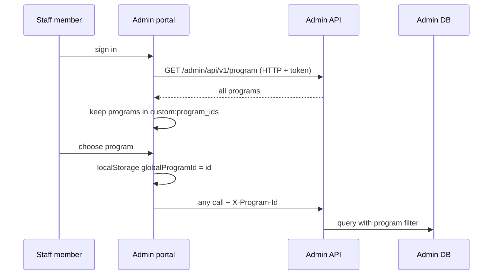

# A-01 · প্রোগ্রাম নির্বাচন ও প্রোগ্রাম-ভিত্তিক মেনু

> **Bangla name:** প্রোগ্রাম নির্বাচন ও প্রোগ্রাম-ভিত্তিক মেনু
>
> [← 10 · অ্যাডমিন পোর্টাল](README.md) · [সূচিপত্র](../README.md) · [ওপেন কোয়ারি](../99-open-queries.md)

## 1. নাম ও উদ্দেশ্য

**প্রোগ্রাম নির্বাচন।** একটি *program* হলো এমন একটি সিরিজ বা টুর্নামেন্ট যা ইভেন্টগুলোকে একত্রে গ্রুপ করে (দেখুন [A-02](A-02-programs.md))। সাইন-ইন করার পর একজন কর্মী টপ বার থেকে একটি program বেছে নেন। এরপর থেকে প্রতিটি অনুরোধে `X-Program-Id` হেডার যায়, পোর্টাল **program মেনু** দেখায় (ড্যাশবোর্ড, events, promo codes, reports, issues, ticket layouts), আর ব্যাকএন্ড program-এর মালিকানাধীন ডেটাকে ওই program-এর মধ্যেই সীমাবদ্ধ রাখে। কোনো program নির্বাচিত না থাকলে (`0`) পোর্টাল **গ্লোবাল মেনু** দেখায় (programs, venues, users, settings, agents, ticket checkers)। ধারণাগুলো: [path-prefix routing](../00-platform-primer.md#explainer-path-prefix-routing); অথরাইজেশনের দিকটি [X-16](../60-cross-cutting/X-16-authz-program-scope.md) ও [X-17](../60-cross-cutting/X-17-authz-client-side.md)-এ।

## 2. ট্রিগার ও অ্যাক্টর

সাইন-ইন করা যেকোনো কর্মী (**admin pool**; রোল `admin`, `event_manager`, `ticket_manager`, `ticket_operator`, `customer_support`, `ticket_operator` (`BCBPersonnel`), [X-15](../60-cross-cutting/X-15-authz-roles.md))। ট্রিগার: লগইনের পর, অথবা টপ বারের ড্রপডাউন, অথবা "Back to global menu"।

## 3. ব্যবসায়িক প্রবাহ

1. লগইনের পর পোর্টাল program-এর তালিকা লোড করে। `admin` নয় এমন একজন user শুধু তার `custom:program_ids` অ্যাট্রিবিউটে তালিকাভুক্ত program-গুলো দেখেন; `admin` সবগুলো দেখেন।
2. যদি এখনো কোনো program বাছাই করা না হয়ে থাকে (`globalProgramId` `0` হয়), একটি মোডাল ব্যবহারকারীকে একটি বেছে নিতে বলে।
3. program বাছাই করলে সেটি ব্রাউজারে সংরক্ষিত হয় এবং ব্যবহারকারী তার রোলের ল্যান্ডিং পেজে চলে যান (যেমন admin-এর জন্য `/` ড্যাশবোর্ড, customer support-এর জন্য `/issues`, event manager-এর জন্য `/events`, ticket manager-এর জন্য `/events/event-ticket`)।
4. "Back to global menu" (নিশ্চিতকরণসহ) program-কে `0`-এ রিসেট করে এবং রোলের গ্লোবাল পেজে ফিরিয়ে নেয় (`/program-management` বা `/home`)।
5. লগ-আউট ও রোল পরিবর্তনেও program `0`-এ রিসেট হয় ([X-03](../60-cross-cutting/X-03-admin-change-password-logout.md), [X-17](../60-cross-cutting/X-17-authz-client-side.md))।

## 4. প্রযুক্তিগত প্রবাহ

1. **[HTTP + user token]** `app.topbar.component.ts`-এর `getPrograms()` → `GET /admin/api/v1/program` (সব program)। **`custom:program_ids` দিয়ে ফিল্টারিং ব্রাউজারেই হয়**, সাইন-ইন করা ব্যবহারকারীর Cognito অ্যাট্রিবিউট ব্যবহার করে।
2. `ProgramService` (`core/services/program.service.ts`) বর্তমান id একটি `BehaviorSubject`-এ এবং `localStorage` key `globalProgramId`-তে রাখে; ডিফল্ট `0`।
3. `ProgramIdInterceptor` 2FA OTP কল (`/admin/login-2fa`) ছাড়া **প্রতিটি** অনুরোধে `X-Program-Id: <id>` যোগ করে। ইন্টারসেপ্টরের ক্রম: Auth, Loader, ProgramId ([X-04](../60-cross-cutting/X-04-admin-session.md))।
4. রুট গার্ড: `ProgramMenuGuard` কেবল তখনই রুট অনুমোদন করে যখন program id 0-এর বেশি, নয়তো `/program-management`-এ রিডাইরেক্ট করে; `LimitedMenuGuard` কেবল তখনই রুট অনুমোদন করে যখন id `0`, নয়তো `/`-এ রিডাইরেক্ট করে ([X-17](../60-cross-cutting/X-17-authz-client-side.md))।
5. **ব্যাকএন্ড:** `ProgramIdMiddleware` `X-Program-Id` (ধনাত্মক পূর্ণসংখ্যা, নয়তো 0) পড়ে `HttpContext.Items["ProgramId"]`-এ রাখে; `ProgramIdAccessor` তা এক্সপোজ করে, আর `AdminDbContext`-এর গ্লোবাল কোয়েরি ফিল্টার program id বহনকারী entity-গুলোকে `ProgramId <= 0 OR match`-এ সীমাবদ্ধ রাখে ([explainer](../00-platform-primer.md#explainer-shared-database), [X-16](../60-cross-cutting/X-16-authz-program-scope.md))। হেডারটি ব্যবহারকারীর `custom:program_ids`-এর সঙ্গে তুলনা করে এমন `[AuthorizeProgram]` অ্যাট্রিবিউট শুধুমাত্র ড্যাশবোর্ড কন্ট্রোলারে প্রয়োগ করা হয়।

## 5. কম্পোনেন্ট

| ধরন | কম্পোনেন্ট |
|---|---|
| ক্লায়েন্ট | অ্যাডমিন পোর্টাল: `layout/app.topbar.component.ts`, `layout/app.menu.component.ts`, `core/services/program.service.ts`, `interceptors/program-id.interceptor.ts`, `core/guard/program-menu.guard.ts`, `core/guard/limited-menu.guard.ts` |
| সার্ভিস | Admin (`ProgramIdMiddleware`, `ProgramIdAccessor`, `AdminDbContext`); অন্য কোনো সার্ভিস হেডারটি পড়ে না (শুধু `Core/.../AdminClient.cs`-এ এর উল্লেখ আছে) |
| AWS | Cognito অ্যাট্রিবিউট `custom:role`, `custom:program_ids` |
| ব্রাউজার স্টোরেজ | `localStorage["globalProgramId"]` |

## 6. API কন্ট্রাক্ট

| মেথড | পাথ | অথ | রিকোয়েস্ট | রেসপন্স |
|---|---|---|---|---|
| GET | `/admin/api/v1/program` | রোল `Admin`, `EventManager`, এবং `ProgramController`-এ তালিকাভুক্ত অন্যরা | none (হেডার `X-Program-Id`) | program-এর তালিকা ([A-02](A-02-programs.md)) |

প্রতিটি কলে রিকোয়েস্ট হেডার: `X-Program-Id: 12` (উদাহরণ মান)। `DashboardController` ছাড়া ([A-21](A-21-dashboard.md)) হেডারটি ব্যবহারকারীর program তালিকার সঙ্গে যাচাই করা হয় না।

## 7. ডেটা ও পার্শ্বপ্রতিক্রিয়া

সার্ভারে কিছু নেই। ব্রাউজারে: `localStorage` এন্ট্রি। নির্বাচিত id program-এর মালিকানাধীন entity-গুলোর সব লিস্ট কোয়েরিকে প্রভাবিত করে।

## 8. কোড রেফারেন্স

| কী | কোথায় |
|---|---|
| Program ড্রপডাউন ও মোডাল | `rvl-gobcb-admin-portal/src/app/layout/app.topbar.component.ts:166-215` |
| "back to global"-এ রিসেট | `rvl-gobcb-admin-portal/src/app/layout/app.menu.component.ts:286-300` |
| Program state | `rvl-gobcb-admin-portal/src/app/core/services/program.service.ts` |
| হেডার ইন্টারসেপ্টর | `rvl-gobcb-admin-portal/src/app/interceptors/program-id.interceptor.ts` |
| গার্ড | `rvl-gobcb-admin-portal/src/app/core/guard/program-menu.guard.ts`, `limited-menu.guard.ts` |
| মিডলওয়্যার | `rvl-gobcb-backend/Services/Admin/ETP.Admin.Service/Middleware/ProgramIdMiddleware.cs` |
| Program তালিকা এন্ডপয়েন্ট | `rvl-gobcb-backend/Services/Admin/ETP.Admin.Service/Api/ProgramController.cs:27` |

## 9. হ্যান্ডওভার নোট

1. **ব্যবহারকারীর program তালিকা শুধু ব্রাউজারে প্রয়োগ হয়** (এবং ড্যাশবোর্ডে)। `GET /program` যেকোনো অনুমোদিত রোলকে সব program ফেরত দেয়, আর ব্যাকএন্ড `X-Program-Id` হেডারে বিশ্বাস করে, তাই একজন কর্মী সাধারণ HTTP ক্লায়েন্ট দিয়ে অন্য program-এর id পাঠিয়ে সেই program-এর ডেটা দেখতে পারেন ([X-16](../60-cross-cutting/X-16-authz-program-scope.md))।
2. **দুটি মেনু, একটি ফ্ল্যাগ।** কোন মেনু দেখাবে তা নির্ভর করে শুধু `globalProgramId` `0` না কি তার উপর, যা `localStorage`-এ থাকে; ব্রাউজার বন্ধ করলেও টিকে থাকে। হাতে এডিট করলে ব্যবহারকারী গার্ড না করে দেওয়া পেজে পৌঁছাতে পারেন, তবে সার্ভারে রোল যাচাই তবুও প্রয়োগ হয়।
3. হেডারটি **সব** সার্ভিসের (Admin, Booking, Ticketing) কলে যোগ হয়, কিন্তু শুধু Admin-এর কোয়েরি ফিল্টার আছে ও সেটিই হেডারটি পড়ে; Booking রিপোর্ট এন্ডপয়েন্টগুলো একটি সুনির্দিষ্ট `programId` query parameter নেয় (দেখুন [A-22](A-22-reports.md))।
4. Customer support ও ticket operator রোলের কোনো program মেনু নেই: তারা `/home` বা `/issues`-এ পড়ে।
5. ইন্টারসেপ্টর কেবল `/admin/login-2fa` বাদ দেয়; AWS Cognito-এর কল Angular `HttpClient` কল নয়, তাই সেগুলোতে হেডার যায় না।

## 10. কম্পোনেন্ট সম্পর্ক

**নির্ভর করে:** অ্যাডমিন লগইন ([X-01](../60-cross-cutting/X-01-admin-login.md)), program সেটআপ ([A-02](A-02-programs.md)), রোল ([X-15](../60-cross-cutting/X-15-authz-roles.md))। **প্রভাব ফেলে:** প্রায় প্রতিটি অ্যাডমিন ফিচার ([A-07](A-07-events.md), [A-15](A-15-promo-codes.md), [A-21](A-21-dashboard.md), [A-22](A-22-reports.md))।

## 11. ডেভেলপার টেস্ট গাইড

**লোকালে টেস্টযোগ্যতা: সম্পূর্ণ।**

| আইটেম | বিবরণ |
|---|---|
| টেস্ট ডেটা ও অ্যাকাউন্ট | `pwsh ./scripts/Seed-EtpData.ps1` program তৈরি করে; অ্যাডমিন ফোন `…01` (OTP stub `123456`, পাসওয়ার্ড `Passw0rd!23`, [X-01](../60-cross-cutting/X-01-admin-login.md)); অন্য seeded অ্যাডমিন `…02` থেকে `…05`-এর রোল আলাদা |
| ব্রাউজার | `http://localhost:4200` → লগইন → টপ বারের program ড্রপডাউন; DevTools → Application → Local Storage `globalProgramId`; Network → যেকোনো রিকোয়েস্ট → হেডার `X-Program-Id` |
| ইমুলেটর | — |
| Postman | `postman/services/etp-admin.postman_collection.json`-এর "GET /api/v1/program" `{{access_token_admin}}` দিয়ে (`base_url`-এ `/admin` প্রিফিক্স নেই, Appendix D দেখুন); ফিল্টারিং পরীক্ষা করতে হেডার `X-Program-Id` যোগ করুন |
| Visual Studio debug | `ProgramIdMiddleware.InvokeAsync` (Admin), তারপর program-scoped entity-র উপর একটি কোয়েরি |
| যাচাই | একটি লিস্ট এন্ডপয়েন্ট (যেমন `GET /events`) `X-Program-Id: 0` দিয়ে এবং আসল id দিয়ে তুলনা করুন; SQL: `select "Id","Name" from etp."Programs"` |
