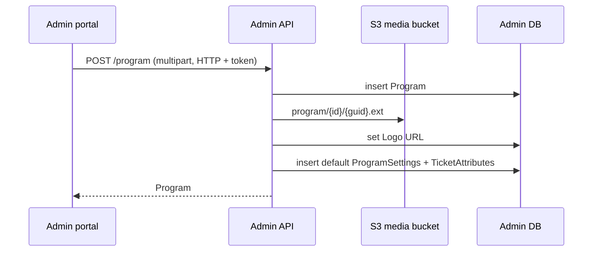

# A-02 · প্রোগ্রাম

> **Bangla name:** প্রোগ্রাম
>
> [← 10 · অ্যাডমিন পোর্টাল](README.md) · [সূচিপত্র](../README.md) · [ওপেন কোয়ারি](../99-open-queries.md)

## 1. নাম ও উদ্দেশ্য

**প্রোগ্রাম।** একটি program হলো ব্যবসার সবচেয়ে উপরের স্তরের কনটেইনার: একটি সিরিজ, টুর্নামেন্ট বা সিজন, যার একটি নাম, সংক্ষিপ্ত নাম, লোগো এবং বৈধতার সময়সীমা থাকে। ভেন্যু ([A-06](A-06-program-venue-mapping.md)), দল ([A-04](A-04-teams.md)), বাণিজ্যিক নিয়ম ([A-03](A-03-program-settings.md)), টিকিট লেআউট ([A-13](A-13-ticket-layouts.md)), ইভেন্ট ([A-07](A-07-events.md)), promo code, discount এবং ব্যবহারকারীদের প্রবেশাধিকার — সবই একটি program-এর উপর নির্ভর করে। অ্যাডমিনরা এখানেই program তৈরি ও সম্পাদনা করেন।

## 2. ট্রিগার ও অ্যাক্টর

অ্যাডমিন পোর্টালে সাইন-ইন করা কর্মী, `ProgramController`-এ অনুমোদিত রোলসহ (`admin`, `event_manager`, `ticket_manager`, `customer_support`, `ticket_operator` (`BCBPersonnel`) পড়তে পারেন; কে লিখতে পারবেন তা §9 দেখুন)। পোর্টালে প্রবেশবিন্দু: মেনু **Prog. Managem.** (`/program-management`, শুধু গ্লোবাল মেনু), তারপর **Create program** (`/program-management/program-create`) বা কোনো program-এর হোম পেজ (`/program-management/program-home/:id`) ট্যাব **Program Update**।

## 3. ব্যবসায়িক প্রবাহ

1. program তালিকা দেখুন (নাম, তারিখ, লোগো)।
2. একটি program তৈরি করুন: নাম (সর্বোচ্চ 100 অক্ষর), সংক্ষিপ্ত নাম, শুরু ও শেষের তারিখ-সময় (শুরু অবশ্যই শেষের আগে হতে হবে), ঐচ্ছিক লোগো।
3. প্ল্যাটফর্ম নতুন program-এর জন্য **ডিফল্ট program settings** ও **ডিফল্ট ticket attributes**-ও তৈরি করে, যাতে program সঙ্গে সঙ্গে ব্যবহার করা যায় ([A-03](A-03-program-settings.md), [A-13](A-13-ticket-layouts.md))।
4. নাম, তারিখ বা লোগো সম্পাদনা করুন। কোনো program মুছে ফেলা যায় কেবল তখনই, যখন তার কোনো ইভেন্ট নেই।

## 4. প্রযুক্তিগত প্রবাহ

1. **[HTTP + user token]** `program-list` কল করে `GET /admin/api/v1/program` (সেটিংস মডিউলের `ProgramsService`-এর মাধ্যমে); হোম পেজ কল করে `GET /admin/api/v1/program/{id}` (ভেন্যু ও settings সহ)।
2. তৈরি: `create-program.component.ts` একটি `FormData` তৈরি করে যাতে থাকে `name`, `shortName`, `startDateTime` (ISO), `endDateTime`, `logo`, এবং পাঠায় `POST /admin/api/v1/program` (`multipart/form-data`)। `ProgramManager.CreateAsync`:
   - `CheckValidation`: নাম আবশ্যক, ≤ 100 অক্ষর, শুরু শেষের আগে;
   - program ইনসার্ট করে; লোগো পাঠানো হলে সেটি S3-তে `program/{programId}/{guid}{ext}` পাথে আপলোড করে এবং URL `{AWS:Bucket:BaseUrl}/{key}` `Logo` হিসেবে সংরক্ষণ করে ([X-20](../60-cross-cutting/X-20-file-storage.md));
   - নির্দিষ্ট ডিফল্টসহ একটি `ProgramSettings` (§7) এবং একটি ডিফল্ট `TicketAttributes` সারি তৈরি করে।
3. আপডেট: `PUT /admin/api/v1/program/{id}` (এটিও multipart); রিপোজিটরি `Name`, `ShortName`, `StartDateTime`, `EndDateTime` কপি করে; নতুন লোগো URL-টি প্রতিস্থাপন করে।
4. মুছে ফেলা: `DELETE /admin/api/v1/program/{id}`। `EventManager.GetEventsByProgramIdIgnoreEndDateAsync` যদি কোনো ইভেন্ট পায়, তাহলে "Cannot delete program. There are N event(s) associated with this program." দিয়ে ব্যর্থ হয়; নয়তো program **সফট-ডিলিট** হয় (`IsDeleted = true`)।
5. program তৈরির পর এবং তালিকা থেকে মুছে ফেলার পর পোর্টাল `programService.notifyProgramsUpdated()` কল করে, যাতে টপ বারের তালিকা রিলোড হয় ([A-01](A-01-program-selection.md))।

## 5. কম্পোনেন্ট

| ধরন | কম্পোনেন্ট |
|---|---|
| ক্লায়েন্ট | `features/program-management/pages/{program-list,create-program,edit-program,program-home}`, `services/program-management.service.ts`; দ্বিতীয় একটি আলাদা, লিঙ্কহীন স্ক্রিন `features/program-settings/pages/program` (রুট `/settings/programs`, §9 দেখুন) |
| সার্ভিস | Admin: `ProgramController`, `ProgramManager`, `ProgramRepository` |
| টেবিল | `Programs`, `ProgramSettings`, `TicketAttributes` |
| স্টোরেজ | S3 media bucket, ফোল্ডার `program/{id}` |
| বাইরে কল | none |

## 6. API কন্ট্রাক্ট

| মেথড | পাথ | অথ | রিকোয়েস্ট | রেসপন্স | প্রধান ত্রুটি |
|---|---|---|---|---|---|
| GET | `/admin/api/v1/program` | রোল Admin, EventManager, TicketManager, CustomerSupportAdmin, BCBPersonnel | none | `Program[]` | 500 |
| GET | `/admin/api/v1/program/{id}` | same | পাথে `id` | ভেন্যু ও settings সহ `Program` | না থাকলে null body |
| POST | `/admin/api/v1/program` | same | `CreateOrUpdateProgram` (multipart) | `Program` | 400 `Name is missing.`, `Name should not be more than 100`, `Start Date Time must be earlier than End Date Time.` |
| PUT | `/admin/api/v1/program/{id}` | same | `CreateOrUpdateProgram` (multipart) | `Program` | উপরের মতো 400, `'{id}' doesn't exist.` |
| DELETE | `/admin/api/v1/program/{id}` | same | পাথ | `Program` | 400 `Cannot delete program. There are N event(s) ...` |

প্রধান নমুনা, `POST /admin/api/v1/program` `multipart/form-data` হিসেবে (ফিল্ডের নাম `CreateOrUpdateProgram` থেকে; মানগুলো উদাহরণ):

```
name=Premier League 2026
shortName=BPL26
startDateTime=2026-12-01T00:00:00.000Z
endDateTime=2027-02-28T00:00:00.000Z
logo=<file>
```

রেসপন্স `Program` (camelCase, enum-এর জন্য সংখ্যা, null-সহ): `id`, `name`, `shortName`, `logo`, `startDateTime`, `endDateTime`, `programVenues[]`, `programSettings[]`।

## 7. ডেটা ও পার্শ্বপ্রতিক্রিয়া

- `Programs` সারি; `Logo` কলামে একটি পূর্ণ URL থাকে।
- ডিফল্ট `ProgramSettings` তৈরি হয় এভাবে: `LimitedAvailabilityThreshold` 60, `AllowableMaximumOrderPerUser` 4, `AllowableMaximumSeatPerOrder` 4, `TicketSellingStartFromHour` 72, `TicketSellingStopFromHour` 1, `TicketAvailableFromHour` 48, `TicketNumberPrefix` `T20`, `Vat` 15 (শতকরা), `ServiceCharge` 0 (শতকরা), VAT inclusive, পেমেন্ট gateway `DgePay`।
- অ্যাক্টিভিটি লগ এন্ট্রি ([X-24](../60-cross-cutting/X-24-activity-logging.md))।

## 8. কোড রেফারেন্স

| কী | কোথায় |
|---|---|
| কন্ট্রোলার | `rvl-gobcb-backend/Services/Admin/ETP.Admin.Service/Api/ProgramController.cs:14-100` |
| ম্যানেজার | `rvl-gobcb-backend/Services/Admin/ETP.Admin.Domain/Managers/ProgramManager.cs:36-198` |
| রিপোজিটরি | `rvl-gobcb-backend/Services/Admin/ETP.Admin.Storage/Repositories/ProgramRepository.cs:25-74` |
| রিকোয়েস্ট মডেল | `rvl-gobcb-backend/Services/Admin/ETP.Admin.Domain/Models/Settings/CreateOrUpdateProgram.cs` |
| পোর্টাল ফর্ম | `rvl-gobcb-admin-portal/src/app/features/program-management/pages/create-program/create-program.component.ts:127-155` |
| পোর্টাল ট্যাব | `rvl-gobcb-admin-portal/src/app/features/program-management/pages/program-home/program-home.component.html:48-62` |

## 9. হ্যান্ডওভার নোট

1. **লিখার প্রবেশাধিকার মেনুর চেয়ে বেশি।** `ProgramController` প্রতিটি অ্যাকশনের জন্য, POST, PUT ও DELETE-ও সহ, উপরের পাঁচটি রোল অনুমোদন করে; পোর্টালে "Prog. Managem." মেনু মূলত admin ও event/ticket রোলদের দেখানো হয় ([X-15](../60-cross-cutting/X-15-authz-roles.md), [X-17](../60-cross-cutting/X-17-authz-client-side.md))। একটি `customer_support` টোকেন API-এর মাধ্যমে program তৈরি বা মুছে ফেলতে পারে।
2. **রিপোজিটরির আপডেট শুধু নাম, সংক্ষিপ্ত নাম ও দুটি তারিখ কপি করে এবং `UpdatedAt` সেট করে না।**
3. **একই ডেটার দুটি স্ক্রিন।** লিঙ্কহীন `/settings` মডিউলের নিজস্ব program, program-teams ও program-venues পেজ আছে এবং একই এন্ডপয়েন্ট ব্যবহার করে; মেনু থেকে কেবল `/program-management` স্ক্রিনগুলোই পৌঁছানো যায় ([A-30](A-30-header-footer-social.md)-এ `/settings`-এ আর কী আছে তার তালিকা দেওয়া আছে)।
4. **মুছে ফেলা সফট, এবং শুধু ইভেন্টই তা আটকায়।** program-এ ম্যাপ করা ভেন্যু, দল, settings, promo code ও discount ডেটাবেসে থেকে যায়, আর `GetAllAsync` program-টিকে লুকিয়ে রাখে। সফট-ডিলিট করা program অন্য সব তালিকা থেকে অদৃশ্য হয় কি না তা এখানে যাচাই করা হয়নি।
5. কন্ট্রোলারে program-এর `Id` একটি `long`, কিন্তু `Program` রেসপন্স মডেলে তা `int`।
6. ডিফল্ট `TicketNumberPrefix` হলো `T20`; যেসব ইভেন্টের settings ওভাররাইড করা নেই, তাদের টিকিটের নম্বর এটি দিয়ে শুরু হয় ([A-08](A-08-event-settings.md), [S-07](../50-system-initiated/S-07-initiate-user-ticket-generation.md))।

## 10. কম্পোনেন্ট সম্পর্ক



**নির্ভর করে:** অ্যাডমিন লগইন ও রোল ([X-01](../60-cross-cutting/X-01-admin-login.md), [X-15](../60-cross-cutting/X-15-authz-roles.md))। **প্রভাব ফেলে:** program-স্কোপড সবকিছু: [A-03](A-03-program-settings.md), [A-04](A-04-teams.md), [A-06](A-06-program-venue-mapping.md), [A-07](A-07-events.md), [A-13](A-13-ticket-layouts.md), [A-15](A-15-promo-codes.md), [A-16](A-16-discounts.md), [A-25](A-25-admin-users.md) (ব্যবহারকারীদের program বরাদ্দ করা হয়)।

## 11. ডেভেলপার টেস্ট গাইড

**লোকালে টেস্টযোগ্যতা: সম্পূর্ণ** (S3 হলো Floci)।

| আইটেম | বিবরণ |
|---|---|
| টেস্ট ডেটা ও অ্যাকাউন্ট | `pwsh ./scripts/Seed-EtpData.ps1` (program আগে থেকেই আছে); অ্যাডমিন `…01` ([X-01](../60-cross-cutting/X-01-admin-login.md)) |
| ব্রাউজার | `http://localhost:4200` → গ্লোবাল মেনু **Prog. Managem.** → তৈরি; Network: `POST .../admin/api/v1/program` multipart; হেডার `X-Program-Id: 0` |
| ইমুলেটর | — |
| Postman | `postman/services/etp-admin.postman_collection.json`: "GET /api/v1/program", "POST /api/v1/program" (form-data), "PUT /api/v1/program/{id}", "DELETE /api/v1/program/{id}" `{{access_token_admin}}` দিয়ে |
| Visual Studio debug | `ProgramManager.CreateAsync`, `ProgramManager.CheckValidation`, `ProgramRepository.DeleteByIdAsync` |
| যাচাই | SQL: `select "Id","Name","Logo","IsDeleted" from etp."Programs"`; `aws --endpoint-url http://localhost:4566 s3 ls s3://etp-local/program/ --recursive` |
