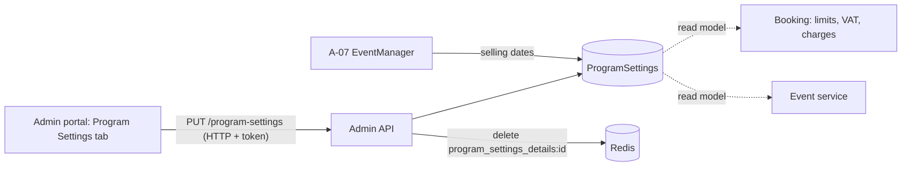

# A-03 · প্রোগ্রাম সেটিংস

> **Bangla name:** প্রোগ্রাম সেটিংস
>
> [← 10 · অ্যাডমিন পোর্টাল](README.md) · [সূচিপত্র](../README.md) · [ওপেন কোয়ারি](../99-open-queries.md)

## 1. নাম ও উদ্দেশ্য

**প্রোগ্রাম সেটিংস।** একটি program-এর বাণিজ্যিক নিয়ম: একজন গ্রাহক কতগুলো অর্ডার ও আসন কিনতে পারবেন, কোনো ইভেন্টের সাপেক্ষে বিক্রি কখন খুলবে ও বন্ধ হবে, টিকিট জেনারেশন কখন খুলবে, টিকিট-নম্বরের প্রিফিক্স, VAT, সার্ভিস চার্জ এবং পেমেন্ট gateway। এগুলো program-এর প্রতিটি ইভেন্টের ডিফল্ট; একটি ইভেন্ট এগুলো ওভাররাইড করতে পারে ([A-08](A-08-event-settings.md))।

## 2. ট্রিগার ও অ্যাক্টর

রোল `admin` বা `event_manager`-এর কর্মী (কন্ট্রোলার কেবল এই দুটিকেই অনুমোদন করে)। প্রবেশবিন্দু: **Prog. Managem.** → একটি program → ট্যাব **Program Settings** (`/program-management/program-home/:id`)।

## 3. ব্যবসায়িক প্রবাহ

অ্যাডমিন একটি program বেছে নেন, মান বদলান এবং **Update** চাপেন। ফর্মের নিয়মগুলো: প্রতি ইভেন্টে প্রতি গ্রাহকের সর্বোচ্চ অর্ডার; প্রতি অর্ডারে সর্বোচ্চ আসন; "ticket selling start from" (ইভেন্ট শুরুর কত ঘণ্টা আগে); "ticket selling stop from" (ইভেন্ট **শেষ** হওয়ার কত ঘণ্টা আগে); "ticket available from" (ইভেন্ট শুরুর কত ঘণ্টা আগে, যখন টিকিট জেনারেট করা যায়, [S-07](../50-system-initiated/S-07-initiate-user-ticket-generation.md)); limited-availability থ্রেশহোল্ড; টিকিট-নম্বরের প্রিফিক্স; পেমেন্ট gateway (DgePay বা SSLCommerz); VAT ও সার্ভিস চার্জ (পরিমাণ বা শতকরা); VAT inclusive।

## 4. প্রযুক্তিগত প্রবাহ

1. **[HTTP + user token]** ট্যাবটি `GET /admin/api/v1/program-settings/{programId}` লোড করে ফর্ম পূরণ করে; program ড্রপডাউন আসে `GET /admin/api/v1/program` থেকে।
2. **[HTTP + user token]** **Update** পুরো `ProgramSettings` object (JSON body) নিয়ে `PUT /admin/api/v1/program-settings` পাঠায়।
3. `ProgramSettingsManager.UpdateAsync` `ProgramId` দিয়ে সারিটি লোড করে (না থাকলে "No program settings found"), ঘণ্টা, সীমা, প্রিফিক্স, থ্রেশহোল্ড, VAT-inclusive ফ্ল্যাগ ও gateway কপি করে; এরপর, যদি **program-এর কোনো ইভেন্ট প্রকাশিত হয়ে থাকে**, তাহলে VAT-এর মান/শতকরা ফ্ল্যাগ বা সার্ভিস চার্জের মান/শতকরা ফ্ল্যাগ বদলাতে "Cannot update VAT and Service Charge while events are published." দিয়ে বাধা দেয়; নয়তে VAT ও সার্ভিস চার্জও কপি করে। এটি সেভ করে এবং Redis key `program_settings_details:{programId}` মুছে ফেলে, যাতে পরের পড়ায় সেটি নতুন করে তৈরি হয় ([X-25](../60-cross-cutting/X-25-redis.md))।
4. মানগুলো কোথায় ব্যবহৃত হয়: **ইভেন্ট তৈরির সময় program settings ইভেন্টের নিজস্ব settings-এ কপি হয়** ([A-07](A-07-events.md))। একটি ইভেন্ট পড়ার সময় `EventManager` হিসাব করে `TicketSellingStartDateTime = ইভেন্ট শুরু − TicketSellingStartFromHour`, `TicketSellingStopDateTime = ইভেন্ট **শেষ** − TicketSellingStopFromHour` এবং `TicketAvailabilityStartDateTime = ইভেন্ট শুরু − TicketAvailableFromHour`, ইভেন্টের নিজস্ব settings থাকলে সেখান থেকে, না থাকলে program settings থেকে ([A-08](A-08-event-settings.md))। Booking অর্ডারের সময় সীমা ও চার্জ পড়ে ([P-06](../20-user-portal/P-06-booking-payment.md))।

## 5. কম্পোনেন্ট

| ধরন | কম্পোনেন্ট |
|---|---|
| ক্লায়েন্ট | `features/program-management/components/program-settings/*`, `services/program-settings.service.ts` (দ্বিতীয় একটি কপি লিঙ্কহীন `features/program-settings` মডিউলে আছে) |
| সার্ভিস | Admin: `ProgramSettingsController`, `ProgramSettingsManager`; Booking ও Event একই টেবিল read model হিসেবে পড়ে |
| টেবিল | `ProgramSettings` |
| Redis | `program_settings_details:{programId}` (ক্যাশ, আপডেটে মুছে যায়) |

## 6. API কন্ট্রাক্ট

| মেথড | পাথ | অথ | রিকোয়েস্ট | রেসপন্স | প্রধান ত্রুটি |
|---|---|---|---|---|---|
| GET | `/admin/api/v1/program-settings` | `Admin`, `EventManager` | none | `ProgramSettings[]` | |
| GET | `/admin/api/v1/program-settings/{programId}` | same | পাথ | `ProgramSettings` | |
| PUT | `/admin/api/v1/program-settings` | same | `ProgramSettings` | `ProgramSettings` | 400 `No program settings found`, `Cannot update VAT and Service Charge while events are published.` |

প্রধান নমুনা, `PUT`-এর body (প্রপার্টির নাম `ProgramSettings` থেকে; দেখানো মানগুলো [A-02](A-02-programs.md)-এর তৈরি-ডিফল্ট):

```json
{
  "id": 7,
  "programId": 12,
  "limitedAvailabilityThreshold": 60,
  "allowableMaximumOrderPerUser": 4,
  "allowableMaximumSeatPerOrder": 4,
  "ticketSellingStartFromHour": 72,
  "ticketSellingStopFromHour": 1,
  "ticketAvailableFromHour": 48,
  "ticketNumberPrefix": "T20",
  "vat": 15,
  "isVatPercentage": true,
  "serviceCharge": 0,
  "isServiceChargePercentage": true,
  "isVatInclusive": true,
  "paymentGateway": 1
}
```

`paymentGateway`: `1` = DgePay, `2` = SSLCommerz (Admin সার্ভিস নাম নয়, সংখ্যা পাঠায়)।

## 7. ডেটা ও পার্শ্বপ্রতিক্রিয়া

`ProgramSettings` সারি আপডেট হয়; ক্যাশ key মুছে যায়; অ্যাক্টিভিটি লগ এন্ট্রি তৈরি হয়। বিদ্যমান ইভেন্টগুলো **পরিবর্তন হয় না** (তারা settings-এর নিজস্ব কপি ধরে রাখে)।

## 8. কোড রেফারেন্স

| কী | কোথায় |
|---|---|
| কন্ট্রোলার | `rvl-gobcb-backend/Services/Admin/ETP.Admin.Service/Api/ProgramSettingsController.cs:14-62` |
| ম্যানেজার | `rvl-gobcb-backend/Services/Admin/ETP.Admin.Domain/Managers/ProgramSettingsManager.cs:58-125` |
| মডেল | `rvl-gobcb-backend/Services/Admin/ETP.Admin.Domain/Models/Settings/ProgramSettings.cs` |
| তারিখ হিসাব | `rvl-gobcb-backend/Services/Admin/ETP.Admin.Domain/Managers/EventManager.cs:96-136, 185-186` |
| পোর্টাল ফর্ম | `rvl-gobcb-admin-portal/src/app/features/program-management/components/program-settings/program-settings.component.html` |

## 9. হ্যান্ডওভার নোট

1. **সেটিংস কপি হয়, রেফারেন্স হয় না।** পোর্টাল দিয়ে তৈরি প্রতিটি ইভেন্ট তৈরির সময় নিজস্ব `EventSettings` সারি পায়, তাই program settings বদলালে কেবল এরপর তৈরি ইভেন্টগুলো প্রভাবিত হয়; বিদ্যমান কোনো ইভেন্ট বদলাতে [A-08](A-08-event-settings.md) ব্যবহার করুন।
2. **VAT লক শুধু program-এর *প্রকাশিত* ইভেন্টগুলো দেখে**; একটি খসড়া ইভেন্ট পুনরায় সেভ না হওয়া পর্যন্ত পুরনো মান ধরে রাখে, এবং এই নিয়ম ইতিমধ্যে দেওয়া অর্ডারগুলোকে রক্ষা করে না।
3. **টিকিট-বিক্রির শেষ মাপা হয় ইভেন্টের শেষ থেকে** (`EndDateTime`), যেখানে শুরু মাপা হয় ইভেন্ট শুরু থেকে; শেষের তারিখ না থাকা ইভেন্ট `EventManager`-এ ব্যর্থ হবে (`entity.EndDateTime.Value`)।
4. **`TicketNumberPrefix` যেকোনো সময় সম্পাদনা করা যায়**; নতুন টিকিট ইভেন্টের settings-এর প্রিফিক্স ব্যবহার করে ([S-07](../50-system-initiated/S-07-initiate-user-ticket-generation.md)), তাই মাঝে পরিবর্তন হলে একটি ইভেন্টের টিকিটে দুটি প্রিফিক্স থাকতে পারে।
5. পেমেন্ট gateway JSON-এ একটি enum সংখ্যা; `SSLCommerz` ফর্মে সমর্থিত, কিন্তু তার callback নিষ্ক্রিয় ([Appendix A](../90-appendix-a-legacy.md)); BS23 অন্য কিছু নিশ্চিত না করলে `DgePay` বেছে নিন `[UNCONFIRMED: Q-19]`।

## 10. কম্পোনেন্ট সম্পর্ক



**নির্ভর করে:** [A-02](A-02-programs.md)। **প্রভাব ফেলে:** [A-07](A-07-events.md), [A-08](A-08-event-settings.md), [P-04](../20-user-portal/P-04-seat-selection.md), [P-06](../20-user-portal/P-06-booking-payment.md), [S-07](../50-system-initiated/S-07-initiate-user-ticket-generation.md), [S-10](../50-system-initiated/S-10-vat-challan.md)।

## 11. ডেভেলপার টেস্ট গাইড

**লোকালে টেস্টযোগ্যতা: সম্পূর্ণ।**

| আইটেম | বিবরণ |
|---|---|
| টেস্ট ডেটা ও অ্যাকাউন্ট | `pwsh ./scripts/Seed-EtpData.ps1`; অ্যাডমিন `…01` বা একটি `event_manager` লগইন (`…02` থেকে `…05`, [X-01](../60-cross-cutting/X-01-admin-login.md)) |
| ব্রাউজার | `http://localhost:4200` → **Prog. Managem.** → program → **Program Settings**; Network: `PUT .../admin/api/v1/program-settings` |
| ইমুলেটর | — |
| Postman | `postman/services/etp-admin.postman_collection.json`: "GET /api/v1/program-settings/{programId}", "PUT /api/v1/program-settings" |
| Visual Studio debug | `ProgramSettingsManager.UpdateAsync` ("published events" শাখাটি দেখুন) |
| যাচাই | SQL: `select * from etp."ProgramSettings" where "ProgramId" = <id>`; আপডেটের পর `redis-cli GET program_settings_details:<id>` nil ফেরত দেয় |
