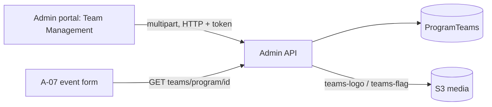

# A-04 · দল (টিম)

> **Bangla name:** টিম
>
> [← 10 · অ্যাডমিন পোর্টাল](README.md) · [সূচিপত্র](../README.md) · [ওপেন কোয়ারি](../99-open-queries.md)

## 1. নাম ও উদ্দেশ্য

**দল (টিম)।** যেসব দল (ক্রিকেট সাইড) একটি program-এর ইভেন্টগুলোতে খেলে, প্রতিটির একটি নাম, সংক্ষিপ্ত নাম, লোগো এবং ঐচ্ছিক flag থাকে। ইভেন্টগুলো এই তালিকা থেকেই তাদের দল বাছে ([A-07](A-07-events.md)), আর গ্রাহক-মুখী পেজগুলো লোগো ও flag দেখায় ([P-02](../20-user-portal/P-02-browse-events.md))।

## 2. ট্রিগার ও অ্যাক্টর

রোল `admin` বা `event_manager`-এর কর্মী (`TeamsController`)। প্রবেশবিন্দু: **Prog. Managem.** → একটি program → ট্যাব **Team Management** (`/program-management/program-home/:id`), তারপর তৈরি বা সম্পাদনা (`/program-management/create/:programId`, `/program-management/edit/:id`)।

## 3. ব্যবসায়িক প্রবাহ

একটি program-এর দলগুলো তালিকাভুক্ত করুন, নাম, সংক্ষিপ্ত নাম, লোগো ও flag ছবি দিয়ে একটি দল যোগ করুন, সম্পাদনা করুন, সক্রিয় বা নিষ্ক্রিয় করুন, অথবা মুছে ফেলুন। program-এর কোনো প্রকাশিত বা ইতিমধ্যে শেষ হয়ে গেছে এমন ইভেন্ট থাকলে দলটি সম্পাদনা করা যায় না।

## 4. প্রযুক্তিগত প্রবাহ

1. **[HTTP + user token]** তালিকা: `GET /admin/api/v1/teams/program/{programId}` (ট্যাব) বা `GET /admin/api/v1/teams?{search, sort, paging}` (পেজযুক্ত); একটি দল: `GET /admin/api/v1/teams/{id}`।
2. তৈরি: `programId`, `name`, `shortName`, `logo`, `flag`, `isFlag`, `isActive` সহ `multipart/form-data` হিসেবে `POST /admin/api/v1/teams`। `ProgramTeamManager.CreateAsync` নাম যাচাই করে (আবশ্যক, সর্বোচ্চ 100 অক্ষর), ইনসার্ট করে, লোগো `teams-logo/{id}/{guid}{ext}` পাথে ও flag `teams-flag/{id}/{guid}{ext}` পাথে আপলোড করে, এবং URL `{AWS:Bucket:BaseUrl}/{key}` `Logo` ও `Flag`-এ সংরক্ষণ করে ([X-20](../60-cross-cutting/X-20-file-storage.md))।
3. আপডেট: `PUT /admin/api/v1/teams/{id}` (multipart)। `CheckValidationForUpdate` অতিরিক্তভাবে program-এর সব ইভেন্ট লোড করে (`GetEventsByProgramIdIgnoreEndDateAsync`) এবং কোনোটি প্রকাশিত বা শেষ হয়ে গেলে "Program team cannot be edited because one or more events are published or expired." ছুঁড়ে দেয়।
4. টগল: `PUT /admin/api/v1/teams/toggle-status/{id}` `IsActive` উল্টে দেয়।
5. মুছে ফেলা: `DELETE /admin/api/v1/teams/{id}`: একটি **সফট ডিলিট** (`IsDeleted = true`)।
6. এডিট ফর্ম চালু করার আগে পোর্টাল `GET /admin/api/v1/events/programs/{programId}/events/no-end-date-check` যাচাই করে (`teams-management.service.ts`)।

## 5. কম্পোনেন্ট

| ধরন | কম্পোনেন্ট |
|---|---|
| ক্লায়েন্ট | `features/program-management/components/{teams-list,create-teams}`, `services/teams-management.service.ts`; লিঙ্কহীন `features/program-settings/pages/program-teams`-এ কপি |
| সার্ভিস | Admin: `TeamsController`, `ProgramTeamManager`, `TeamRepository` |
| টেবিল | `ProgramTeams` (Admin entity `ProgramTeam`) |
| স্টোরেজ | S3 media: `teams-logo/{id}`, `teams-flag/{id}` |

## 6. API কন্ট্রাক্ট

| মেথড | পাথ | অথ | রিকোয়েস্ট | রেসপন্স | প্রধান ত্রুটি |
|---|---|---|---|---|---|
| GET | `/admin/api/v1/teams/program/{programId}` | `Admin`, `EventManager` | পাথ | `ProgramTeam[]` | |
| GET | `/admin/api/v1/teams` | same | query (search, sort, paging) | পেজযুক্ত `ProgramTeam` | |
| GET | `/admin/api/v1/teams/{id}` | same | পাথ | `ProgramTeam` | |
| POST | `/admin/api/v1/teams` | same | `CreateOrUpdateProgramTeam` (multipart) | `ProgramTeam` | 400 `Name is missing.`, `Name should not be more than 100` |
| PUT | `/admin/api/v1/teams/{id}` | same | `CreateOrUpdateProgramTeam` (multipart) | `ProgramTeam` | উপরের মতো 400; 500 `Program team cannot be edited because one or more events are published or expired.` |
| PUT | `/admin/api/v1/teams/toggle-status/{id}` | same | পাথ | `ProgramTeam` | 400 `Invalid event ID.`, `Team with ID {id} not found.` |
| DELETE | `/admin/api/v1/teams/{id}` | same | পাথ | `ProgramTeam` | 400 `'{id}' doesn't exist.` |

প্রধান নমুনা, `POST /admin/api/v1/teams` multipart (ফিল্ডের নাম `CreateOrUpdateProgramTeam` থেকে; মানগুলো উদাহরণবিশেষ):

```
programId=12
name=Dhaka Dynamites
shortName=DD
isActive=true
isFlag=false
logo=<file>
flag=<file>
```

## 7. ডেটা ও পার্শ্বপ্রতিক্রিয়া

`Logo` ও `Flag` URL-সহ একটি `ProgramTeams` সারি; দুটি S3 ফোল্ডার; অ্যাক্টিভিটি লগ এন্ট্রি ([X-24](../60-cross-cutting/X-24-activity-logging.md))।

## 8. কোড রেফারেন্স

| কী | কোথায় |
|---|---|
| কন্ট্রোলার | `rvl-gobcb-backend/Services/Admin/ETP.Admin.Service/Api/TeamsController.cs:28-140` |
| ম্যানেজার | `rvl-gobcb-backend/Services/Admin/ETP.Admin.Domain/Managers/ProgramTeamManager.cs:41-260` |
| রিপোজিটরি | `rvl-gobcb-backend/Services/Admin/ETP.Admin.Storage/Repositories/TeamRepository.cs:111-121` |
| পোর্টাল সার্ভিস | `rvl-gobcb-admin-portal/src/app/features/program-management/services/teams-management.service.ts:24-47` |

## 9. হ্যান্ডওভার নোট

1. **এডিট লক খুবই মোটা।** যেকোনো প্রকাশিত বা শেষ হয়ে যাওয়া ইভেন্ট থাকা একটি program-এর দলকে একেবারেই সম্পাদনা করা যায় না (সংক্ষিপ্ত নামের বানানভুলও নয়); আপডেটের সময় লোগো ও flag আপলোডের ক্ষেত্রেও একই বিষয়। তৈরিতে কোনো বাধা নেই।
2. **মুছে ফেলায় ব্যবহারের যাচাই নেই।** ইতিমধ্যে কোনো ইভেন্টে ব্যবহৃত দলকে সফট-ডিলিট করা যায়; ইভেন্ট পেজগুলোতে তা এখনও দেখা যাবে কি না তা ব্যবহৃত কোয়েরির উপর নির্ভর করে `[UNCONFIRMED: Q-20]`।
3. **টগলের ত্রুটির বার্তায় "Invalid event ID." লেখা** (কপি-পেস্ট); এটি আসলে দলের id-কেই বোঝায়।
4. **`isFlag`** দলের উপর সংরক্ষিত হয় (রিপোজিটরি কপি করে), কিন্তু ম্যানেজার flag আপলোড করবে কি না তা শুধু `flag` ফাইলের উপস্থিতি দেখে সিদ্ধান্ত নেয়; Admin সার্ভিসে অন্য কোথাও `IsFlag` পড়া হয় না।
5. **আপডেট ভ্যালিডেশন রিকোয়েস্ট বডির `ProgramId`** ব্যবহার করে, সংরক্ষিত দলেরটি নয়, তাই অন্য program-এর id উল্লেখ করা একটি রিকোয়েস্ট সেই program-এর ইভেন্টগুলোর বিপরীতে যাচাই হয়।

## 10. কম্পোনেন্ট সম্পর্ক



**নির্ভর করে:** [A-02](A-02-programs.md)। **প্রভাব ফেলে:** [A-07](A-07-events.md), ইউজার পোর্টাল ও অ্যাপের ইভেন্ট পেজগুলো ([P-02](../20-user-portal/P-02-browse-events.md), [U-02](../30-user-app/U-02-home-browse-events.md))।

## 11. ডেভেলপার টেস্ট গাইড

**লোকালে টেস্টযোগ্যতা: সম্পূর্ণ।**

| আইটেম | বিবরণ |
|---|---|
| টেস্ট ডেটা ও অ্যাকাউন্ট | `pwsh ./scripts/Seed-EtpData.ps1`; অ্যাডমিন `…01` |
| ব্রাউজার | `http://localhost:4200` → **Prog. Managem.** → program → **Team Management** → যোগ; Network: multipart `POST .../admin/api/v1/teams` |
| ইমুলেটর | — |
| Postman | `postman/services/etp-admin.postman_collection.json`: "GET /api/v1/teams/program/{programId}", "POST /api/v1/teams" (form-data) |
| Visual Studio debug | `ProgramTeamManager.CreateAsync`, `CheckValidationForUpdate` |
| যাচাই | SQL: `select "Id","Name","Logo","Flag","IsActive","IsDeleted" from etp."ProgramTeams"`; `aws --endpoint-url http://localhost:4566 s3 ls s3://etp-local/teams-logo/ --recursive` |
