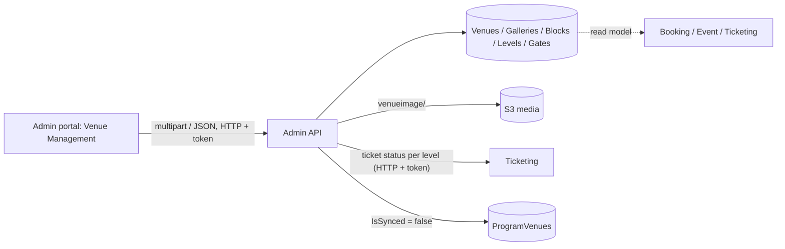

# A-05 · ভেন্যু ও স্টেডিয়াম লেআউট

> **Bangla name:** ভেন্যু ও স্টেডিয়াম লেআউট
>
> [← 10 · অ্যাডমিন পোর্টাল](README.md) · [সূচিপত্র](../README.md) · [ওপেন কোয়ারি](../99-open-queries.md)

## 1. নাম ও উদ্দেশ্য

**ভেন্যু।** একটি venue হলো একটি স্টেডিয়াম বা প্রদর্শনী হল। এর বসার ব্যবস্থা একটি ট্রি হিসেবে মডেল করা: **venue → gallery → block → level**, প্রতিটি নোড একটি SVG ম্যাপ ছবির id (`SvgKey`)-এর সঙ্গে যুক্ত, যাতে seat-নির্বাচন স্ক্রিন ছবির সঠিক অংশ রঙ করতে পারে। level-এর উপর থাকে বসার ধারণক্ষমতা এবং ঐচ্ছিক আসনের লেবেল; **entry gate** ও **mini gate** level-এর সঙ্গে যুক্ত থাকে এবং টিকিটে ও চেকার অ্যাপে দেখা যায়। ধারণাগুলো: [shared database](../00-platform-primer.md#explainer-shared-database) (Booking, Ticketing ও Event এই টেবিলগুলো read model হিসেবে পড়ে)।

## 2. ট্রিগার ও অ্যাক্টর

রোল `admin` বা `event_manager`-এর কর্মী (`VenuesController`)। প্রবেশবিন্দু: গ্লোবাল মেনু **Venue Management** (`/venue-management`, শুধু গ্লোবাল মেনু): তালিকা, **Create venue** (`/venue-management/create-venue`), **Update venue** (`/update-venue/:venueId`), **Stadium layout** (`/stadium-layout/:venueId`), **Exhibition layout** (`/exhibition-layout/:venueId`), **Gallery details** (`/gallery-details/:venueId`)।

## 3. ব্যবসায়িক প্রবাহ

1. venue তৈরি করুন: ধরন (`Stadium` বা `ExhibitionHall`), নাম, সংক্ষিপ্ত নাম, অবস্থান, SVG ম্যাপ ছবি এবং SVG id-এর তালিকা।
2. লেআউট তৈরি বা সম্পাদনা করুন: gallery, gallery-র ভেতরে block, block-এর ভেতরে level, প্রতিটিতে নাম, SVG key, বসার ধারণক্ষমতা, sellable/active ফ্ল্যাগ এবং (বসার থাকা level-এর জন্য) আসনের তালিকা।
3. level-এর সঙ্গে entry gate ও mini gate যুক্ত করুন।
4. লেআউট বদলানোর পর program-venue ডিটেইলস পুনরায় তৈরি করতে হয় ([A-06](A-06-program-venue-mapping.md)), আর চলমান কোনো ইভেন্টের ওই নোডে টিকিট থাকলে পরিবর্তন প্রত্যাখ্যান করা হয়।

## 4. প্রযুক্তিগত প্রবাহ

1. **[HTTP + user token]** তালিকা `GET /admin/api/v1/venues?pageOffset&pageSize`; পুরো ট্রি-সহ একটি venue `GET /admin/api/v1/venues/venue?venueId=`; gallery, block ও level `GET .../venues/gallery`, `galleryBlocks`, `blockLevel`।
2. তৈরি `POST /admin/api/v1/venues` (`multipart/form-data`): `VenueManager.CreateAsync` venue ইনসার্ট করে, তারপর **`UploadSvgKeys`** প্রতিটি SVG id-কে `_` দিয়ে ভাগ করে স্বয়ংক্রিয়ভাবে ট্রি তৈরি করে: `A_1_2` থেকে gallery `A`, block `A_1` ও level `A_1_2` হয়; `A_1` থেকে gallery `A` হয় এবং block ও level দুটোই key `A_1`; `A` থেকে gallery, block ও level তিনটিই key `A` (সব ফ্ল্যাগ `IsActive`, `IsSeatMapped`, `IsSellable` true, ধারণক্ষমতা 0)। SVG ম্যাপ ফাইল `venueimage/{venueId}/venue-svgimage-{id}-{guid}{ext}` পাথে আপলোড হয় এবং URL `SvgMapImage`-এ সংরক্ষিত হয়; আগে পুরনো ছবিটি মুছে ফেলা হয় ([X-20](../60-cross-cutting/X-20-file-storage.md))।
3. আপডেট `PUT /admin/api/v1/venues/venue/{venueId}` (multipart): ধরন, নাম, সংক্ষিপ্ত নাম বা অবস্থান বদলালে venue-এর প্রতিটি level `IsValidForUpdateAsync` দিয়ে যাচাই করা হয়, যা venue-এ একটি **চলমান ইভেন্ট** থাকলে এবং ওই level-এর কোনো টিকিট `Requested` বা `Generated` হলে বাধা দেয় ("This venue is currently being used. You cannot update that information.")। নতুন SVG key মার্জ করা হয় (`UpdateSvgKeys`) এবং **venue-এর সব program-venue ডিটেইলস আনসিঙ্কড চিহ্নিত হয়** (`IsSynced = false`)।
4. লেআউট `POST /admin/api/v1/venues/venueLayout` (JSON `CreateOrUpdateVenueLayout`: `venueId`, `venueGalleries[]` তার ভেতরে `galleryBlocks[]` তার ভেতরে `blockLevels[]`): এক কলেই তৈরি বা আপডেট করে। বিদ্যমান কোনো gallery, block বা level-এর SVG key বা নাম বদলানো একই চলমান-ইভেন্ট নিয়মে "This gallery/block/level is currently being used. You cannot update that information." দিয়ে প্রত্যাখ্যাত হয়; শেষে সব program-venue ডিটেইলস আনসিঙ্কড চিহ্নিত হয়।
5. গেট `GET/POST /admin/api/v1/venues/entry-gate` এবং `mini-gate` (`blockLevelId`): `CreateOrUpdateEntryGateAsync` একটি তালিকা নেয়, খালি তালিকা ও ডুপ্লিকেট নাম প্রত্যাখ্যান করে, বিদ্যমান gate-এর `IsActive` আপডেট করে এবং level-এর নতুনগুলো যোগ করে।
6. "চলমান ইভেন্ট" (`CheckVenueHasRunningEventsAsync`, এছাড়া `GET /venues/has-running-events/{venueId}`): venue-এ এমন একটি ইভেন্ট আছে যা প্রকাশিত, যার টিকিট-বিক্রির শুরু (ইভেন্ট শুরু থেকে ইভেন্ট settings-এর `TicketSellingStartFromHour` বাদ দিলে) পেরিয়েছে এবং যার শেষ ভবিষ্যতে।
7. এই venue-এর program-এর কপি আপ টু ডেট কি না তা দেখাতে পোর্টাল `GET /programVenueDetails/sync-status/{programId}/{venueId}`-ও জিজ্ঞাসা করে ([A-06](A-06-program-venue-mapping.md))।

## 5. কম্পোনেন্ট

| ধরন | কম্পোনেন্ট |
|---|---|
| ক্লায়েন্ট | `features/venue-management/{pages,services/venue-management.service.ts}` (পেজ: `venue-list`, `create-venue`, `stadium-layout-create`, `exhibition-layout-create`, `gallery-details`) |
| সার্ভিস | Admin: `VenuesController`, `BlockLevelEntryGateController`, `VenueManager`, `BlockLevelEntryGateManager`, `BlockLevelMiniGateManager` |
| অন্য সার্ভিস | Ticketing (`ITicketingClient`-এর মাধ্যমে টিকিট স্ট্যাটাস লুকআপ), একই টেবিল Booking, Event, Ticketing-এর পড়া |
| টেবিল | `Venues`, `VenueGalleries`, `GalleryBlocks`, `BlockLevels`, `BlockLevelEntryGates`, `BlockLevelMiniGates`, `ProgramVenues` (`IsSynced`) |
| স্টোরেজ | S3 media `venueimage/{venueId}` |

## 6. API কন্ট্রাক্ট

| মেথড | পাথ | অথ | রিকোয়েস্ট | রেসপন্স |
|---|---|---|---|---|
| GET | `/admin/api/v1/venues` | `Admin`, `EventManager` | `pageOffset`, `pageSize`, search | পেজযুক্ত `Venue` |
| GET | `/admin/api/v1/venues/{programId}` | same | পাথ | একটি program-এর venue |
| GET | `/admin/api/v1/venues/venue?venueId=` | same | query | পুরো ট্রি-সহ `Venue` |
| GET | `/admin/api/v1/venues/gallery?venueId=`, `/galleryBlocks`, `/blockLevel` | same | query | নোড |
| POST | `/admin/api/v1/venues` | same | `CreateOrUpdateVenue` (multipart) | `Venue` |
| PUT | `/admin/api/v1/venues/venue/{venueId}` | same | `CreateOrUpdateVenue` (multipart) | `Venue` |
| POST/PUT | `/admin/api/v1/venues/venueGallery`, `venueGallery/{id}`, `galleryBlocks`, `galleryBlocks/{id}`, `blockLevel`, `blockLevel/{id}` | same | নোড DTO | নোড |
| POST | `/admin/api/v1/venues/venueLayout` | same | `CreateOrUpdateVenueLayout` (JSON) | `Venue` |
| GET/POST | `/admin/api/v1/venues/entry-gate`, `/mini-gate` | same | `blockLevelId` / gate-এর তালিকা | gate |
| GET | `/admin/api/v1/venues/has-running-events/{venueId}` | same | পাথ | `bool` |

প্রধান নমুনা, `POST /admin/api/v1/venues` (multipart; নাম `CreateOrUpdateVenue` থেকে; `type` হলো `1` Stadium বা `2` ExhibitionHall):

```
type=1
name=Sher-e-Bangla National Cricket Stadium
shortName=SBNCS
location=Mirpur, Dhaka
svgKeys=A
svgKeys=A_1
svgKeys=A_1_1
svgMapImageFile=<file.svg>
```

## 7. ডেটা ও পার্শ্বপ্রতিক্রিয়া

নতুন ট্রি সারি, S3 ছবি, পরিবর্তনের পর প্রতিটি ম্যাপ করা program-এর জন্য `ProgramVenues.IsSynced = false`; অ্যাক্টিভিটি লগ ([X-24](../60-cross-cutting/X-24-activity-logging.md))।

## 8. কোড রেফারেন্স

| কী | কোথায় |
|---|---|
| কন্ট্রোলার | `rvl-gobcb-backend/Services/Admin/ETP.Admin.Service/Api/VenuesController.cs:34-345` |
| ম্যানেজার | `rvl-gobcb-backend/Services/Admin/ETP.Admin.Domain/Managers/VenueManager.cs:103-704` (তৈরি 103, SVG ভাগ 197, আপডেট 262, লেআউট 470, বৈধতা 636, চলমান ইভেন্ট 649, আনসিঙ্ক 691) |
| গেট | `rvl-gobcb-backend/Services/Admin/ETP.Admin.Domain/Managers/BlockLevelEntryGateManager.cs:26-` |
| পোর্টাল সার্ভিস | `rvl-gobcb-admin-portal/src/app/features/venue-management/services/venue-management.service.ts:26-80` |
| লেআউট স্ক্রিন | `rvl-gobcb-admin-portal/src/app/features/venue-management/pages/stadium-layout-create/stadium-layout-create.component.ts:224`, `.../gallery-details/gallery-details.component.ts:1207` |

## 9. হ্যান্ডওভার নোট

1. **SVG key-এর রীতিই সবকিছু চালায়।** Gallery, block ও level চেনা হয় key-কে `_` দিয়ে ভাগ করে (`A`, `A_1`, `A_1_2`); কেবল এক থেকে তিনটি অংশ বোঝা যায়, আর চার বা তার বেশি অংশের key এক-অংশের key-এর মতোই পড়া হয় (gallery, block ও level তিনটিই প্রথম অংশ দিয়ে key করা)। SVG ফাইলের element id-গুলোকেও একই রীতি অনুসরণ করতে হবে, নয়তো seat map হাইলাইট হবে না।
2. **"ব্যবহৃত" যাচাইটি সরু।** এটি বদলানো আটকায় কেবল তখনই, যখন venue-এ একটি বর্তমানে চলমান প্রকাশিত ইভেন্ট আছে **এবং** ওই নোডে কোনো টিকিট `Requested` বা `Generated`। প্রকাশিত ইভেন্ট বিক্রিতে থাকা অবস্থায় কিন্তু এখনো কোনো টিকিট জেনারেট না হলে পরিবর্তনের অনুমতি থাকে, যদিও ক্যাপাসিটি সারি (A-09/A-10) তৈরি থাকতে পারে।
3. **পোর্টাল সার্ভিসের `updateVenueLayout` `PUT /venues/venueLayout/{id}` কল করে, যা ব্যাকএন্ডে নেই** (শুধু `POST venueLayout` আছে)। স্ক্রিনগুলো `createVenueLayout` ব্যবহার করে, তাই মেথডটি মৃত কোড।
4. **প্রতি level-এ entry gate নাম দিয়ে প্রতিস্থাপিত হয়।** `CreateOrUpdateEntryGateAsync` পরিচিত id-গুলোর `IsActive` আপডেট করে এবং বাকিগুলো যোগ করে; নাম একটি রিকোয়েস্টের ভেতরে অনন্য হতে হবে, venue-জুড়ে নয়।
5. **লেআউট বদলালে প্রতিটি program-venue কপি অপরাজা হয়ে ওঠে**, ফলে প্রতিটি program-এ হাতে **Sync** করতে হয় ([A-06](A-06-program-venue-mapping.md))। ততক্ষণ পর্যন্ত সেসব program-এর ইভেন্টের দাম ও ক্যাপাসিটি যেমন তৈরি হয়েছিল তেমনই থাকে।
6. **আরও দুটি অ্যাডমিন কন্ট্রোলার** একই ট্রি পড়ে: `GalleryController` (`GET /gallery`) এবং `BlockLevelEntryGateController` (`GET /block-level-entry-gate/ids`, কেবল রোল `Admin`), যেটি `Core/.../AdminClient.cs` কল করতে পারে; TicketChecker সার্ভিস এখন gate টেবিলটি সরাসরি পড়ে ([C-02](../40-checker-app/C-02-offline-ticket-download.md))।
7. কন্ট্রোলার venue সফট-ডিলিট অফার করে না; পোর্টাল থেকে venue সরানো যায় না।

## 10. কম্পোনেন্ট সম্পর্ক



**নির্ভর করে:** [X-15](../60-cross-cutting/X-15-authz-roles.md)। **প্রভাব ফেলে:** [A-06](A-06-program-venue-mapping.md), [A-07](A-07-events.md), [A-09](A-09-event-level-pricing.md), [A-10](A-10-capacity-adjustment.md), [A-11](A-11-seat-reservation.md), [A-18](A-18-gate-assignment.md), [P-04](../20-user-portal/P-04-seat-selection.md), টিকিট ([S-07](../50-system-initiated/S-07-initiate-user-ticket-generation.md))।

## 11. ডেভেলপার টেস্ট গাইড

**লোকালে টেস্টযোগ্যতা: সম্পূর্ণ** (S3 হলো Floci; seeded venue আগে থেকেই আছে)।

| আইটেম | বিবরণ |
|---|---|
| টেস্ট ডেটা ও অ্যাকাউন্ট | `pwsh ./scripts/Seed-EtpData.ps1` (gallery ট্রিসহ একটি venue, `scripts/seed/01-catalog.sql`); অ্যাডমিন `…01` |
| ব্রাউজার | `http://localhost:4200` → **Venue Management**; Network: `GET .../admin/api/v1/venues/venue?venueId=`, `POST .../venues/venueLayout` |
| ইমুলেটর | — |
| Postman | `postman/services/etp-admin.postman_collection.json`: "GET /api/v1/venues", "POST /api/v1/venues" (form-data), "POST /api/v1/venues/venueLayout", "GET /api/v1/venues/has-running-events/{venueId}" |
| Visual Studio debug | `VenueManager.SplitSvgKeys`, `CreateOrUpdateVenueLayoutAsync`, `IsValidForUpdateAsync` |
| যাচাই | ওই venue-এর জন্য SQL: `select "Id","SvgKey","SeatingCapacity" from etp."BlockLevels"`; আপডেটের পর `select "IsSynced" from etp."ProgramVenues"` |
