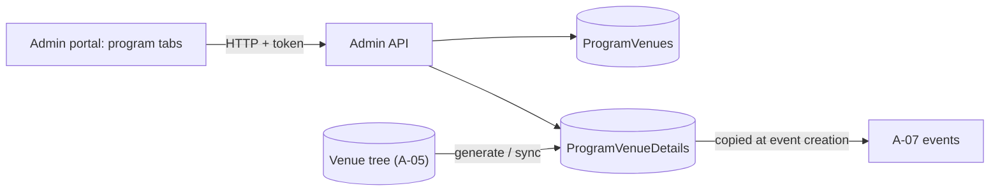

# A-06 · প্রোগ্রাম–ভেন্যু ম্যাপিং ও ভেন্যু ডিটেইলস

> **Bangla name:** প্রোগ্রাম–ভেন্যু ম্যাপিং ও ভেন্যু ডিটেইলস
>
> [← 10 · অ্যাডমিন পোর্টাল](README.md) · [সূচিপত্র](../README.md) · [ওপেন কোয়ারি](../99-open-queries.md)

## 1. নাম ও উদ্দেশ্য

**প্রোগ্রাম–ভেন্যু ম্যাপিং।** একটি program [A-05](A-05-venues.md)-এ সংজ্ঞায়িত কিছু venue ব্যবহার করে। কোনো venue program-এর সঙ্গে যুক্ত হলে প্ল্যাটফর্ম তার ট্রির একটি **স্ন্যাপশট** program-ভিত্তিকভাবে রক্ষণাবেক্ষণ করে (`ProgramVenueDetails`: gallery, block ও level প্রতিটির জন্য একটি সারি), যেখানে থাকে program-এর নিজস্ব পছন্দ: প্রতি আসনের দাম, বসার ধারণক্ষমতা, active ও sellable ফ্ল্যাগ, আসন। program-এর নতুন ইভেন্টগুলো এই সারিগুলো থেকেই তৈরি হয় ([A-07](A-07-events.md)); স্ন্যাপশট একই venue ব্যবহারকারী অন্য program-গুলো থেকে এক program-এর দাম আলাদা রাখে।

## 2. ট্রিগার ও অ্যাক্টর

রোল `admin` বা `event_manager`-এর কর্মী (`ProgramVenueController`, `ProgramVenueDetailsController`)। প্রবেশবিন্দু: **Prog. Managem.** → একটি program → ট্যাব **List Of Venues** (`app-program-venue-list`) এবং **Program venue details** পেজ (`/program-management/programVenueDetails`)।

## 3. ব্যবসায়িক প্রবাহ

1. venue-কে program-এর সঙ্গে যুক্ত করুন (venue তালিকা থেকে বেছে নিন)।
2. program-এর জন্য program-venue ডিটেইলস **Generate** করুন (প্রথমবার)।
3. ডিটেইলস পেজে প্রতি level-এর দাম, ধারণক্ষমতা ও ফ্ল্যাগ নির্ধারণ করুন।
4. পরে venue-এর লেআউট বদলালে ([A-05](A-05-venues.md)) ম্যাপিংটি "সিঙ্ক হয়নি" হিসেবে চিহ্নিত হয়; program-এর কপি হালনাগাদ করতে **Sync** চাপুন।

## 4. প্রযুক্তিগত প্রবাহ

1. **[HTTP + user token]** যুক্ত করা: `{ "programId": 12, "venueId": 3 }` সহ `POST /admin/api/v1/programVenue` → `ProgramVenueManager.CreateOrUpdateAsync` দুটোই আছে কি না যাচাই করে ("Venue not found with the specific id.", "program not found with the specific id.") এবং venue-এর বর্তমান `SvgMapImage` কপি করে `ProgramVenue` সারি ইনসার্ট বা আপডেট করে। তালিকা: `GET /admin/api/v1/programVenue/{programId}`।
2. জেনারেট: `POST /admin/api/v1/programVenueDetails/{programId}` → `GenerateProgramVenueDetails`: program-এর জন্য আগে থেকেই সারি থাকলে প্রত্যাখ্যান করে ("Data already in table."); নয়তে প্রতিটি ম্যাপ করা venue-এর জন্য প্রতি level-এ একটি সারি তৈরি করে (`ProgramId`, `VenueId`, gallery/block/level id ও তাদের `IsActive`, `IsSellable`, `IsSeatMapped` ফ্ল্যাগ, `SeatingCapacity`, `HasSeats`, `Seats`) `PricePerSeat = 0` এবং ডিফল্ট মুদ্রা (`CurrencyRepository.GetDefaultAsync`) সহ।
3. কোনো সারি সম্পাদনা: বদলানো ফিল্ডসহ (প্রতিটি ঐচ্ছিক) `PUT /admin/api/v1/programVenueDetails/update/{id}`; `UpdateAsync` সেগুলো প্রয়োগ করে; `IsGalleryActive` বদলালে সেটি **ওই gallery-এর সব সারিতে** প্রয়োগ করা হয়।
4. সিঙ্ক: `POST /admin/api/v1/programVenueDetails/{programId}/{venueId}` → `SyncProgramVenueDetailsV2`: যেসব সারির level আর নেই সেগুলো মুছে ফেলে, নতুন level-এর জন্য সারি তৈরি করে (দাম 0), বিদ্যমানগুলো আপডেট করে এবং `ProgramVenue.IsSynced = true` সেট করে।
5. পড়া: `GET /programVenueDetails/{programId}/{venueId}`, `/venue-details/{programId}`, `/venue-galleries/{programId}/{venueId}`, এবং "সিঙ্ক দরকার" ব্যাজের জন্য `GET /programVenueDetails/sync-status/{programId}/{venueId}` (`HasUnsyncedVenueAsync`)।

## 5. কম্পোনেন্ট

| ধরন | কম্পোনেন্ট |
|---|---|
| ক্লায়েন্ট | `features/program-management/components/{program-venue-list,program-venue-details}`, `services/program-venues-details.service.ts`, `program-management.service.ts` (`programVenue`) |
| সার্ভিস | Admin: `ProgramVenueController`, `ProgramVenueDetailsController`, `ProgramVenueManager`, `ProgramVenueDetailsManager` |
| টেবিল | `ProgramVenues` (`IsSynced`, `SVGMapImage`), `ProgramVenueDetails`, `Currencies` |

## 6. API কন্ট্রাক্ট

| মেথড | পাথ | অথ | রিকোয়েস্ট | রেসপন্স | প্রধান ত্রুটি |
|---|---|---|---|---|---|
| POST | `/admin/api/v1/programVenue` | `Admin`, `EventManager` | `CreateOrUpdateProgramVenue { id, programId, venueId }` | `ProgramVenue` | 400 উপরের not found বার্তাগুলো |
| GET | `/admin/api/v1/programVenue/{programId}` | same | পাথ | `ProgramVenue[]` | |
| POST | `/admin/api/v1/programVenueDetails/{programId}` | same | পাথ | `200` | 400 `Data already in table.` |
| POST | `/admin/api/v1/programVenueDetails/{programId}/{venueId}` | same | পাথ | `200` | |
| GET | `/admin/api/v1/programVenueDetails/{programId}/{venueId}` | same | পাথ | `ProgramVenueDetails[]` | |
| PUT | `/admin/api/v1/programVenueDetails/update/{id}` | same | `CreateOrUpdateProgramVenueDetails` (সব ফিল্ড ঐচ্ছিক) | `ProgramVenueDetails` | 400 `No ProgramVenueDetails found with id {id}.` |
| GET | `/admin/api/v1/programVenueDetails/venue-galleries/{programId}/{venueId}` | same | পাথ | সক্রিয় gallery |
| GET | `/admin/api/v1/programVenueDetails/venue-details/{programId}` | same | পাথ | program-এর সব সারি |
| GET | `/admin/api/v1/programVenueDetails/sync-status/{programId}/{venueId}` | same | পাথ | সিঙ্ক ফ্ল্যাগ |

প্রধান নমুনা, `PUT /admin/api/v1/programVenueDetails/update/{id}`-এর body (প্রপার্টির নাম `CreateOrUpdateProgramVenueDetails` থেকে; মানগুলো উদাহরণবিশেষ):

```json
{ "pricePerSeat": 1500, "seatingCapacity": 800, "isLevelActive": true, "isLevelSellable": true }
```

## 7. ডেটা ও পার্শ্বপ্রতিক্রিয়া

`ProgramVenues` ও `ProgramVenueDetails` সারি; কোনো কিউ নেই, কোনো ক্যাশ নেই। ইভেন্ট তৈরির সময় এই সারিগুলো ইভেন্টের নিজস্ব venue ডিটেইলসে কপি হয় ([A-07](A-07-events.md), [A-09](A-09-event-level-pricing.md))।

## 8. কোড রেফারেন্স

| কী | কোথায় |
|---|---|
| কন্ট্রোলার | `rvl-gobcb-backend/Services/Admin/ETP.Admin.Service/Api/ProgramVenueController.cs:14-60`, `.../ProgramVenueDetailsController.cs:24-140` |
| ম্যাপিং | `rvl-gobcb-backend/Services/Admin/ETP.Admin.Domain/Managers/ProgramVenueManager.cs:28-60` |
| জেনারেট ও সিঙ্ক | `rvl-gobcb-backend/Services/Admin/ETP.Admin.Domain/Managers/ProgramVenueDetailsManager.cs:44-140` (জেনারেট), `:227-332` (sync V2) |
| আপডেট | `rvl-gobcb-backend/Services/Admin/ETP.Admin.Domain/Managers/ProgramVenueDetailsManager.cs:508-552` |
| পোর্টাল সার্ভিস | `rvl-gobcb-admin-portal/src/app/features/program-management/services/program-venues-details.service.ts:22-32` |

## 9. হ্যান্ডওভার নোট

1. **তিনটি সিঙ্ক বাস্তবায়ন আছে** (`SyncProgramVenueDetails`, `SyncProgramVenueDetailsV2`, `SyncProgramVenueDetailsV2_Old`); কন্ট্রোলার কেবল `V2` কল করে। প্রথমটি program ও venue-এর বিদ্যমান সারি মুছে দাম 0 দিয়ে নতুন করে তৈরি করে, যা সম্পাদিত দাম হারিয়ে ফেলবে, তাই কেউ কন্ট্রোলারকে ফিরিয়ে না আসে তা নিশ্চিত করুন ([Appendix A](../90-appendix-a-legacy.md))।
2. **সম্পাদনার প্রবেশাধিকার চওড়া**: যেকোনো `admin` বা `event_manager` যেকোনো সময় program স্ন্যাপশটের দাম বদলাতে পারেন। আগে থেকে তৈরি ইভেন্টগুলো নিজস্ব কপি ধরে রাখে, তাই এখানে দাম বদলালে চলমান ইভেন্ট বদলায় না (ইভেন্টের নিজস্ব দাম বদলায় [A-09](A-09-event-level-pricing.md))।
3. **`Data already in table.`** জন্য **Generate** প্রতি program-এ একবারের কাজ — পরে যুক্ত করা ভেন্যুকে আনতে **Generate** নয়, **Sync** ব্যবহার করতে হবে।
4. **Gallery সুইচ গ্যালারির সব সারিতে প্রয়োগ হয়**, কিন্তু block ও level সুইচ শুধু সম্পাদিত সারিতে প্রভাব ফেলে।
5. **Program মুছে ফেললে** এই সারিগুলো মুছে যায় না ([A-02](A-02-programs.md))।
6. আনসিঙ্ক ফ্ল্যাগ venue এডিটর **প্রতিটি** program-এর জন্য সেট করে যেটি venue ব্যবহার করে, এমনকি পরিবর্তনটি ওই program-এর দামকে প্রভাবিত না করলেও।

## 10. কম্পোনেন্ট সম্পর্ক



**নির্ভর করে:** [A-02](A-02-programs.md), [A-05](A-05-venues.md)। **প্রভাব ফেলে:** [A-07](A-07-events.md), [A-09](A-09-event-level-pricing.md), [A-13](A-13-ticket-layouts.md) (লেআউট প্রতি program, venue ও gallery-ভিত্তিক)।

## 11. ডেভেলপার টেস্ট গাইড

**লোকালে টেস্টযোগ্যতা: সম্পূর্ণ।**

| আইটেম | বিবরণ |
|---|---|
| টেস্ট ডেটা ও অ্যাকাউন্ট | `pwsh ./scripts/Seed-EtpData.ps1` (ম্যাপ করা venue ও ডিটেইলসসহ একটি program); অ্যাডমিন `…01` |
| ব্রাউজার | `http://localhost:4200` → **Prog. Managem.** → program → **List Of Venues**; Sync-এর জন্য Network: `POST .../programVenueDetails/{programId}/{venueId}` |
| ইমুলেটর | — |
| Postman | `postman/services/etp-admin.postman_collection.json`: "POST /api/v1/programVenue", "POST /api/v1/programVenueDetails/{programId}", "PUT /api/v1/programVenueDetails/update/{id}" |
| Visual Studio debug | `ProgramVenueDetailsManager.GenerateProgramVenueDetails`, `SyncProgramVenueDetailsV2` |
| যাচাই | SQL: `select "BlockLevelId","PricePerSeat","SeatingCapacity" from etp."ProgramVenueDetails" where "ProgramId" = <id>`; `select "IsSynced" from etp."ProgramVenues"` |
