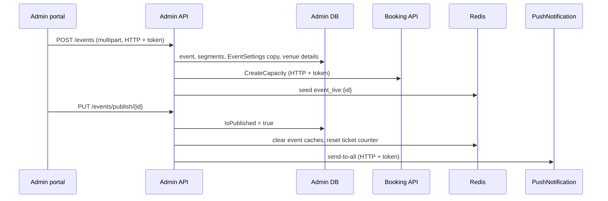

# A-07 · ইভেন্ট (ম্যাচ)

> **Bangla name:** ইভেন্ট (ম্যাচ)
>
> [← 10 · অ্যাডমিন পোর্টাল](README.md) · [সূচিপত্র](../README.md) · [ওপেন কোয়ারি](../99-open-queries.md)

## 1. নাম ও উদ্দেশ্য

**ইভেন্ট।** একটি event হলো কোনো program-এর একটি venue-তে অনুষ্ঠিত একটি ম্যাচ বা শো, যা এক বা একাধিক **segment**-এর সমন্বয়ে গড়ে ওঠে (দুটি দলের সাথে একটি ক্রীড়া segment, বা একটি কনসার্ট segment)। একটি ইভেন্ট তৈরি করলে তার বাণিজ্যিক settings এবং venue-এর দামসহ level ও ধারণক্ষমতার নিজস্ব কপি তৈরি হয়, যাতে টিকিট বিক্রি প্রতি ইভেন্টে চলে। প্রকাশ করলে সেটি দৃশ্যমান ও বিক্রিযোগ্য হয়; প্ল্যাটফর্ম তখন অ্যাপ ব্যবহারকারীদের পুশ নোটিফিকেশনও জানায়। ধারণাগুলো: [shared database](../00-platform-primer.md#explainer-shared-database), [Redis live capacity](../00-platform-primer.md#explainer-redis-live-capacity)।

## 2. ট্রিগার ও অ্যাক্টর

রোল `admin`, `event_manager`, `ticket_manager`, `ticket_operator` (`BCBPersonnel`) কর্মী (`EventsController`-এর class attribute; `[AuthorizeProgram]` মন্তব্যযুক্ত)। প্রবেশবিন্দু: program মেনু **Events** (`/events`): তালিকা, **Create** (`/events/create`), **Edit** (`/events/edit/:id`), **Details** (`/events/event-details/:id`)।

## 3. ব্যবসায়িক প্রবাহ

1. নির্বাচিত program-এর ইভেন্টগুলো তালিকাভুক্ত করুন; ফিল্টার ও সার্চ করুন।
2. **তৈরি:** program, venue, নাম (≤ 60 অক্ষর), শুরু ও শেষ, কভার ছবি, এক বা একাধিক segment (নাম, ধরন `Sport` বা `Concert`, শুরু, শেষ, ক্রীড়ার জন্য team 1 ও team 2, ব্যানার ছবি)।
3. দাম, ক্যাপাসিটি ও settings পর্যালোচনা ও সমন্বয় করুন ([A-08](A-08-event-settings.md), [A-09](A-09-event-level-pricing.md), [A-10](A-10-capacity-adjustment.md))।
4. **প্রকাশ** (সব সক্রিয় gallery-র জন্য প্রকাশিত টিকিট লেআউট প্রয়োজন, [A-13](A-13-ticket-layouts.md)); এরপর গ্রাহকরা দেখতে এবং বিক্রি শুরু হলে কিনতে পারেন।
5. প্রকাশিত ইভেন্ট **active/inactive** টগল করুন; **Unpublish** কেবল বিক্রি শুরুর আগে; **Duplicate**; **Delete**।

## 4. প্রযুক্তিগত প্রবাহ

1. **তৈরি** **[HTTP + user token]** `POST /admin/api/v1/events` (`multipart/form-data`, `CreateEvent`)। `EventManager.CreateAsync`:
   - `CheckValidityOfCreateEvent`: program ও venue id আছে; নাম আবশ্যক ও ≤ 60; শুরু অতীত নয়; শেষ শুরুর পরে; কভার ছবি আবশ্যক; প্রতি segment-এর জন্য: নাম, তারিখ, ব্যানার আবশ্যক; ক্রীড়ার জন্য দুটি ভিন্ন দল লাগে, কনসার্টে কোনো দল থাকে না।
   - ইভেন্টে এবং প্রতিটি segment-এ একটি নতুন `EventId` GUID নিয়োগ করা হয়।
   - **Program settings একটি নতুন `EventSettings` সারিতে কপি হয়** (সীমা, বিক্রির ঘণ্টা, প্রিফিক্স, VAT, সার্ভিস চার্জ, gateway) ([A-03](A-03-program-settings.md)); `IsVatInclusive` ইভেন্টেও সেট হয়।
   - ইনসার্ট; কভার `eventcover/{id}/...`-এ এবং প্রতিটি ব্যানার `eventsegmentcover/...`-এ আপলোড করা হয় ([X-20](../60-cross-cutting/X-20-file-storage.md))।
   - `GenerateEventVenueDetails(programId, eventId)` program-এর venue ডিটেইলস সারি ইভেন্টে কপি করে ([A-09](A-09-event-level-pricing.md))।
   - **[HTTP + user token]** `IBookingClient.CreateCapacity(list)` Booking-এ প্রতি level-এর জন্য একটি `Capacities` সারি তৈরি করে (`TicketingCapacity` = level-এর বসার ধারণক্ষমতা, থাকলে আসন), তারপর `GetEventLiveCapacity` Redis-এ `event_live:{id}` সিড করে ([S-02](../50-system-initiated/S-02-event-live-capacity.md))।
2. **আপডেট** `PUT /admin/api/v1/events/{id}` (multipart):
   - **প্রকাশিত নয়:** `CheckValidityOfUpdateEvent` (venue আছে, নাম, তারিখ, segment নিয়ম সহ "Concert segments cannot have team IDs."), তারপর ইভেন্ট ও তার segment আপডেট হয়।
   - **প্রকাশিত:** বৈধতা যাচাই **বাদ দেওয়া হয়** এবং কেবল এই ফিল্ডগুলো বদলায়: ইভেন্টের শেষ সময়, VAT-inclusive ফ্ল্যাগ, কভার ছবি, প্রতিটি segment-এর শেষ সময়, ব্যানার ও দল।
   - `event_details:*`, `admin_event_details:*`, `event_settings_details:{id}`, `event_venue_details:*` ক্যাশ মুছে ফেলা হয়।
3. **প্রকাশ** `PUT /admin/api/v1/events/publish/{id}`: আগে থেকেই প্রকাশিত হলে ব্যর্থ, program-এ venue-এর জন্য টিকিট লেআউট না থাকলে ("No ticket layout configuration found for VenueId: n."), অথবা কোনো **সক্রিয় gallery-র লেআউট প্রকাশিত না হলে** ("Ticket layout is not configured for all active galleries."); `IsPublished` সেট করে, একই ক্যাশ মোছে, `event_ticket_counter:{eventId}` 0-এ রিসেট করে, এবং PushNotification-এর মাধ্যমে সব অ্যাপ ব্যবহারকারীকে পুশ পাঠায় (টাইটেল "New Event Available!", ডেটা `eventId`, `eventName`, `type = event_published`); পুশ ব্যর্থ হলে তা লগ হয় ও উপেক্ষা করা হয় ([X-23](../60-cross-cutting/X-23-push-firebase.md))।
4. **Unpublish** `PUT .../unpublish/{id}`: প্রকাশিত না হলে ব্যর্থ, অথবা `event start − TicketSellingStartFromHour` ইতিমধ্যে অতীত হলে ("Event can't unpublished after start ticket selling."); ক্যাশ মোছে।
5. **টগল** `PUT .../toggle-status/{id}`: কেবল প্রকাশিত ইভেন্টে, `IsActive` উল্টে দেয়; ক্যাশ মোছে।
6. **Duplicate** `POST .../duplicate/{id}`: "{name} - Copy" নামে অপ্রকাশিত ইভেন্ট তৈরি করে, segment, settings, venue ডিটেইলস ও ক্যাপাসিটি (আবার `CreateCapacity` ও `GetEventLiveCapacity`-এর মাধ্যমে), এবং মূলের gate ও checker বরাদ্দ কপি করে ([A-18](A-18-gate-assignment.md))।
7. **মুছে ফেলা** `DELETE .../{id}`: সফট ডিলিট (`IsDeleted`), তালিকার ক্যাশ মোছে।
8. `TicketSellingStartDateTime`, `TicketSellingStopDateTime` ও `TicketAvailabilityStartDateTime`-এর মতো তারিখ-সময় **ইভেন্ট পড়ার সময় হিসাব হয়** (ইভেন্ট শুরু/শেষ থেকে settings-এর ঘণ্টা বাদ; ইভেন্টের নিজস্ব settings থাকলে সেখান থেকে, নয়তো program settings থেকে), সংরক্ষিত থাকে না।

## 5. কম্পোনেন্ট

| ধরন | কম্পোনেন্ট |
|---|---|
| ক্লায়েন্ট | `features/events/pages/{event-list,event-create,event-details}`, `services/event.service.ts` |
| সার্ভিস | Admin (`EventsController`, `EventManager`, `EventVenueDetailsManager`); Booking (`CreateCapacity`); PushNotification (প্রকাশের সময় পুশ); Event সার্ভিস একই টেবিল পড়ে |
| টেবিল | `Events`, `EventSegments`, `EventSettings`, `EventVenueDetails`, Booking `Capacities` |
| Redis | `event_details:*`, `admin_event_details:*`, `event_settings_details:*`, `event_venue_details:*`, `event_ticket_counter:*`, `event_live:*` ([X-25](../60-cross-cutting/X-25-redis.md)) |
| স্টোরেজ | S3 `eventcover/`, `eventsegmentcover/` |
| কিউ | প্রকাশের সময় পরোক্ষভাবে `FirebaseNotification` |

## 6. API কন্ট্রাক্ট

| মেথড | পাথ | অথ | রিকোয়েস্ট | রেসপন্স | প্রধান ত্রুটি |
|---|---|---|---|---|---|
| GET | `/admin/api/v1/events` | রোল Admin, EventManager, TicketManager, BCBPersonnel | paging, search, sort | পেজযুক্ত `Event` | |
| GET | `/admin/api/v1/events/{id}` | same | পাথ | `Event` | |
| POST | `/admin/api/v1/events` | same | `CreateEvent` (multipart) | `Event` | 400 §4-এর বার্তা |
| PUT | `/admin/api/v1/events/{id}` | same | `UpdateEvent` (multipart) | `Event` | 400 |
| PUT | `/admin/api/v1/events/publish/{id}`, `unpublish/{id}`, `toggle-status/{id}` | same | পাথ | `Event` | 400 §4-এর বার্তা |
| POST | `/admin/api/v1/events/duplicate/{id}` | same | পাথ | `Event` | 400 `Event with ID n not found` |
| DELETE | `/admin/api/v1/events/{id}` | same | পাথ | `Event` | 500 `Event with ID n not found.` |
| GET | `/admin/api/v1/events/search`, `/list`, `/published/list`, `/filtered-list/{status}/{count}`, `/by-public-id/{eventId}`, `/program/{programId}/events`, `/programs/{programId}/events/no-end-date-check`, `/{start}/{end}/{eventId}` | same (`/published/list`: [X-18](../60-cross-cutting/X-18-endpoints-without-auth.md) দেখুন) | | তালিকা | |

প্রধান নমুনা, `POST /admin/api/v1/events` (multipart; নাম `CreateEvent`/`CreateEventSegment` থেকে; ASP.NET model binding segmentগুলো ইনডেক্স করে; মানগুলো উদাহরণবিশেষ):

```
programId=12
venueId=3
name=Dhaka vs Chattogram
startDateTime=2026-12-10T10:00:00.000Z
endDateTime=2026-12-10T18:00:00.000Z
eventCoverImageFile=<file>
segments[0].name=Match 1
segments[0].segmentType=0
segments[0].startDateTime=2026-12-10T10:00:00.000Z
segments[0].endDateTime=2026-12-10T18:00:00.000Z
segments[0].team1Id=4
segments[0].team2Id=5
segments[0].bannerImageFile=<file>
```

(`segmentType`: `0` Sport, `1` Concert।)

## 7. ডেটা ও পার্শ্বপ্রতিক্রিয়া

নতুন ইভেন্ট, segment, settings কপি, venue ডিটেইলস কপি, Booking ক্যাপাসিটি, Redis কাউন্টার, S3 ছবি, এবং প্রকাশের সময় সব ডিভাইসে পুশ। অ্যাক্টিভিটি লগ এন্ট্রি ([X-24](../60-cross-cutting/X-24-activity-logging.md))।

## 8. কোড রেফারেন্স

| কী | কোথায় |
|---|---|
| কন্ট্রোলার | `rvl-gobcb-backend/Services/Admin/ETP.Admin.Service/Api/EventsController.cs:29-300` |
| তৈরি ও যাচাই | `rvl-gobcb-backend/Services/Admin/ETP.Admin.Domain/Managers/EventManager.cs:211-363` |
| আপডেট | `.../EventManager.cs:364-537` |
| প্রকাশ, অপ্রকাশ, টগল | `.../EventManager.cs:657-891` (পুশ `:722-745`) |
| Duplicate | `.../EventManager.cs:908-1034` |
| তারিখ হিসাব | `.../EventManager.cs:96-136, 185-186` |
| পোর্টাল | `rvl-gobcb-admin-portal/src/app/features/events/services/event.service.ts:28-60` |

## 9. হ্যান্ডওভার নোট

1. **সার্ভিসগুলোর মধ্যে তৈরি atomic নয়।** আগে ইভেন্টটি সেভ হয়; এরপর HTTP-তে Booking-এর `CreateCapacity` কল হয়। সেটি ব্যর্থ হলে ইভেন্টটি ক্যাপাসিটি সারি ছাড়াই তৈরি হয়ে থাকে, আর API একটি ত্রুটি ফেরত দেয়, ফলে পুনরায় চেষ্টা করলে দ্বিতীয় একটি ইভেন্ট তৈরি হয়। কোনো ইভেন্ট "আসন নেই" দেখালে Booking-এর `Capacity` সারি দেখুন ([S-01](../50-system-initiated/S-01-level-capacity-update.md))।
2. **প্রকাশিত ইভেন্ট আপডেটে বৈধতা যাচাই এড়িয়ে যায়**, তাই তার শেষ সময় শুরুর সময়ের আগে সেট করা যায়, আর segment-এর শেষ সময় যাচাই ছাড়াই বদলানো যায় (প্রকাশিত ইভেন্টে কেবল শেষ সময় ও দল গ্রহণ করা হয়)।
3. **Settings একটি কপি**, তৈরির সময় নেওয়া। পরে program settings বদলালে তা বিদ্যমান ইভেন্টে পৌঁছায় না; [A-08](A-08-event-settings.md) ব্যবহার করুন।
4. **Null শেষ তারিখ।** DTO-তে `EndDateTime` nullable, তৈরির যাচাই null শেষ প্রত্যাখ্যান করে না, কিন্তু তারিখ হিসাব `EndDateTime.Value` ডিরেফারেন্স করে; সবসময় একটি শেষ সময় পাঠান।
5. **অতীতের শুরু প্রতিটি আপডেটেই প্রত্যাখ্যাত**, খসড়া হলেও: শুরুর সময় পেরিয়ে গেলে খসড়া ইভেন্ট সম্পাদনা করলে "StartDateTime must be greater than or equal to the current date and time." ত্রুটি হয়।
6. **Unpublish কেবল বিক্রি শুরুর আগে সম্ভব**; এরপর বিক্রি বন্ধ করতে Toggle (inactive) ব্যবহার করুন।
7. **Duplicate মূল ইভেন্টের gate ও checker বরাদ্দ কপি করে**, তাই কপিটি প্রকাশের আগে সেগুলো যাচাই করুন।
8. **প্রকাশ সবার কাছে পুশ পাঠায়** এবং কোনো preview বা টেস্ট মোড নেই, তাই প্রোডাকশনে টেস্ট প্রকাশ আসল ব্যবহারকারীদের জানাবে।

## 10. কম্পোনেন্ট সম্পর্ক



**নির্ভর করে:** [A-02](A-02-programs.md), [A-03](A-03-program-settings.md), [A-04](A-04-teams.md), [A-05](A-05-venues.md), [A-06](A-06-program-venue-mapping.md), [A-13](A-13-ticket-layouts.md)। **প্রভাব ফেলে:** গ্রাহক-মুখী সবকিছু ([P-02](../20-user-portal/P-02-browse-events.md), [P-04](../20-user-portal/P-04-seat-selection.md), [P-06](../20-user-portal/P-06-booking-payment.md)), [A-08](A-08-event-settings.md) থেকে [A-12](A-12-reserved-tickets.md), রিপোর্ট, [S-07](../50-system-initiated/S-07-initiate-user-ticket-generation.md)।

## 11. ডেভেলপার টেস্ট গাইড

**লোকালে টেস্টযোগ্যতা: সম্পূর্ণ**, পুশ ছাড়া (dummy Firebase)।

| আইটেম | বিবরণ |
|---|---|
| টেস্ট ডেটা ও অ্যাকাউন্ট | `pwsh ./scripts/Seed-EtpData.ps1` (ইভেন্ট, লেআউট); অ্যাডমিন `…01`; টপ বারে একটি program নির্বাচন করুন ([A-01](A-01-program-selection.md)) |
| ব্রাউজার | `http://localhost:4200/events` → তৈরি, প্রকাশ; Network: multipart `POST .../admin/api/v1/events`, `PUT .../events/publish/{id}` |
| ইমুলেটর | — |
| Postman | `postman/services/etp-admin.postman_collection.json`: "GET /api/v1/events", "POST /api/v1/events" (form-data), "PUT /api/v1/events/publish/{id}", "POST /api/v1/events/duplicate/{id}" |
| Visual Studio debug | `EventManager.CreateAsync`, `PublishEventAsync`; Booking `CapacityController.CreateCapacityAsync` |
| যাচাই | SQL: `select "Id","Name","IsPublished","IsActive" from etp."Events"`; ওই event id-এর জন্য Booking `Capacities` সারি; `redis-cli GET event_live:<id>` |
