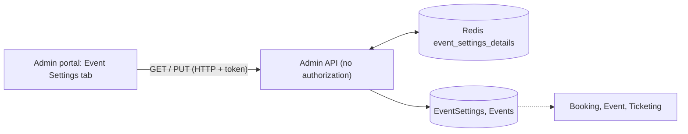

# A-08 · ইভেন্ট সেটিংস ওভাররাইড

> **Bangla name:** ইভেন্ট সেটিংস ওভাররাইড
>
> [← 10 · অ্যাডমিন পোর্টাল](README.md) · [সূচিপত্র](../README.md) · [ওপেন কোয়ারি](../99-open-queries.md)

## 1. নাম ও উদ্দেশ্য

**ইভেন্ট সেটিংস।** প্রতিটি ইভেন্ট বাণিজ্যিক settings-এর (ক্রয়সীমা, বিক্রির ঘণ্টা, টিকিট প্রিফিক্স, VAT, সার্ভিস চার্জ, পেমেন্ট gateway) নিজস্ব কপি বহন করে। এগুলো program settings-এর ([A-03](A-03-program-settings.md)) কপি হিসেবে শুরু হয় এবং এখানে প্রতি ইভেন্টে বদলানো যায়, যেমন কোনো এক ম্যাচের জন্য বিশেষ VAT বা আগেভাগে বিক্রি শুরু।

## 2. ট্রিগার ও অ্যাক্টর

যে কর্মীরা ইভেন্ট ডিটেইলস পেজ (`/events/event-details/:id`) খুলতে পারেন, ট্যাব **Event Settings**। **সার্ভার** রোল যাচাই করে না: `EventSettingsController`-এ কোনো `[Authorize]` নেই ([X-18](../60-cross-cutting/X-18-endpoints-without-auth.md))।

## 3. ব্যবসায়িক প্রবাহ

একটি ইভেন্ট খুলুন, **Event Settings**-এ যান, মান বদলান, **Update** দিন। ইভেন্টটি ইতিমধ্যে প্রকাশিত হলে VAT ও সার্ভিস চার্জ বদলানো যায় না; বাকি মান বদলানো যায়।

## 4. প্রযুক্তিগত প্রবাহ

1. **[HTTP + user token]** লোড `GET /admin/api/v1/event-settings/{eventId}` (Redis key `event_settings_details:{id}` থাকলে সেটি পরিবেশ করে, নয়তো সারিটি পড়ে **৩০ দিনের** জন্য ক্যাশ করা হয়)।
2. **[HTTP + user token]** সেভ `PUT /admin/api/v1/event-settings/{eventId}` `EventSettings` সহ। `EventSettingsManager.UpdateAsync`:
   - settings লোড করে (না থাকলে "No event settings found");
   - ঘণ্টা, সীমা, প্রিফিক্স, থ্রেশহোল্ড, VAT-inclusive ফ্ল্যাগ ও gateway কপি করে (gateway না থাকলে সেটি `DgePay` দিয়ে প্রতিস্থাপিত হয়);
   - ইভেন্ট **প্রকাশিত** হলে VAT-এর মান, VAT-শতকরা ফ্ল্যাগ, সার্ভিস চার্জের মান বা সার্ভিস-চার্জ-শতকরা ফ্ল্যাগ বদলাতে বাধা দেয় ("Cannot update VAT and Service Charge while events are published."); নয়তে সেগুলোও কপি করে;
   - ইভেন্টের নিজেই `IsVatInclusive` সেট করে, দুটোই সেভ করে, `event_details:list`, `event_details:{eventId}`, `admin_event_details:{eventId}` ও `admin_event_details:{id}` মুছে ফেলে, এবং নতুন settings ৩০ দিনের জন্য `event_settings_details:{id}`-তে লেখে।
3. মানগুলো কোথায় ব্যবহৃত হয়: ইভেন্টের বিক্রি ও উপলব্ধতার সময় ([A-03](A-03-program-settings.md) ধাপ 4), অর্ডারের সময় Booking-এর সীমা ও চার্জ ([P-06](../20-user-portal/P-06-booking-payment.md)), টিকিট তৈরির সময় প্রিফিক্স ([S-07](../50-system-initiated/S-07-initiate-user-ticket-generation.md)), এবং VAT রেকর্ডের VAT লাইন ([S-10](../50-system-initiated/S-10-vat-challan.md))।

## 5. কম্পোনেন্ট

| ধরন | কম্পোনেন্ট |
|---|---|
| ক্লায়েন্ট | `features/events/components/event-settings/*`, `services/event-settings.service.ts` |
| সার্ভিস | Admin: `EventSettingsController`, `EventSettingsManager`; Booking, Event ও Ticketing একই টেবিল পড়ে |
| টেবিল | `EventSettings`, `Events.IsVatInclusive` |
| Redis | `event_settings_details:{id}` (৩০ দিন), `event_details:*`, `admin_event_details:*` |

## 6. API কন্ট্রাক্ট

| মেথড | পাথ | অথ | রিকোয়েস্ট | রেসপন্স | প্রধান ত্রুটি |
|---|---|---|---|---|---|
| GET | `/admin/api/v1/event-settings/{eventId}` | **none** | পাথ | `EventSettings` | |
| PUT | `/admin/api/v1/event-settings/{eventId}` | **none** | `EventSettings` | `EventSettings` | 400 `No event settings found`, `Cannot update VAT and Service Charge while events are published.` |

প্রধান নমুনা, `PUT`-এর body (`ProgramSettings`-এর মতো ফিল্ড, [A-03](A-03-program-settings.md) দেখুন; মানগুলো উদাহরণবিশেষ):

```json
{
  "allowableMaximumOrderPerUser": 2,
  "allowableMaximumSeatPerOrder": 4,
  "ticketSellingStartFromHour": 72,
  "ticketSellingStopFromHour": 1,
  "ticketAvailableFromHour": 48,
  "ticketNumberPrefix": "T20",
  "limitedAvailabilityThreshold": 60,
  "vat": 15,
  "isVatPercentage": true,
  "serviceCharge": 0,
  "isServiceChargePercentage": true,
  "isVatInclusive": true,
  "paymentGateway": 1
}
```

## 7. ডেটা ও পার্শ্বপ্রতিক্রিয়া

`EventSettings` সারি, `Events.IsVatInclusive`, ক্যাশ key; অ্যাক্টিভিটি লগ ([X-24](../60-cross-cutting/X-24-activity-logging.md))।

## 8. কোড রেফারেন্স

| কী | কোথায় |
|---|---|
| কন্ট্রোলার | `rvl-gobcb-backend/Services/Admin/ETP.Admin.Service/Api/EventSettingsController.cs:14-48` |
| ম্যানেজার | `rvl-gobcb-backend/Services/Admin/ETP.Admin.Domain/Managers/EventSettingsManager.cs:20-100` |
| পোর্টাল | `rvl-gobcb-admin-portal/src/app/features/events/services/event-settings.service.ts:20-24` |
| ইভেন্ট ডিটেইলস ট্যাব | `rvl-gobcb-admin-portal/src/app/features/events/pages/event-details/event-details.component.html:7-24` |

## 9. হ্যান্ডওভার নোট

1. **কোনো প্রমাণীকরণ বা রোল যাচাই নেই।** যে কেউ `/admin/api/v1/event-settings/{eventId}`-এ পৌঁছাতে পারেন, সে যেকোনো ইভেন্টের VAT, চার্জ, প্রিফিক্স, gateway ও সীমা পড়তে ও বদলাতে পারেন (খসড়া ইভেন্টের VAT-ও)। লক্ষ্য করুন, Postman collection-এও EventSettings নেই (Appendix D)।
2. **প্রকাশিত-ইভেন্ট লক কেবল VAT ও সার্ভিস চার্জ ঢাকে।** বিক্রি চলাকালীনও বিক্রির ঘণ্টা, সীমা, প্রিফিক্স ও gateway বদলানো যায়; প্রিফিক্স বদলালে পরের টিকিটগুলোর প্রিফিক্স আলাদা হয়।
3. **ক্যাশ অবলোপন `event_details:{id}` বাদ পড়ে** (এটি তালিকার key এবং `EventId` অনুযায়ী key-গুলো মোছে), তাই সংখ্যাগত id দিয়ে ক্যাশ করা একজন পাঠক তার এন্ট্রির মেয়াদ শেষ না হওয়া পর্যন্ত পুরনো settings দেখাতে পারে।
4. **`isVatInclusive` দুই জায়গায় থাকে** (`EventSettings` ও `Events`); এই ম্যানেজার দুটোই লেখে, আর `EventManager.UpdateAsync`-ও ইভেন্টের কলামটি লেখে ([A-07](A-07-events.md))।

## 10. কম্পোনেন্ট সম্পর্ক



**নির্ভর করে:** [A-07](A-07-events.md), [A-03](A-03-program-settings.md)। **প্রভাব ফেলে:** [P-06](../20-user-portal/P-06-booking-payment.md), [S-07](../50-system-initiated/S-07-initiate-user-ticket-generation.md), [S-10](../50-system-initiated/S-10-vat-challan.md)।

## 11. ডেভেলপার টেস্ট গাইড

**লোকালে টেস্টযোগ্যতা: সম্পূর্ণ।**

| আইটেম | বিবরণ |
|---|---|
| টেস্ট ডেটা ও অ্যাকাউন্ট | `pwsh ./scripts/Seed-EtpData.ps1`; অ্যাডমিন `…01` |
| ব্রাউজার | `http://localhost:4200/events` → একটি ইভেন্ট → **Event Settings**; Network: `GET/PUT .../admin/api/v1/event-settings/{id}` |
| ইমুলেটর | — |
| Postman | **Collection-এ নেই** (`postman/services/etp-admin.postman_collection.json`-এ কোনো EventSettings রিকোয়েস্ট নেই); হাতে "GET {{base_url}}/event-settings/{id}" তৈরি করুন (collection-এর `base_url`-এ `/admin/api/v1` প্রিফিক্স নেই, Appendix D দেখুন) |
| Visual Studio debug | `EventSettingsManager.UpdateAsync` |
| যাচাই | SQL: `select * from etp."EventSettings" where "EventId" = <id>`; `redis-cli GET event_settings_details:<id>` |
