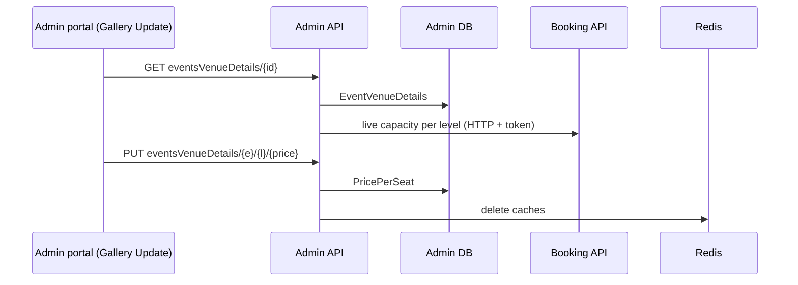

# A-09 · ইভেন্ট ভেন্যু ডিটেইলস ও লেভেলভিত্তিক দাম

> **Bangla name:** ইভেন্টের ভেন্যু ডিটেইলস ও লেভেল-ভিত্তিক মূল্য
>
> [← 10 · অ্যাডমিন পোর্টাল](README.md) · [সূচিপত্র](../README.md) · [ওপেন কোয়ারি](../99-open-queries.md)

## 1. নাম ও উদ্দেশ্য

**ইভেন্ট ভেন্যু ডিটেইলস ও লেভেলভিত্তিক দাম।** প্রতিটি ইভেন্টের venue ট্রির (gallery → block → level) নিজস্ব কপি থাকে, যেখানে প্রতি level-এর জন্য থাকে একটি **প্রতি আসনের দাম**, ধারণক্ষমতা, আসন ও ফ্ল্যাগ (`EventVenueDetails`)। অ্যাডমিন ইভেন্টের **Gallery Update** ট্যাবে এই ট্রিটি দেখেন এবং প্রতিটি level-এর একক দাম নির্ধারণ করেন। গ্রাহক যা দেন, তা program-এর নয়, এই কপির দাম।

## 2. ট্রিগার ও অ্যাক্টর

রোল `admin`, `event_manager`, `ticket_manager`, `ticket_operator` (`BCBPersonnel`) কর্মী (`EventsVenueDetailsController`)। প্রবেশবিন্দু: `/events/event-details/:id` → ট্যাব **Gallery Update** (একই ট্যাবে ক্যাপাসিটি সমন্বয় [A-10](A-10-capacity-adjustment.md) ও রিজার্ভেশন [A-11](A-11-seat-reservation.md)-ও আছে)।

## 3. ব্যবসায়িক প্রবাহ

1. ইভেন্ট তৈরির সময় program-এর সারিগুলো ইভেন্টে কপি হয় ([A-07](A-07-events.md)); দাম শুরু হয় program স্ন্যাপশটে যা ছিল তা থেকে (নতুন generate-এর পর 0, [A-06](A-06-program-venue-mapping.md))।
2. **Gallery Update**-এ অ্যাডমিন প্রতিটি level-কে allocated, reserved ও released সংখ্যা এবং তার একক দাম দিয়ে দেখেন, সরাসরি একক দাম সম্পাদনা করে সেভ করেন।
3. নতুন দাম নতুন অর্ডারে প্রযোজ্য; বিদ্যমান অর্ডার তাদের তৈরির সময়কার দামই রাখে।

## 4. প্রযুক্তিগত প্রবাহ

1. **[HTTP + user token]** `GET /admin/api/v1/eventsVenueDetails/{eventId}?isForTicket=false` ট্রিটি ফেরত দেয় (`Node { data, children }`; `data`-তে `galleryId`, `blockId`, `levelId`, নাম ও সংখ্যা)। এটি গড়ে ওঠার সময় `EventVenueDetailsManager.GetDetailsTreeByEventId` প্রতি level-এর live ক্যাপাসিটি জানতে Booking-কে জিজ্ঞাসা করে (**[HTTP + user token]** `IBookingClient.GetLevelLiveCapacity`)।
2. **[HTTP + user token]** দাম সেভ: `PUT /admin/api/v1/eventsVenueDetails/{eventId}/{levelId}/{price}` (দাম URL-এ, decimal)। `UpdateSeatPriceAsync` ইভেন্ট ও level-এর সারিটি খুঁজে নেয় (না পেলে "Event venue details with id '{levelId}' doesn't exist."), `PricePerSeat` সেট করে, সেভ করে, এবং `admin_level_info:{eventId}_{levelId}`, `event_details:list`, `event_details:{eventId}`, `event_venue_details:{eventId}` ক্যাশ এবং ইভেন্টের public id-এর নিচে একই দুটি details key মুছে ফেলে।
3. অন্যান্য পড়া: `GET .../eventsVenueDetails/get-level/{eventId}/{levelId}` (গেটসহ একটি level), `GET .../venue-details/{eventId}` (সমতল সারি), `POST .../galleries/by-event-ids` (কয়েকটি ইভেন্টের gallery, promo ও discount ফর্মে ব্যবহৃত, [A-15](A-15-promo-codes.md))।
4. গ্রাহকের দিক: Booking ও Event `EventVenueDetails` read model হিসেবে পড়ে দাম দেখাতে ও অর্ডারের পরিমাণ হিসাব করতে ([P-04](../20-user-portal/P-04-seat-selection.md), [P-06](../20-user-portal/P-06-booking-payment.md))।

## 5. কম্পোনেন্ট

| ধরন | কম্পোনেন্ট |
|---|---|
| ক্লায়েন্ট | `features/events/components/gallery-update/*` (`updatePriceByLevel`), `services/event.service.ts:82, 126` |
| সার্ভিস | Admin (`EventsVenueDetailsController`, `EventVenueDetailsManager`, `EventVenueDetailsRepository`); Booking (live ক্যাপাসিটি) |
| টেবিল | `EventVenueDetails` |
| Redis | `admin_level_info`, `event_details`, `event_venue_details` ক্যাশ |

## 6. API কন্ট্রাক্ট

| মেথড | পাথ | অথ | রিকোয়েস্ট | রেসপন্স | প্রধান ত্রুটি |
|---|---|---|---|---|---|
| GET | `/admin/api/v1/eventsVenueDetails/{eventId}` | রোল Admin, EventManager, TicketManager, BCBPersonnel | `isForTicket` (bool) | `Node[]` | |
| GET | `/admin/api/v1/eventsVenueDetails/get-level/{eventId}/{levelId}` | same | পাথ | গেটসহ level |
| GET | `/admin/api/v1/eventsVenueDetails/venue-details/{eventId}` | same | পাথ | `EventVenueDetails[]` |
| PUT | `/admin/api/v1/eventsVenueDetails/{eventId}/{levelId}/{price}` | same | শুধু পাথ | `true` | 400 `Event venue details with id '{levelId}' doesn't exist.` |
| POST | `/admin/api/v1/eventsVenueDetails/galleries/by-event-ids` | same | event id-এর তালিকা | gallery |

প্রধান নমুনা: খালি body সহ `PUT /admin/api/v1/eventsVenueDetails/101/3305/1500` (event 101, level 3305, দাম 1500; id উদাহরণবিশেষ); রেসপন্স body `true`।

## 7. ডেটা ও পার্শ্বপ্রতিক্রিয়া

`EventVenueDetails.PricePerSeat`; ক্যাশ মুছে ফেলা; অ্যাক্টিভিটি লগ ([X-24](../60-cross-cutting/X-24-activity-logging.md))।

## 8. কোড রেফারেন্স

| কী | কোথায় |
|---|---|
| কন্ট্রোলার | `rvl-gobcb-backend/Services/Admin/ETP.Admin.Service/Api/EventsVenueDetailsController.cs:14-100` |
| ম্যানেজার | `rvl-gobcb-backend/Services/Admin/ETP.Admin.Domain/Managers/EventVenueDetailsManager.cs:103-166` (জেনারেট, দাম), `:167-268` (ট্রি) |
| রিপোজিটরি | `rvl-gobcb-backend/Services/Admin/ETP.Admin.Storage/Repositories/EventVenueDetailsRepository.cs:60-67` |
| পোর্টাল | `rvl-gobcb-admin-portal/src/app/features/events/components/gallery-update/gallery-update.component.ts:592-600` |

## 9. হ্যান্ডওভার নোট

1. **দাম যেকোনো সময় বদলানো যায়**, এমনকি ইভেন্ট প্রকাশিত ও বিক্রিতে থাকা অবস্থায়ও: `UpdateSeatPriceAsync` কিছুই যাচাই করে না (না প্রকাশিত, না বিক্রি, ক্লাস তালিকার বাইরে কোনো রোল নয়)। ইতিমধ্যে পেন্ডিং অর্ডার ধরে থাকা গ্রাহকরা পুরনো দামই রাখেন; এরপর যারা আসন পেজ খোলেন তারা নতুন দাম দেখেন, যতক্ষণ না ক্যাশের মেয়াদ শেষ হয়।
2. **দামটি একটি URL path segment** এবং রিকোয়েস্টের কোনো body নেই, তাই মানটি access log ও proxy log-এ দেখা যায়।
3. **ক্যাশের পরিধি।** মেথডটি সংখ্যাগত ও public event id — দুই ধরনেই কয়েকটি key মোছে; আগে থেকে রেন্ডার করা একটি গ্রাহক পেজ রিলোড না হওয়া পর্যন্ত পুরনো দামই দেখায়।
4. **ট্রি কলটি প্রতি level-এ Booking-এ ছড়িয়ে যায়** (live ক্যাপাসিটি), তাই বড় venue-এর ক্ষেত্রে Gallery Update ট্যাব ধীর।
5. **Program-এর দাম যুক্ত নয়।** পরে program স্ন্যাপশটে দাম বদলালে ইভেন্ট বদলায় না ([A-06](A-06-program-venue-mapping.md))।

## 10. কম্পোনেন্ট সম্পর্ক

**নির্ভর করে:** [A-07](A-07-events.md), [A-06](A-06-program-venue-mapping.md)। **প্রভাব ফেলে:** [P-04](../20-user-portal/P-04-seat-selection.md), [P-06](../20-user-portal/P-06-booking-payment.md), [A-22](A-22-reports.md) (রাজস্ব), [S-10](../50-system-initiated/S-10-vat-challan.md) (চালানের পরিমাণ)।

## 11. ডেভেলপার টেস্ট গাইড

**লোকালে টেস্টযোগ্যতা: সম্পূর্ণ।**

| আইটেম | বিবরণ |
|---|---|
| টেস্ট ডেটা ও অ্যাকাউন্ট | `pwsh ./scripts/Seed-EtpData.ps1`; অ্যাডমিন `…01` বা একজন `ticket_manager` |
| ব্রাউজার | `http://localhost:4200/events` → event → **Gallery Update**; Network: `GET .../eventsVenueDetails/{id}`, `PUT .../eventsVenueDetails/{e}/{l}/{price}` |
| ইমুলেটর | — |
| Postman | `postman/services/etp-admin.postman_collection.json`: "GET /api/v1/eventsVenueDetails/{eventId}", "PUT /api/v1/eventsVenueDetails/{eventId}/{levelId}/{price}" |
| Visual Studio debug | `EventVenueDetailsManager.UpdateSeatPriceAsync`, `GetDetailsTreeByEventId` |
| যাচাই | SQL: `select "BlockLevelId","PricePerSeat" from etp."EventVenueDetails" where "EventId" = <id>`; `redis-cli --scan --pattern 'event_venue_details*'` |
