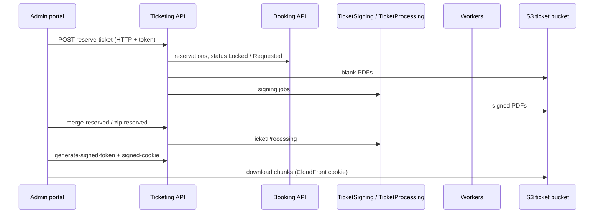

# A-12 · রিজার্ভড টিকিট তৈরি ও বিতরণ

> **Bangla name:** রিজার্ভড টিকিট তৈরি ও বিতরণ
>
> [← 10 · অ্যাডমিন পোর্টাল](README.md) · [সূচিপত্র](../README.md) · [ওপেন কোয়ারি](../99-open-queries.md)

## 1. নাম ও উদ্দেশ্য

**রিজার্ভড টিকিট।** আসন সংরক্ষণ করার পর ([A-11](A-11-seat-reservation.md)) অ্যাডমিন রিজার্ভেশনটিকে আসল টিকিটে রূপ দেন: টিকিট তৈরি করেন, সেগুলো সাইন করান, তারপর ডাউনলোড করেন (মার্জ করা PDF, একটি zip, বা আলাদা ফাইল) অথবা ইমেইল করেন। এগুলো complimentary ও partner টিকিট; এদের কোনো ক্রেতার অ্যাকাউন্ট থাকে না। এটিই **Generate Tickets** মেনু। ধারণাগুলো: [queue-driven processing](../00-platform-primer.md#explainer-queue-driven), [token forwarding](../00-platform-primer.md#explainer-token-forwarding)।

## 2. ট্রিগার ও অ্যাক্টর

**admin policy**-যুক্ত কর্মী (এখানকার প্রতিটি এন্ডপয়েন্টে Ticketing-এর `[Authorize(Policy = Admin)]`)। প্রবেশবিন্দু: program মেনু **Generate Tickets** (`/events/event-ticket`), তারপর `/events/generate-ticket/:id` (কম্পোনেন্ট `generate-ticket` ও `app-gallery-reservation`-সহ)।

## 3. ব্যবসায়িক প্রবাহ

1. একটি event, একটি level ও একটি রিজার্ভেশন বাছুন (অবশিষ্ট reserved আসন দেখানো হয়)।
2. একটি পরিমাণের (অথবা নির্দিষ্ট আসনের) জন্য একটি টিকিট ধরন নিয়ে (ডিফল্ট `Partner Sale`) **Generate** করুন। একটি **test** রিকোয়েস্ট কেবল ফাঁকা টিকিটের একটি প্রিভিউ তৈরি করে।
3. তৈরি টিকিটগুলো **Sign** করান ([S-08](../50-system-initiated/S-08-ticket-signing.md)); সব সাইন না হওয়া পর্যন্ত অপেক্ষা করুন।
4. PDF-তে **Merge** বা **Zip** করুন ([S-09](../50-system-initiated/S-09-ticket-merge-zip.md)); চাংগগুলো ডাউনলোড করুন।
5. বিকল্পে আলাদা টিকিটগুলো একটি zip হিসেবে ডাউনলোড করুন, বা একজন প্রাপককে ইমেইল করুন ([X-21](../60-cross-cutting/X-21-email-ses.md))। টিকিটের action state রেকর্ড করে কী ঘটেছে (`downloaded`, `emailed: {recipient}`, বা একটি কাস্টম লেখা)।

## 4. প্রযুক্তিগত প্রবাহ

1. **তৈরি** **[HTTP + user token]** `ReservedTicketRequest {id (reservation id), amount, hasSeats, seats, ticketType, isTest}`-এর একটি তালিকা সহ `POST /ticketing/api/v1/booking-order-ticket/reserve-ticket?eventId&levelId`। `TicketManager.CreateReservationTicketsAsync`: Booking থেকে রিজার্ভেশন পড়ে (**[HTTP + user token]** `GetReservationsCountAsync`); প্রতিটি রিকোয়েস্টের জন্য: রিজার্ভেশন থাকতে হবে, `Locked` হওয়া চলবে না ("Ticket generation is in process already ..."), এবং `existing + amount` তার টিকিট সংখ্যা বেশি হতে পারবে না ("Request exceeds reserved capacity ..."); একটি ফাঁকা PDF রেন্ডার করে (`GenerateBlankReservedTicket`); একটি **test** রিকোয়েস্টে রিজার্ভেশনে প্রিভিউ URL সংরক্ষণ করে (`UpdateReservationTicketPreviewUrlAsync`) এবং থেমে যায়; নয়তে `amount` সংখ্যক (অথবা প্রতি আসনে একটি) টিকিট ইনসার্ট করে, নম্বর `{prefix}{unique code}`, Redis কাউন্টার `event_ticket_counter:{eventId}` থেকে একটি **ধারাবাহিক নম্বর**, স্ট্যাটাস `Requested`, `CreatedBy = "System"`, তারপর রিজার্ভেশনের স্ট্যাটাস `Locked` সেট করে, প্রতি টিকিটে একটি করে সাইনিং কাজ প্রকাশ করে **[SQS: TicketSigning]** `Complimentary` (টিকিট ধরন) ও `Platform` ফিল্ড সহ, এবং রিজার্ভেশনকে `Requested` সেট করে।
2. **সাইন** (আবার) `POST .../sign-reserve-ticket?eventId&levelId` → `PublishBulkTicketToSign`: ইভেন্টের যেসব টিকিট এখনো `Requested` স্ট্যাটাসে আছে তাদের জন্য সাইনিং কাজ প্রকাশ করে (যেসব টিকিটের কাজ হারিয়ে গেছে তার জন্য একটি মেরামত-পথ)।
3. **পড়া** `GET .../reserve-ticket?eventId&levelId` প্রতি রিজার্ভেশনে রিজার্ভড টিকিট তালিকাভুক্ত করে; `ticketNumbers[]` ও `action` সহ `PUT .../reserve-ticket` action state-এর লেখা সেট করে।
4. **মার্জ ও zip** `GET .../merge-reserved?reservationId`, `zip-reserved?reservationId` `TicketProcessing`-এ প্রকাশ করে, অগ্রগতি `merged-ticket-number`, `zipped-ticket-number` ও Booking-এর স্ট্যাটাস এন্ডপয়েন্টের মাধ্যমে জানা যায় ([S-09](../50-system-initiated/S-09-ticket-merge-zip.md))।
5. **ডাউনলোড** করতে অ্যাডমিনকে আগে `POST .../generate-signed-token` (গ্লোবাল Redis key-তে একটি ৬০ সেকেন্ডের টোকেন) এবং `GET .../signed-cookie` (CloudFront cookie) কল করতে হয় ([X-20](../60-cross-cutting/X-20-file-storage.md))। তারপর `TicketRequest {ticketNumbers[], fileName}` সহ `POST .../download-reserved?signedToken=<token>` টিকিটগুলোর একটি **zip** (ফ্রন্ট প্লাস ব্যাক পেজ) স্ট্রিম করে এবং তাদের স্ট্যাটাস `downloaded` করে; `GET .../download-merged?reservationId&signedToken` রিজার্ভেশনের সব মার্জ করা চাংগ `{reservationId}.zip` হিসেবে স্ট্রিম করে; `POST .../download-test-blank-reserved?signedToken` প্রিভিউ স্ট্রিম করে। অবৈধ বা মেয়াদোত্তীর্ণ টোকেনে "Invalid or expired token." ফেরত হয়।
6. **ইমেইল** `POST .../send-reserved` ([X-21](../60-cross-cutting/X-21-email-ses.md))।
7. `GET .../reserved-urls?reservationId` একটি রিজার্ভেশনের সাইন করা টিকিটের URL তালিকাভুক্ত করে; এতে কোনো `[Authorize]` নেই ও পোর্টালে কোনো কলকারী নেই, এবং এর অ্যাকশন `GetSignedReservedTicketUrlsAsync` দুইবার কল করে (প্রথম ফলাফল বিস্থৃত হয়)।

## 5. কম্পোনেন্ট

| ধরন | কম্পোনেন্ট |
|---|---|
| ক্লায়েন্ট | `features/events/pages/event-ticket`, `components/generate-ticket`, `components/gallery-reservation`, `services/event.service.ts:135-250` |
| সার্ভিস | Ticketing (`BookingOrderTicketController`, `TicketManager`, `TicketGenerationService`); Booking (রিজার্ভেশন); Utility (মার্জ/zip); Event, Admin ক্লায়েন্ট |
| কিউ | `TicketSigning`, `TicketProcessing` |
| টেবিল | Ticketing `Tickets`; Booking `SeatReservations` (`Status`, `MergeStatus`, `ZipStatus`, `BlankTicketPreviewUrl`) |
| Redis | `event_ticket_counter:{eventId}`, `signedToken`, লক |
| স্টোরেজ | S3 টিকিট বাকেট: blank, signed, merged ([X-20](../60-cross-cutting/X-20-file-storage.md)) |
| AWS | SES, CloudFront |

## 6. API কন্ট্রাক্ট

সবগুলো `/ticketing/api/v1/booking-order-ticket/`-এর নিচে, policy `Admin`:

| মেথড | পাথ | রিকোয়েস্ট | রেসপন্স |
|---|---|---|---|
| POST | `reserve-ticket?eventId&levelId` | `ReservedTicketRequest[]` | `200` |
| GET | `reserve-ticket?eventId&levelId` | query | রিজার্ভেশন অনুযায়ী সম্প্রদায়িত টিকিট |
| PUT | `reserve-ticket` | `ticketNumbers[]`, `action` | `200` |
| POST | `sign-reserve-ticket?eventId&levelId` | query | `200` |
| POST | `download-reserved?signedToken=` | `TicketRequest {ticketNumbers[], fileName, email}` | zip স্ট্রিম |
| POST | `download-test-blank-reserved?signedToken=` | `BlankTicketRequest` | zip স্ট্রিম |
| GET | `download-merged?reservationId&signedToken` | query | zip স্ট্রিম |
| GET | `merge-reserved`, `zip-reserved`, `merged-ticket-number`, `zipped-ticket-number` | `reservationId` | `202` / সংখ্যা |
| POST | `send-reserved` | `TicketRequest` | `200` |
| POST / GET | `generate-signed-token`, `signed-cookie` | none | টোকেন / cookie লেখা |

প্রধান নমুনা, `POST .../reserve-ticket?eventId=101&levelId=3305` (প্রপার্টির নাম `ReservedTicketRequest` থেকে; মানগুলো উদাহরণবিশেষ):

```json
[ { "id": 55, "amount": 100, "hasSeats": false, "seats": null, "ticketType": "Partner Sale", "isTest": false } ]
```

## 7. ডেটা ও পার্শ্বপ্রতিক্রিয়া

টিকিট, S3 PDF, রিজার্ভেশনের স্ট্যাটাস পরিবর্তন (`Locked` → `Requested`), সাইনিং বার্তা, Redis কাউন্টার; ইমেইল; ডেটাবেস সারির জন্য অ্যাক্টিভিটি লগ ([X-24](../60-cross-cutting/X-24-activity-logging.md))।

## 8. কোড রেফারেন্স

| কী | কোথায় |
|---|---|
| এন্ডপয়েন্ট | `rvl-gobcb-backend/Services/Ticketing/ETP.Ticketing.Service/Api/BookingOrderTicketController.cs:147-340, 488-535` |
| তৈরি | `rvl-gobcb-backend/Services/Ticketing/ETP.Ticketing.Domain/Managers/TicketManager.cs:1208-1427` |
| বাল্ক সাইনিং | `.../TicketManager.cs:1440-1523` |
| ডাউনলোড | `.../TicketManager.cs:1633-1706, 1750-1795` |
| সাইনড টোকেন | `.../TicketManager.cs:1989-2006` |
| পোর্টাল | `rvl-gobcb-admin-portal/src/app/features/events/services/event.service.ts:135-250` |

## 9. হ্যান্ডওভার নোট

1. **ধারাবাহিক নম্বর আসে একটি Redis কাউন্টার থেকে যা পড়া হয়, কোডে বাড়ানো হয় এবং ফিরিয়ে লেখা হয়** (`event_ticket_counter`), atomic `INCR` নয়। একই ইভেন্টে দুজন অ্যাডমিন একসঙ্গে টিকিট তৈরি করলে ডুপ্লিকেট ধারাবাহিক নম্বর হতে পারে; ইভেন্ট প্রকাশের সময় কাউন্টারটি `0`-এ রিসেট হয় ([A-07](A-07-events.md)) এবং `0` পড়লে ডেটাবেস থেকে নতুন করে তৈরি হয়।
2. **test রিকোয়েস্ট প্রথম আইটেমের পরেই ফেরত দেয়** (লুপের ভেতরে `return`), তাই `isTest` true হলে রিকোয়েস্টের তালিকার কেবল প্রথম উপাদানই প্রক্রিয়া হয়।
3. **আংশিক ব্যর্থতা রিজার্ভেশনকে `Locked` রেখে যায়।** টিকিট ইনসার্ট হওয়ার পর রিজার্ভেশন `Locked` হয় এবং সব সাইনিং কাজ প্রকাশ হওয়ার পরই `Requested`; এই দুইয়ের মাঝে ব্যর্থতা হলে আরও তৈরি ও release আটকে যায় ([A-11](A-11-seat-reservation.md) নোট 6)।
4. **ডাউনলোড টোকেন একটি গ্লোবাল key।** দুজন অ্যাডমিন একসঙ্গে ডাউনলোড করলে ৬০ সেকেন্ডের মধ্যে তাদের টোকেন একে অপরকে বদলে দেয় (X-20 নোট 1); হারাজেতা পক্ষ "Invalid or expired token." পায়।
5. **টিকিটধারীর নাম ফাঁকা** (`TicketHolderName = null`), তাই রিজার্ভড টিকিটে কোনো নাম বা ফোন থাকে না; QR ডেটায় থাকে টিকিটের id, গেট ও `Complimentary` ধরন।
6. **টিকিট ধরনের ডিফল্ট `Partner Sale`**; এই লেখাটি Agent flow-তেও ([X-13](../60-cross-cutting/X-13-agent-pool.md)) এবং রিপোর্টেও দেখা যায়।
7. `download-reserved` zip সরাসরি response-এ লেখে এবং টিকিটগুলো `downloaded` চিহ্নিত করে কেবল স্ট্রিম শেষ হওয়ার পর; সংযোগ বিচ্ছিন্ন হলে টিকিটগুলো চিহ্নিত না থেকে যেতে পারে।

## 10. কম্পোনেন্ট সম্পর্ক



**নির্ভর করে:** [A-11](A-11-seat-reservation.md), [A-13](A-13-ticket-layouts.md), [X-20](../60-cross-cutting/X-20-file-storage.md)। **প্রভাব ফেলে:** [S-08](../50-system-initiated/S-08-ticket-signing.md), [S-09](../50-system-initiated/S-09-ticket-merge-zip.md), [X-21](../60-cross-cutting/X-21-email-ses.md), চেকারের তালিকা ([C-02](../40-checker-app/C-02-offline-ticket-download.md))।

## 11. ডেভেলপার টেস্ট গাইড

**লোকালে টেস্টযোগ্যতা: আংশিক।** সাইনিং পর্যন্ত সবকিছু লোকালে চলে; সাইনিংয়ের জন্য TSP লাগে (dummy), আর CloudFront cookie লোকালে ব্যর্থ হয় ([X-20](../60-cross-cutting/X-20-file-storage.md))।

| আইটেম | বিবরণ |
|---|---|
| টেস্ট ডেটা ও অ্যাকাউন্ট | একটি রিজার্ভেশন ([A-11](A-11-seat-reservation.md)); অ্যাডমিন `…01` |
| ব্রাউজার | `http://localhost:4200/events/event-ticket` → event → জেনারেট; Network: `POST .../reserve-ticket` |
| ইমুলেটর | — |
| Postman | `postman/services/etp-ticketing.postman_collection.json`: "POST /api/v1/booking-order-ticket/reserve-ticket", "POST /api/v1/booking-order-ticket/sign-reserve-ticket", "POST /api/v1/booking-order-ticket/generate-signed-token" `{{access_token_admin}}` দিয়ে |
| Visual Studio debug | `TicketManager.CreateReservationTicketsAsync`, `PublishBulkTicketToSign`; Utility `TicketProcessingTaskManager` |
| যাচাই | SQL: ওই রিজার্ভেশনের টিকিটগুলো (`Status`, `Action`, `ConsecutiveNumber`); `redis-cli GET event_ticket_counter:<eventGuid>`; SQS `TicketSigning` ডেপথ |
