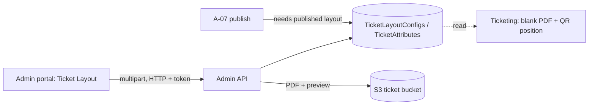

# A-13 · টিকিট লেআউট ও টিকিট অ্যাট্রিবিউট

> **Bangla name:** টিকিট লেআউট ও টিকিট অ্যাট্রিবিউট
>
> [← 10 · অ্যাডমিন পোর্টাল](README.md) · [সূচিপত্র](../README.md) · [ওপেন কোয়ারি](../99-open-queries.md)

## 1. নাম ও উদ্দেশ্য

**টিকিট লেআউট।** ছাপা টিকিট একটি PDF টেমপ্লেট যা প্ল্যাটফর্ম পূরণ করে: টেমপ্লেটের উপর সে টেক্সট ফিল্ড, টিকিট নম্বর, আসনের তথ্য এবং একটি QR কোড আঁকে ([S-07](../50-system-initiated/S-07-initiate-user-ticket-generation.md), [S-08](../50-system-initiated/S-08-ticket-signing.md))। একটি **layout config** একটি program, venue ও gallery-এর জন্য ছয়টি পর্যন্ত টেমপ্লেট ধরে (single বা multiple segments × user, partner, complimentary) এবং একটি ঐচ্ছিক ব্যাক পেজ। **টিকিট অ্যাট্রিবিউট** নির্ধারণ করে টিকিটে কোন তথ্য-ক্ষেত্র কোন ক্রমে দেখাবে। লেআউট প্রকাশ করা একটি ইভেন্ট প্রকাশের পূর্বশর্ত ([A-07](A-07-events.md))।

## 2. ট্রিগার ও অ্যাক্টর

রোল `admin`, `event_manager`, `ticket_manager`, `ticket_operator` (`BCBPersonnel`) কর্মী (`TicketLayoutConfigsController`, `TicketAttributesController`)। প্রবেশবিন্দু: **Prog. Managem.** → একটি program → ট্যাব **Ticket Layout** (`/program-management/program-home/:id`; পেজ `layoutCreate`, `layoutDetails/:id`, `configuration`)। দ্বিতীয় একটি মডিউল `/ticket-layout` (`ticket-layout-management`) একই স্ক্রিনগুলো রাখে কিন্তু মেনুতে নেই।

## 3. ব্যবসায়িক প্রবাহ

1. একটি program, venue ও gallery-এর জন্য লেআউট তৈরি করুন: নাম, টিকিট ধরন, টিকিট সাইজ (`Default`, `Vertical`, `A4`, `Horizontal`), ডিফল্ট লেখা ও partner-sale ডিফল্ট লেখা।
2. ছয়টি ধরনের PDF টেমপ্লেট ও একটি ব্যাক-পেজ PDF আপলোড করুন; প্ল্যাটফর্ম প্রতিটি আপলোডের একটি **প্রিভিউ** রেন্ডার করে।
3. লেআউট প্রকাশ করুন (প্রতি gallery-তে একটি প্রকাশিত লেআউট)। একটি রূপান্তর শুরু করতে লেআউট ডুপ্লিকেট করুন। **program ও venue-এর প্রথম ইভেন্ট তৈরির আগে এটি করুন**, কারণ এরপর আপলোড, অপ্রকাশ ও মুছে ফেলা প্রত্যাখ্যাত হয় (§9)।
4. program-এর টিকিট অ্যাট্রিবিউট নির্ধারণ করুন (gallery, block, level/row, entry gate, mini gate, venue name, segment-এর তারিখ ও সময়, টিকিট ধরন, entry ও exit সময় দেখাবেন কি না, এবং তাদের ক্রম)।

## 4. প্রযুক্তিগত প্রবাহ

1. **[HTTP + user token]** তৈরি `POST /admin/api/v1/ticket-layout` (JSON `TicketLayoutConfig`); এরপর `CheckValidation` ও ইনসার্ট। আপডেট `PUT .../ticket-layout/{id}`; তালিকা `GET .../ticket-layout`, `.../venue/{programId}/{venueId}`, `.../configs/{programId}/{venueId}/{venueGalleryId}`, `.../published/...`, `.../back-page/...`; একটি `GET .../ticket-layout/{id}`।
2. আপলোড `POST /admin/api/v1/ticket-layout/upload/{id}` (multipart: file ও `ticketLayoutType` 0 থেকে 5: `SingleSegmentUser`, `MultipleSegmentUser`, `SingleSegmentPartner`, `MultipleSegmentPartner`, `SingleSegmentComplimentary`, `MultipleSegmentComplimentary`): program ও venue-এর ইভেন্ট ইতিমধ্যে ব্যবহৃত হলে প্রত্যাখ্যাত ("... not uploadable due to active events."); পুরনো ফাইল ও প্রিভিউ মুছে ফেলে, **টিকিট বাকেটে** `ticekt-layout/{id}/{type}/...` পাথে আপলোড করে এবং Admin-এ একটি **প্রিভিউ PDF** তৈরি করে (`BlankPdf.GenerateTicketPdf` টিকিট সাইজ অনুযায়ী, এক বা একাধিক segment) `ticekt-layout-preview/{id}/{type}/...` পাথে; দুটি URL-ই সংরক্ষণ করে ([X-20](../60-cross-cutting/X-20-file-storage.md))। ব্যাক পেজ: `POST .../upload/back-page/{id}` → `back-page-ticekt-layout/{id}/`। ফাইল মুছে ফেলা: `DELETE .../delete-pdf/{id}`, `.../delete-pdf/back-page/{id}`।
3. প্রকাশ `PUT .../publish/{id}`: আগে থেকেই প্রকাশিত হলে ব্যর্থ, অথবা **একই program, venue ও gallery-এর অন্য কোনো লেআউট প্রকাশিত থাকলে** ব্যর্থ ("Ticket Layout Config Already Published for same gallary")। অপ্রকাশ `PUT .../unpublish/{id}`: program ও venue-এ ইতিমধ্যে **কোনো ইভেন্ট** থাকলে ব্যর্থ ("... not unpublishable due to active events.") অথবা আগে থেকেই অপ্রকাশিত হলে ব্যর্থ।
4. ডুপ্লিকেট `PUT .../duplicate/{id}`; মুছে ফেলা `DELETE .../{id}`: program ও venue-এ ইভেন্ট থাকলে প্রত্যাখ্যাত ("... cannot be deleted due to active events."), নয়তে সারিটি সফট ডিলিট হয়; S3 ফাইলগুলো সরানো হয় না।
5. অ্যাট্রিবিউট: `GET /admin/api/v1/ticket-attributes/program/{programId}`, `PUT /admin/api/v1/ticket-attributes/{id}` (ফ্ল্যাগ ও প্রায়োরিটি)। program তৈরির সময় প্রতি program-এর জন্য একটি সারি তৈরি হয় ([A-02](A-02-programs.md)); venue ধরন (`Stadium`/`Exhibition Hall`) এর একটি অংশ।
6. ব্যবহার: টিকিট তৈরির সময় Ticketing ও Admin প্রকাশিত লেআউট ও অ্যাট্রিবিউট অনুযায়ী ফাঁকা PDF রেন্ডার করে (`GetBlankPdf`, `BuildTicketDynamicAttributesAsync`, [S-07](../50-system-initiated/S-07-initiate-user-ticket-generation.md)); `GET .../download-backpage/{eventId}` ডাউনলোডের জন্য ব্যাক পেজ পরিবেশ করে।

## 5. কম্পোনেন্ট

| ধরন | কম্পোনেন্ট |
|---|---|
| ক্লায়েন্ট | `features/program-management/components/ticket-layout-*`, `ticket-configuration`; ডুপ্লিকেট মডিউল `features/ticket-layout-management` |
| সার্ভিস | Admin (`TicketLayoutConfigsController`, `TicketLayoutConfigsManager`, `TicketAttributesController`, `TicketAttributesManager`); Ticketing ও Booking টেবিলগুলো পড়ে |
| টেবিল | `TicketLayoutConfigs`, `TicketAttributes` |
| স্টোরেজ | S3 **টিকিট বাকেট**: `ticekt-layout`, `ticekt-layout-preview`, `back-page-ticekt-layout` |

## 6. API কন্ট্রাক্ট

| মেথড | পাথ | অথ | রিকোয়েস্ট | রেসপন্স | প্রধান ত্রুটি |
|---|---|---|---|---|---|
| POST | `/admin/api/v1/ticket-layout` | রোল Admin, EventManager, TicketManager, BCBPersonnel | `TicketLayoutConfig` | লেআউট | 400 যাচাই |
| PUT | `/admin/api/v1/ticket-layout/{id}` | same | `TicketLayoutConfig` | লেআউট | |
| POST | `/admin/api/v1/ticket-layout/upload/{id}` | same | multipart `file`, `ticketLayoutType` | লেআউট | 400 `not uploadable due to active events` |
| POST | `/admin/api/v1/ticket-layout/upload/back-page/{id}` | same | multipart `file` | লেআউট | |
| PUT | `/admin/api/v1/ticket-layout/publish/{id}`, `unpublish/{id}`, `duplicate/{id}` | same | পাথ | লেআউট | §4-এর বার্তা |
| DELETE | `/admin/api/v1/ticket-layout/{id}`, `delete-pdf/{id}`, `delete-pdf/back-page/{id}` | same | পাথ | লেআউট | |
| GET | `/admin/api/v1/ticket-layout`, `/venue/...`, `/configs/...`, `/published/...`, `/back-page/...`, `/{id}`, `/{id}/{ticketLayoutType}`, `/download-backpage/{eventId}` | same | | | |
| GET | `/admin/api/v1/ticket-attributes/program/{programId}`, `/{id}` | same | | `TicketAttributes` | |
| POST, PUT | `/admin/api/v1/ticket-attributes`, `/{id}` | same | `TicketAttributes` | | |

প্রধান নমুনা, `POST /admin/api/v1/ticket-layout` (প্রপার্টির নাম `TicketLayoutConfig` থেকে; মানগুলো উদাহরণবিশেষ):

```json
{
  "ticketLayoutName": "Final - Stadium",
  "programId": 12, "venueId": 3, "venueGalleryId": 12,
  "ticketType": "Stadium", "ticketSize": "Default",
  "defaultText": "Please keep this ticket safe", "partnerSaleDefaultText": "Partner sale",
  "isPublished": false
}
```

`ticketAttributes` (নির্বাচিত প্রপার্টি): `venueType`, `showGallery`, `showBlock`, `showLevelRow`, `showEntryGate`, `showMiniGate`, `showVenueName`, `showSegmentDateTime`, `galleryPriority`, `blockPriority`, `levelRowPriority`, `entryGatePriority`, `miniGatePriority`, `showTicketType`, `showEntryTime`, `showExitTime` এবং তাদের প্রায়োরিটি।

## 7. ডেটা ও পার্শ্বপ্রতিক্রিয়া

১২টি ফাইল URL (ছয়টি টেমপ্লেট ও ছয়টি প্রিভিউ) সহ লেআউট সারি এবং ব্যাক-পেজের URL; S3 অবজেক্ট; অ্যাক্টিভিটি লগ ([X-24](../60-cross-cutting/X-24-activity-logging.md))।

## 8. কোড রেফারেন্স

| কী | কোথায় |
|---|---|
| কন্ট্রোলার | `rvl-gobcb-backend/Services/Admin/ETP.Admin.Service/Api/TicketLayoutConfigsController.cs:30-330` |
| ম্যানেজার | `rvl-gobcb-backend/Services/Admin/ETP.Admin.Domain/Managers/TicketLayoutConfigsManager.cs:51-760` (তৈরি 51, প্রকাশ 260, অপ্রকাশ 288, আপলোড 478, ব্যাক পেজ 558) |
| অ্যাট্রিবিউট | `rvl-gobcb-backend/Services/Admin/ETP.Admin.Domain/Managers/TicketAttributesManager.cs`, `Models/TicketLayoutConfig/TicketAttributes.cs` |
| পোর্টাল | `rvl-gobcb-admin-portal/src/app/features/program-management/services/ticket-layout.service.ts:28-108`, `ticket-attributes.service.ts` |

## 9. হ্যান্ডওভার নোট

1. **লেআউট আগে আসতে হবে।** program ও venue-এ একটি ইভেন্ট তৈরি হলেই (খসড়া হলেও) লেআউটে নতুন ফাইল আসে না, সেটি অপ্রকাশ করা যায় না বা মুছে ফেলা যায় না; কিন্তু প্রতিটি সক্রিয় gallery-র জন্য প্রকাশিত লেআউট ছাড়া ইভেন্ট প্রকাশ করা যায় না। সঠিক ক্রম: venue, program-venue details, লেআউট (আপলোড ও প্রকাশিত), তারপর ইভেন্ট। ইতিমধ্যে ইভেন্ট থাকা একটি venue-এর টেমপ্লেট বদলানোর কোনো সমর্থিত পথ নেই, ছাড়া সরাসরি ডেটাবেসে হাত দেওয়া `[UNCONFIRMED: Q-23]`।
2. **যাচাই program ও venue-ভিত্তিক, gallery-ভিত্তিক নয়**, তাই একটি ইভেন্ট ওই venue ও program-এর প্রতিটি gallery লেআউটের পরিবর্তন আটকে দেয়।
3. **`ticekt` বানানটি ডেটাতেই আছে** (S3 key ও URL) ([X-20](../60-cross-cutting/X-20-file-storage.md))।
4. **লেআউট ও টিকিট সাইজ Ticketing-এর QR-এর অবস্থান নির্ধারণ করে** (ডিফল্ট ও vertical-এর জন্য `[900, 650, 650]`, A4 ও horizontal ভিন্ন) ([S-08](../50-system-initiated/S-08-ticket-signing.md)); যে টেমপ্লেটের QR এলাকা সাইজের সঙ্গে মেলে না তাতে অপাঠযোগ্য টিকিট তৈরি হয়।
5. **ইভেন্ট প্রকাশের জন্য ইভেন্টের প্রতিটি *সক্রিয়* gallery-র জন্য একটি *প্রকাশিত* লেআউট দরকার** ([A-07](A-07-events.md)); পরে venue-এ যোগ করা এমন gallery প্রকাশ আটকে দেয়।
6. **দুটি পোর্টাল পাথ** (`/program-management` ও লিঙ্কহীন `/ticket-layout`) একই এন্ডপয়েন্ট কল করে; রিফ্যাক্টর করার সময় কেবল একটি রাখুন।
7. আংশিক আপলোড (ফাইল সংরক্ষিত, প্রিভিউ তৈরি ব্যর্থ) ফাইলের URL সেট রেখে প্রিভিউ ছাড়া রাখে; ম্যানেজার আগে পুরনো প্রিভিউ মুছে ফেলে, তারপর আপলোড করে।

## 10. কম্পোনেন্ট সম্পর্ক



**নির্ভর করে:** [A-02](A-02-programs.md), [A-05](A-05-venues.md), [A-06](A-06-program-venue-mapping.md)। **প্রভাব ফেলে:** [A-07](A-07-events.md), [S-07](../50-system-initiated/S-07-initiate-user-ticket-generation.md), [S-08](../50-system-initiated/S-08-ticket-signing.md), [A-12](A-12-reserved-tickets.md)।

## 11. ডেভেলপার টেস্ট গাইড

**লোকালে টেস্টযোগ্যতা: সম্পূর্ণ।**

| আইটেম | বিবরণ |
|---|---|
| টেস্ট ডেটা ও অ্যাকাউন্ট | `pwsh ./scripts/Seed-EtpData.ps1` (লেআউট আগে থেকেই আছে যাতে ইভেন্ট প্রকাশ করা যায়); অ্যাডমিন `…01` |
| ব্রাউজার | `http://localhost:4200/program-management` → program → **Ticket Layout**; Network: multipart `POST .../ticket-layout/upload/{id}` |
| ইমুলেটর | — |
| Postman | `postman/services/etp-admin.postman_collection.json`: "GET /api/v1/ticket-layout", "POST /api/v1/ticket-layout", "POST /api/v1/ticket-layout/upload/{id}" (form-data), "PUT /api/v1/ticket-layout/publish/{id}" |
| Visual Studio debug | `TicketLayoutConfigsManager.UploadTicketLayoutAsync`, `PublishTicketLayoutAsync` |
| যাচাই | SQL: `select "Id","IsPublished","VenueGalleryId" from etp."TicketLayoutConfigs"`; `aws --endpoint-url http://localhost:4566 s3 ls s3://etp-local/ticekt-layout/ --recursive` |
