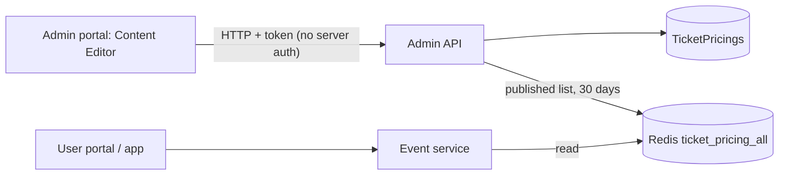

# A-14 · টিকিট-প্রাইসিং কনটেন্ট পেজ

> **Bangla name:** টিকিট-প্রাইসিং কনটেন্ট পেজ
>
> [← 10 · অ্যাডমিন পোর্টাল](README.md) · [সূচিপত্র](../README.md) · [ওপেন কোয়ারি](../99-open-queries.md)

## 1. নাম ও উদ্দেশ্য

**টিকিট-প্রাইসিং পেজ।** একটি কনটেন্ট স্ক্রিন যা গ্রাহককে সাধারণ টেক্সট লাইন হিসেবে কোনো program ও venue-এর টিকিটের দাম জানায় (অ্যাট্রিবিউটের নাম ও দাম, যেমন "Gallery A: 500")। এটি **কনটেন্ট**, ইভেন্টের আসল দাম থেকে আলাদা ([A-09](A-09-event-level-pricing.md)); অ্যাডমিন হাতে এটি হালনাগাদ রাখেন।

**এই স্ক্রিনটি গ্রাহক-মুখী দামের পেজের সঙ্গে যুক্ত নয়।** Event সার্ভিস এই কনটেন্টটি `/event/api/v1/ticket-pricing/list`-এ এক্সপোজ করে, কিন্তু পোর্টাল ও অ্যাপ `program-pricing` পড়ে — অর্থাৎ ইভেন্ট টেবিল থেকে আসা প্রকৃত লেভেলভিত্তিক দাম। **এখানে প্রকাশ করা কোনো কিছুই আজ গ্রাহককে দেখানো হয় না।** §4 নোট 4 ও §9 নোট 1 দেখুন।

## 2. ট্রিগার ও অ্যাক্টর

যে কর্মীরা **Site Settings → Content Editor** খুলতে পারেন (গ্লোবাল মেনু, `/content-editor/ticket-pricing`)। **সার্ভারে** `TicketPricingController`-এ কোনো `[Authorize]` নেই ([X-18](../60-cross-cutting/X-18-endpoints-without-auth.md))।

## 3. ব্যবসায়িক প্রবাহ

এন্ট্রিগুলো তালিকাভুক্ত করুন, একটি তৈরি করুন (program-এর নাম, venue-এর নাম, অ্যাট্রিবিউটের নাম ও দামের একটি তালিকা), সম্পাদনা করুন, **প্রকাশ** বা **অপ্রকাশ** করুন, মুছে ফেলুন। কেবল প্রকাশিত এন্ট্রিই গ্রাহকের কাছে দৃশ্যমান হতো — এবং §4 নোট 4-এর কারণে, একটিও নয়।

## 4. প্রযুক্তিগত প্রবাহ

1. **[HTTP + user token]** `GET /admin/api/v1/ticket-pricing?...` (পেজযুক্ত), `GET .../ticket-pricing/list`, `GET .../{id}`।
2. তৈরি `POST .../ticket-pricing` (JSON `CreateOrUpdateTicketPricing {programName, venueName, isPublished, attributes[{attributeName, attributePrice}]}`), আপডেট `PUT .../{id}` (অ্যাট্রিবিউটের তালিকা মুছে নতুন করে লেখা হয়), প্রকাশ `PUT .../publish/{id}`, অপ্রকাশ `PUT .../unpublish/{id}`, মুছে ফেলা `DELETE .../{id}`, একটি অ্যাট্রিবিউট মুছে ফেলা `DELETE .../attribute/{attributeId}`।
3. প্রতিটি পরিবর্তনের পর `RefreshTicketPricingCacheAsync` সব সারি পড়ে, **প্রকাশিত**গুলো রাখে, এবং তালিকাটি Redis key `ticket_pricing_all`-এ **৩০ দিনের** জন্য লেখে ([X-25](../60-cross-cutting/X-25-redis.md))।
4. **গ্রাহকের পড়া — এবং এটিই গুরুত্বপূর্ণ অংশ: গ্রাহকের প্রকৃত দামের পেজ এই কনটেন্ট ব্যবহার করে না।** Event সার্ভিস **দুটি** প্রাইসিং এন্ডপয়েন্ট এক্সপোজ করে:
   - `GET /event/api/v1/ticket-pricing/list` → `EventTicketPriceManager.GetAllTicketPricingAsync` **শুধু Redis key `ticket_pricing_all`** থেকে পড়ে — অর্থাৎ এই স্ক্রিনের কনটেন্ট। Key না থাকলে এটি "Ticket pricing data not found in cache. Please ensure Admin service has populated the cache." লগ করে এবং একটি **ফাঁকা তালিকা** ফেরত দেয়।
   - `GET /event/api/v1/ticket-pricing/program-pricing` → `ProgramPricingManager.GetProgramPricingAsync` প্রকৃত event, venue, gallery, ticket-type ও price টেবিল থেকে একটি **live** তালিকা তৈরি করে।

   ইউজার পোর্টাল ও অ্যাপ রেন্ডার করে **`program-pricing`**, `list` নয়। পোর্টালে `EventApiService.getTicketPricingList()` (`event-api.service.ts:65-70`, যা `/list`-এ যায়)-এর **কোনো কলকারী নেইই**, অথবা `getProgramPricing()` (`:72-77`) `event.effects.ts:40` থেকে কল হয় এবং `ticket-pricing.component.ts:46` ও `event-overview.component.ts:171` তা পড়ে। **তাই এই স্ক্রিনে কর্মীরা যে কনটেন্ট সম্পাদনা করেন, তা গ্রাহকের কাছে অদৃশ্য**, আর ধাপ 3-এ তৈরি করা Redis ক্যাশ করা তালিকাও কখনও দেখানো হয় না ([P-03](../20-user-portal/P-03-info-pages.md), [U-03](../30-user-app/U-03-info-pages.md))।

## 5. কম্পোনেন্ট

| ধরন | কম্পোনেন্ট |
|---|---|
| ক্লায়েন্ট | `features/content-editor` কম্পোনেন্ট `TicketPricingListComponent`, `CreateTicketPricingComponent`, `services/content-editor.service.ts:26-53` |
| সার্ভিস | Admin (`TicketPricingController`, `TicketPricingManager`); Event (`TicketPricingController`, `EventTicketPriceManager`, Redis থেকে পড়ে) |
| টেবিল | `TicketPricings`, `TicketPricingAttributes` |
| Redis | `ticket_pricing_all` (৩০ দিন) |

## 6. API কন্ট্রাক্ট

| মেথড | পাথ | অথ | রিকোয়েস্ট | রেসপন্স |
|---|---|---|---|---|
| GET | `/admin/api/v1/ticket-pricing`, `/list`, `/{id}` | **none** | paging | `TicketPricingProgram` |
| POST | `/admin/api/v1/ticket-pricing` | **none** | `CreateOrUpdateTicketPricing` | `TicketPricingProgram` |
| PUT | `/admin/api/v1/ticket-pricing/{id}`, `publish/{id}`, `unpublish/{id}` | **none** | body / পাথ | `TicketPricingProgram` |
| DELETE | `/admin/api/v1/ticket-pricing/{id}`, `attribute/{attributeId}` | **none** | পাথ | ফলাফল |

প্রধান নমুনা, `POST /admin/api/v1/ticket-pricing` (প্রপার্টির নাম `CreateOrUpdateTicketPricing` থেকে; মানগুলো উদাহরণবিশেষ; `attributePrice` একটি পূর্ণসংখ্যা):

```json
{
  "programName": "Premier League 2026",
  "venueName": "Sher-e-Bangla National Cricket Stadium",
  "isPublished": true,
  "attributes": [ { "attributeName": "Gallery A", "attributePrice": 500 }, { "attributeName": "VIP", "attributePrice": 3000 } ]
}
```

ত্রুটি: `Id must be greater than zero.`, `No ticket pricing found for id {id}.` (400)।

## 7. ডেটা ও পার্শ্বপ্রতিক্রিয়া

সারি, ৩০ দিনের Redis তালিকা; অ্যাক্টিভিটি লগ ([X-24](../60-cross-cutting/X-24-activity-logging.md))।

## 8. কোড রেফারেন্স

| কী | কোথায় |
|---|---|
| কন্ট্রোলার | `rvl-gobcb-backend/Services/Admin/ETP.Admin.Service/Api/TicketPricingController.cs:14-170` |
| ম্যানেজার | `rvl-gobcb-backend/Services/Admin/ETP.Admin.Domain/Managers/TicketPricingManager.cs:97-330` |
| DTO | `rvl-gobcb-backend/Services/Admin/ETP.Admin.Domain/Models/TicketPricing/CreateOrUpdateTicketPricing.cs` |
| পোর্টাল | `rvl-gobcb-admin-portal/src/app/features/content-editor/services/content-editor.service.ts:26-53` |

## 9. হ্যান্ডওভার নোট

1. **এখানে এডিটর যা লেখেন তা গ্রাহক পর্যন্ত পৌঁছায় না।** পুরো স্ক্রিনটিই একটি মৃত প্রান্ত: গ্রাহকের দামের পেজ `program-pricing` পড়ে (ইভেন্ট টেবিল থেকে live দাম), `ticket_pricing_all` নয় (§4 নোট 4)। এই কনটেন্ট সম্পাদনা, প্রকাশ ও অপ্রকাশ করলে **কোনো গ্রাহক-দৃশ্যমান পেজ বদলায় না**। ব্যবসার সঙ্গে নিশ্চিত করুন যে এই স্ক্রিনের থাকার কথাই কি, নাকি পোর্টাল ভুল এন্ডপয়েন্টে যুক্ত — go-live-এর আগে এর উত্তর দরকার।
2. **কোনো অথরাইজেশন নেই**: যে কেউ এন্ডপয়েন্টে পৌঁছাতে পারেন, সে পাবলিক দামের পেজ প্রকাশ, পরিবর্তন বা মুছে ফেলতে পারেন।
3. **নাম, id নয়।** এন্ট্রিটি program ও venue-কে মুক্ত লেখা হিসেবে সংরক্ষণ করে; এটি program বা প্রকৃত দামের সঙ্গে যুক্ত নয়, তাই সেগুলোর সঙ্গে অসামঞ্জস্য হতে পারে।
4. **ক্যাশ করা তালিকা দেখানো হলেও সেটি ভঙ্গুর হতো।** `/list` **শুধু** Redis key `ticket_pricing_all` থেকে উত্তর দেয়। Redis flush, failover বা ৩০ দিনের মেয়াদ শেষ হওয়ার পর এটি ফাঁকা তালিকা ফেরত দেয়, যা কোনো অ্যাডমিন আবার কোনো টিকিট-প্রাইসিং এন্ট্রি না সেভ করা পর্যন্ত; স্টার্ট-আপে কিছুই এটি নতুন করে তৈরি করে না, আর ডেটাবেসে হাতে বদলালেও তা দৃশ্যমান হয় না।
5. **`attributePrice` একটি পূর্ণসংখ্যা** (`long`), তাই দশমিক দাম দেখানো যায় না।
6. **অপ্রকাশে সময়ের পুরনো অবস্থা।** অপ্রকাশ এন্ট্রিটি সঙ্গে সঙ্গে ক্যাশ করা তালিকা থেকে সরায়, কিন্তু পুরনো তালিকা ধরে রাখা কোনো ক্লায়েন্ট রিলোড না করা পর্যন্ত তা দেখাতে থাকে।
7. **গ্রাহক-মুখী প্রাইসিং `attributePrice`-মুক্ত**, কারণ `program-pricing` প্রকৃত লেভেলভিত্তিক দাম পড়ে ([A-09](A-09-event-level-pricing.md)) — তাই দুটি ফিচার সম্পূর্ণ ভিন্ন সংখ্যা দেখাতে পারে, এবং সেগুলো মিলে কি না যাচাইয়ের কোনো ব্যবস্থা নেই।

## 10. কম্পোনেন্ট সম্পর্ক



**নির্ভর করে:** কিছু নয়। **প্রভাব ফেলে:** [P-03](../20-user-portal/P-03-info-pages.md), [U-03](../30-user-app/U-03-info-pages.md)।

## 11. ডেভেলপার টেস্ট গাইড

**লোকালে টেস্টযোগ্যতা: সম্পূর্ণ।**

| আইটেম | বিবরণ |
|---|---|
| টেস্ট ডেটা ও অ্যাকাউন্ট | অ্যাডমিন `…01` (গ্লোবাল মেনু) |
| ব্রাউজার | `http://localhost:4200/content-editor/ticket-pricing` → তৈরি, প্রকাশ; ইউজার পোর্টালের প্রাইসিং পেজ |
| ইমুলেটর | — |
| Postman | `postman/services/etp-admin.postman_collection.json`: "GET /api/v1/ticket-pricing", "POST /api/v1/ticket-pricing" |
| Visual Studio debug | `TicketPricingManager.RefreshTicketPricingCacheAsync` |
| যাচাই | `redis-cli GET ticket_pricing_all`; `TicketPricings`-এ SQL |
