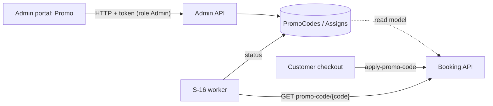

# A-15 · প্রোমো কোড

> **Bangla name:** প্রোমো কোড
>
> [← 10 · অ্যাডমিন পোর্টাল](README.md) · [সূচিপত্র](../README.md) · [ওপেন কোয়ারি](../99-open-queries.md)

## 1. নাম ও উদ্দেশ্য

**প্রোমো কোড।** একটি promo code হলো ছোট একটি লেখা যা চেকআউটে গ্রাহক টাইপ করে ছাড় পান। অ্যাডমিন তার মান (শতকরা বা নির্দিষ্ট পরিমাণ), বৈধতার সময়সীমা, মোট ও প্রতি গ্রাহক ব্যবহারের সীমা, এবং এটি কোন program-এর কোন event বা gallery-তে প্রযোজ্য তা নির্ধারণ করেন। স্ট্যাটাস (`Upcoming`, `Active`, `Expired`, `LimitReached`) একটি ওয়ার্কার হালনাগাদ রাখে ([S-16](../50-system-initiated/S-16-promo-code-status.md)); গ্রাহকের দিকটি [P-05](../20-user-portal/P-05-apply-promo-code.md)।

## 2. ট্রিগার ও অ্যাক্টর

রোল `admin` কর্মী (`PromoCodeController` কেবল `Admin` অনুমোদন করে)। প্রবেশবিন্দু: program মেনু **Promo & Discount → Promo** (`/promo-management`, `/promo-management/create`, `/promo-management/edit-promo/:promoCodeId`)।

## 3. ব্যবসায়িক প্রবাহ

1. program-এর promo code স্ট্যাটাস, তারিখ ও ব্যবহারসহ তালিকাভুক্ত করুন।
2. তৈরি: code (≤ 12 অক্ষর, অনন্য), নাম (≤ 26), ছাড়ের ধরন (`Percentage` বা `FixedAmount`) ও মান, "প্রয়োগ হয়" (`BasePrice` বা `DiscountedPrice`), শুরু ও শেষ, মোট ব্যবহারের সীমা, প্রতি ব্যবহারকারীর সীমা, এবং একটি program-এর সঙ্গে এক বা একাধিক **অ্যাসাইনমেন্ট** — যেখানে নির্দিষ্ট **events** অথবা নির্দিষ্ট **galleries of events**।
3. সম্পাদনা বা মুছে ফেলুন (সফট ডিলিট)।
4. নির্বাচিত event-এ ইতিমধ্যে অন্য promo code থাকলে ফর্ম সতর্ক করে (`exists` যাচাই)।

## 4. প্রযুক্তিগত প্রবাহ

1. **[HTTP + user token]** `GET /admin/api/v1/promo-codes?...` (পেজযুক্ত), `/promo-codes/{id}`; `GET .../promo-codes/exists?eventIds=...&promoCodeId=` অন্য কোড ইতিমধ্যে ওই eventগুলো আধারণ করলে `{Success: false, Message: "A promo code is already assigned to the selected events: ..."}` ফেরত দেয়। ফর্ম program, event ও gallery `GET /program`, `GET /events/list`, `GET /events/program/{id}/events`, `POST /eventsVenueDetails/galleries/by-event-ids` থেকে লোড করে ([A-07](A-07-events.md), [A-09](A-09-event-level-pricing.md))।
2. তৈরি `POST .../promo-codes` (JSON `CreateOrUpdatePromoCode`)। `PromoCodeManager.CreateAsync`: `CheckValidityOfPromoCode` (code আবশ্যক, ≤ 12, code-গুলোর মধ্যে অনন্য (`ExistsAsync(id, code)`), নাম আবশ্যক, ≤ 26, প্রতি ব্যবহারকারীর সীমা মোট সীমার বেশি নয়, শতকরা মানের জন্য পূর্ণসংখ্যা, শুরু ও শেষ দুটোই সেট ও শেষ শুরুর পরে, অন্তত একটি অ্যাসাইনমেন্ট, প্রতিটি program ও event আছে); স্ট্যাটাস হিসাব করে (`GetPromoCodeStatusAsync`: শুরুর আগে `Upcoming`, শেষের পরে `Expired`, ওই code-এর paid order মোট সীমায় পৌঁছালে `LimitReached`, নয়তো `Active`); `IsPublished = (status == Active)` রেখে code ইনসার্ট করে; অ্যাসাইনমেন্ট ইনসার্ট করে (event অ্যাসাইনমেন্ট event-গুলো যুক্ত করে; gallery অ্যাসাইনমেন্ট event, gallery ও venue-event-gallery নাম যুক্ত করে)।
3. আপডেট `PUT .../promo-codes/{id}`: একই যাচাই, অ্যাসাইনমেন্টের তালিকা প্রতিস্থাপন করে, স্ট্যাটাস পুনরায় হিসাব করে। মুছে ফেলা `DELETE .../promo-codes/{id}`: `IsDeleted = true`।
4. স্ট্যাটাস ওয়ার্কার `Status`, `IsActive`, `IsPublished` হালনাগাদ রাখে ([S-16](../50-system-initiated/S-16-promo-code-status.md))। Booking একই টেবিল read model হিসেবে পড়ে এবং চেকআউটে নিজেই code যাচাই করে ([P-05](../20-user-portal/P-05-apply-promo-code.md))।

## 5. কম্পোনেন্ট

| ধরন | কম্পোনেন্ট |
|---|---|
| ক্লায়েন্ট | `features/promo-management/pages/{promo-list,create-promo}`, `services/promo-management.service.ts:22-72` |
| সার্ভিস | Admin (`PromoCodeController`, `PromoCodeManager`); Booking (পড়া, ব্যবহারের সংখ্যা); Admin ওয়ার্কার |
| টেবিল | `PromoCodes`, `PromoCodeAssigns` (+ event, gallery ও venue-event-gallery লিঙ্ক টেবিল) |

## 6. API কন্ট্রাক্ট

| মেথড | পাথ | অথ | রিকোয়েস্ট | রেসপন্স | প্রধান ত্রুটি |
|---|---|---|---|---|---|
| GET | `/admin/api/v1/promo-codes`, `/list`, `/{id}`, `/code/{code}/{eventId}` | `Admin` | paging | `PromoCode` | |
| POST | `/admin/api/v1/promo-codes` | `Admin` | `CreateOrUpdatePromoCode` | `PromoCode` | 400 উপরের যাচাই বার্তা |
| PUT | `/admin/api/v1/promo-codes/{id}` | `Admin` | same | `PromoCode` | 400 `PromoCode with ID {id} not found.` |
| DELETE | `/admin/api/v1/promo-codes/{id}` | `Admin` | পাথ | `PromoCode` | 400 `Invalid promo code ID.` |
| GET | `/admin/api/v1/promo-codes/exists` | `Admin` | `eventIds[]`, `promoCodeId` | `{Success, Message}` | |

Enum: `discountType` `1` Percentage, `2` FixedAmount; `discountAppliedTo` `1` BasePrice, `2` DiscountedPrice; `assignType` `1` Event, `2` Gallery।

প্রধান নমুনা, `POST /admin/api/v1/promo-codes` (প্রপার্টির নাম `CreateOrUpdatePromoCode` থেকে; মানগুলো উদাহরণবিশেষ):

```json
{
  "code": "EARLY10", "name": "Early bird 10 percent", "programId": 12,
  "discountType": 1, "discountValue": 10, "discountAppliedTo": 1,
  "startDateTime": "2026-12-01T00:00:00Z", "endDateTime": "2026-12-31T23:59:59Z",
  "totalUsageLimit": 500, "limitPerUser": 2,
  "assignTo": [ { "assignType": 1, "programId": 12, "eventIds": [101] } ]
}
```

## 7. ডেটা ও পার্শ্বপ্রতিক্রিয়া

promo code সারি ও অ্যাসাইনমেন্ট; অ্যাক্টিভিটি লগ ([X-24](../60-cross-cutting/X-24-activity-logging.md)); কোনো ক্যাশ নেই, কোনো কিউ নেই।

## 8. কোড রেফারেন্স

| কী | কোথায় |
|---|---|
| কন্ট্রোলার | `rvl-gobcb-backend/Services/Admin/ETP.Admin.Service/Api/PromoCodeController.cs:26-150` |
| ম্যানেজার | `rvl-gobcb-backend/Services/Admin/ETP.Admin.Domain/Managers/PromoCodeManager.cs:98-286, 320-457` |
| গ্রাহক-দিকের যাচাই | `rvl-gobcb-backend/Services/Booking/ETP.Booking.Domain/Managers/UserBookingOrderManager.cs:1135-1193` |
| পোর্টাল | `rvl-gobcb-admin-portal/src/app/features/promo-management/services/promo-management.service.ts:22-72` |

## 9. হ্যান্ডওভার নোট

1. **"আগে থেকেই বরাদ্দ করা" শুধু পরামর্শমূলক।** `exists` কল কেবল একটি বার্তা ফেরত দেয়; `CreateAsync` ওভারল্যাপিং event অ্যাসাইনমেন্ট প্রত্যাখ্যান করে না, তাই একটি event-এ দুটি code থাকতে পারে।
2. **স্ট্যাটাস সেভের সময় এবং এরপর ওয়ার্কার দ্বারা হিসাব হয়**, কিন্তু প্রয়োগের ধাপ নিজেই তারিখ ও ব্যবহার পুনরায় হিসাব করে ([S-16](../50-system-initiated/S-16-promo-code-status.md) নোট 2), তাই স্ট্যাটাস ক্ষেত্রটি মূলত অ্যাডমিনের তালিকার জন্য কাজ করে।
3. **একটি code-এর লেখা কেবল অ-মুছা code-গুলোর মধ্যে অনন্য** (`ExistsAsync`); সফট-ডিলিট করা কোড তার লেখা আটকায় কি না তা এখানে যাচাই করা হয়নি `[UNCONFIRMED: Q-25]`।
4. **শতকরা মান অবশ্যই পূর্ণসংখ্যা।** ১০০-এর বেশি কোনো মান এখানে তালিকাভুক্ত ম্যানেজারের যাচাই দ্বারা প্রত্যাখ্যাত হয় না।
5. **আপডেট অ্যাসাইনমেন্ট প্রতিস্থাপন করে** (`AssignTo.Clear()` তারপর পুনরায় যোগ), তাই প্রতিটি সম্পাদনায় অ্যাসাইনমেন্টের id বদলে যায়।
6. **ছাড়ের স্তর।** `discountAppliedTo` একটি code-কে base price-এর বা সিস্টেম ছাড়ের পরের দামে প্রয়োগ করতে দেয় ([A-16](A-16-discounts.md)); Booking এই দুটির ক্রম কীভাবে নেয় তা [P-05](../20-user-portal/P-05-apply-promo-code.md) ও [P-06](../20-user-portal/P-06-booking-payment.md)-এ বর্ণিত।

## 10. কম্পোনেন্ট সম্পর্ক



**নির্ভর করে:** [A-02](A-02-programs.md), [A-07](A-07-events.md)। **প্রভাব ফেলে:** [P-05](../20-user-portal/P-05-apply-promo-code.md), [P-06](../20-user-portal/P-06-booking-payment.md), রিপোর্ট ([A-22](A-22-reports.md))।

## 11. ডেভেলপার টেস্ট গাইড

**লোকালে টেস্টযোগ্যতা: সম্পূর্ণ।**

| আইটেম | বিবরণ |
|---|---|
| টেস্ট ডেটা ও অ্যাকাউন্ট | `pwsh ./scripts/Seed-EtpData.ps1`; অ্যাডমিন `…01` (রোল `admin` আবশ্যক) |
| ব্রাউজার | `http://localhost:4200/promo-management` (আগে একটি program নির্বাচন করুন) → তৈরি; Network: `POST .../admin/api/v1/promo-codes` |
| ইমুলেটর | — |
| Postman | `postman/services/etp-admin.postman_collection.json`: "GET /api/v1/promo-codes", "POST /api/v1/promo-codes", "GET /api/v1/promo-codes/exists" |
| Visual Studio debug | `PromoCodeManager.CreateAsync`, `CheckValidityOfPromoCode` |
| যাচাই | SQL: `select "Code","Status","IsPublished","TotalUsageLimit" from etp."PromoCodes"` |
