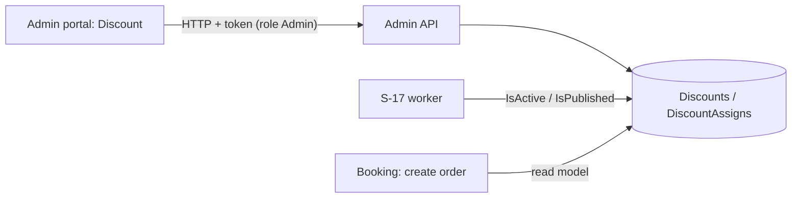

# A-16 · সিস্টেম ডিসকাউন্ট

> **Bangla name:** সিস্টেম ডিসকাউন্ট
>
> [← 10 · অ্যাডমিন পোর্টাল](README.md) · [সূচিপত্র](../README.md) · [ওপেন কোয়ারি](../99-open-queries.md)

## 1. নাম ও উদ্দেশ্য

**সিস্টেম ডিসকাউন্ট।** একটি system discount কোড ছাড়াই স্বয়ংক্রিয়ভাবে টিকিটের দাম কমায় — নির্বাচিত event বা gallery-এর জন্য একটি সময়সীমার মধ্যে (যেমন early-bird দাম)। অ্যাডমিন নাম, ধরন (শতকরা বা নির্দিষ্ট পরিমাণ), মান, শুরু ও শেষ এবং অ্যাসাইনমেন্টগুলো নির্ধারণ করেন। শুরু ও শেষে স্ট্যাটাস সুইচ একটি ওয়ার্কার করে ([S-17](../50-system-initiated/S-17-discount-status.md)); গ্রাহক আসন নির্বাচন ও অর্ডারে কম দাম দেখেন ([P-04](../20-user-portal/P-04-seat-selection.md), [P-06](../20-user-portal/P-06-booking-payment.md))।

## 2. ট্রিগার ও অ্যাক্টর

রোল `admin` কর্মী (`DiscountController` `Admin` অনুমোদন করে; একটি পড়ার এন্ডপয়েন্ট বেগতর)। প্রবেশবিন্দু: program মেনু **Promo & Discount → Discount** (`/promo-management/discount`, `/promo-management/discount/create-discount`, `/discount/edit-discount/:discountId`)।

## 3. ব্যবসায়িক প্রবাহ

ছাড় তালিকাভুক্ত করুন; তৈরি করুন নাম (≤ 26 অক্ষর), ধরন `Percentage` (পূর্ণসংখ্যা) বা `FixedAmount`, মান, শুরু ও শেষ এবং এক বা একাধিক অ্যাসাইনমেন্ট (event-সহ একটি program, অথবা gallery-সহ event) দিয়ে; সম্পাদনা করুন; মুছে ফেলুন (সফট)। ফর্ম প্রথমে যাচাই করে নেয় নির্বাচিত event-এ ইতিমধ্যে ছাড় আছে কি না।

## 4. প্রযুক্তিগত প্রবাহ

1. **[HTTP + user token]** `GET /admin/api/v1/discount?...`, `/discount/list`, `/discount/{id}`; `GET .../discount/exists?eventIds&discountId` ফেরত দেয় অন্য ছাড় ইতিমধ্যে ওই eventগুলো আধারণ করেছে কি না।
2. তৈরি `POST .../discount` (JSON `CreateOrUpdateDiscount {name, programId, discountType, discountValue, startDateTime, endDateTime, discountAssigns[]}`)। `DiscountManager.CreateAsync`: যাচাই (নাম আবশ্যক ও ≤ 26, শতকরার জন্য পূর্ণসংখ্যা, তারিখ দুটোই সেট ও শেষ শুরুর পরে, অন্তত একটি অ্যাসাইনমেন্ট, program ও event আছে), তারপর `GetDiscountStatus` (তারিখ অনুযায়ী `Upcoming`, `Expired`, `Active`) এবং `IsActive = IsPublished = (status == Active)` রেখে ইনসার্ট, সঙ্গে অ্যাসাইনমেন্ট।
3. আপডেট `PUT .../discount/{id}`, মুছে ফেলা `DELETE .../discount/{id}`।
4. **চেকআউটে (এই API-র মাধ্যমে নয়, Booking-এ):** `UserBookingOrderManager.CreateAsync` কল করে `DiscountRepository.GetDiscountByIdsAsync(programId, eventId, galleryId)`: এমন একটি ছাড় যা মুছা হয়নি, `IsActive` ও `IsPublished`, program-এর সঙ্গে এবং event-এর সঙ্গে (অথবা event-এর সঙ্গে gallery-র) বরাদ্দ করা। একটি শতকরা ছাড় **base price** কমায় (`basePrice × value / 100 × seats`), আর একটি নির্দিষ্ট ছাড় `value × seats` বিয়োগ করে ([S-17](../50-system-initiated/S-17-discount-status.md))।
5. `GET /admin/api/v1/discount/program/{programId}/{eventId}/{galleryId}` বেগতর এবং মিলে যাওয়া ছাড় ফেরত দেয়; Booking একে `IAdminClient`-এর মাধ্যমে কল করত (`UserBookingOrderManager.CreateAsync`-এ সেই কল মন্তব্যযুক্ত)।

## 5. কম্পোনেন্ট

| ধরন | কম্পোনেন্ট |
|---|---|
| ক্লায়েন্ট | `features/promo-management/pages/{discount-list,create-discount}`, `services/promo-management.service.ts:76-98` |
| সার্ভিস | Admin (`DiscountController`, `DiscountManager`, ওয়ার্কার); Booking (read model ও ব্যবহার) |
| টেবিল | `Discounts`, `DiscountAssigns` |

## 6. API কন্ট্রাক্ট

| মেথড | পাথ | অথ | রিকোয়েস্ট | রেসপন্ড | প্রধান ত্রুটি |
|---|---|---|---|---|---|
| GET | `/admin/api/v1/discount`, `/list`, `/{id}` | `Admin` | paging | `Discount` | |
| POST | `/admin/api/v1/discount` | `Admin` | `CreateOrUpdateDiscount` | `Discount` | 400 যাচাই |
| PUT | `/admin/api/v1/discount/{id}` | `Admin` | same | `Discount` | 400 `Discount with ID {id} not found.` |
| DELETE | `/admin/api/v1/discount/{id}` | `Admin` | পাথ | `Discount` | |
| GET | `/admin/api/v1/discount/exists` | `Admin` | `eventIds[]`, `discountId` | বার্তা |
| GET | `/admin/api/v1/discount/program/{programId}/{eventId}/{galleryId}` | **anonymous** | পাথ | `Discount` | |

প্রধান নমুনা, `POST /admin/api/v1/discount` (নাম `CreateOrUpdateDiscount` থেকে; `discountType` `1` Percentage, `2` FixedAmount; অ্যাসাইনমেন্টের ফিল্ড [A-15](A-15-promo-codes.md)-এর মতো; মানগুলো উদাহরণবিশেষ):

```json
{
  "name": "Early bird", "programId": 12, "discountType": 1, "discountValue": 15,
  "startDateTime": "2026-12-01T00:00:00Z", "endDateTime": "2026-12-05T23:59:59Z",
  "discountAssigns": [ { "assignType": 1, "programId": 12, "eventIds": [101] } ]
}
```

## 7. ডেটা ও পার্শ্বপ্রতিক্রিয়া

Discount সারি ও অ্যাসাইনমেন্ট; অ্যাক্টিভিটি লগ ([X-24](../60-cross-cutting/X-24-activity-logging.md))। ওয়ার্কার পরে ফ্ল্যাগগুলো বদলায় ([S-17](../50-system-initiated/S-17-discount-status.md))।

## 8. কোড রেফারেন্স

| কী | কোথায় |
|---|---|
| কন্ট্রোলার | `rvl-gobcb-backend/Services/Admin/ETP.Admin.Service/Api/DiscountController.cs:26-150` |
| ম্যানেজার | `rvl-gobcb-backend/Services/Admin/ETP.Admin.Domain/Managers/DiscountManager.cs:60-350, 439-450` |
| Booking-এ লুকআপ ও ব্যবহার | `rvl-gobcb-backend/Services/Booking/ETP.Booking.Storage/Repositories/DiscountRepository.cs:14-31`, `.../UserBookingOrderManager.cs:188-200` |
| পোর্টাল | `rvl-gobcb-admin-portal/src/app/features/promo-management/services/promo-management.service.ts:76-98` |

## 9. হ্যান্ডওভার নোট

1. **কেবল একটি ছাড়ই প্রযোজ্য** এবং `FirstOrDefault` সেটিকে বেছে নেয়; ওভারল্যাপিং অ্যাসাইনমেন্টের জন্য `exists` শুধু সতর্ক করে, সেভের সময় প্রত্যাখ্যান করে না ([S-17](../50-system-initiated/S-17-discount-status.md) নোট 3)।
2. **শুরু ও শেষে দুই মিনিট পর্যন্ত দামের বিচ্যুতি**, কারণ Booking তারিখ নয়, ফ্ল্যাগ যাচাই করে ([S-17](../50-system-initiated/S-17-discount-status.md) নোট 1)।
3. **অতীতে তৈরি নতুন ছাড় `Expired` হিসেবে সেভ হয়**, আর অ্যাডমিন এডিট করে `IsActive` হাতে বদলালেও সেটি পরবর্তী স্ট্যাটাস পরিবর্তনে বদলে যায়।
4. **নির্দিষ্ট পরিমাণের ছাড় প্রতি আসন**, তাই চারটি আসনে ২০০-এর ছাড় মানে ৮০০; দামের চেয়ে বড় নির্দিষ্ট মান এখানে সীমাবদ্ধ করা হয় না।
5. `discount/program/...` পড়াটি বেগতর ([X-18](../60-cross-cutting/X-18-endpoints-without-auth.md))।

## 10. কম্পোনেন্ট সম্পর্ক



**নির্ভর করে:** [A-07](A-07-events.md)। **প্রভাব ফেলে:** [P-04](../20-user-portal/P-04-seat-selection.md), [P-06](../20-user-portal/P-06-booking-payment.md), [S-10](../50-system-initiated/S-10-vat-challan.md), রিপোর্ট ([A-22](A-22-reports.md))।

## 11. ডেভেলপার টেস্ট গাইড

**লোকালে টেস্টযোগ্যতা: সম্পূর্ণ।**

| আইটেম | বিবরণ |
|---|---|
| টেস্ট ডেটা ও অ্যাকাউন্ট | `pwsh ./scripts/Seed-EtpData.ps1`; অ্যাডমিন `…01` |
| ব্রাউজার | `http://localhost:4200/promo-management/discount` → তৈরি; তারপর ইউজার পোর্টালে চেকআউট |
| ইমুলেটর | — |
| Postman | `postman/services/etp-admin.postman_collection.json`: "GET /api/v1/discount", "POST /api/v1/discount", "GET /api/v1/discount/exists" |
| Visual Studio debug | `DiscountManager.CreateAsync`, `GetDiscountStatus`; Booking `DiscountRepository.GetDiscountByIdsAsync` |
| যাচাই | SQL: `select "Name","Status","IsActive","IsPublished" from etp."Discounts"` |
