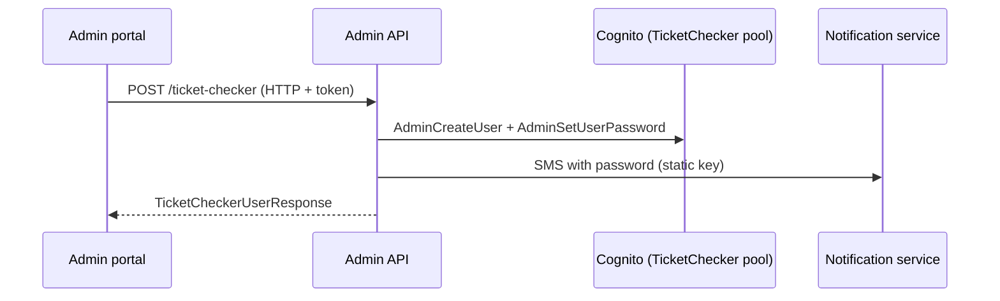

# A-17 · টিকিট-চেকার (গেট স্টাফ) অ্যাকাউন্ট

> **Bangla name:** টিকিট-চেকার (গেট স্টাফ) অ্যাকাউন্ট
>
> [← 10 · অ্যাডমিন পোর্টাল](README.md) · [সূচিপত্র](../README.md) · [ওপেন কোয়ারি](../99-open-queries.md)

## 1. নাম ও উদ্দেশ্য

**টিকিট-চেকার অ্যাকাউন্ট।** গেট স্টাফরা **TicketChecker Cognito pool**-এর একটি অ্যাকাউন্ট দিয়ে চেকার অ্যাপে সাইন ইন করেন। অ্যাডমিনরা এখানেই এই অ্যাকাউন্টগুলো তৈরি ও ব্যবস্থাপনা করেন: তৈরি, নাম বদলানো, disable, enable, পাসওয়ার্ড রিসেট, মুছে ফেলা, খোঁজা। Cognito ইউজার, তার অ্যাট্রিবিউটগুলো ও পাসওয়ার্ডসহ SMS কীভাবে তৈরি হয় তা একবারই [X-05](../60-cross-cutting/X-05-admin-provisioning.md)-এ বর্ণিত; চেকারের লগইন হলো [X-12](../60-cross-cutting/X-12-checker-login.md); চেকারদের গেটে নিয়োগ করা হলো [A-18](A-18-gate-assignment.md)।

## 2. ট্রিগার ও অ্যাক্টর

গ্লোবাল মেনুতে কর্মীরা (**Users → Ticket Checkers**, `/ticket-checker`, `LimitedMenuGuard`: প্রোগ্রাম 0 হতে হবে)। `TicketCheckerController` রোল অনুমোদন করে `admin`, `event_manager`, `ticket_manager`, `ticket_operator` (`BCBPersonnel`); **search** শুধু `admin` ও `event_manager`-এর মধ্যে সীমাবদ্ধ।

## 3. ব্যবসায়িক প্রবাহ

1. চেকারদের তালিকা দেখুন (নাম, ফোন, স্ট্যাটাস)। 2. নাম ও ফোন দিয়ে **তৈরি** করুন: অ্যাকাউন্ট সঙ্গে সঙ্গে তৈরি হয় এবং নতুন চেকার একটি SMS পান যেখানে থাকে user name ও একটি তৈরি করা পাসওয়ার্ড। 3. নাম **সম্পাদনা** করুন। 4. অ্যাকাউন্ট **disable** বা **enable** করুন (disable করা কর্মী সাইন ইন করতে পারে না)। 5. **পাসওয়ার্ড সেট** করলে একটি নতুন পাসওয়ার্ড তৈরি হয় এবং SMS-এ পাঠানো হয়। 6. অ্যাকাউন্ট **মুছে ফেলুন**।

## 4. প্রযুক্তিগত প্রবাহ

1. **[HTTP + ইউজার টোকেন]** তালিকা `GET /admin/api/v1/ticket-checker`; একক `GET .../ticket-checker/{id}`; খোঁজা `GET .../ticket-checker/search?name=` (গেট নিয়োগের সময় ব্যবহৃত, [A-18](A-18-gate-assignment.md)) এবং `search-by-userid?sub=`।
2. তৈরি `POST .../ticket-checker` দিয়ে `{ "name", "phone" }` → `TicketCheckerManager.CreateUserAsync` → `TicketCheckerUserProvider.CreateUserAsync`: TicketChecker pool-এ `AdminCreateUser` (username = ফোন, ফোন থেকে তৈরি e-mail অ্যাট্রিবিউট, `custom:role = TicketChecker`), একটি তৈরি করা পাসওয়ার্ড, তারপর notification service-এর মাধ্যমে credentials SMS (**[HTTP, static key]**, [X-22](../60-cross-cutting/X-22-sms-notification.md))। বিস্তারিত: [X-05](../60-cross-cutting/X-05-admin-provisioning.md)।
3. হালনাগাদ `PUT .../ticket-checker/{id}` দিয়ে `{ userId, name }`: **বডির `userId`-ই ব্যবহৃত হয়, পাথের `id` নয়**; শুধু নাম বদলায়।
4. `POST .../ticket-checker/disable/{id}`, `enable/{id}`; `POST .../ticket-checker/set-password?userId=`; `DELETE .../ticket-checker/{id}`; `PUT .../ticket-checker/change-password` (চেকার access token দিয়ে নিজের পাসওয়ার্ড বদলায়)।
5. একজন চেকারের গেট তালিকা: `GET /admin/api/v1/ticket-checker-gate/user/{userId}` , এবং প্রতি গেটের জন্য `PUT .../ticket-checker-gate/update-download-status/{userId}/{gateId}/{status}`, `DELETE .../ticket-checker-gate/remove-user/{id}` ([A-18](A-18-gate-assignment.md))।

## 5. কম্পোনেন্ট

| ধরন | কম্পোনেন্ট |
|---|---|
| ক্লায়েন্ট | `features/ticket-checker/*`, `services/ticket-checker.service.ts` |
| সার্ভিস | Admin (`TicketCheckerController`, `TicketCheckerManager`, `TicketCheckerUserProvider`) |
| AWS | Cognito TicketChecker pool; static AWS keys |
| বাহ্যিক | Notification service (SMS) |
| টেবিল | অ্যাকাউন্টের জন্য কোনোটিই নয় (Cognito-তে থাকে); গেট নিয়োগ `TicketCheckerGateUsers`-এ |

## 6. API কন্ট্রাক্ট

| Method | Path | Auth | Request | Response |
|---|---|---|---|---|
| GET | `/admin/api/v1/ticket-checker` | roles Admin, EventManager, TicketManager, BCBPersonnel | paging | `TicketCheckerUserResponse[]` |
| GET | `/admin/api/v1/ticket-checker/{id}` | same | path | `TicketCheckerUserResponse` |
| POST | `/admin/api/v1/ticket-checker` | same | `TicketCheckerCreateUser {name, phone}` | `TicketCheckerUserResponse` |
| PUT | `/admin/api/v1/ticket-checker/{id}` | same | `TicketCheckerUpdateUser {userId, name}` | `TicketCheckerUserResponse` |
| POST | `/admin/api/v1/ticket-checker/disable/{id}`, `enable/{id}` | same | path | `bool` |
| POST | `/admin/api/v1/ticket-checker/set-password?userId=` | same | query | `bool` |
| DELETE | `/admin/api/v1/ticket-checker/{id}` | same | path | `bool` |
| PUT | `/admin/api/v1/ticket-checker/change-password` | same | `TicketCheckerChangePassword {accessToken, oldPassword, newPassword}` | `bool` |
| GET | `/admin/api/v1/ticket-checker/search`, `search-by-userid` | search-এর জন্য `Admin`, `EventManager` | `name` / `sub` | list |

প্রধান নমুনা, `POST /admin/api/v1/ticket-checker`:

```json
{ "name": "Rahim Uddin", "phone": "+8801700000099" }
```

Response `TicketCheckerUserResponse`: `userId`, `name`, `email`, `phone`, `role`, `currentStatus`, `isActive`, `isPhoneNumberVerified`। লক্ষ্য করুন, provider-এর একটি বানানভুলের কারণে response ফিল্ড `isPhoneNumberVerified` `false` থাকে (দেখুন [X-05](../60-cross-cutting/X-05-admin-provisioning.md))।

## 7. ডেটা ও পার্শ্বপ্রতিক্রিয়া

TicketChecker pool-এ Cognito ইউজার; পাসওয়ার্ডসহ SMS; activity log এন্ট্রি শুধু ডেটাবেস টেবিলের জন্য লেখা হয়, এখানে করা Cognito পরিবর্তনের জন্য নয় (অ্যাডমিন ইউজারের তুলনায়, [A-25](A-25-admin-users.md))।

## 8. কোড রেফারেন্স

| কী | কোথায় |
|---|---|
| Controller | `rvl-gobcb-backend/Services/Admin/ETP.Admin.Service/Api/TicketCheckerController.cs:27-215` |
| Manager | `rvl-gobcb-backend/Services/Admin/ETP.Admin.Domain/Managers/TicketCheckerManager.cs:20-90` |
| Provider | `rvl-gobcb-backend/Services/Admin/ETP.Admin.Integration/Services/TicketCheckerUserProvider.cs:20-200` |
| Portal | `rvl-gobcb-admin-portal/src/app/features/ticket-checker/services/ticket-checker.service.ts:18-54` |

## 9. হ্যান্ডওভার নোট

1. **পাসওয়ার্ড SMS-এ স্পষ্ট লেখা অবস্থায় যাত্রা করে** এবং `System.Random` দিয়ে তৈরি হয় ([X-05](../60-cross-cutting/X-05-admin-provisioning.md), [X-22](../60-cross-cutting/X-22-sms-notification.md))।
2. **কর্মীর চারটি রোলের যেকোনো একটি চেকার অ্যাকাউন্ট তৈরি ও মুছতে পারে**, `ticket_operator` (`BCBPersonnel`)-সহ, যদিও পোর্টাল গ্লোবাল মেনুতে Ticket Checkers মেনুটি শুধু একটি নির্দিষ্ট অংশকেই দেখায় ([X-17](../60-cross-cutting/X-17-authz-client-side.md))।
3. **`PUT .../{id}` পাথের id উপেক্ষা করে** এবং বডির `userId`-কে বিশ্বাস করে, তাই URL যা বলছে তার চেয়ে ভিন্ন একটি অ্যাকাউন্টের নাম বদলানো যেতে পারে।
4. **SMS ব্যর্থ হলেও অ্যাকাউন্ট তৈরি হয়ে যায়** এমন পাসওয়ার্ডসহ যেটি কেউ জানে না (কলের ক্রম: create user, set password, send SMS); আবার পাঠাতে **Set password** ব্যবহার করুন ([X-22](../60-cross-cutting/X-22-sms-notification.md) নোট ৪)।
5. **একজন চেকারকে মুছলে `TicketCheckerGateUsers`-এর গেট নিয়োগ মোছে না** (মুছে ফেলাটি Cognito-কে লক্ষ্য করে); আগে [A-18](A-18-gate-assignment.md)-এ নিয়োগ সরান `[UNCONFIRMED: Q-26]`।
6. চেকারের নিজের `change-password` access token নেয় **request body**-তে, Authorization header-এ নয়।

## 10. কম্পোনেন্ট সম্পর্ক



**নির্ভর করে:** [X-05](../60-cross-cutting/X-05-admin-provisioning.md), [X-15](../60-cross-cutting/X-15-authz-roles.md)। **প্রভাব ফেলে:** [A-18](A-18-gate-assignment.md), [X-12](../60-cross-cutting/X-12-checker-login.md), [C-01](../40-checker-app/C-01-assigned-event-gate.md)।

## 11. ডেভেলপার টেস্ট গাইড

**লোকালভাবে পরীক্ষা: আংশিক।** Cognito হলো Floci; notification endpoint dummy বলে SMS কল ব্যর্থ হয় ([X-22](../60-cross-cutting/X-22-sms-notification.md)), তাই **Cognito ইউজার তৈরি হওয়ার পরেই তৈরির কলটি একটি ত্রুটি ফেরত দেয়**।

| বিষয় | বিবরণ |
|---|---|
| টেস্ট ডেটা ও অ্যাকাউন্ট | Admin `…01`; seeded checker `…21` (`Passw0rd!23`) |
| ব্রাউজার | `http://localhost:4200/ticket-checker` (প্রোগ্রাম 0 হতে হবে, [A-01](A-01-program-selection.md)) |
| এমুলেটর | চেকার অ্যাপে সাইন ইন একটি পরিচিত লোকাল ঘাটতি |
| Postman | `postman/services/etp-admin.postman_collection.json`: "GET /api/v1/ticket-checker", "POST /api/v1/ticket-checker/disable/{id}" |
| Visual Studio debug | `TicketCheckerUserProvider.CreateUserAsync` |
| যাচাই | `aws --endpoint-url http://localhost:4566 cognito-idp list-users --user-pool-id <TicketChecker pool>` |
