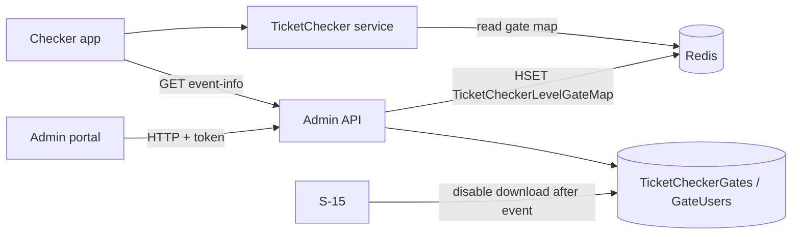

# A-18 · গেট অ্যাসাইনমেন্ট ও ডাউনলোড নিয়ন্ত্রণ

> **Bangla name:** গেট অ্যাসাইনমেন্ট ও ডাউনলোড নিয়ন্ত্রণ
>
> [← 10 · অ্যাডমিন পোর্টাল](README.md) · [সূচিপত্র](../README.md) · [ওপেন কোয়ারি](../99-open-queries.md)

## 1. নাম ও উদ্দেশ্য

**গেট অ্যাসাইনমেন্ট।** প্রতিটি ইভেন্টের জন্য অ্যাডমিন ঠিক করেন কোন টিকিট চেকাররা কোন **এন্ট্রি গেট**-এ কাজ করবেন, এবং প্রতিটি চেকার ইভেন্টের টিকিট তালিকা ফোনে **ডাউনলোড** করতে পারবে কি না। চেকার অ্যাপ কেবল সেই ইভেন্ট ও গেট দেখায় যেখানে তার ইউজারকে ডাউনলোডসহ নিয়োগ দেওয়া হয়েছে ([C-01](../40-checker-app/C-01-assigned-event-gate.md), [C-02](../40-checker-app/C-02-offline-ticket-download.md))। ধারণা: [Redis live capacity](../00-platform-primer.md#explainer-redis-live-capacity) (গেট ম্যাপ Redis-এ থাকে)।

## 2. ট্রিগার ও অ্যাক্টর

ইভেন্টের **Ticket Checker Assign** ট্যাবে (`/events/event-details/:id`, কম্পোনেন্ট `event-ticket-checker-gate`) এবং **Ticket Checkers** তালিকায় (`/ticket-checker`, প্রতি চেকারে) কর্মীরা। `TicketCheckerGateController` ক্লাস-লেভেলে **admin ও ticket-checker authentication schemes** গ্রহণ করে, রোল `Admin`, `EventManager`, `BCBPersonnel` ও `TicketChecker`; কেবল `GET /{eventId}` ও `POST /` (assign) যোগ করে `Roles = Admin, EventManager`, আর `event-info`-এর জন্য `ticket-checker` policy প্রয়োজন (§৯ দেখুন)।

## 3. ব্যবসায়িক প্রবাহ

1. ট্যাবটি খুলুন: ইভেন্টের ভেন্যুর এন্ট্রি গেটগুলো তালিকাভুক্ত, প্রতিটির সঙ্গে তার নিয়োগকৃত চেকাররা।
2. নাম দিয়ে চেকার খুঁজুন ([A-17](A-17-ticket-checker-users.md)), তাদের একটি গেটে যোগ করুন, **download enabled** টিক দিন, সেভ করুন।
3. চেকারকে সরাতে হলে একগুচ্ছ ব্যবহারকারীর জন্য **force assign** বা **force unassign** করুন — এমনকি তার অন্য কোথাও download access থাকলেও।
4. চেকারের নিজের সারি থেকে প্রতি গেটে download চালু বা বন্ধ করুন, অথবা গেট থেকে চেকারকে সরান।
5. ইভেন্ট শেষ হওয়ার পর সিস্টেম সবার জন্য download বন্ধ করে দেয় ([S-15](../50-system-initiated/S-15-gate-download-status-cleanup.md))।

## 4. প্রযুক্তিগত প্রবাহ

1. **[HTTP + ইউজার টোকেন]** `GET /admin/api/v1/ticket-checker-gate/{eventId}` → `GetAllByEventAsync`: ভেন্যু থেকে ইভেন্টের এন্ট্রি গেটগুলো (গেট **নাম** অনুযায়ী গ্রুপ করা: একই নামের কয়েকটি `BlockLevelEntryGates` একটি গেট হয়ে যায়, যেখানে id ও gallery নাম কমা দিয়ে জোড়া হয়), ইভেন্টের জন্য সংরক্ষিত নিয়োগের সঙ্গে যুক্ত করে।
2. সেভ `POST .../ticket-checker-gate` দিয়ে `AssignTicketCheckerGate { eventId, entryGateName, entryGateId, ticketCheckerUsers[{userId, name, isEnabled}] }`। `AssignTicketCheckerGate`:
   - ইভেন্টটি থাকতে হবে ("Invalid Event Id");
   - **অন্য কোনো ইভেন্টে download-enabled** একজন ইউজারকে এখানে enable করা যাবে না ("Please disable the ticket checker from other event");
   - গেটের সারি থাকলে: **একই ইভেন্টের ভিন্ন একটি গেটে** ইতিমধ্যে বসানো একজন ইউজারকে প্রত্যাখ্যান করা হয় ("User duplicate found"); নয়তো `AddOrRemoveAsync` গেটের ইউজার তালিকাকে পোস্ট করা তালিকার সমান করে দেয় (নতুন ইউজার যোগ হয়, **তালিকায় নেই এমন ইউজার সরে যায়**, `IsDownloadEnable` হালনাগাদ হয়);
   - না থাকলে: পোস্ট করা যেকোনো ইউজার অন্য কোথাও নিয়োগ থাকলে প্রত্যাখ্যান করা হয়; নয়তো ইভেন্ট, প্রোগ্রাম ও ভেন্যুর জন্য একটি `TicketCheckerGate` তৈরি হয় এবং Redis hash `TicketCheckerLevelGateMap`-এ প্রতি এন্ট্রি-গেট id-এর জন্য একটি এন্ট্রি `{eventId}_{entryGateId}` → গেট id যুক্ত হয় ([X-25](../60-cross-cutting/X-25-redis.md))।
3. `POST .../ticket-checker-gate/force-assign` ও `.../force-unassign` দিয়ে `AssignTicketCheckerGate`-এর একটি তালিকা: force-assign পোস্ট করা ইউজারদের জন্য বিদ্যমান গেটে `IsDownloadEnable = true` করে, তবে আগে দেখে নেয় যে কেউ **অন্য ইভেন্টে** download-enabled না ("The following user(s) are already download-enabled in another event: ..."); force-unassign সেটি false করে। যে গেট বিদ্যমান নয় তা নীরবে বাদ পড়ে।
4. `PUT .../ticket-checker-gate/update-download-status/{userId}/{gateId}/{status}` একজন চেকারের ফ্ল্যাগ উল্টায়; `DELETE .../ticket-checker-gate/remove-user/{id}` একটি গেট-ইউজার সারি সরায়; `GET .../ticket-checker-gate/user/{userId}` একজন চেকারের গেট তালিকা দেয়।
5. চেকার অ্যাপ তার নিয়োগ `GET .../ticket-checker-gate/event-info` থেকে পড়ে (policy `ticket-checker`, [C-01](../40-checker-app/C-01-assigned-event-gate.md))।

## 5. কম্পোনেন্ট

| ধরন | কম্পোনেন্ট |
|---|---|
| ক্লায়েন্ট | `features/events/components/event-ticket-checker-gate/*`, `services/ticket-checker-gate.service.ts`; `features/ticket-checker/*` |
| সার্ভিস | Admin (`TicketCheckerGateController`, `TicketCheckerGateManager`, `TicketCheckerGateUserRepository`); TicketChecker (পড়ে) |
| টেবিল | `TicketCheckerGates`, `TicketCheckerGateUsers` (`IsDownloadEnable`), `BlockLevelEntryGates` |
| Redis | `TicketCheckerLevelGateMap` hash |

## 6. API কন্ট্রাক্ট

| Method | Path | Auth | Request | Response | Main errors |
|---|---|---|---|---|---|
| GET | `/admin/api/v1/ticket-checker-gate/{eventId}` | roles Admin, EventManager | path | ইউজারসহ গেট | `Invalid Event Id` |
| POST | `/admin/api/v1/ticket-checker-gate` | roles Admin, EventManager | `AssignTicketCheckerGate` | `200` | `User duplicate found`, `Please disable the ticket checker from other event` |
| POST | `/admin/api/v1/ticket-checker-gate/force-assign`, `force-unassign` | class attribute: schemes admin and ticket-checker, roles Admin, EventManager, BCBPersonnel, TicketChecker | `AssignTicketCheckerGate[]` | `200` | `The following user(s) are already download-enabled in another event: ...` |
| GET | `/admin/api/v1/ticket-checker-gate/user/{userId}` | same | path | গেট | |
| PUT | `/admin/api/v1/ticket-checker-gate/update-download-status/{userId}/{gateId}/{status}` | same | path | `200` | |
| DELETE | `/admin/api/v1/ticket-checker-gate/remove-user/{id}` | same | path | `200` | |
| GET | `/admin/api/v1/ticket-checker-gate/event-info` | `ticket-checker` policy | none | নিয়োগকৃত ইভেন্ট ও গেট | |

প্রধান নমুনা, `POST /admin/api/v1/ticket-checker-gate` (নাম `AssignTicketCheckerGate` থেকে; id শুধু উদাহরণ):

```json
{
  "eventId": 101, "entryGateName": "Gate 3", "entryGateId": "811,812",
  "ticketCheckerUsers": [ { "userId": "7d3c-example-sub", "name": "Rahim Uddin", "isEnabled": true } ]
}
```

## 7. ডেটা ও পার্শ্বপ্রতিক্রিয়া

গেট ও গেট-ইউজার সারি; Redis গেট ম্যাপ; activity log ([X-24](../60-cross-cutting/X-24-activity-logging.md))। গেটের টিকিট তালিকা (`ticket_checker_tickets:*`) পরে তৈরি হয়, যখন চেকার ডাউনলোড করে ([C-02](../40-checker-app/C-02-offline-ticket-download.md))।

## 8. কোড রেফারেন্স

| কী | কোথায় |
|---|---|
| Controller | `rvl-gobcb-backend/Services/Admin/ETP.Admin.Service/Api/TicketCheckerGateController.cs:37-260` |
| Manager | `rvl-gobcb-backend/Services/Admin/ETP.Admin.Domain/Managers/TicketCheckerGateManager.cs:24-232` |
| Gate-user repository | `rvl-gobcb-backend/Services/Admin/ETP.Admin.Storage/Repositories/TicketCheckerGateUserRepository.cs:12-42` |
| Portal | `rvl-gobcb-admin-portal/src/app/features/events/services/ticket-checker-gate.service.ts:22-43`; `features/ticket-checker/services/ticket-checker.service.ts:18-25` |

## 9. হ্যান্ডওভার নোট

1. **আংশিক তালিকা বাকিদের সরিয়ে দেয়।** `AddOrRemoveAsync` গেটের ইউজার তালিকাকে পোস্ট করা তালিকার সমান করে দেয়। `force-unassign` ও `force-assign` কেবল নির্বাচিত ইউজারদের পোস্ট করে, তাই সেই গেটের অন্য কোনো চেকার শুধু ফ্ল্যাগ মুছে পাওয়া নয়, **গেট থেকে সরে যায়**। গেটের সম্পূর্ণ তালিকা পাঠান।
2. **প্রতি চেকারের জন্য একসময়ে একটি ইভেন্ট।** একজন চেকার সর্বোচ্চ একটি ইভেন্টেই download-enabled থাকতে পারে; দ্বিতীয় ইভেন্ট প্রত্যাখ্যান করে যতক্ষণ না প্রথমটি বন্ধ বা শেষ হয় ([S-15](../50-system-initiated/S-15-gate-download-status-cleanup.md))।
3. **Redis গেট ম্যাপ un-awaited task দিয়ে লেখা হয়।** লুপ `Split(',').ToList().ForEach(async e => ...)` লেখার জন্য অপেক্ষা করে না; দ্রুত পরের একটি অনুরোধ (কিংবা কোনো exception) ম্যাপটি অসম্পূর্ণ রেখে দিতে পারে, তখন চেকার-অ্যাপের sync আর গেটটি সমাধান করতে পারে না (`TicketsManager` `TicketCheckerLevelGateMap` পড়ে) `[UNCONFIRMED: Q-27]`।
4. **ক্লাস-লেভেলের auth বহল।** ক্লাস অ্যাট্রিবিউট ticket-checker scheme ও `TicketChecker` রোল গ্রহণ করে, আর কেবল দুটি অ্যাকশন কঠোর রোল তালিকা যোগ করে। সুতরাং সাইন-ইন করা একটি **চেকার** টোকনও `report`, `export`, `force-assign`, `force-unassign`, `update-download-status`, `remove-user`, `duplicate-tickets` ও `manual-entry-tickets`-এ পৌঁছাতে পারে, ফলে একজন চেকার নিজের বা অন্যদের জন্য download চালু করতে পারে ([X-15](../60-cross-cutting/X-15-authz-roles.md))।
5. **গেটগুলো নাম অনুযায়ী গ্রুপ করা**, তাই ভেন্যুতে একটি এন্ট্রি গেটের নাম বদলালে ([A-05](A-05-venues.md)) বিদ্যমান নিয়োগ একটি নতুন, নিয়োগ-বিহীন গেটে ভেঙে যায়।
6. **ডুপ্লিকেট করা ইভেন্ট নিয়োগ কপি করে** ([A-07](A-07-events.md))।

## 10. কম্পোনেন্ট সম্পর্ক



**নির্ভর করে:** [A-05](A-05-venues.md), [A-07](A-07-events.md), [A-17](A-17-ticket-checker-users.md)। **প্রভাব ফেলে:** [C-01](../40-checker-app/C-01-assigned-event-gate.md), [C-02](../40-checker-app/C-02-offline-ticket-download.md), [C-05](../40-checker-app/C-05-ticket-sync.md), [A-19](A-19-gate-reports.md), [S-14](../50-system-initiated/S-14-checked-ticket-sync.md)।

## 11. ডেভেলপার টেস্ট গাইড

**লোকালভাবে পরীক্ষা: অ্যাডমিন দিকের জন্য সম্পূর্ণ।**

| বিষয় | বিবরণ |
|---|---|
| টেস্ট ডেটা ও অ্যাকাউন্ট | Seeded checker `…21`; admin `…01`; এন্ট্রি গেটসহ একটি ইভেন্ট (`scripts/seed/01-catalog.sql`) |
| ব্রাউজার | `http://localhost:4200/events` → ইভেন্ট → **Ticket Checker Assign**; Network: `POST .../ticket-checker-gate` |
| এমুলেটর | চেকার অ্যাপে সাইন ইন একটি পরিচিত লোকাল ঘাটতি (`docs/mobile-local.md` §8) |
| Postman | `postman/services/etp-admin.postman_collection.json`: "GET /api/v1/ticket-checker-gate/{eventId}", "POST /api/v1/ticket-checker-gate"; `etp-ticketchecker`: "GET /api/v1/ticket-checker-gate/event-info" with `{{access_token_ticket_operator}}` |
| Visual Studio debug | `TicketCheckerGateManager.AssignTicketCheckerGate`, `ForceAssignTicketCheckerGate` |
| যাচাই | SQL: `select "UserId","IsDownloadEnable" from etp."TicketCheckerGateUsers"`; `redis-cli HGETALL TicketCheckerLevelGateMap` |
