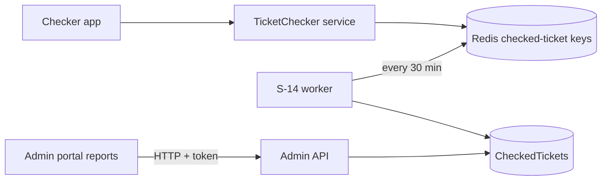

# A-19 · গেট (টিকিট-চেকার) রিপোর্ট

> **Bangla name:** গেট (টিকিট-চেকার) রিপোর্ট
>
> [← 10 · অ্যাডমিন পোর্টাল](README.md) · [সূচিপত্র](../README.md) · [ওপেন কোয়ারি](../99-open-queries.md)

## 1. নাম ও উদ্দেশ্য

**গেট রিপোর্ট।** ইভেন্ট চলাকালে ও শেষ হওয়ার পর অ্যাডমিন দেখেন প্রতিটি গেটে কতগুলো টিকিট স্ক্যান হয়েছে, কোন চেকার দিয়ে, কতগুলো এন্ট্রি ম্যানুয়ালি টাইপ করা হয়েছে, এবং কোন টিকিট একাধিকবার স্ক্যান হয়েছে। ডেটা আসে `CheckedTickets` টেবিল থেকে, যা চেকার অ্যাপগুলো থেকে [S-14](../50-system-initiated/S-14-checked-ticket-sync.md)-এ পূরণ হয়।

## 2. ট্রিগার ও অ্যাক্টর

প্রোগ্রাম মেনুর **Reports → Ticket Checker**-এর অধীনে কর্মীরা (`/report/checker` **Detailed Checker**, `/report/ticket-duplicate` **Duplicate Entry Count**)। কন্ট্রোলার `TicketCheckerGateController` [A-18](A-18-gate-assignment.md)-এর মতোই (admin ও ticket-checker schemes, রোল `Admin`, `EventManager`, `BCBPersonnel`, `TicketChecker`)।

## 3. ব্যবসায়িক প্রবাহ

1. **Detailed Checker:** একটি ইভেন্ট বাছুন; প্রতি গেটে একটি ট্রি দেখুন যেখানে এন্ট্রি সংখ্যা ও ম্যানুয়াল-এন্ট্রি সংখ্যা, প্রতি চেকারের হিসাবে; সব স্ক্যান এক্সপোর্ট করুন।
2. **Duplicate Entry Count:** প্রতি গেটে মোট স্ক্যান হওয়া টিকিট, ম্যানুয়াল এন্ট্রি এবং একাধিকবার স্ক্যান হওয়া টিকিট; বিস্তারিতের জন্য একটি গেট খুলুন; গেট বেছে নিয়ে ডুপ্লিকেট ও ম্যানুয়াল-এন্ট্রি টিকিট নম্বর তালিকাভুক্ত করুন।

## 4. প্রযুক্তিগত প্রবাহ

সব কল Admin-এ **[HTTP + ইউজার টোকেন]**, পড়ে `etp."CheckedTickets"`:

1. `GET /admin/api/v1/ticket-checker-gate/report/{eventId}` → `GetCheckerGateReport`: ইভেন্টের checked-ticket সারিগুলো গেট নাম ও চেকার নাম অনুযায়ী গ্রুপ করে `EntryCount` ও `ManualEntryCount` যোগ করে; manager একটি গেট → চেকার ট্রি তৈরি করে (`BuildTicketCheckerGateNodeTree`)।
2. `GET .../ticket-checker-gate/export/{eventId}` → `GetBulkTicketsAsync`: ইভেন্টের প্রতিটি checked ticket (`CheckedTicketExportData`) পোর্টালের এক্সপোর্টের জন্য।
3. `POST .../ticket-checker-gate/duplicate-tickets/{eventLongId}` এবং `.../manual-entry-tickets/{eventLongId}` গেট id-এর একটি JSON তালিকা সহ: সেই গেটগুলোতে টিকিট নম্বর যেগুলো ডুপ্লিকেট বা ম্যানুয়াল এন্ট্রি (খালি হলে একটি `400` "EventLongId must be greater than 0, and TicketCheckerGateIds are required.")।
4. `GET .../ticket-checker-gate/reports/duplicate-entries?eventId` → প্রতি গেটে একটি সারি, যেখানে `ScannedTickets` (সারি), `ManualEntry` (`IsManualEntry` সহ সারি) ও `DuplicateEntry`; `GET .../reports/duplicate-entries/details?eventId&ticketCheckerGateId` ডুপ্লিকেট টিকিট তালিকাভুক্ত করে। এগুলো `etp."CheckedTickets"`-এর বিরুদ্ধে হাতে-লেখা SQL ব্যবহার করে।

## 5. কম্পোনেন্ট

| ধরন | কম্পোনেন্ট |
|---|---|
| ক্লায়েন্ট | `features/reports` কম্পোনেন্ট `TicketCheckerReportComponent`, `TicketDuplicationComponent`; `services/report.service.ts:24-36, 92-101` |
| সার্ভিস | Admin (`TicketCheckerGateController`, `CheckedTicketManager`, `CheckedTicketRepository`, `TicketCheckerGateRepository`) |
| টেবিল | `CheckedTickets`, `TicketCheckerGates`, `Events` |

## 6. API কন্ট্রাক্ট

| Method | Path | Auth | Request | Response |
|---|---|---|---|---|
| GET | `/admin/api/v1/ticket-checker-gate/report/{eventId}` | class attribute (§২ দেখুন) | path | `TicketCheckerGateNode[]` |
| GET | `/admin/api/v1/ticket-checker-gate/export/{eventId}` | same | path | `CheckedTicketExportData[]` |
| POST | `/admin/api/v1/ticket-checker-gate/duplicate-tickets/{eventLongId}`, `manual-entry-tickets/{eventLongId}` | same | `["811","812"]` (গেট id স্ট্রিং হিসেবে) | টিকিট নম্বর |
| GET | `/admin/api/v1/ticket-checker-gate/reports/duplicate-entries` | same | `eventId` | `DuplicateScannedReportData[]` |
| GET | `/admin/api/v1/ticket-checker-gate/reports/duplicate-entries/details` | same | `eventId`, `ticketCheckerGateId` | `DuplicateScannedDetailsReportData[]` |

`DuplicateScannedReportData` (SQL alias থেকে): `GateId`, `TicketCheckerGateName`, `ScannedTickets`, `ManualEntry`, `DuplicateEntry`.

## 7. ডেটা ও পার্শ্বপ্রতিক্রিয়া

কিছু নয় (শুধু পড়ে)।

## 8. কোড রেফারেন্স

| কী | কোথায় |
|---|---|
| Controller | `rvl-gobcb-backend/Services/Admin/ETP.Admin.Service/Api/TicketCheckerGateController.cs:37-262` |
| Manager | `rvl-gobcb-backend/Services/Admin/ETP.Admin.Domain/Managers/CheckedTicketManager.cs:40-80`, `TicketCheckerGateManager.cs:245-290` |
| Queries | `rvl-gobcb-backend/Services/Admin/ETP.Admin.Storage/Repositories/CheckedTicketRepository.cs:39-180`, `TicketCheckerGateRepository.cs:138-` |
| Portal | `rvl-gobcb-admin-portal/src/app/features/reports/services/report.service.ts:24-36, 92-101` |

## 9. হ্যান্ডওভার নোট

1. **রিপোর্ট সর্বোচ্চ ৩০ মিনিট পিছিয়ে থাকে**, কারণ স্ক্যানগুলো worker প্রতি ৩০ মিনিটে টেবিলে কপি করে ([S-14](../50-system-initiated/S-14-checked-ticket-sync.md))।
2. **"Duplicate" মানে একটি গেটের একাধিক সারিতে থাকা একই টিকিট নম্বর।** প্রতিটি worker রান একটি পিরিয়ডে একটি টিকিট একবার লেখে (একটি `EntryCount`-সহ), তাই **একই পিরিয়ডে** দুবার স্ক্যান হওয়া টিকিট হলো `EntryCount` 2-সহ একটি সারি, যা SQL-এ (`count(...) > 1` সারির ওপর) ডুপ্লিকেট হিসেবে গণনা হয় **না**; দুটি পিরিয়ডে স্ক্যান হলে গণনা হয়। এই সংজ্ঞাটি ব্যবহারের আগে ব্যবসার সঙ্গে যাচাই করুন `[UNCONFIRMED: Q-28]`।
3. **যেকোনো চেকার টোকন এই endpointগুলো কল করতে পারে** ([A-18](A-18-gate-assignment.md) নোট ৪): স্ক্যান হওয়া সব টিকিট নম্বরের তালিকা প্রতিটি গেট ব্যবহারকারীই পড়তে পারে।
4. **ডুপ্লিকেট রিপোর্টটি raw SQL** — হার্ড-কোড করা টেবিল নাম `etp."CheckedTickets"` এবং ইভেন্ট id-এর জন্য একটি `Integer` প্যারামিটার সহ; স্কিমার নাম বদলে গেলে রান টাইমে নীরবে ভেঙে যায়।
5. রিপোর্ট **গেটের নাম** গণনা করে (trim করা), তাই একই নামের দুটি বাস্তব গেট এক হয়ে যায়।
6. `export` একটি response-এ সব সারি ফেরত দেয়; খুব বড় ইভেন্টের জন্য এটি ভারী (কোনো paging নেই)।

## 10. কম্পোনেন্ট সম্পর্ক

**নির্ভর করে:** [S-14](../50-system-initiated/S-14-checked-ticket-sync.md), [C-05](../40-checker-app/C-05-ticket-sync.md), [A-18](A-18-gate-assignment.md)। **প্রভাব ফেলে:** ইভেন্ট রিপোর্টিং ([A-22](A-22-reports.md))।

## 11. ডেভেলপার টেস্ট গাইড

**লোকালভাবে পরীক্ষা: আংশিক** (চেকার অ্যাপ লোকালভাবে সাইন ইন করতে পারে না, তাই স্ক্যান Postman বা seed ডেটা থেকে আসতে হবে)।

| বিষয় | বিবরণ |
|---|---|
| টেস্ট ডেটা ও অ্যাকাউন্ট | Admin `…01`; TicketChecker sync-এর মাধ্যমে স্ক্যান (Postman, `{{access_token_ticket_operator}}`), তারপর [S-14](../50-system-initiated/S-14-checked-ticket-sync.md)-এর জন্য অপেক্ষা করুন |
| ব্রাউজার | `http://localhost:4200/report/checker` এবং `/report/ticket-duplicate` (একটি প্রোগ্রাম বাছুন) |
| এমুলেটর | চেকার অ্যাপে সাইন ইন একটি পরিচিত লোকাল ঘাটতি |
| Postman | `postman/services/etp-admin.postman_collection.json`: "GET /api/v1/ticket-checker-gate/report/{eventId}", "GET /api/v1/ticket-checker-gate/reports/duplicate-entries" |
| Visual Studio debug | `CheckedTicketRepository.GetDuplicateScannedTicketReportAsync` |
| যাচাই | SQL: `select "TicketCheckerGateName","TicketNumber","EntryCount","IsManualEntry" from etp."CheckedTickets" where "EventLongId" = <id>` |
