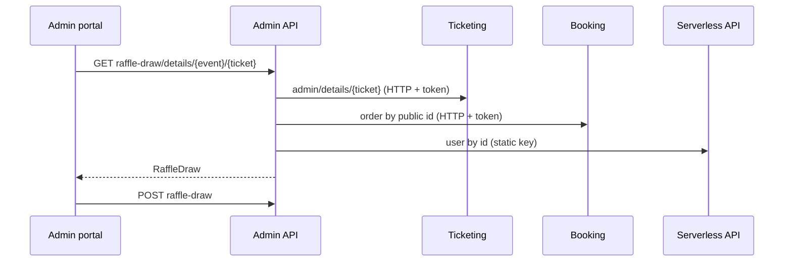

# A-20 · র‍্যাফেল ড্র

> **Bangla name:** র‍্যাফেল ড্র
>
> [← 10 · অ্যাডমিন পোর্টাল](README.md) · [সূচিপত্র](../README.md) · [ওপেন কোয়ারি](../99-open-queries.md)

## 1. নাম ও উদ্দেশ্য

**র‍্যাফেল ড্র।** ভেন্যুতে টিকিট নম্বর থেকে একটি র‍্যাফেল টানা হয়। অ্যাডমিন বিজয়ী টিকিট নম্বরটি টাইপ করেন; প্ল্যাটফর্ম যাচাই করে যে সেটি এই ইভেন্টের একটি বৈধ টিকিট, দেখায় কে তা ধরে আছেন, এবং বিজয়ী নথিভুক্ত করে। এটি একটি **রেকর্ড-রক্ষণ** ফিচার: প্ল্যাটফর্ম নিজে নম্বর টানে না।

## 2. ট্রিগার ও অ্যাক্টর

ইভেন্টের **Raffle Draw Winners** ট্যাবে (`/events/event-details/:id`, কম্পোনেন্ট `raffle-draw`) কর্মীরা। `RaffleDrawController` রোল `Admin` ও `EventManager` অনুমোদন করে।

## 3. ব্যবসায়িক প্রবাহ

1. যে টিকিট নম্বরটি টানা হয় তা লিখুন।
2. ট্যাবটি টিকিটধারীকে দেখায় (নাম ও ফোন), টিকিটের ধরন, অর্ডার নম্বর ও বুকিং সময়, অথবা একটি ত্রুটি।
3. বিজয়ীকে **যোগ** করুন; ইভেন্টের বিজয়ীদের তালিকা দেখানো হয়; একজন বিজয়ীকে সরানোও যায়।

## 4. প্রযুক্তিগত প্রবাহ

1. **[HTTP + ইউজার টোকেন]** খোঁজা: `GET /admin/api/v1/raffle-draw/details/{eventId}/{ticketNumber}` → `RaffleDrawManager.GetTicketDetailsForRaffleDrawAsync`:
   - যে টিকিট **ইতিমধ্যেই বিজয়ী** সেটি প্রত্যাখ্যান করে ("This ticket is already added");
   - **[HTTP + ইউজার টোকেন]** `ITicketingClient.GetTicketDetailsByTicketNumber` → `GET /ticketing/api/v1/booking-order-ticket/admin/details/{ticketNum}` (admin policy); ফল না মিললে: "This ticket is not system generated."; অন্য ইভেন্টের টিকিট হলে: "This ticket ID is not valid for this event. Please enter a valid ticket ID for this event.";
   - একটি **User** টিকিটের জন্য: Booking থেকে অর্ডার পড়ে (**[HTTP + ইউজার টোকেন]**) এবং Serverless API থেকে গ্রাহকের নাম ও ফোন পড়ে (**[HTTP, static key]**, [X-22](../60-cross-cutting/X-22-sms-notification.md)); অন্য ধরনের (পার্টনার, কমপ্লিমেন্টারি) ক্ষেত্রে টিকিটে সংরক্ষিত ধারীর নাম ও পরিচয় ব্যবহার করে।
2. সেভ: `POST .../raffle-draw` দিয়ে খোঁজায় ফেরত পাওয়া `RaffleDraw` অবজেক্ট; `CreateAsync` এটি আর কোনো যাচাই ছাড়াই ঢোকায়।
3. তালিকা: `GET .../raffle-draw?eventId=`; সরানো: `DELETE .../raffle-draw/{id}`।

## 5. কম্পোনেন্ট

| ধরন | কম্পোনেন্ট |
|---|---|
| ক্লায়েন্ট | `features/events/components/raffle-draw/*`, `services/raffle-draw-winner.service.ts:31-35` |
| সার্ভিস | Admin (`RaffleDrawController`, `RaffleDrawManager`); Ticketing ও Booking (lookup) |
| বাহ্যিক | Serverless API (ব্যবহারকারীর নাম ও ফোন) |
| টেবিল | `RaffleDraws` |

## 6. API কন্ট্রাক্ট

| Method | Path | Auth | Request | Response | Main errors |
|---|---|---|---|---|---|
| GET | `/admin/api/v1/raffle-draw/details/{eventId}/{ticketNumber}` | roles Admin, EventManager | path | `RaffleDraw` (সংরক্ষিত নয়) | উপরের ৪০০ বার্তা |
| POST | `/admin/api/v1/raffle-draw` | same | `RaffleDraw` | `RaffleDraw` | |
| GET | `/admin/api/v1/raffle-draw` | same | `eventId` | `RaffleDraw[]` | |
| DELETE | `/admin/api/v1/raffle-draw/{id}` | same | path | `RaffleDraw` | |

`RaffleDraw` প্রপার্টি (manager থেকে): `ticketNumber`, `ticketType`, `ticketHolderName`, `ticketHolderIdentification`, `userId`, `eventLongId`, `eventPublicId`, `bookingOrderId`, `bookingOrderPublicId`, `bookingOrderDateTime`, `orderNumber`। প্রধান নমুনা (lookup-এর response; মান শুধু উদাহরণ):

```json
{
  "ticketNumber": "T20ABC123", "ticketType": "User",
  "ticketHolderName": "Karim Ahmed", "ticketHolderIdentification": "+8801700000011",
  "userId": "7d3c-example-sub", "eventLongId": 101,
  "orderNumber": "ORD-000123", "bookingOrderDateTime": "2026-12-02T09:30:00Z"
}
```

## 7. ডেটা ও পার্শ্বপ্রতিক্রিয়া

**ব্যক্তিগত ডেটা** ধরনের (নাম, ফোন, user id) একটি `RaffleDraws` সারি; activity log ([X-24](../60-cross-cutting/X-24-activity-logging.md))।

## 8. কোড রেফারেন্স

| কী | কোথায় |
|---|---|
| Controller | `rvl-gobcb-backend/Services/Admin/ETP.Admin.Service/Api/RaffleDrawController.cs:26-80` |
| Manager | `rvl-gobcb-backend/Services/Admin/ETP.Admin.Domain/Managers/RaffleDrawManager.cs:26-110` |
| Ticket lookup | `rvl-gobcb-backend/Core/ETP.Core/ServiceClient/TicketingClient/TicketingClient.cs:185-200` |
| Portal | `rvl-gobcb-admin-portal/src/app/features/events/services/raffle-draw-winner.service.ts:31-35` |

## 9. হ্যান্ডওভার নোট

1. **"already added" যাচাইটি কেবল lookup-এ।** `POST` সেটি আবার করে না, তাই দুই অ্যাডমিন একই টিকিট যোগ করতে পারেন, অথবা একজন ক্লায়েন্ট যেকোনো `RaffleDraw` কনটেন্ট পোস্ট করতে পারেন (সার্ভার যা পায় তাই সংরক্ষণ করে, ধারীর নাম ও ফোনসহ)।
2. **সরানোর আচরণ** হলো repository-তে `DeleteByIdAsync`; এই পর্যালোচনায় যাচাই করা হয়নি এটি soft delete নাকি hard delete `[UNCONFIRMED: Q-29]`।
3. **ব্যক্তিগত ডেটা টেবিলে কপি হয়** (নাম ও ফোন), আর Serverless কল ব্যর্থ হলে user টিকিটের lookup ব্যর্থ হয়।
4. **ড্র মানানিজ।** প্ল্যাটফর্মে বিজয়ী বেছে নেওয়ার কোনো কিছু নেই; অডিট ট্রেইল হলো activity log।
5. lookup `User`-এর বাইরের যেকোনো টিকিট ধরনকে পার্টনার বা কমপ্লিমেন্টারি টিকিট হিসেবে ধরে এবং টিকিটে সংরক্ষিত ধারীর লেখা বিশ্বাস করে (রিজার্ভড টিকিটের জন্য খালি, [A-12](A-12-reserved-tickets.md) নোট ৫)।

## 10. কম্পোনেন্ট সম্পর্ক



**নির্ভর করে:** [S-08](../50-system-initiated/S-08-ticket-signing.md) (টিকিটের অস্তিত্ব), [A-07](A-07-events.md)। **প্রভাব ফেলে:** নিচের দিকে কিছু নয়।

## 11. ডেভেলপার টেস্ট গাইড

**লোকালভাবে পরীক্ষা: আংশিক।** Serverless API dummy, তাই **User** টিকিটের lookup লোকালভাবে ব্যর্থ হয়; পার্টনার বা কমপ্লিমেন্টারি টিকিট কাজ করে।

| বিষয় | বিবরণ |
|---|---|
| টেস্ট ডেটা ও অ্যাকাউন্ট | Admin `…01`; seeded টিকিট থেকে একটি টিকিট নম্বর (`scripts/seed/03-orders-tickets.sql`) |
| ব্রাউজার | `http://localhost:4200/events` → ইভেন্ট → **Raffle Draw Winners** |
| এমুলেটর | — |
| Postman | `postman/services/etp-admin.postman_collection.json`: "GET /api/v1/raffle-draw/details/{eventId}/{ticketNumber}", "POST /api/v1/raffle-draw" |
| Visual Studio debug | `RaffleDrawManager.GetTicketDetailsForRaffleDrawAsync` |
| যাচাই | SQL: `select "TicketNumber","TicketHolderName","EventLongId" from etp."RaffleDraws"` |
