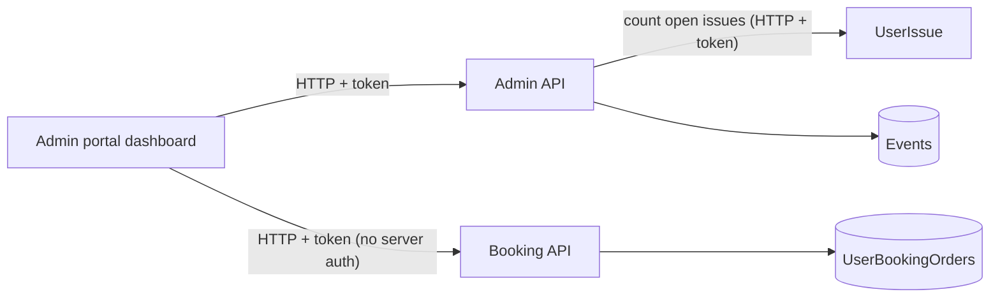

# A-21 · ড্যাশবোর্ড

> **Bangla name:** ড্যাশবোর্ড
>
> [← 10 · অ্যাডমিন পোর্টাল](README.md) · [সূচিপত্র](../README.md) · [ওপেন কোয়ারি](../99-open-queries.md)

## 1. নাম ও উদ্দেশ্য

**ড্যাশবোর্ড।** একটি প্রোগ্রামের ল্যান্ডিং পেজ (`/`, route guard `ProgramMenuGuard`): প্রকাশিত ইভেন্ট, ওপেন ইস্যু ও টিকিট বিক্রির টাইল, আসন্ন সাতটি ইভেন্টের চার্ট, এবং গত সপ্তাহ ও গত মাসের বিক্রির চার্ট। এটি দুটি সার্ভিস থেকে পড়ে: Admin (ইভেন্ট ও ইস্যু) এবং Booking (বিক্রি)।

## 2. ট্রিগার ও অ্যাক্টর

রোল `admin` বা `ticket_operator` (`BCBPersonnel`) থাকা কর্মীরা (Admin ড্যাশবোর্ড কন্ট্রোলার এদের চায়; অন্য রোলকে অন্য ল্যান্ডিং পেজে পাঠানো হয়, [A-01](A-01-program-selection.md))। একটি প্রোগ্রাম নির্বাচিত হতে হবে।

## 3. ব্যবসায়িক প্রবাহ

প্রোগ্রাম নির্বাচিত করে পোর্টাল খুলুন: টাইল ও চার্গ নিজে থেকেই লোড হয়; কিছু সম্পাদনা করা হয় না।

## 4. প্রযুক্তিগত প্রবাহ

সব কল **[HTTP + ইউজার টোকেন]**, প্রতিটিতে হেডার `X-Program-Id` ও একটি `programId` query parameter:

1. Admin `GET /admin/api/v1/dashboard/get-tile-data?programId=` → `DashboardManager.GetTileDataAsync`: `TotalEvents` (প্রোগ্রামের প্রকাশিত ইভেন্ট, `EventRepository.GetPublishedEventCountAsync`) এবং `UnResolveIssue` (**UserIssue** সার্ভিস থেকে `IUserIssueClient.GetCountAsync`-এর মাধ্যমে `Open` ইস্যুর সংখ্যা)।
2. Admin `GET .../dashboard/get-event-by-category` → `GetEventsByCategoryAsync` (ক্যাটাগরি অনুযায়ী ইভেন্টের সংখ্যা; **কোনো প্রোগ্রাম প্যারামিটার নেই**)।
3. Booking `GET /booking/api/v1/dashboard/get-ticket-sales-summary?programId=` (`TicketSalesSummary`: মোট টিকিট ও পরিমাণ; repository "today"-এর জন্য Asia/Dhaka time zone ব্যবহার করে)।
4. Booking `GET .../dashboard/get-upcomming-seven-events?programId=`, `.../get-last-week-seats-sale-amount?programId=`, `.../get-last-Month-seats-sale-amount?programId=` (`DashboardChartData[]`)।

Admin কন্ট্রোলারে `[AuthorizeProgram]`: `admin` পাস করে; `user` রোলযুক্ত ব্যবহারকারী পাস করে; অন্যদের `program_id` claim-এর একটির সমান `X-Program-Id` পাঠাতে হবে, নয়তে 400 "Missing or invalid X-Program-Id header." বা একটি 403 টেক্সট ফেরত আসে ([X-16](../60-cross-cutting/X-16-authz-program-scope.md))।

## 5. কম্পোনেন্ট

| ধরন | কম্পোনেন্ট |
|---|---|
| ক্লায়েন্ট | `features/dashboard/*`, `services/dashboard.service.ts` |
| সার্ভিস | Admin (`DashboardController`, `DashboardManager`); Booking (`dashboard` রুটের অধীনে `BookingReportController`); UserIssue (গণনা) |
| টেবিল | Admin `Events`; Booking `UserBookingOrders`; UserIssue issues |

## 6. API কন্ট্রাক্ট

| Method | Path | Auth | Request | Response |
|---|---|---|---|---|
| GET | `/admin/api/v1/dashboard/get-tile-data` | roles Admin, BCBPersonnel + `[AuthorizeProgram]` | `programId` | `TileData {totalEvents, unResolveIssue}` |
| GET | `/admin/api/v1/dashboard/get-event-by-category` | same | none | `EventsByCategory` |
| GET | `/booking/api/v1/dashboard/get-ticket-sales-summary` | **none** | `programId` | `TicketSalesSummary` |
| GET | `/booking/api/v1/dashboard/get-upcomming-seven-events`, `get-last-week-seats-sale-amount`, `get-last-Month-seats-sale-amount` | **none** | `programId` | `DashboardChartData[]` |

প্রধান নমুনা (`get-tile-data`-এর response; প্রপার্টির নাম `TileData` থেকে, মান শুধু উদাহরণ):

```json
{ "totalEvents": 7, "unResolveIssue": 3 }
```

## 7. ডেটা ও পার্শ্বপ্রতিক্রিয়া

কিছু নয় (শুধু পড়ে)।

## 8. কোড রেফারেন্স

| কী | কোথায় |
|---|---|
| Admin controller | `rvl-gobcb-backend/Services/Admin/ETP.Admin.Service/Api/DashboardController.cs:14-48` |
| Admin manager | `rvl-gobcb-backend/Services/Admin/ETP.Admin.Domain/Managers/DashboardManager.cs:22-35` |
| Program filter attribute | `rvl-gobcb-backend/Services/Admin/ETP.Admin.Service/Attributes/AuthorizeProgramAttribute.cs` |
| Booking endpoints | `rvl-gobcb-backend/Services/Booking/ETP.Booking.Service/Api/BookingReportController.cs:13-76` |
| Portal | `rvl-gobcb-admin-portal/src/app/features/dashboard/services/dashboard.service.ts:14-60` |

## 9. হ্যান্ডওভার নোট

1. **বিক্রির সংখ্যা অজ্ঞাতপরিচয়ের।** Booking ড্যাশবোর্ড endpointগুলোতে কোনো `[Authorize]` নেই ([X-18](../60-cross-cutting/X-18-endpoints-without-auth.md)); `/booking/api/v1/dashboard/...` পৌঁছাতে পারে এমন যেকোনো ব্যক্তিই যেকোনো `programId`-এর বিক্রির সারাংশ পড়তে পারে (0 মানে সব)।
2. **`[AuthorizeProgram]` হেডারের সঙ্গে তুলনা করে, কিন্তু অ্যাকশন query parameter ব্যবহার করে।** হেডারটি অনুমোদিত হলে একজন non-admin ব্যবহারকারী query-তে ভিন্ন `programId` পাঠিয়ে অন্য প্রোগ্রামের টাইল পড়তে পারে। অ্যাট্রিবিউটের 403 শাখাটি `context.Result` সেট না করেই response লেখে, তাই অ্যাকশনটিরপরেও চলে।
3. **`get-event-by-category` প্রোগ্রাম উপেক্ষা করে**, তাই তার সংখ্যাগুলো সব প্রোগ্রামের।
4. **একটি হার্ড-কোড করা development URL** `https://download.admin.dev.ticket-bangla.com/BP23101EAF6C.pdf` `dashboard.service.ts` (`downloadPDF`)-এ এবং টপ বারের একটি কমেন্টে আছে; এই মেথডের কোনো caller পাওয়া যায়নি, তবে URL-টি একটি dev host-এর নাম বলে দেয়।
5. **বিক্রির সারাংশে "Today" ঢাকার time zone ব্যবহার করে** (`TimeZoneInfo` id `Asia/Dhaka`, `UserBookingOrderRepository.GetTicketSalesSummaryAsync`), যা container image-এ থাকতে হবে।
6. **ওপেন ইস্যুর টাইল UserIssue সার্ভিসের মাধ্যমে গণনা করে**; সেই সার্ভিস নামিয়ে গেলে পুরো টাইল কলটি ব্যর্থ হয়।
7. `get-upcomming-seven-events` রুটের নাম বানানভুল (`upcomming`) এবং মাসের রুটে বড় `M` আছে; কল করার সময় দুটি বানানই রাখুন।

## 10. কম্পোনেন্ট সম্পর্ক



**নির্ভর করে:** [A-01](A-01-program-selection.md), [A-07](A-07-events.md), [P-06](../20-user-portal/P-06-booking-payment.md) (অর্ডার), [A-24](A-24-user-issues-admin.md)। **প্রভাব ফেলে:** কিছু নয়।

## 11. ডেভেলপার টেস্ট গাইড

**লোকালভাবে পরীক্ষা: সম্পূর্ণ** (`pwsh ./scripts/Seed-EtpData.ps1` চার্টে অর্ডার দেয়)।

| বিষয় | বিবরণ |
|---|---|
| টেস্ট ডেটা ও অ্যাকাউন্ট | Admin `…01` (রোল `admin`) বা `ticket_operator` (`BCBPersonnel`) (`…02` থেকে `…05`-এর একটি); একটি প্রোগ্রাম নির্বাচিত |
| ব্রাউজার | `http://localhost:4200/` → Network: `GET .../admin/api/v1/dashboard/get-tile-data?programId=` এবং চারটি Booking কল |
| এমুলেটর | — |
| Postman | `postman/services/etp-admin.postman_collection.json`: "GET /api/v1/dashboard/get-tile-data"; `etp-booking`: "GET /api/v1/dashboard/get-ticket-sales-summary" |
| Visual Studio debug | `DashboardManager.GetTileDataAsync`; `AuthorizeProgramAttribute.OnAuthorizationAsync` |
| যাচাই | SQL: `etp."Events"`-এ প্রকাশিত ইভেন্টের সংখ্যা; UserIssue স্কিমায় ওপেন ইস্যু |
