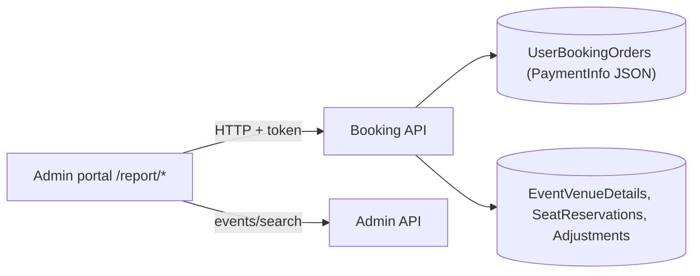

# A-22 · বুকিং, বিক্রি, রাজস্ব ও পেমেন্ট-অসঙ্গতি রিপোর্ট

> **Bangla name:** বুকিং, বিক্রি, রাজস্ব ও পেমেন্ট-অসঙ্গতি রিপোর্ট
>
> [← 10 · অ্যাডমিন পোর্টাল](README.md) · [সূচিপত্র](../README.md) · [ওপেন কোয়ারি](../99-open-queries.md)

## 1. নাম ও উদ্দেশ্য

**রিপোর্ট।** একটি প্রোগ্রামের **Reports** মেনু অর্ডার ও অর্থের read-only ভিউ দেয়: বুকিং অর্ডার (মেট্রিক্স ও এক্সপোর্টসহ), প্রতি ইভেন্টে বিক্রি, প্রতিদিন ও প্রতি ইভেন্টে রাজস্ব, সারাংশ, এবং একটি **পেমেন্ট অসঙ্গতি** রিপোর্ট যা gateway যা আসায় এবং অর্ডারে যা লেখা আছে তার মধ্যে তুলনা করে। গেট রিপোর্টগুলো [A-19](A-19-gate-reports.md)-এ।

## 2. ট্রিগার ও অ্যাক্টর

প্রোগ্রাম নির্বাচিত করে কর্মীরা (`/report/*`, রুটগুলো `AuthGuard`-এ সুরক্ষিত)। মেনুটি [X-17](../60-cross-cutting/X-17-authz-client-side.md)-এর রোলগুলোকে দেখায়। Booking-এর `ReportController` (`/booking/api/v1/report/admin/...`) থেকে **কোনো `[Authorize]` নেই**; অর্ডার তালিকা ও ডিটেইল endpointগুলো admin policy চায়।

## 3. ব্যবসায়িক প্রবাহ

| মেনু আইটেম | রুট | কী দেখায় |
|---|---|---|
| Booking Orders | `/report/booking-orders` | স্ট্যাটাস ফিল্টার, অর্ডার নম্বর খোঁজা, মেট্রিক্স ও এক্সপোর্টসহ একটি ইভেন্টের অর্ডার |
| Payment Discrepancy | `/report/payment-discrepancy` | সেই অর্ডারগুলো যেখানে gateway-এর পরিমাণ অর্ডারের মোট থেকে আলাদা |
| Event-Wise Sales | `/report/event-wise-sales` | একটি ইভেন্টের প্রতি লেভেলে আসন ও পরিমাণ |
| Summary Sales | `/report/summary-sales` | প্রতি ইভেন্টে বিক্রির সারাংশ |
| Day-wise Revenue | `/report/day-wise-revenue` | দুই তারিখের মধ্যে রাজস্ব |
| Event-wise Revenue | `/report/event-wise-revenue` | একটি ইভেন্টের রাজস্বের বিস্তারিত |
| Summary Revenue | `/report/summary-revenue` | প্রতি ইভেন্টে রাজস্বের সারাংশ |

## 4. প্রযুক্তিগত প্রবাহ

পোর্টাল থেকে সব কল **[HTTP + ইউজার টোকেন]** সরাসরি Booking-এ (ইভেন্ট বাছাইয়ের জন্য Admin-এ):

1. ইভেন্ট বাছাই `GET /admin/api/v1/events/search?...` ([A-07](A-07-events.md))।
2. বুকিং অর্ডার: `GET /booking/api/v1/user-booking-order/admin/list/{eventId}?page&status&orderNumber&sortOrder&programId` (admin policy, প্রতি পাতায় ২০টি), `GET .../user-booking-order/admin/{bookingId}` (ডিটেইল), `GET /booking/api/v1/report/admin/booking-metrics?eventId` → `GetBookingMetricstByEventId`: রিজার্ভড টিকিট, ক্যাপাসিটি অ্যাডজাস্টমেন্ট, সিটিং ক্যাপাসিটি, বিক্রীত টিকিট, অনলাইনে তৈরি টিকিট এবং স্ট্যাটাস অনুযায়ী অর্ডারের সংখ্যা (`Pending`, `Failed`, `Paid`, `Requested`, `Generated`); এক্সপোর্ট `GET .../report/admin/export-booking-orders?eventId&programId`।
3. বিক্রি ও রাজস্ব: `GET .../report/admin/event-sales-summary?programId`, `event-sales-details?id&programId`, `event-revenue-summary?programId`, `event-revenue-sales-details?id&programId`, `revenue-report-list?startDate&endDate&eventId&programId`।
4. পেমেন্ট অসঙ্গতি: `GET .../report/admin/payment-discrepancy?programId&eventId`: `etp."UserBookingOrders"`-এর ওপর একটি হাতে-লেখা SQL যা সংরক্ষিত `PaymentInfo` JSON থেকে gateway-এর জানানো পরিমাণ পড়ে (DgePay-এর জন্য `data.amount`, SSLCommerz-এর জন্য `amount`), এবং `OverBilling` (gateway-এর পরিমাণ `TotalCharge`-এর চেয়ে বেশি) ও `UnderBilling` (কম) ফেরত দেয়, সঙ্গে gateway-এর নাম, স্ট্যাটাস টেক্সট ও পেমেন্ট পদ্ধতি।
5. প্রতিটি রিপোর্ট endpoint `programId`-কে একটি **query parameter** হিসেবে নেয়, যা পোর্টাল নির্বাচিত প্রোগ্রাম থেকে বেছে নেয় ([A-01](A-01-program-selection.md))।

## 5. কম্পোনেন্ট

| ধরন | কম্পোনেন্ট |
|---|---|
| ক্লায়েন্ট | `features/reports/*`, `services/booking-orders.service.ts`, `services/report.service.ts:41-92` |
| সার্ভিস | Booking (`ReportController`, `UserBookingOrderController`, `BookingReportManager`, repositories); Admin (events search) |
| টেবিল | `UserBookingOrders`, `EventVenueDetails`, `SeatReservations`, `EventCapacityAdjustments` |

## 6. API কন্ট্রাক্ট

| Method | Path | Auth | Request | Response |
|---|---|---|---|---|
| GET | `/booking/api/v1/user-booking-order/admin/list/{eventId}` | admin policy | page, `status`, `orderNumber`, `sortOrder`, `programId` | পাতাভিত্তিক অর্ডার |
| GET | `/booking/api/v1/user-booking-order/admin/{id}` | admin policy | path | অর্ডারের বিবরণ |
| GET | `/booking/api/v1/report/admin/booking-metrics` | **none** | `eventId` | `BookingMetrics` |
| GET | `/booking/api/v1/report/admin/export-booking-orders` | **none** | `eventId`, `programId` | `ExportOrderDetails[]` |
| GET | `/booking/api/v1/report/admin/event-sales-summary`, `event-revenue-summary` | **none** | `programId` | সারাংশ |
| GET | `/booking/api/v1/report/admin/event-sales-details`, `event-revenue-sales-details` | **none** | `id`, `programId` | বিস্তারিত সারি |
| GET | `/booking/api/v1/report/admin/revenue-report-list` | **none** | `startDate`, `endDate`, `eventId`, `programId` | সারি |
| GET | `/booking/api/v1/report/admin/payment-discrepancy` | **none** | `programId`, `eventId` | `PaymentDiscrepancyData[]` |

`PaymentDiscrepancyData` ফিল্ড (SQL alias): `EventName`, `EventStartDateTime`, `UserId`, `OrderNumber`, `NumberOfSeats`, `OrderTime`, `ETPTxnId`, `Status`, `ETPChargeAmount`, `PaymentGateway`, `GatewayChargedAmount`, `OverBilling`, `UnderBilling`, `PaymentMethod`.

## 7. ডেটা ও পার্শ্বপ্রতিক্রিয়া

শুধু পড়ে।

## 8. কোড রেফারেন্স

| কী | কোথায় |
|---|---|
| Report controller | `rvl-gobcb-backend/Services/Booking/ETP.Booking.Service/Api/ReportController.cs:14-160` |
| Orders list and detail | `rvl-gobcb-backend/Services/Booking/ETP.Booking.Service/Api/UserBookingOrderController.cs:325, 378` |
| Manager | `rvl-gobcb-backend/Services/Booking/ETP.Booking.Domain/Managers/BookingReportManager.cs:22-105` |
| Discrepancy SQL | `rvl-gobcb-backend/Services/Booking/ETP.Booking.Storage/Repositories/UserBookingOrderRepository.cs:1446-1560` |
| Portal | `rvl-gobcb-admin-portal/src/app/features/reports/services/booking-orders.service.ts:25-57`, `report.service.ts:41-92` |

## 9. হ্যান্ডওভার নোট

1. **আর্থিক ডেটা টোকেন ছাড়াই পড়া যায়।** আটটি `report/admin/*` endpointই অজ্ঞাতপরিচয়ের ([X-18](../60-cross-cutting/X-18-endpoints-without-auth.md)): গ্রাহকের user id, অর্ডার নম্বর, পরিমাণ ও পেমেন্টের বিবরণ যেকোনো সেই ব্যক্তিকে ফেরত দেয় যে Booking-এর পাথে পৌঁছাতে পারে।
2. **প্রোগ্রাম স্কোপ হলো একটি প্যারামিটার।** `programId` ক্লায়েন্ট বেছে নেয়; `programId=0` বা অন্য প্রোগ্রাম দিলে সবই ফেরত আসে (সার্ভার-সাইডে কোনো যাচাই নেই, [X-16](../60-cross-cutting/X-16-authz-program-scope.md))।
3. **অসঙ্গতি রিপোর্ট সংরক্ষিত gateway JSON-এর গঠনের ওপর নির্ভরশীল**; keyগুলো (`data.amount`, `data.payment_method`, `card_type`) দুটি gateway-এর জন্য হার্ড-কোড করা। anonymous bypass endpoint যে অর্ডারকে Paid চিহ্নিত করে, সেটি পরিমাণ `1.0` ও gateway DgePay-সহ একটি নির্দিষ্ট payment-info লেখা সংরক্ষণ করে ([S-01](../50-system-initiated/S-01-level-capacity-update.md), `UserBookingOrderManager.cs:495-545`), তাই এই রিপোর্ট সেটিকে under-billed হিসেবে দেখাবে; এই endpoint-এর অপব্যবহার সেখানেই চোখে পড়বে।
4. **তুলনার নিয়ম বদলেছে।** SQL-এর একটি আগের সংস্করণ (repository-তে commented out) সেই অর্ডারগুলো বাদ দিত যেখানে gateway-এর পরিমাণ `TotalCharge × 1.03`-এর সমান ছিল; সক্রিয় query-তে gateway-এর পরিমাণ ও `TotalCharge`-এর মধ্যে প্রতিটি অ-শূন্য পার্থক্য রিপোর্ট হয়।
5. **বিক্রির চার্টে ক্যাপাসিটি মানে ভেন্যুর সিটিং ক্যাপাসিটি**, বর্তমানে বরাদ্দ ও রিজার্ভেশনের পরের অনলাইন ক্যাপাসিটি নয় ([A-10](A-10-capacity-adjustment.md), [A-11](A-11-seat-reservation.md)); তাই বিক্রীত ও উপলব্ধের যোগফল গ্রাহক যা কিনতে পারেন তার সমান হয় না।
6. **রাজস্ব রিপোর্টে তারিখগুলো স্ট্রিং** (`GetUserBookingOrdersByEvent`-এ `startDate`, `endDate`); মাস-শেষে reconcile করার আগে দিনের সীমানা কোন time zone ব্যবহার হচ্ছে তা যাচাই করা উচিত `[UNCONFIRMED: Q-30]`।
7. **এক্সপোর্ট সব সারি** মেমরিতে ও একটি response-এ নেয়।

## 10. কম্পোনেন্ট সম্পর্ক

**নির্ভর করে:** [P-06](../20-user-portal/P-06-booking-payment.md) (অর্ডার), [S-05](../50-system-initiated/S-05-pending-failed-revalidation.md) (স্ট্যাটাস), [A-09](A-09-event-level-pricing.md)। **প্রভাব ফেলে:** রিকনসিলিয়েশন ([A-23](A-23-reconciliation.md)), VAT যাচাই ([S-10](../50-system-initiated/S-10-vat-challan.md))।

## 11. ডেভেলপার টেস্ট গাইড

**লোকালভাবে পরীক্ষা: সম্পূর্ণ** seeded অর্ডারসহ (`scripts/seed/03-orders-tickets.sql`)।

| বিষয় | বিবরণ |
|---|---|
| টেস্ট ডেটা ও অ্যাকাউন্ট | `pwsh ./scripts/Seed-EtpData.ps1`; admin `…01`; একটি প্রোগ্রাম নির্বাচন করুন |
| ব্রাউজার | `http://localhost:4200/report/booking-orders` এবং §3-এর অন্য রুটগুলো; Network: `GET .../booking/api/v1/report/admin/...` |
| এমুলেটর | — |
| Postman | `postman/services/etp-booking.postman_collection.json`: "GET /api/v1/report/admin/booking-metrics", "GET /api/v1/report/admin/payment-discrepancy", "GET /api/v1/user-booking-order/admin/list/{eventId}" (admin token) |
| Visual Studio debug | `BookingReportManager.GetBookingMetricstByEventId`, `UserBookingOrderRepository.GetPaymentDiscrepancyDataAsync` |
| যাচাই | SQL: `select "OrderNumber","TotalCharge","Status" from etp."UserBookingOrders" where "EventLongId" = <id>` |
