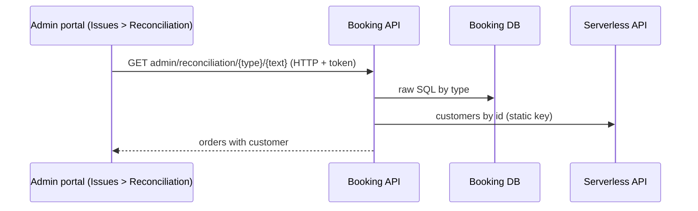

# A-23 · রিকনসিলিয়েশন অনুসন্ধান

> **Bangla name:** রিকনসিলিয়েশন অনুসন্ধান
>
> [← 10 · অ্যাডমিন পোর্টাল](README.md) · [সূচিপত্র](../README.md) · [ওপেন কোয়ারি](../99-open-queries.md)

## 1. নাম ও উদ্দেশ্য

**রিকনসিলিয়েশন।** সাপোর্ট কর্মী গ্রাহকের অভিযোগ ("আমি পেমেন্ট করেছি কিন্তু টিকিট পাইনি") সমাধান করেন গ্রাহক যা কিছু দিতে পারেন তা থেকেই অর্ডার খুঁজে: অর্ডার নম্বর, পেমেন্ট ট্রানজ্যাকশন আইডি, টিকিট নম্বর কিংবা ফোন নম্বর। ফলাফলে অর্ডারটি তার স্ট্যাটাস, পেমেন্ট তথ্য ও গ্রাহকসহ দেখায়। এটি **Issues → Reconciliation**-এর অধীনে ইস্যু তালিকার পাশে রয়েছে।

## 2. ট্রিগার ও অ্যাক্টর

admin policy-ওয়ালা কর্মীরা (`admin`, `customer_support` এবং **Issues** মেনু দেখতে পাওয়ারা অন্যরা, [X-17](../60-cross-cutting/X-17-authz-client-side.md)); একটি প্রোগ্রাম নির্বাচিত হতে হবে (`/issues/reconciliation`)। Booking endpoint-এর জন্য `[Authorize(Policy = Admin)]` প্রয়োজন।

## 3. ব্যবসায়িক প্রবাহ

অনুসন্ধানের ধরন বাছুন (**Order number**, **Transaction id**, **Ticket number**, **Phone number**), মান লিখুন, সার্চ চাপুন, এবং মিলে যাওয়া অর্ডারগুলো পড়ুন (একটি ফোন নম্বরে কয়েকটি হতে পারে)। এরপর সাপোর্ট কর্মী gateway-এর সঙ্গে তুলনা করেন এবং প্রয়োজন হলে বিষয়টি টেকনিক্যাল টিমে তুলে দেন।

## 4. প্রযুক্তিগত প্রবাহ

1. **[HTTP + ইউজার টোকেন]** `GET /booking/api/v1/user-booking-order/admin/reconciliation/{searchType}/{searchText}?programId=` (পোর্টাল `getReconciliationDetails`, পোর্টাল থেকে সরাসরি Booking-এ কল হয়)।
2. `UserBookingOrderManager.GetAllBySearchType`: `PhoneNo` হলে প্রথমে `IPortalUserManager`-এর মাধ্যমে ফোন দিয়ে গ্রাহককে খোঁজে (`"+88" + searchText`, একটি নির্দিষ্ট বাংলাদেশি prefix) এবং search text-কে user id দিয়ে প্রতিস্থাপন করে (না পেলে "User not found with this phone number.")।
3. `UserBookingOrderRepository.FindListBySearchType` ইভেন্ট ও প্রোগ্রাম সেটিংসের সঙ্গে যুক্ত `etp."UserBookingOrders"`-এর ওপর একটি **parameterised** raw SQL চালায়: `OrderNumber = @data`, `PaymentTransactionId = @data`, কোনো টিকিট নম্বরের অর্ডার (`Tickets.BookingOrderId`), বা `CreatedBy = @data` (ফোন থেকে পাওয়া user id); `programId > 0` হলে `ProgramId` দিয়ে ফিল্টার।
4. গ্রাহকদের নাম ও ফোন **Serverless API**-এ একটি bulk কল দিয়ে পূরণ করা হয় (**[HTTP, static key]** `GetAllUserByIdAsync`, [X-22](../60-cross-cutting/X-22-sms-notification.md)); সেটি null ফেরত দিলে সারিগুলোতে কোনো ইউজার ডেটা থাকে না।

## 5. কম্পোনেন্ট

| ধরন | কম্পোনেন্ট |
|---|---|
| ক্লায়েন্ট | `features/issues/pages/reconciliation`, `services/reconciliation.service.ts:30-42` |
| সার্ভিস | Booking (`UserBookingOrderController`, `UserBookingOrderManager`, `PortalUserManager`); Serverless API (বাহ্যিক) |
| টেবিল | `UserBookingOrders` |

## 6. API কন্ট্রাক্ট

| Method | Path | Auth | Request | Response | Main errors |
|---|---|---|---|---|---|
| GET | `/booking/api/v1/user-booking-order/admin/reconciliation/{searchType}/{searchText}` | `admin` policy | `searchType` `OrderNumber`, `TransactionId`, `TicketNumber`, `PhoneNo`; `programId` | ইউজারসহ `UserBooking[]` | 400 `User not found with this phone number.` |

`searchType` পাথ থেকে বাউন্ড একটি enum, তাই নাম বা তার নম্বর (`0`..`3`) — দুটোই গ্রহণযোগ্য। Response-এ অর্ডারের ফিল্ড (অর্ডার নম্বর, স্ট্যাটাস, পরিমাণ, `paymentInfo` JSON, প্রোগ্রাম, ইভেন্ট, লেভেল, আসন) এবং গ্রাহকের রেকর্ড থাকে; প্রপার্টির নামগুলো `UserBooking`-এর।

প্রধান নমুনা: `GET /booking/api/v1/user-booking-order/admin/reconciliation/PhoneNo/01700000011?programId=12` (ফোন শুধু উদাহরণ; সামনের `+88` সার্ভার যোগ করে)।

## 7. ডেটা ও পার্শ্বপ্রতিক্রিয়া

শুধু পড়ে; একটি অর্ডারের `paymentInfo`-তে gateway-এর raw response থাকতে পারে।

## 8. কোড রেফারেন্স

| কী | কোথায় |
|---|---|
| Endpoint | `rvl-gobcb-backend/Services/Booking/ETP.Booking.Service/Api/UserBookingOrderController.cs:338-344` |
| Manager | `rvl-gobcb-backend/Services/Booking/ETP.Booking.Domain/Managers/UserBookingOrderManager.cs:811-835` |
| Query | `rvl-gobcb-backend/Services/Booking/ETP.Booking.Storage/Repositories/UserBookingOrderRepository.cs:1268-` |
| Enum | `rvl-gobcb-backend/Services/Booking/ETP.Booking.Domain/Models/Enum.cs:49-55` |
| Portal | `rvl-gobcb-admin-portal/src/app/features/issues/services/reconciliation.service.ts:30-42` |

## 9. হ্যান্ডওভার নোট

1. **search text URL path-এর অংশ**, তাই ফোন নম্বর ও ট্রানজ্যাকশন আইডি access log-এ দেখা যায়; এটি path segment হিসেবেও বাউন্ড হয়, তাই `/`-এর মতো অক্ষর অনুসন্ধান ভেঙে দেয়।
2. **ফোন prefix `+88` হার্ড-কোড করা**; সামনে `+88` বা `88` লিখে টাইপ করা নম্বর মিলবে না।
3. **`programId` ঐচ্ছিক ও ক্লায়েন্ট-সরবরাহকৃত**: `0` (কিংবা বাদ দিলে) অনুসন্ধান সব প্রোগ্রামে ছড়ায়, তাই একজন সাপোর্ট কর্মী তার নিয়োগ না থাকা প্রোগ্রামের অর্ডারও দেখতে পান ([X-16](../60-cross-cutting/X-16-authz-program-scope.md))।
4. **টিকিট-নম্বরের অনুসন্ধান রিজার্ভড টিকিটের ক্ষেত্রে ভুল অর্ডার ফেরত দিতে পারে।** SQL খোঁজে `UBO."Id" = (select T."BookingOrderId" from "Tickets" T where T."TicketNumber" = @data)`, কিন্তু রিজার্ভড টিকিট `BookingOrderId`-তে একটি **reservation id** সংরক্ষণ করে ([A-12](A-12-reserved-tickets.md)); তখন মিলে যায় একটি অসম্পর্কিত গ্রাহক অর্ডার যার সংখ্যাগত id এক `[UNCONFIRMED: Q-31]`।
5. **Serverless API নামিয়ে গেলে** অর্ডার নম্বরে অনুসন্ধান অর্ডারগুলো ফেরত দেয়, কিন্তু গ্রাহকের বিবরণ ছাড়া।
6. রিকনসিলিয়েশন **বাতিল কিন্তু পরিশোধিত** কেসগুলোতে সাহায্য করে, যা [S-05](../50-system-initiated/S-05-pending-failed-revalidation.md) তৈরি করতে পারে (সেখানে নোট ১): `status` ও `paymentInfo` একসঙ্গে দেখুন।

## 10. কম্পোনেন্ট সম্পর্ক

**নির্ভর করে:** [P-06](../20-user-portal/P-06-booking-payment.md), [A-22](A-22-reports.md)। **প্রভাব ফেলে:** সাপোর্ট সিদ্ধান্ত; কোনো ডেটা পরিবর্তন নয়।

## 11. ডেভেলপার টেস্ট গাইড

**লোকালভাবে পরীক্ষা: আংশিক।** Serverless API dummy, তাই লোকালভাবে গ্রাহকের বিবরণ খালি; অর্ডারের অনুসন্ধান কাজ করে (`PhoneNo` অনুসন্ধানের জন্য portal-user lookup দরকার, যা Cognito/Floci ব্যবহার করে)।

| বিষয় | বিবরণ |
|---|---|
| টেস্ট ডেটা ও অ্যাকাউন্ট | Admin `…01`; ব্যবহারকারী `…11`-এর seeded অর্ডার (`scripts/seed/03-orders-tickets.sql`) |
| ব্রাউজার | `http://localhost:4200/issues/reconciliation` (প্রোগ্রাম নির্বাচিত) |
| এমুলেটর | — |
| Postman | `postman/services/etp-booking.postman_collection.json`: "GET /api/v1/user-booking-order/admin/reconciliation/{searchType}/{searchText}" with `{{access_token_admin}}` |
| Visual Studio debug | `UserBookingOrderManager.GetAllBySearchType` |
| যাচাই | SQL: `select "OrderNumber","PaymentTransactionId","Status" from etp."UserBookingOrders"` |
