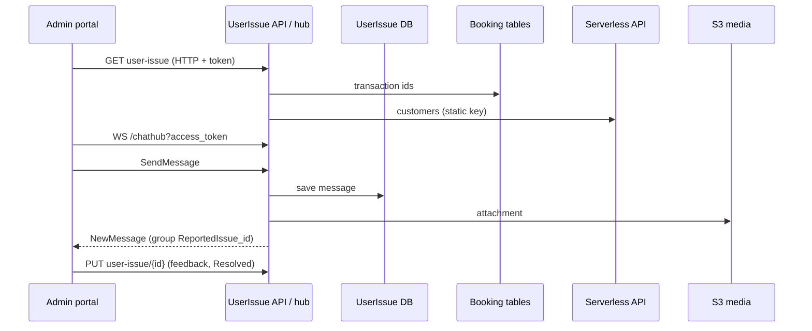

# A-24 · ইউজার ইস্যু ও সাপোর্ট চ্যাট (অ্যাডমিন দিক)

> **Bangla name:** ইউজার ইস্যু ও সাপোর্ট চ্যাট (অ্যাডমিন দিক)
>
> [← 10 · অ্যাডমিন পোর্টাল](README.md) · [সূচিপত্র](../README.md) · [ওপেন কোয়ারি](../99-open-queries.md)

## 1. নাম ও উদ্দেশ্য

**সাপোর্ট ইস্যু ও চ্যাট।** একজন গ্রাহক অর্ডার নিয়ে সমস্যা জানান (গ্রাহকের দিক [P-12](../20-user-portal/P-12-issues-chat.md) ও [U-08](../30-user-app/U-08-issues-chat.md))। সাপোর্ট টিম ইস্যুগুলো তালিকাভুক্ত করে, একটি খোলে, রিয়েল-টাইম চ্যাটে উত্তর দেয়, ফিডব্যাক যোগ করে এবং সেটিকে **Resolved** চিহ্নিত করে। এই ফিচারটি **UserIssue** সার্ভিসে চলে (লোকালভাবে পোর্ট 5110), চ্যাটের জন্য একটি SignalR hub আছে। ধারণা: [path-prefix routing](../00-platform-primer.md#explainer-path-prefix-routing), [token forwarding](../00-platform-primer.md#explainer-token-forwarding)।

## 2. ট্রিগার ও অ্যাক্টর

রোল `customer_support` বা `admin` থাকা কর্মীরা (প্রোগ্রাম নির্বাচিত অবস্থায় **Issues** মেনু, `/issues/list`, `/issues/:id/details`; **সার্ভারের** admin policy যেকোনো admin-pool ব্যবহারকারীকে গ্রহণ করে)। hub **user** ও **admin** দুটি scheme-ই গ্রহণ করে।

## 3. ব্যবসায়িক প্রবাহ

1. **ইস্যু তালিকা:** স্ট্যাটাস অনুযায়ী ফিল্টার (`Open`, `Resolved`), ইস্যু নম্বর / অর্ডার নম্বর / ট্রানজ্যাকশন আইডি দিয়ে খোঁজা, সাজানো; তালিকায় গ্রাহকের নাম ও ফোন দেখায়।
2. **ইস্যু বিবরণ:** অর্ডারের সারাংশ, গ্রাহক, unread সংখ্যাসহ চ্যাট থ্রেড, এবং সংযুক্তি।
3. **চ্যাট:** বার্তা লিখুন বা ফাইল সংযুক্ত করুন; গ্রাহক সংযুক্ত থাকলে সঙ্গে সঙ্গে দেখতে পান; typing indicator ও join/leave ইভেন্ট দেখা যায়।
4. **সমাধান:** ফিডব্যাক লিখুন এবং স্ট্যাটাস `Resolved` করুন।

## 4. প্রযুক্তিগত প্রবাহ

1. **[HTTP + ইউজার টোকেন]** তালিকা `GET /userissue/api/v1/user-issue?search=&searchType=&sortBy=&sortOrder=&pageOffset=&pageSize=10&status=&programId=` (admin policy): `ReportIssueManager.GetAllAsync` (একটি `searchType=txnid` অনুসন্ধান আগে shared orders টেবিলে পেমেন্ট ট্রানজ্যাকশন আইডি দিয়ে অর্ডার id খোঁজে), তারপর **Serverless API** থেকে গ্রাহকদের পড়ে (**[HTTP, static key]**) এবং অর্ডারের ট্রানজ্যাকশন আইডি। ডিটেইল `GET .../user-issue/{id}`; গণনা `GET .../user-issue/count?status&programId` (ড্যাশবোর্ড ব্যবহার করে, [A-21](A-21-dashboard.md)); মুছে ফেলা `DELETE .../{id}`।
2. হালনাগাদ `PUT .../user-issue/{id}` দিয়ে `{feedback, status}` → `UpdateFeedbackAsync` ফিডব্যাক ও স্ট্যাটাস সেট করে। **গ্রাহককে কোনো নোটিফিকেশন পাঠানো হয় না** (§৯ দেখুন)।
3. **চ্যাট, REST:** `GET .../user-issue-chat/{id}/messages` (পাতাভিত্তিক), `.../unread`, `.../unread-count?receiverType`, `POST .../{id}/mark-read`, `.../last`, `.../recent?count`, `POST .../user-issue-chat/send` (ফাইলসহ multipart), `GET .../message/{messageId}/attachment/download`।
4. **চ্যাট, SignalR** `/userissue/chathub?access_token=<admin token>` **[SignalR]**: ক্লায়েন্ট মেথড `SendMessage(CreateChatMessage)` (`ReportIssueChatManager.SendMessageAsync`-এর মাধ্যমে সংরক্ষণ করে এবং group `ReportedIssue_{id}`-তে `NewMessage` ব্রডকাস্ট করে), `JoinUserIssueChat(id)`, `LeaveUserIssueChat(id)`, `SendTypingIndicator(id)`, `StopTyping(id)`; পোর্টাল যে ইভেন্ট পায়: `NewMessage`, `ReceiveMessage`, `MessageError`, `UserJoined`, `UserLeft`, `UserTyping`, `UserStoppedTyping`। কানেক্ট করার সময় একজন ব্যবহারকারী group `User_{nameIdentifier}`-এ যোগ হয় এবং role claim-এ "Admin" থাকলে `AdminGroup`-এও।
5. `SendMessageAsync`-এ লেখা থাকা না সঙ্গে না সঙ্গে একটি ফাইল লাগে, বার্তাটি সংরক্ষণ করে (`SenderType`, `SenderId`, `SenderName` **যেভাবে caller পাঠিয়েছে ঠিক তেমন**), `HandleFileUploadAsync`-এর মাধ্যমে সংযুক্তি S3-এ `chat-attachments/{issueId}/...` পাঠায় ([X-20](../60-cross-cutting/X-20-file-storage.md)), তারপর `IChatNotificationService.NotifyNewMessageAsync`।

## 5. কম্পোনেন্ট

| ধরন | কম্পোনেন্ট |
|---|---|
| ক্লায়েন্ট | `features/issues/pages/{issue-list,issue-details,reconciliation}`, `services/{issue,chat}.service.ts` (SignalR client) |
| সার্ভিস | UserIssue (`ReportIssueController`, `ReportIssueChatController`, `UserIssueChatHub`, managers); Booking (`IBookingClient`/read model-এর মাধ্যমে অর্ডার খোঁজা); Serverless API |
| টেবিল | UserIssue `ReportedIssues`, `ReportedIssueChatMessages` |
| স্টোরেজ | S3 media `chat-attachments/{issueId}` |
| রিয়েল টাইম | SignalR hub `/userissue/chathub` |

## 6. API কন্ট্রাক্ট

| Method | Path | Auth | Request | Response |
|---|---|---|---|---|
| GET | `/userissue/api/v1/user-issue` | admin policy | উপরের ফিল্টার | পাতাভিত্তিক `ReportedUserIssue`, `user` ও `transactionId`-সহ |
| GET | `/userissue/api/v1/user-issue/{id}` | admin policy | path | `ReportedUserIssueDetails` |
| PUT | `/userissue/api/v1/user-issue/{id}` | admin policy | `UpdateUserIssue {feedback, status}` | `ReportedUserIssue` |
| DELETE | `/userissue/api/v1/user-issue/{id}` | admin policy | path | ফলাফল |
| GET | `/userissue/api/v1/user-issue/count` | admin policy | `status`, `programId` | `int` |
| GET/POST | `/userissue/api/v1/user-issue-chat/...` (৮টি রুট) | **none** | §৪ দেখুন | বার্তা |
| WS | `/userissue/chathub` | user or admin scheme | hub মেথড | ইভেন্ট |

স্ট্যাটাস: `Open`, `Resolved`। প্রধান নমুনা, `PUT /userissue/api/v1/user-issue/45`:

```json
{ "feedback": "Refunded by the payment gateway on 12 Dec.", "status": "Resolved" }
```

## 7. ডেটা ও পার্শ্বপ্রতিক্রিয়া

ইস্যু ও চ্যাট সারি, S3 সংযুক্তি, SignalR ব্রডকাস্ট; activity log UserIssue ডেটাবেসকে কভার করে ([X-24](../60-cross-cutting/X-24-activity-logging.md))।

## 8. কোড রেফারেন্স

| কী | কোথায় |
|---|---|
| Issue controller | `rvl-gobcb-backend/Services/UserIssue/ETP.UserIssue.Service/Api/ReportIssueController.cs:14-170` |
| Chat controller | `.../Api/ReportIssueChatController.cs:12-160` |
| Hub | `rvl-gobcb-backend/Services/UserIssue/ETP.UserIssue.Service/Hubs/UserIssueChatHub.cs` |
| Managers | `rvl-gobcb-backend/Services/UserIssue/ETP.UserIssue.Domain/Managers/ReportIssueManager.cs:54-312`, `ReportIssueChatManager.cs:37-140` |
| Portal | `rvl-gobcb-admin-portal/src/app/features/issues/services/chat.service.ts:60-240`, `issue.service.ts:50-74` |

## 9. হ্যান্ডওভার নোট

1. **চ্যাটের REST endpointগুলোর কোনো অনুমোদন নেই** (`ReportIssueChatController`); যেকোনো caller যেকোনো ইস্যু id-এর বার্তা পড়তে বা সংযুক্তি ডাউনলোড করতে পারে, এবং যেকোনো sender হিসেবে পোস্ট করতে পারে ([X-18](../60-cross-cutting/X-18-endpoints-without-auth.md))।
2. **hub-এ কোনো ownership যাচাই নেই।** যেকোনো authenticated গ্রাহক বা admin যেকোনো ইস্যু id দিয়ে `JoinUserIssueChat` কল করতে পারে এবং তারপর সেই ইস্যুর প্রতিটি বার্তা পেতে পারে; `SendMessage` payload থেকে আসা `SenderType`, `SenderId` ও `SenderName` বিশ্বাস করে।
3. **একটি ইস্যু সমাধান করলে গ্রাহককে কিছুই পাঠানো হয় না।** `issue_resolved` নোটিফিকেশনটি কেবল Admin সার্ভিসের **legacy কপিতে** আছে (`UserIssueManager.UpdateFeedbackAsync`), যা পোর্টাল আর কল করে না ([X-22](../60-cross-cutting/X-22-sms-notification.md) নোট ২, [Appendix A](../90-appendix-a-legacy.md))। live সার্ভিসের `UpdateFeedbackAsync` কেবল সংরক্ষণ করে।
4. **একটি অর্ডারে একটি ইস্যু।** একই অর্ডারের জন্য দ্বিতীয় ইস্যু তৈরি প্রত্যাখ্যান করা হয় ("You cannot create multiple issues per order") এবং বিবরণ ৬০০ অক্ষরে সীমাবদ্ধ; থ্রেডের প্রথম বার্তাটিই সেই বিবরণ।
5. **hub-এর জন্য টোকেন query string-এ দরকার** (`?access_token=`), যা proxy-তে লগ হয়; অ্যাডমিন পোর্টাল এটি ব্যবহার করে ([X-04](../60-cross-cutting/X-04-admin-session.md))।
6. **Admin সার্ভিসে ইস্যু, চ্যাট ও `/admin/chathub`-এর একটি দ্বিতীয়, পুরোনো কপি আছে**; পোর্টালের `issue.service.ts` ও `chat.service.ts` `/userissue/...` পাথ কল করে ([Appendix A](../90-appendix-a-legacy.md))।
7. ইস্যু তালিকা প্রতি অনুরোধে পুরো পাতার জন্য গ্রাহকের ডেটা ও ট্রানজ্যাকশন আইডি পড়ে (প্রতি পাতায় একটি Serverless কল ও একটি orders query)।

## 10. কম্পোনেন্ট সম্পর্ক



**নির্ভর করে:** গ্রাহকের ইস্যু তৈরি ([P-12](../20-user-portal/P-12-issues-chat.md), [U-08](../30-user-app/U-08-issues-chat.md)), [P-06](../20-user-portal/P-06-booking-payment.md) (অর্ডার)। **প্রভাব ফেলে:** ড্যাশবোর্ডের টাইল ([A-21](A-21-dashboard.md)), [A-23](A-23-reconciliation.md)।

## 11. ডেভেলপার টেস্ট গাইড

**লোকালভাবে পরীক্ষা: আংশিক।** সার্ভিস, hub ও REST API চলে (UserIssue পোর্ট 5110-এ); গ্রাহকের ডেটা ও নোটিফিকেশন আসে dummy Serverless API থেকে।

| বিষয় | বিবরণ |
|---|---|
| টেস্ট ডেটা ও অ্যাকাউন্ট | Admin `…01` (অথবা `customer_support`); ইউজার পোর্টাল দিয়ে তৈরি একটি গ্রাহক ইস্যু (`…11`, [P-12](../20-user-portal/P-12-issues-chat.md)) |
| ব্রাউজার | `http://localhost:4200/issues/list` → একটি ইস্যু খুলুন; DevTools → Network → WS → `.../userissue/chathub?access_token=...` frames |
| এমুলেটর | — |
| Postman | `postman/services/etp-userissue.postman_collection.json`: "GET /api/v1/user-issue", "PUT /api/v1/user-issue/{id}" with `{{access_token_admin}}` (collection-এর `base_url`-এ `/userissue` prefix নেই, Appendix D দেখুন) |
| Visual Studio debug | `ReportIssueManager.UpdateFeedbackAsync`, `UserIssueChatHub.SendMessage` |
| যাচাই | UserIssue টেবিলে SQL; `aws --endpoint-url http://localhost:4566 s3 ls s3://etp-local/chat-attachments/ --recursive` |
