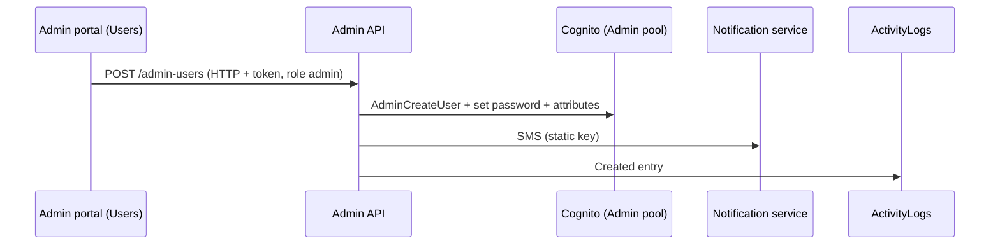

# A-25 · অ্যাডমিন ইউজার

> **Bangla name:** অ্যাডমিন ইউজার
>
> [← 10 · অ্যাডমিন পোর্টাল](README.md) · [সূচিপত্র](../README.md) · [ওপেন কোয়ারি](../99-open-queries.md)

## 1. নাম ও উদ্দেশ্য

**অ্যাডমিন ইউজার।** অ্যাডমিন পোর্টালের কর্মী অ্যাকাউন্ট ("Regular Admins"): তৈরি, নাম সম্পাদনা, **role** ও **programs** সম্পাদনা, disable, enable, পাসওয়ার্ড রিসেট এবং মুছে ফেলা। একটি কর্মী অ্যাকাউন্ট **Admin Cognito pool**-এর একজন ব্যবহারকারী; তার role ও programs `custom:role` ও `custom:program_ids` অ্যাট্রিবিউটে সংরক্ষিত, যা মেনু ও সার্ভারের যাচাই চালায় ([X-15](../60-cross-cutting/X-15-authz-roles.md), [X-16](../60-cross-cutting/X-16-authz-program-scope.md), [X-17](../60-cross-cutting/X-17-authz-client-side.md))। Cognito-র যান্ত্রিক বিষয় ও পাসওয়ার্ডসহ SMS [X-05](../60-cross-cutting/X-05-admin-provisioning.md)-এ।

## 2. ট্রিগার ও অ্যাক্টর

শুধু `admin` রোলযুক্ত কর্মীরা (`AdminUsersController`তে `[Authorize(Roles = Admin)]`; দুটি পাসওয়ার্ড-রিসেট endpoint অজ্ঞাতপরিচয়ের, [X-02](../60-cross-cutting/X-02-admin-forgot-password.md))। প্রবেশ: গ্লোবাল মেনু **Users → Regular Admins** (`/users`, প্রোগ্রাম 0)।

## 3. ব্যবসায়িক প্রবাহ

অ্যাডমিনদের তালিকা (নাম, ফোন, ইমেইল, role, programs, স্ট্যাটাস); **তৈরি** নাম, ফোন, ইমেইল, role ও programs দিয়ে; **সম্পাদনা** নাম, role, programs; **disable** বা **enable**; **পাসওয়ার্ড সেট** (একটি নতুন পাসওয়ার্ড তৈরি হয়ে SMS-এ যায়); **মুছে ফেলা**। একজন অ্যাডমিন নিজের অ্যাকাউন্ট disable বা মুছতে পারে না।

## 4. প্রযুক্তিগত প্রবাহ

1. **[HTTP + ইউজার টোকেন]** `GET /admin/api/v1/admin-users` (তালিকা), `GET .../admin-users/{id}`।
2. তৈরি `POST .../admin-users` `{name, phone, email, role, programIds}` → `AdminUserManager.CreateUserAsync` → `AdminUserProvider.CreateUserAsync` (Cognito `AdminCreateUser` ফোনকে user name হিসেবে নিয়ে, `custom:role`, `custom:program_ids`; তৈরি করা পাসওয়ার্ড; notification service-এর মাধ্যমে SMS, [X-22](../60-cross-cutting/X-22-sms-notification.md)); এরপর `IActivityLogger.LogActivityAsync("AdminUser", id, "Created", null, {name, email, phone, role, programIds})` ([X-24](../60-cross-cutting/X-24-activity-logging.md))।
3. হালনাগাদ `PUT .../admin-users/{id}` `{userId, name, role, programIds}` (বডির `userId` ব্যবহৃত হয়); পুরোনো ও নতুন মানসহ লগ করা হয়।
4. `DELETE .../admin-users/{id}` ও `POST .../disable/{id}` caller-এর নিজের id প্রত্যাখ্যান করে ("Invalid permission"); `POST .../enable/{id}`; `POST .../set-password?userId=`।
5. লক্ষ্য ব্যবহারকারীর ওপর প্রভাব: role ও program-এর পরিবর্তন তখনই কার্যকর হয় যখন `CognitoUserAttributesMiddleware` অ্যাট্রিবিউটগুলো আবার পড়ে (cache `User`/`user_{sub}` প্রায় ২ মিনিট থাকে, [X-15](../60-cross-cutting/X-15-authz-roles.md)); পোর্টাল role-এর পরিবর্তন শনাক্ত করে ব্যবহারকারীকে প্রোগ্রাম কনটেক্সট থেকে সাইন আউট করায় ([X-17](../60-cross-cutting/X-17-authz-client-side.md))।

## 5. কম্পোনেন্ট

| ধরন | কম্পোনেন্ট |
|---|---|
| ক্লায়েন্ট | `features/users/*` (`UserListComponent`), `services/user.service.ts:19-47` |
| সার্ভিস | Admin (`AdminUsersController`, `AdminUserManager`, `AdminUserProvider`, `ActivityLogger`) |
| AWS | Cognito Admin pool; static AWS keys |
| বাহ্যিক | Notification service (SMS) |
| টেবিল | কেবল `ActivityLogs` (অ্যাকাউন্ট Cognito-তে) |

## 6. API কন্ট্রাক্ট

| Method | Path | Auth | Request | Response |
|---|---|---|---|---|
| GET | `/admin/api/v1/admin-users`, `/{id}` | role `Admin` | | `AdminUserResponse[]` / একটি |
| POST | `/admin/api/v1/admin-users` | `Admin` | `AdminCreateUser` | `AdminUserResponse` |
| PUT | `/admin/api/v1/admin-users/{id}` | `Admin` | `AdminUpdateUser` | `AdminUserResponse` |
| DELETE | `/admin/api/v1/admin-users/{id}` | `Admin` | path | `bool` |
| POST | `/admin/api/v1/admin-users/disable/{id}`, `enable/{id}`, `set-password?userId=` | `Admin` | path / query | `bool` |
| GET, POST | `/admin/api/v1/admin-users/forget-password`, `set-forget-password` | **anonymous** | [X-02](../60-cross-cutting/X-02-admin-forgot-password.md) দেখুন | |

`role`-এর মান: `admin`, `event_manager`, `ticket_manager`, `ticket_operator`, `customer_support` (কয়েকটি দেওয়া যায়, কমা দিয়ে আলাদা, [X-15](../60-cross-cutting/X-15-authz-roles.md)); `programIds`: কমা দিয়ে আলাদা প্রোগ্রাম id, কোনোটি না থাকলে খালি।

প্রধান নমুনা, `POST /admin/api/v1/admin-users` (নাম `AdminCreateUser` থেকে; মান শুধু উদাহরণ):

```json
{ "name": "Nadia Rahman", "phone": "+8801700000055", "email": "nadia@example.com",
  "role": "event_manager,ticket_manager", "programIds": "12,13" }
```

Response `AdminUserResponse`: `userId`, `name`, `email`, `phone`, `role`, `programIds`, `currentStatus`, `isActive`, `isPhoneNumberVerified` ([X-05](../60-cross-cutting/X-05-admin-provisioning.md)-এর বানানভুলের নোট দেখুন)।

## 7. ডেটা ও পার্শ্বপ্রতিক্রিয়া

একটি Cognito ব্যবহারকারী; একটি SMS; পুরোনো ও নতুন মানসহ `AdminUser` নামে activity log সারি (পাসওয়ার্ড ছাড়া)।

## 8. কোড রেফারেন্স

| কী | কোথায় |
|---|---|
| Controller | `rvl-gobcb-backend/Services/Admin/ETP.Admin.Service/Api/AdminUsersController.cs:28-200` |
| Manager | `rvl-gobcb-backend/Services/Admin/ETP.Admin.Domain/Managers/AdminUserManager.cs:26-200` |
| Provider | `rvl-gobcb-backend/Services/Admin/ETP.Admin.Integration/Services/AdminUserProvider.cs:29-580` |
| Portal | `rvl-gobcb-admin-portal/src/app/features/users/services/user.service.ts:19-47` |

## 9. হ্যান্ডওভার নোট

1. **Role-এর নাম free text।** `role` এমন একটি স্ট্রিং যা সার্ভার পরিচিত role-এর সঙ্গে যাচাই ছাড়াই `custom:role`-এ লেখে; বানানভুল হলে অ্যাক্সেসহীন অ্যাকাউন্ট তৈরি হয়, আর যেকোনো স্ট্রিং গ্রহণযোগ্য ([X-15](../60-cross-cutting/X-15-authz-roles.md))।
2. **বেশিরভাগ ডেটার জন্য প্রোগ্রাম সীমা কার্যকর হয় না** ([X-16](../60-cross-cutting/X-16-authz-program-scope.md)); `programIds` দিলে পোর্টালের প্রোগ্রাম dropdown ও ড্যাশবোর্ড সীমাবদ্ধ হয়, API নয়।
3. **পাসওয়ার্ড `System.Random` দিয়ে তৈরি হয় এবং স্পষ্ট লেখা অবস্থায় SMS-এ যায়** ([X-05](../60-cross-cutting/X-05-admin-provisioning.md))।
4. **SMS ব্যর্থ হলে অ্যাকাউন্ট থাকে কিন্তু পাসওয়ার্ড কেউ জানে না** ([X-22](../60-cross-cutting/X-22-sms-notification.md) নোট ৪)।
5. **Role-এর পরিবর্তন তাৎক্ষণিক নয়**: cache-এর মেয়াদ শেষ হওয়া পর্যন্ত (প্রায় ২ মিনিট) সার্ভারে পুরোনো role কার্যকর থাকে; disable করা অ্যাকাউন্টের **বিদ্যমান টোকেন তার মেয়াদ শেষ হওয়া পর্যন্ত বৈধ থাকে**, কারণ সার্ভার কেবল টোকেন যাচাই করে এবং প্রতি অনুরোধে Cognito স্ট্যাটাস দেখে না ([X-14](../60-cross-cutting/X-14-authz-pool-policies.md)) `[UNCONFIRMED: Q-32]`।
6. **এখানে কেবল অ্যাডমিনের পরিবর্তন নামসহ লগ হয়**; টিকিট চেকার ও এজেন্টের পরিবর্তন হয় না ([A-17](A-17-ticket-checker-users.md), [A-26](A-26-agent-users.md))।
7. `PUT .../{id}` বডির `userId`-কে বিশ্বাস করে এবং পাথের id উপেক্ষা করে।

## 10. কম্পোনেন্ট সম্পর্ক



**নির্ভর করে:** [X-01](../60-cross-cutting/X-01-admin-login.md), [X-05](../60-cross-cutting/X-05-admin-provisioning.md)। **প্রভাব ফেলে:** প্রতিটি অ্যাডমিন ফিচারের অ্যাক্সেস ([X-15](../60-cross-cutting/X-15-authz-roles.md)), [A-01](A-01-program-selection.md), [A-27](A-27-activity-log.md)।

## 11. ডেভেলপার টেস্ট গাইড

**লোকালভাবে পরীক্ষা: আংশিক।** Cognito হলো Floci; SMS ব্যর্থ হয় (dummy endpoint), তাই **ব্যবহারকারী তৈরি হওয়ার পরেই তৈরির কলে ত্রুটি আসে** ([X-22](../60-cross-cutting/X-22-sms-notification.md))।

| বিষয় | বিবরণ |
|---|---|
| টেস্ট ডেটা ও অ্যাকাউন্ট | Admin `…01` (রোল `admin`) |
| ব্রাউজার | `http://localhost:4200/users` (প্রোগ্রাম 0, [A-01](A-01-program-selection.md)) |
| এমুলেটর | — |
| Postman | `postman/services/etp-admin.postman_collection.json`: "GET /api/v1/admin-users", "POST /api/v1/admin-users/disable/{id}" with `{{access_token_admin}}` |
| Visual Studio debug | `AdminUserManager.CreateUserAsync`, `AdminUserProvider.CreateUserAsync` |
| যাচাই | `aws --endpoint-url http://localhost:4566 cognito-idp admin-get-user --user-pool-id <Admin pool> --username <phone>` দেখায় `custom:role`; SQL: `select "EntityName","Action","Timestamp" from etp."ActivityLogs" where "EntityName" = 'AdminUser'` |
