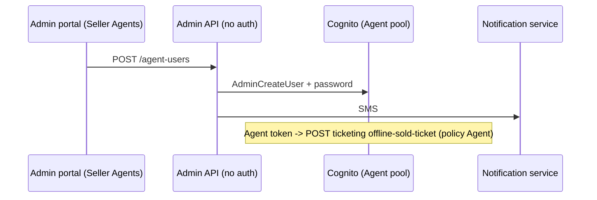

# A-26 · এজেন্ট (বিক্রেতা) ইউজার

> **Bangla name:** এজেন্ট (বিক্রেতা) ইউজার
>
> [← 10 · অ্যাডমিন পোর্টাল](README.md) · [সূচিপত্র](../README.md) · [ওপেন কোয়ারি](../99-open-queries.md)

## 1. নাম ও উদ্দেশ্য

**এজেন্ট ইউজার।** এজেন্টরা অফলাইন বিক্রেতা (কোম্পানি ও শাখা), যারা ওয়েবসাইটের বাইরে টিকিট বিক্রি করে। তাদের অ্যাকাউন্ট থাকে **Agent Cognito pool**-এ। অ্যাডমিনরা এখানে সেগুলো তৈরি ও ব্যবস্থাপনা করেন ("Seller Agents")। pool ও একমাত্র agent API [X-13](../60-cross-cutting/X-13-agent-pool.md)-এ বর্ণিত: `POST /ticketing/api/v1/offline-sold-ticket` (policy `Agent`)। এই অ্যাকাউন্ট ব্যবহার করে এমন ক্লায়েন্ট **রিপোজিটরিতে নেই** (`[UNCONFIRMED: Q-07]`)।

## 2. ট্রিগার ও অ্যাক্টর

গ্লোবাল মেনুতে কর্মীরা (**Users → Seller Agents**, `/agent-user`, প্রোগ্রাম 0)। **সার্ভারের** কন্ট্রোল러 `AgentController`-এ মোটেও কোনো `[Authorize]` নেই ([X-18](../60-cross-cutting/X-18-endpoints-without-auth.md))।

## 3. ব্যবসায়িক প্রবাহ

এজেন্টদের তালিকা (নাম, ফোন, ইমেইল, কোম্পানি, শাখা, শাখার অবস্থান, স্ট্যাটাস); নাম, ফোন, ঐচ্ছিক ইমেইল, কোম্পানির নাম, কোম্পানির শাখা ও শাখার অবস্থান দিয়ে এজেন্ট তৈরি (সবগুলো আবশ্যক, ইমেইল ছাড়া); enable, disable, নতুন পাসওয়ার্ড সেট; পোর্টাল service-এ তালিকা পর্দায় কোনো সম্পাদনা বা মুছে ফেলার সুবিধা নেই।

## 4. প্রযুক্তিগত প্রবাহ

1. **[HTTP + ইউজার টোকেন]** `GET /admin/api/v1/agent-users`, `POST .../agent-users`, `POST .../agent-users/enable/{userId}`, `.../disable/{userId}`, `POST .../agent-users/set-password?userId=` (পোর্টাল `agent-user.service.ts`)। ব্যাকএন্ড `GET .../{id}`, `PUT .../{id}` (শুধু নাম) ও `DELETE .../{id}`-ও দেয়।
2. `AgentUserManager.CreateUserAsync` যাচাই করে: রিকোয়েস্ট আছে; `Name`, `Phone`, `CompanyBranch`, `BranchLocation`, `CompanyName` খালি নয় ("Name should not be empty", "Phone should not be empty", "Agent branch should not be empty", "Branch location should not be empty", "Agent name should not be empty"); এরপর `AgentUserProvider.CreateUserAsync`: Agent pool-এ `AdminCreateUser` (ফোনকে user name হিসেবে নিয়ে, কোম্পানির অ্যাট্রিবিউট), একটি তৈরি করা পাসওয়ার্ড এবং SMS ([X-05](../60-cross-cutting/X-05-admin-provisioning.md), [X-22](../60-cross-cutting/X-22-sms-notification.md))।
3. Disable, enable, set password, delete provider-কে কল করে (Cognito `AdminDisableUser`, `AdminEnableUser`, `AdminSetUserPassword`, `AdminDeleteUser`)।

## 5. কম্পোনেন্ট

| ধরন | কম্পোনেন্ট |
|---|---|
| ক্লায়েন্ট | `features/agent-user/*`, `services/agent-user.service.ts:19-35` |
| সার্ভিস | Admin (`AgentController`, `AgentUserManager`, `AgentUserProvider`) |
| AWS | Cognito Agent pool; static AWS keys |
| বাহ্যিক | Notification service (SMS) |

## 6. API কন্ট্রাক্ট

| Method | Path | Auth | Request | Response | Main errors |
|---|---|---|---|---|---|
| GET | `/admin/api/v1/agent-users`, `/{id}` | **none** | | `AgentUserResponse` | |
| POST | `/admin/api/v1/agent-users` | **none** | `AgentCreateUser` | `AgentUserResponse` | উপরের ৪০০ বার্তা |
| PUT | `/admin/api/v1/agent-users/{id}` | **none** | `AgentUpdateUser {userId, name}` | `AgentUserResponse` | |
| DELETE | `/admin/api/v1/agent-users/{id}` | **none** | path | `bool` | |
| POST | `/admin/api/v1/agent-users/disable/{id}`, `enable/{id}`, `set-password?userId=` | **none** | path / query | `bool` | |

প্রধান নমুনা, `POST /admin/api/v1/agent-users` (নাম `AgentCreateUser` থেকে; মান শুধু উদাহরণ):

```json
{ "name": "Sabbir Hossain", "phone": "+8801700000066", "email": null,
  "companyName": "Ticket Express", "companyBranch": "Dhanmondi", "branchLocation": "Road 8, Dhanmondi, Dhaka" }
```

Response `AgentUserResponse`: `userId`, `name`, `email`, `phone`, `companyName`, `companyBranch`, `branchLocation`, `currentStatus`, `isActive`.

## 7. ডেটা ও পার্শ্বপ্রতিক্রিয়া

Agent pool-এ একটি Cognito ব্যবহারকারী ও একটি SMS; কোনো ডেটাবেস সারি নয়, কোনো activity-log এন্ট্রি নয়।

## 8. কোড রেফারেন্স

| কী | কোথায় |
|---|---|
| Controller | `rvl-gobcb-backend/Services/Admin/ETP.Admin.Service/Api/AgentUserController.cs:23-146 (class `AgentController`)` |
| Manager | `rvl-gobcb-backend/Services/Admin/ETP.Admin.Domain/Managers/AgentUserManager.cs` |
| Provider | `rvl-gobcb-backend/Services/Admin/ETP.Admin.Integration/Services/AgentUserProvider.cs:20-200` |
| Portal | `rvl-gobcb-admin-portal/src/app/features/agent-user/services/agent-user.service.ts:19-35` |

## 9. হ্যান্ডওভার নোট

1. **endpoint-এ পৌঁছাতে পারলে যেকোনো ব্যক্তি এজেন্ট অ্যাকাউন্ট তৈরি, enable, disable, পাসওয়ার্ড রিসেট বা মুছতে পারে**, এবং কোনো টোকেন যাচাই পায় না। যেহেতু নতুন পাসওয়ার্ডটি রিকোয়েস্টে দেওয়া ফোনে SMS-এ যায়, তাই নিজের ফোন দিয়ে অ্যাকাউন্ট তৈরি করা আক্রমণকারী কার্যকর Agent credentials পেয়ে যায় ([X-13](../60-cross-cutting/X-13-agent-pool.md), [X-18](../60-cross-cutting/X-18-endpoints-without-auth.md))।
2. **Agent credentials এরপর `offline-sold-ticket` কল করতে পারে**, যা পেমেন্ট ছাড়াই টিকিট তৈরি করে।
3. **কোনো অডিট ট্রেইল নেই**: `IActivityLogger` এজেন্টের পরিবর্তন লগ করে না (কেবল অ্যাডমিন ইউজার লগ হয়, [A-25](A-25-admin-users.md))।
4. **রিপোজিটরিতে এই অ্যাকাউন্টগুলোর কোনো consumer পাওয়া যায়নি**: কোনো agent app নেই, কোনো web client নেই; `OfflineSoldTickets` ডেটার কোনো reader-ও নেই ([X-13](../60-cross-cutting/X-13-agent-pool.md) `[UNCONFIRMED: Q-07]`))।
5. `set-password` query string হিসেবে user id নেয়।

## 10. কম্পোনেন্ট সম্পর্ক



**নির্ভর করে:** [X-05](../60-cross-cutting/X-05-admin-provisioning.md)। **প্রভাব ফেলে:** [X-13](../60-cross-cutting/X-13-agent-pool.md)।

## 11. ডেভেলপার টেস্ট গাইড

**লোকালভাবে পরীক্ষা: আংশিক।** Cognito হলো Floci; অ্যাকাউন্ট তৈরি হওয়ার পর SMS কলটি ব্যর্থ হয় (dummy endpoint)।

| বিষয় | বিবরণ |
|---|---|
| টেস্ট ডেটা ও অ্যাকাউন্ট | Admin `…01`; seeded agent `…31` (`Passw0rd!23`) |
| ব্রাউজার | `http://localhost:4200/agent-user` (প্রোগ্রাম 0) |
| এমুলেটর | — |
| Postman | `postman/services/etp-admin.postman_collection.json`: "GET /api/v1/agent-users", "POST /api/v1/agent-users"; `etp-login-all-pools` থেকে agent token |
| Visual Studio debug | `AgentUserManager.CreateUserAsync`, `AgentUserProvider.CreateUserAsync` |
| যাচাই | `aws --endpoint-url http://localhost:4566 cognito-idp list-users --user-pool-id <Agent pool>` |
