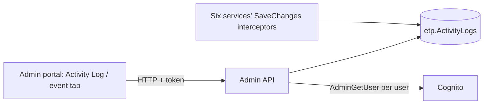

# A-27 · অ্যাক্টিভিটি লগ ভিউয়ার

> **Bangla name:** অ্যাক্টিভিটি লগ ভিউয়ার
>
> [← 10 · অ্যাডমিন পোর্টাল](README.md) · [সূচিপত্র](../README.md) · [ওপেন কোয়ারি](../99-open-queries.md)

## 1. নাম ও উদ্দেশ্য

**অ্যাক্টিভিটি লগ ভিউয়ার।** দুটি পর্দায় সেই অডিট ট্রেইল পড়া হয় যা সার্ভিসগুলো স্বয়ংক্রিয়ভাবে লেখে ([X-24](../60-cross-cutting/X-24-activity-logging.md)): গ্লোবাল মেনুর **Activity Log**, এবং একটি নির্দিষ্ট ইভেন্টের **Activity Log** ট্যাব। রেকর্ড করার যান্ত্রিক বিষয় ও টেবিল X-24-এ; এই ফাইলে পর্দাগুলো ও তাদের API রয়েছে।

## 2. ট্রিগার ও অ্যাক্টর

- **গ্লোবাল লগ:** `/activity-log` (গ্লোবাল মেনু, `AuthGuard`; মেনুটি অ্যাডমিনের গ্লোবাল মেনুতে দেখায়)।
- **ইভেন্ট ট্রেইল:** `/events/event-details/:id` → ট্যাব **Activity Log** (`event-activity-log`)।
- সার্ভার: `ActivityLogController` রোল `Admin` ও `EventManager` অনুমোদন করে।

## 3. ব্যবসায়িক প্রবাহ

1. **গ্লোবাল লগ:** পরিবর্তনের পাতাভিত্তিক তালিকা (সাম্প্রতিক আগে): কখন, কে (নাম), কী কাজ (যেমন "AdminUser Created", "Event Updated"), entity এবং পুরোনো ও নতুন মানের পাঠযোগ্য বিবরণ; সার্চ বাক্স।
2. **ইভেন্ট ট্রেইল:** একটি ইভেন্ট ও তার অংশগুলোতে (ইভেন্ট, সেগমেন্ট, ভেন্যু ডিটেইলস, সেটিংস, গেট...) করা সব পরিবর্তন, যাতে টিম ম্যাচের আগে কে কী বদলাল তা দেখতে পারে (Admin entity এবং Booking-এর capacity, adjustment ও reservation সারি)।

## 4. প্রযুক্তিগত প্রবাহ

1. **[HTTP + ইউজার টোকেন]** গ্লোবাল লগ: `GET /admin/api/v1/activity-log?serviceName=Admin&entityNamesToExclude=Event&entityNamesToExclude=EventSegment&entityNamesToExclude=EventVenueDetails&entityNamesToExclude=EventSettings&pageOffset=&pageSize=&search=` (`activity-log.service.ts`)। পর্দায় **`serviceName` `Admin`-এ নির্দিষ্ট** (`activity-log.component.ts:21`): এতে শুধু Admin সার্ভিসে রেকর্ড করা পরিবর্তন দেখায়, উল্লিখিত ইভেন্ট entityগুলো ছাড়া।
2. ইভেন্ট ট্রেইল: `GET /admin/api/v1/activity-log/event/{eventId}?pageOffset&pageSize` → `ActivityLogManager.GetActivityLogEventAsync`: এটি ইভেন্ট, তার সেটিংস, ভেন্যু ডিটেইলস ও টিকিট-চেকার গেটের id সংগ্রহ করে (Admin), এবং **[HTTP + ইউজার টোকেন]** Booking কলের মাধ্যমে তার ক্যাপাসিটি, ক্যাপাসিটি অ্যাডজাস্টমেন্ট ও আসন রিজার্ভেশন, তারপর সেই entityগুলোর লগ সারি পড়ে ও মিলিয়ে দেয়।
3. এরপর `ActivityLogManager` প্রতিটি আলাদা ব্যবহারকারীর জন্য একটি করে Cognito lookup চালিয়ে `UserId`-কে একটি **নামে** ম্যাপ করে (`AdminUserManager.GetUserDetails`); অজানা ব্যবহারকারী (যেমন `System`) যাচাইয়ের ত্রুটি টেক্সট দেখায়।
4. ব্রাউজারে `formatOperationType` ও `generateDescription` JSON স্ট্রিং `oldValues` ও `newValues`-কে টেক্সটে বদলায় (`AdminUser`, `TicketCheckerGateUser`, `LandingPageImage`-এর বিশেষ ক্ষেত্র; S3 পাথ লিংকে পরিণত হয়)।
5. একটি batch endpoint `POST /admin/api/v1/activity-log/batch` `{serviceName, entityName, entityId}` তালিকার জন্য এন্ট্রি ফেরত দেয় (পোর্টালে কোনো caller পাওয়া যায়নি)।

## 5. কম্পোনেন্ট

| ধরন | কম্পোনেন্ট |
|---|---|
| ক্লায়েন্ট | `features/global-activity-log/*`, `features/events/components/event-activity-log/*`, `services/activity-log.service.ts`, `event.service.ts:256` |
| সার্ভিস | Admin (`ActivityLogController`, `ActivityLogManager`, `ActivityLogRepository`) |
| AWS | Cognito (নাম) |
| টেবিল | `etp."ActivityLogs"` |

## 6. API কন্ট্রাক্ট

তিনটি endpoint ও `ActivityLogsResponse`-এর জন্য [X-24](../60-cross-cutting/X-24-activity-logging.md) §৬ দেখুন। প্রধান নমুনা (response-এর একটি সারি; মান শুধু উদাহরণ; `oldValues` ও `newValues` JSON **স্ট্রিং**):

```json
{
  "serviceName": "Admin", "entityName": "ProgramTeam", "entityId": "21", "action": "Modified",
  "oldValues": "{\"Name\":\"Dhaka D\"}", "newValues": "{\"Name\":\"Dhaka Dynamites\"}",
  "entityContext": null, "transactionId": "5b1f...", "timestamp": "2026-12-02T09:31:12Z",
  "userId": "7d3c-example-sub", "userName": "Nadia Rahman", "ipAddress": "203.0.113.10"
}
```

## 7. ডেটা ও পার্শ্বপ্রতিক্রিয়া

শুধু পড়ে; নামের lookup প্রতি পাতায় প্রতিটি আলাদা ব্যবহারকারীর জন্য একবার Cognito কল করে।

## 8. কোড রেফারেন্স

| কী | কোথায় |
|---|---|
| Screens | `rvl-gobcb-admin-portal/src/app/features/global-activity-log/pages/activity-log/activity-log.component.ts:21-170`, `.../events/components/event-activity-log/*` |
| Services | `rvl-gobcb-admin-portal/src/app/features/global-activity-log/services/activity-log.service.ts:22`, `.../events/services/event.service.ts:256` |
| API | `rvl-gobcb-backend/Services/Admin/ETP.Admin.Service/Api/ActivityLogController.cs:14-66` |
| Manager | `rvl-gobcb-backend/Services/Admin/ETP.Admin.Domain/Managers/ActivityLogManager.cs:44-245` |

## 9. হ্যান্ডওভার নোট

1. **গ্লোবাল পর্দা কেবল Admin সার্ভিস দেখায়**, কারণ `serviceName = 'Admin'` হার্ড-কোড করা। Booking, Ticketing, TicketChecker, Event ও UserIssue-এর পরিবর্তন টেবিলে আছে কিন্তু তাদের কোনো পর্দা নেই; দেখতে অন্য `serviceName` দিয়ে endpoint কল করুন বা টেবিলে query করুন ([X-24](../60-cross-cutting/X-24-activity-logging.md) নোট ৭ এমন সার্ভিসগুলোর তালিকা দেয় যারা মোটেও লেখে না)।
2. **ইভেন্ট entityগুলো ইচ্ছাকৃতভাবে** গ্লোবাল তালিকা থেকে বাদ, আর সেগুলো শুধু ইভেন্ট ট্যাবে দেখা যায়, যা ভিন্ন endpoint ব্যবহার করে।
3. **নাম প্রতি অনুরোধে Cognito থেকে আসে**, তাই মুছে ফেলা বা অন্য pool-এর ব্যবহারকারীর বদলে ত্রুটি টেক্সট বা `System` দেখায়।
4. **API-তে ডিফল্ট পাতার আকার ১০০** (পর্দায় ১০); খুব পুরোনো লগ আর্কাইভ বা পারিষ্কার করা হয় না ([X-24](../60-cross-cutting/X-24-activity-logging.md) নোট ৬)।
5. **রোল `EventManager` থাকা যে কোনো ব্যক্তি পুরো Admin ট্রেইল পড়তে পারে**, কর্মীদের নাম, ফোন ও ইমেইলসহ অ্যাডমিন-ইউজারের পরিবর্তনগুলোও।

## 10. কম্পোনেন্ট সম্পর্ক



**নির্ভর করে:** [X-24](../60-cross-cutting/X-24-activity-logging.md)। **প্রভাব ফেলে:** কিছু নয়।

## 11. ডেভেলপার টেস্ট গাইড

**লোকালভাবে পরীক্ষা: সম্পূর্ণ।**

| বিষয় | বিবরণ |
|---|---|
| টেস্ট ডেটা ও অ্যাকাউন্ট | Admin `…01`; আগে একটি পরিবর্তন করুন (যেমন একটি দলের নাম বদলানো, [A-04](A-04-teams.md)) |
| ব্রাউজার | `http://localhost:4200/activity-log` (প্রোগ্রাম 0) এবং একটি ইভেন্টের **Activity Log** ট্যাব |
| এমুলেটর | — |
| Postman | `postman/services/etp-admin.postman_collection.json`: "GET /api/v1/activity-log" with `serviceName=Admin` |
| Visual Studio debug | `ActivityLogManager.GetAllAsync`, `MapUserNamesToActivityLogs` |
| যাচাই | SQL: `select "ServiceName","EntityName","Action","UserId","Timestamp" from etp."ActivityLogs" order by "Timestamp" desc limit 20` |
