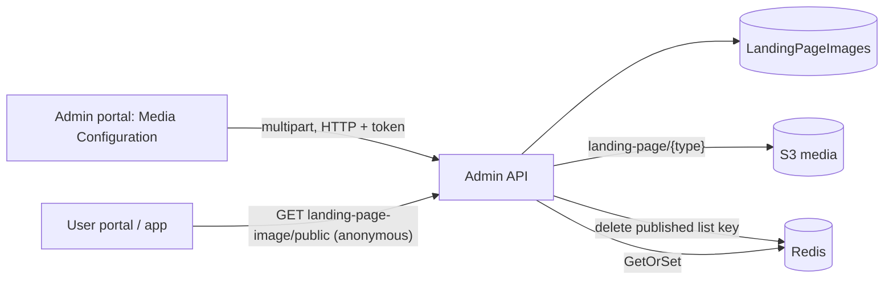

# A-28 · মিডিয়া কনফিগারেশন (ব্যানার, গ্যালারি, যোগাযোগ, রেজিস্ট্রেশন)

> **Bangla name:** মিডিয়া কনফিগারেশন (ব্যানার, গ্যালারি, যোগাযোগ, রেজিস্ট্রেশন)
>
> [← 10 · অ্যাডমিন পোর্টাল](README.md) · [সূচিপত্র](../README.md) · [ওপেন কোয়ারি](../99-open-queries.md)

## 1. নাম ও উদ্দেশ্য

**মিডিয়া কনফিগারেশন।** পাবলিক পেজের ছবি ও ব্লকগুলো **landing-page items** হিসেবে ব্যবস্থাপিত হয়: hero ব্যানার, স্পনসর লোগো, গ্রাফিটি ব্যানার, একটি বিজ্ঞাপন, গ্যালারি পেজ (দুটি শিরোনামযুক্ত সেগমেন্ট), contact-us ব্লক এবং রেজিস্ট্রেশন ব্যানার। সবগুলো একটি টেবিলে (`LandingPageImages`) রাখা হয়, `Type` দিয়ে আলাদা করা হয়। ইউজার পোর্টাল ও অ্যাপ কেবল **প্রকাশিত** আইটেমগুলো পড়ে ([P-01](../20-user-portal/P-01-home-content.md), [U-02](../30-user-app/U-02-home-browse-events.md))। টেক্সট পেজগুলো (শর্তাবলি, প্রাইভেসি, FAQ, নোটিশ) একই টেবিল ব্যবহার করে এবং [A-29](A-29-content-editor.md)-এ বর্ণিত।

## 2. ট্রিগার ও অ্যাক্টর

যে কর্মীরা **Site Settings → Media Configuration** খুলতে পারেন (গ্লোবাল মেনু, `/media-configuration`; সাইন ইন ছাড়া আর কোনো route guard নেই)। `LandingPageImageController` রোল `Admin` ও `EventManager` অনুমোদন করে; একটি read endpoint পাবলিক।

## 3. ব্যবসায়িক প্রবাহ

1. পেজটি আইটেমগুলো ধরন অনুযায়ী গ্রুপ করে তালিকাভুক্ত করে (Hero, Sponsors, Graffiti, Advertisement, Gallery page, Contact us, Registration)।
2. ধরনের একটি আইটেম ছবি (স্পনসরের ক্ষেত্রে একটি thumbnail), শিরোনাম, বিবরণ, action URL, ঐচ্ছিক শুরু ও শেষ সময় এবং display order দিয়ে **তৈরি** করুন; **সম্পাদনা**; **মুছে ফেলা**; **duplicate**; **publish/unpublish**; একটি আইটেমকে অন্য অবস্থানে সরিয়ে **সাজান**; গ্যালারি পেজের ক্ষেত্রে একসঙ্গে তার দুটি সেগমেন্টে কয়েকটি ছবি যোগ করুন।
3. গ্রাহকের কাছে কেবল প্রকাশিত আইটেম দেখা যায়; প্রতি ধরনে প্রকাশিত আইটেমের সংখ্যা সীমাবদ্ধ।

## 4. প্রযুক্তিগত প্রবাহ

1. **[HTTP + ইউজার টোকেন]** `GET /admin/api/v1/landing-page-image` (সব), `GET .../{id}`; পাবলিক `GET .../landing-page-image/public` (**anonymous**, Redis key `landing_page_image_published:list` থেকে দেওয়া হয় এবং না থাকলে ডেটাবেস থেকে আবার তৈরি হয়)।
2. তৈরি `POST .../landing-page-image` (`multipart/form-data`, `CreateOrUpdateLandingPageImage {title, question, description, actionUrl, type, displayOrder, isPublished, startDateTime, endDateTime, imageFile, thumbnailFile}`)। `CreateAsync`: যাচাই (ছবি আবশ্যক; `Sponsors`-এর জন্য একটি thumbnail; **কেবল একটি** `Advertisement`, একটি `Terms_Condition`, একটি `Privacy_Policy` থাকতে পারে); `Terms_Condition` ও `Privacy_Policy` সবসময় প্রকাশিত অবস্থায় সংরক্ষিত হয়; `CreatedBy` = অ্যাডমিনের নাম (Cognito lookup); ছবি যায় S3 `landing-page/{type}/...`-এ এবং তার URL সংরক্ষিত হয়; টেক্সট ধরনগুলোর (`Notice`, `Terms_Condition`, `Privacy_Policy`, `FAQ`) কোনো ছবি নেই; এরপর cache key মুছে ফেলা হয় ([X-20](../60-cross-cutting/X-20-file-storage.md), [X-25](../60-cross-cutting/X-25-redis.md))।
3. হালনাগাদ `PUT .../{id}`; মুছে ফেলা `DELETE .../{id}`; duplicate `PUT .../duplicate/{id}`; গ্যালারি `POST .../add-gallery-image` (দুটি সেগমেন্ট, প্রতিটিতে শিরোনাম ও কয়েকটি ছবির ফাইল, ধরন `Gallery_Page_Segment_1` ও `_2`)।
4. প্রকাশ `PUT .../publish/{id}` ও unpublish `PUT .../unpublish/{id}`: `IsPublished` টগল করে; প্রকাশ প্রত্যাখ্যান করা হয় যখন ধরনের **ইতিমধ্যে প্রকাশিত** আইটেমের সংখ্যা সীমায় পৌঁছায়: `Hero` ও `Sponsors`-এর জন্য **৬**, `Graffiti`-এর জন্য **৪**, `Registration`-এর জন্য **৩** (অন্যগুলোতে সীমা নেই): "A maximum of {n} {type} can be published at a time."; সংখ্যা cached প্রকাশিত তালিকা থেকে নেওয়া হয়।
5. পুনর্বিন্যাস `PUT .../display-order/{type}/{displayOrder1}/{displayOrder2}`: অবস্থান ১-এর আইটেমকে অবস্থান ২-এ নিয়ে যায় এবং মাঝের আইটেমগুলো এক ধাপ সরায়; দুটি অবস্থানই ০-এর চেয়ে বড় হতে হবে।
6. প্রতিটি পরিবর্তন `landing_page_image_published:list` মুছে ফেলে।

## 5. কম্পোনেন্ট

| ধরন | কম্পোনেন্ট |
|---|---|
| ক্লায়েন্ট | `features/media-configuration/*` (পেজ `hero-banner`, `sponsors-banner`, `graffiti-banner`, `advertisement-banner`, `gallery-page`, `contact-us`, `register-page`), `services/media-configuration.service.ts:19-59`; লিঙ্কহীন `features/program-settings/pages/landing-page-*`-এ একটি পুরোনো কপি |
| সার্ভিস | Admin (`LandingPageImageController`, `LandingPageImageManager`); Event সার্ভিস প্রকাশিত তালিকা পড়ে |
| টেবিল | `LandingPageImages` |
| Redis | `landing_page_image_published:list` |
| স্টোরেজ | S3 media `landing-page/{type}` |

## 6. API কন্ট্রাক্ট

| Method | Path | Auth | Request | Response |
|---|---|---|---|---|
| GET | `/admin/api/v1/landing-page-image`, `/{id}` | `Admin`, `EventManager` | | আইটেম |
| GET | `/admin/api/v1/landing-page-image/public` | **anonymous** | | `LandingPageImagePublic[]` |
| POST | `/admin/api/v1/landing-page-image` | same | multipart | আইটেম |
| POST | `/admin/api/v1/landing-page-image/add-gallery-image` | same | multipart `GalleryPageSegmentImages` | আইটেম |
| PUT | `/admin/api/v1/landing-page-image/{id}`, `publish/{id}`, `unpublish/{id}`, `duplicate/{id}`, `display-order/{type}/{o1}/{o2}` | same | | আইটেম |
| DELETE | `/admin/api/v1/landing-page-image/{id}` | same | path | আইটেম |

`type`-এর মান: `Hero`, `Sponsors`, `Graffiti`, `Advertisement`, `Gallery_Page_Segment_1`, `Gallery_Page_Segment_2`, `Contact_Us`, `Registration`, `Notice`, `Terms_Condition`, `Privacy_Policy`, `FAQ` (স্ট্রিং)। প্রধান নমুনা, `POST /admin/api/v1/landing-page-image` multipart (নাম `CreateOrUpdateLandingPageImage` থেকে):

```
type=Hero
title=Premier League 2026
description=Book now
actionUrl=https://example.com/events
displayOrder=1
isPublished=true
imageFile=<file>
```

## 7. ডেটা ও পার্শ্বপ্রতিক্রিয়া

সারি, S3 ফাইল, cache মুছে ফেলা; activity log ([X-24](../60-cross-cutting/X-24-activity-logging.md)) entity `LandingPageImage` নথিভুক্ত করে।

## 8. কোড রেফারেন্স

| কী | কোথায় |
|---|---|
| Controller | `rvl-gobcb-backend/Services/Admin/ETP.Admin.Service/Api/LandingPageImageController.cs:27-190` |
| Manager | `rvl-gobcb-backend/Services/Admin/ETP.Admin.Domain/Managers/LandingPageImageManager.cs:47-340` |
| Enum | `rvl-gobcb-backend/Services/Admin/ETP.Admin.Domain/Enums/Enums.cs:20-34` |
| Portal | `rvl-gobcb-admin-portal/src/app/features/media-configuration/services/media-configuration.service.ts:19-59` |

## 9. হ্যান্ডওভার নোট

1. **প্রকাশের সীমা একটি cached তালিকা পড়ে।** `PublishLandingPageImageAsync` প্রকাশিত আইটেম গণনা করে `GetAllPublishedAsync`-এর মাধ্যমে, যা Redis থেকে আসে; cache পুরোনো হলে সীমার যাচাই যেকোনো দিকে ভুল হতে পারে।
2. **Publish টগল করে।** `publish/{id}` ফ্ল্যাগ উল্টায়; পুনরায় কল করলে unpublish হয়। পোর্টাল publish ও unpublish আলাদা করে কল করে, তবে দুটি ক্লিকে পরিবর্তন ফিরে যেতে পারে।
3. **স্পনসরের জন্য thumbnail দরকার; বিজ্ঞাপন, শর্তাবলি ও প্রাইভেসি প্রতিটির জন্য একটি করে আইটেমের অনুমতি**, যা কেবল তৈরির সময়ে প্রয়োগ করা হয়; সম্পাদনায় singleton নিয়ম আবার দেখা হয় না।
4. **`GetOrSetAsync`-এ manager কোনো expiry ঠিক করে না**, তাই প্রকাশিত তালিকা Redis-এ থাকে যতক্ষণ না কোনো পরিবর্তন তা মুছে ফেলে; ডেটাবেসে হাতে করা সম্পাদনা পরের পরিবর্তনের আগে গ্রাহকের কাছে অদৃশ্য থাকে।
5. **এই টেবিলের একটি পাবলিক, অপ্রমাণীকৃত read** ইচ্ছাকৃত (`public` রুট) এবং ইউজার পোর্টাল ও অ্যাপ এটি কল করে।
6. **পোর্টালে দুটি কপি**: লিঙ্কহীন `/settings/landing-page` পেজগুলো একই endpoint কল করে।

## 10. কম্পোনেন্ট সম্পর্ক



**নির্ভর করে:** অ্যাডমিন লগইন ([X-01](../60-cross-cutting/X-01-admin-login.md))। **প্রভাব ফেলে:** [P-01](../20-user-portal/P-01-home-content.md), [U-02](../30-user-app/U-02-home-browse-events.md), [P-03](../20-user-portal/P-03-info-pages.md)।

## 11. ডেভেলপার টেস্ট গাইড

**লোকালভাবে পরীক্ষা: সম্পূর্ণ।**

| বিষয় | বিবরণ |
|---|---|
| টেস্ট ডেটা ও অ্যাকাউন্ট | Admin `…01`; seeded ব্যানার (`scripts/seed/01-catalog.sql`) |
| ব্রাউজার | `http://localhost:4200/media-configuration` → একটি hero ব্যানার যোগ করুন → `http://localhost:4201` home দেখুন |
| এমুলেটর | — |
| Postman | `postman/services/etp-admin.postman_collection.json`: "GET /api/v1/landing-page-image", "GET /api/v1/landing-page-image/public", "PUT /api/v1/landing-page-image/publish/{id}" |
| Visual Studio debug | `LandingPageImageManager.CreateAsync`, `PublishLandingPageImageAsync` |
| যাচাই | `redis-cli GET landing_page_image_published:list`; `aws --endpoint-url http://localhost:4566 s3 ls s3://etp-local/landing-page/ --recursive`; `LandingPageImages`-এ SQL |
