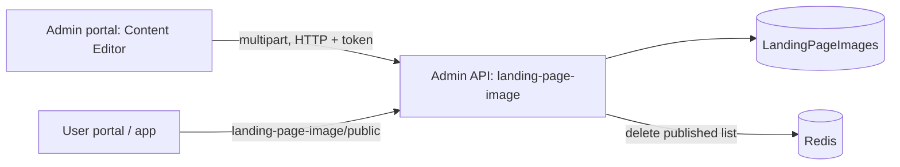

# A-29 · কনটেন্ট এডিটর (T&C, FAQ, প্রাইভেসি, নোটিশ)

> **Bangla name:** কনটেন্ট এডিটর (T&C, FAQ, প্রাইভেসি, নোটিশ)
>
> [← 10 · অ্যাডমিন পোর্টাল](README.md) · [সূচিপত্র](../README.md) · [ওপেন কোয়ারি](../99-open-queries.md)

## 1. নাম ও উদ্দেশ্য

**কনটেন্ট এডিটর।** পাবলিক সাইট ও অ্যাপের স্থির টেক্সট পেজগুলো এখানে সম্পাদনা করা হয়: **Terms & Conditions**, **Privacy Policy**, **FAQ** (প্রশ্ন ও উত্তর এন্ট্রি), **Notice** (ঘোষণা এন্ট্রি) এবং **ticket-pricing** পেজ ([A-14](A-14-ticket-pricing-content.md))। ticket pricing ছাড়া সবগুলো **ব্যানারের মতো একই টেবিলে ও একই endpoint দিয়ে** সংরক্ষিত হয় ([A-28](A-28-media-configuration.md)): `LandingPageImages`-এর সারি যেগুলোর `Type` হলো `Terms_Condition`, `Privacy_Policy`, `FAQ` বা `Notice`, টেক্সট থাকে `Description` (এবং `Title`, `Question`) ফিল্ডে এবং কোনো ছবি থাকে না।

## 2. ট্রিগার ও অ্যাক্টর

যে কর্মীরা **Site Settings → Content Editor** খুলতে পারেন (গ্লোবাল মেনু, `/content-editor`, ট্যাব `terms-conditions` (default), `faq`, `privacy-policy`, `ticket-pricing`, `notice`)। সার্ভারের রোল: `Admin`, `EventManager` (`LandingPageImageController`)।

## 3. ব্যবসায়িক প্রবাহ

- **Terms ও Privacy:** প্রতিটি একটি করে নথি। টেক্সট সম্পাদনা করে সেভ করুন; আইটেমটি সবসময় প্রকাশিত থাকে।
- **FAQ:** এন্ট্রির একটি তালিকা (শিরোনাম ও উত্তর), যোগ, সম্পাদনা, মুছে ফেলা, publish/unpublish, পুনর্বিন্যাস।
- **Notice:** শিরোনাম ও টেক্সটসহ নোটিশের একটি তালিকা, তৈরি, সম্পাদনা, মুছে ফেলা, publish/unpublish, পুনর্বিন্যাস (তৈরির ফর্ম অসংরক্ষিত পরিবর্তনের বিষয়ে সতর্ক করে)।
- গ্রাহকেরা ইউজার পোর্টাল ও অ্যাপে প্রকাশিত কনটেন্ট পড়েন ([P-03](../20-user-portal/P-03-info-pages.md), [U-03](../30-user-app/U-03-info-pages.md))।

## 4. প্রযুক্তিগত প্রবাহ

সবই **[HTTP + ইউজার টোকেন]**, [A-28](A-28-media-configuration.md) §4-এর কল ব্যবহার করে, `type` দিয়ে:

1. লোড: `MediaDataManagerService.getDataByType(type)` `GET /admin/api/v1/landing-page-image` পড়ে এবং ব্রাউজারে ধরন অনুযায়ী ফিল্টার করে।
2. সেভ: `POST /admin/api/v1/landing-page-image` বা `PUT .../{id}` `multipart/form-data` হিসেবে `type` (`Terms_Condition`, `Privacy_Policy`, `FAQ`, `Notice`), `title`, `description`, `displayOrder`, `isPublished` সহ। `CheckValidationLandingPageImage`: ধরন বৈধ; এই চারটি ধরনের জন্য **কোনো ছবি আবশ্যক নয়**; **কেবল একটি** Terms ও একটি Privacy Policy আইটেম থাকতে পারে ("Terms & Condition should not be multiple", "Privacy Policy should not be multiple"); display-order নিয়ম ("Invalid display order. It should be 0", "Invalid display order.", "Display order duplicate")। Terms ও Privacy `IsPublished = true` সহ সংরক্ষিত হয় এবং অপ্রকাশিত অবস্থায় সেভ করা যায় না (`UpdateAsync` তা প্রত্যাখ্যান করে)।
3. FAQ ও Notice: প্রকাশ `PUT .../publish/{id}`, unpublish `.../unpublish/{id}`, মুছে ফেলা `DELETE .../{id}`, পুনর্বিন্যাস `PUT .../display-order/{type}/{o1}/{o2}`।
4. প্রতিটি পরিবর্তন Redis key `landing_page_image_published:list` মুছে ফেলে; গ্রাহকরা পড়েন `GET .../landing-page-image/public` ([P-03](../20-user-portal/P-03-info-pages.md))।

## 5. কম্পোনেন্ট

| ধরন | কম্পোনেন্ট |
|---|---|
| ক্লায়েন্ট | `features/content-editor/components/{terms-conditions,privacy-policy,faq,notice/*,ticket-pricing}`; এগুলো `features/media-configuration/services/{media-configuration,media-data-manager}.service.ts` পুনর্ব্যবহার করে |
| সার্ভিস | Admin: `LandingPageImageController`, `LandingPageImageManager` (এবং pricing-এর জন্য `TicketPricingController`) |
| টেবিল | `LandingPageImages` |
| Redis | `landing_page_image_published:list` |

## 6. API কন্ট্রাক্ট

[A-28](A-28-media-configuration.md) §6-এর মতো। প্রধান নমুনা, FAQ এন্ট্রি সংরক্ষণ (`multipart/form-data`; নাম `CreateOrUpdateLandingPageImage` থেকে; মান শুধু উদাহরণ):

```
type=FAQ
title=How do I get my ticket?
description=Open My Bookings and press Generate Ticket after payment.
displayOrder=1
isPublished=true
```

## 7. ডেটা ও পার্শ্বপ্রতিক্রিয়া

`LandingPageImages` সারি (কোনো S3 ফাইল নয়), cache মুছে ফেলা, activity log entity `LandingPageImage` ([X-24](../60-cross-cutting/X-24-activity-logging.md))।

## 8. কোড রেফারেন্স

| কী | কোথায় |
|---|---|
| Manager | `rvl-gobcb-backend/Services/Admin/ETP.Admin.Domain/Managers/LandingPageImageManager.cs:61-110, 340-400` |
| Portal tabs | `rvl-gobcb-admin-portal/src/app/features/content-editor/content-editor-routing.module.ts:23-34` |
| Components | `.../content-editor/components/faq/faq.component.ts:100-350`, `notice/*`, `terms-conditions/*`, `privacy-policy/*` |

## 9. হ্যান্ডওভার নোট

1. **কনটেন্ট ছবির নামে একটি কলামে সাধারণ টেক্সট**: কোনো versioning নেই, কোনো preview নেই, কোনো approval নেই; Terms ও Privacy-তে সম্পাদনা সঙ্গে সঙ্গে live হয় (সবসময় প্রকাশিত)।
2. **দুটি আলাদা "notice" ফিচার আছে, আর গ্রাহকেরা কেবল এটিই দেখেন।** এই ট্যাবের **Notice** `LandingPageImages` ধরন `Notice` ব্যবহার করে। আলাদা **General notices** পর্দা নিজস্ব টেবিল ও API ব্যবহার করে এবং লিঙ্কহীন `/settings` মডিউলে আছে ([A-31](A-31-general-notices.md))। **ইউজার পোর্টাল general notice-গুলো আনে, ফিল্টার করে, কিন্তু তারপর কখনোই render করে না** — `notices` `home-events-page.component.html`-এ bind করা নেই, আর কোডের কমেন্টে লেখা `// Fetch notices but do not start the marquee`। তাই গ্রাহকরা যে marquee দেখেন তা এই ট্যাব থেকেই আসে। কোন পর্দাটি ব্যবসা আসলে ব্যবহার করতে চায় তা ব্যবসার সঙ্গে নিশ্চিত করুন, কারণ অন্যটি সম্পাদনা করলে কোনো দৃশ্যমান পরিবর্তন হয় না `[UNCONFIRMED: Q-35]`।
3. **এখানে HTML বা markdown sanitize করা হয় না**; description যেভাবে পাঠানো হয় তেমনই সংরক্ষিত হয়, তাই সেটি কীভাবে render হবে (escaped নাকি HTML হিসেবে) তা গ্রাহকের ক্লায়েন্টগুলো ঠিক করে `[UNCONFIRMED: Q-33]`।
4. **একটি মাত্র আইটেমের নিয়ম কেবল তৈরির সময়ে দেখা হয়**; ধরন বদলে দেওয়া একটি সম্পাদনায় সেটি আবার যাচাই হয় না।
5. **Cached public তালিকার** কোনো expiry নেই; ডেটাবেসে হাতে করা সম্পাদনা পরের পরিবর্তনের আগে অদৃশ্য থাকে ([A-28](A-28-media-configuration.md) নোট ৪)।

## 10. কম্পোনেন্ট সম্পর্ক



**নির্ভর করে:** [A-28](A-28-media-configuration.md) (একই API)। **প্রভাব ফেলে:** [P-03](../20-user-portal/P-03-info-pages.md), [U-03](../30-user-app/U-03-info-pages.md)।

## 11. ডেভেলপার টেস্ট গাইড

**লোকালভাবে পরীক্ষা: সম্পূর্ণ।**

| বিষয় | বিবরণ |
|---|---|
| টেস্ট ডেটা ও অ্যাকাউন্ট | Admin `…01` |
| ব্রাউজার | `http://localhost:4200/content-editor/faq`; Network: `type=FAQ` সহ multipart `POST .../landing-page-image`; ইউজার পোর্টালের তথ্য পেজ |
| এমুলেটর | — |
| Postman | `postman/services/etp-admin.postman_collection.json`: "POST /api/v1/landing-page-image" (form-data with `type`), "GET /api/v1/landing-page-image/public" |
| Visual Studio debug | `LandingPageImageManager.CheckValidationLandingPageImage` |
| যাচাই | SQL: `select "Type","Title","IsPublished","DisplayOrder" from etp."LandingPageImages" where "Type" in ('FAQ','Notice','Terms_Condition','Privacy_Policy')` |
