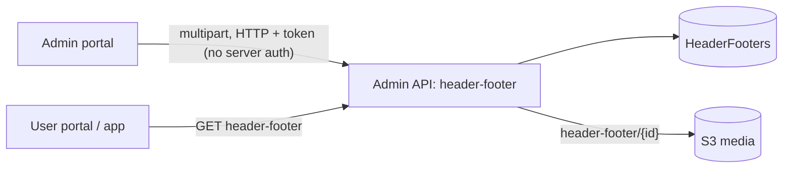

# A-30 · হেডার/ফুটার ও সোশ্যাল-মিডিয়া সেটিংস

> **Bangla name:** হেডার/ফুটার ও সোশ্যাল-মিডিয়া সেটিংস
>
> [← 10 · অ্যাডমিন পোর্টাল](README.md) · [সূচিপত্র](../README.md) · [ওপেন কোয়ারি](../99-open-queries.md)

## 1. নাম ও উদ্দেশ্য

**হেডার/ফুটার ও সোশ্যাল মিডিয়া।** পাবলিক সাইটের হেডার ও ফুটার একটি রেকর্ড নিয়ন্ত্রণ করে: শিরোনাম, একটি brand ছবি, একটি "powered by" ছবি, সোশ্যাল-মিডিয়া লিংক (Facebook, Instagram, Twitter/X, LinkedIn) এবং **যোগাযোগের ব্লক — `phoneNumber`, `email` ও `officeAddress`**। দ্বিতীয় একটি পুরোনো রেকর্ড (`SocialMediaSettings`) কেবল চারটি লিংক ধরে এবং লিঙ্কহীন `/settings` মডিউলে তার নিজস্ব পর্দা আছে।

যোগাযোগের ব্লক হলো সাইটের পাবলিক ফোন নম্বর, ইমেইল ঠিকানা ও ডাক ঠিকানা। এটি `HeaderFooters`-এ সংরক্ষিত হয়, Event সার্ভিস ফেরত দেয় এবং গ্রাহকের ফুটারে দেখায় ([P-01](../20-user-portal/P-01-home-content.md))।

## 2. ট্রিগার ও অ্যাক্টর

- **হেডার/ফুটার:** **Site Settings → Media Configuration**-এ কর্মীরা (পেজ সেকশন `HeaderFooterComponent`)। **সার্ভারের** `HeaderFooterController`-এ **কোনো `[Authorize]` নেই**: read ও update দুটোই খোলা ([X-18](../60-cross-cutting/X-18-endpoints-without-auth.md))।
- **সোশ্যাল মিডিয়া সেটিংস:** পর্দা `/settings/footer-settings` (শুধু URL দিয়ে পৌঁছানো যায়); সার্ভার রোল `Admin` (`SocialMediaSettingsController`)।

## 3. ব্যবসায়িক প্রবাহ

সেকশনটি খুলুন, শিরোনাম বদলান, ছবিগুলো বদলান, চারটি লিংক সম্পাদনা করুন, **ফোন নম্বর, ইমেইল ও অফিসের ঠিকানা** দিন, তারপর **Update** চাপুন। গ্রাহকেরা পরিবর্তনটি পোর্টালের হেডার ও ফুটারে দেখেন ([P-01](../20-user-portal/P-01-home-content.md), [U-02](../30-user-app/U-02-home-browse-events.md))।

## 4. প্রযুক্তিগত প্রবাহ

1. **[HTTP + ইউজার টোকেন]** `GET /admin/api/v1/header-footer` (তালিকা, সাধারণত একটি রেকর্ড); `PUT /admin/api/v1/header-footer` (`multipart/form-data`, `UpdateHeaderFooter {title, facebookUrl, instagramUrl, twitterUrl, linkedInUrl, brandImageUrl (file), poweredByImageUrl (file), phoneNumber, email, officeAddress}`)।
2. `HeaderFooterManager.UpdateHeaderFooterAsync`: শিরোনাম আবশ্যক ("Title is required and cannot be empty."); খালি নয় এমন প্রতিটি সোশ্যাল লিংক অবশ্যই `facebook.com`, `instagram.com`, `x.com`, `twitter.com` বা `linkedin.com`-এর একটি `http(s)` URL হতে হবে (subdomain গ্রহণযোগ্য), নয়তে "Invalid {Platform} URL format."; সারি হালনাগাদ; brand ও powered-by ছবি S3 `header-footer/{id}/...`-এ আপলোড হয় এবং তার URL সংরক্ষিত হয় ([X-20](../60-cross-cutting/X-20-file-storage.md))। লক্ষ্য করুন, `brandImageUrl` ও `poweredByImageUrl` ফিল্ডের নাম বলছে Url, কিন্তু request-এ এগুলো আসলে **ফাইল**। DTO-টি Mapster দিয়ে entity-তে ম্যাপ হয় (`updateHeaderFooter.Adapt<Storage.Models.Settings.HeaderFooter>()`), তাই `phoneNumber`, `email` ও `officeAddress` নাম দিয়ে সংরক্ষিত হয় — **তিনটির কোনোটিই যাচাই হয় না**, শিরোনাম ও সোশ্যাল URL-এর মতো নয়।
3. **সোশ্যাল মিডিয়া সেটিংস:** `GET /admin/api/v1/social-media-settings`, `PUT /admin/api/v1/social-media-settings` (JSON `{facebookUrl, instagramUrl, linkedInUrl, twitterUrl}`), একই URL যাচাই; কোনো cache নেই।
4. **গ্রাহকের পড়া:** ইউজার পোর্টাল হেডার ও ফুটারের ডেটা (`HeaderFooterData`) এবং সোশ্যাল সেটিংস তার `common` store-এর মাধ্যমে পড়ে ([P-01](../20-user-portal/P-01-home-content.md))।

## 5. কম্পোনেন্ট

| ধরন | কম্পোনেন্ট |
|---|---|
| ক্লায়েন্ট | `features/media-configuration/pages/header-footer/*`; `features/program-settings/pages/footer-settings/*` সঙ্গে `services/footer-settings.service.ts:19-23` |
| সার্ভিস | Admin (`HeaderFooterController`, `HeaderFooterManager`, `SocialMediaSettingsController`, `SocialMediaSettingsManager`) |
| টেবিল | `HeaderFooters`, `SocialMediaSettings` |
| স্টোরেজ | S3 media `header-footer/{id}` |

## 6. API কন্ট্রাক্ট

| Method | Path | Auth | Request | Response |
|---|---|---|---|---|
| GET | `/admin/api/v1/header-footer` | **none** | | `HeaderFooter[]` |
| PUT | `/admin/api/v1/header-footer` | **none** | `UpdateHeaderFooter` (multipart) | `HeaderFooter` |
| GET | `/admin/api/v1/social-media-settings` | `Admin` | | `SocialMediaSettings[]` |
| PUT | `/admin/api/v1/social-media-settings` | `Admin` | `SocialMediaSettings` | `SocialMediaSettings` |

প্রধান নমুনা, `PUT /admin/api/v1/header-footer` multipart (নাম `UpdateHeaderFooter` থেকে):

```
title=GoBCB
facebookUrl=https://facebook.com/gobcb
instagramUrl=https://instagram.com/gobcb
phoneNumber=+8801700000000
email=info@gobcb.com
officeAddress=Bangabandhu National Stadium, Dhaka
brandImageUrl=<file>
poweredByImageUrl=<file>
```

## 7. ডেটা ও পার্শ্বপ্রতিক্রিয়া

একটি হেডার/ফুটার সারি (`PhoneNumber`, `Email`, `OfficeAddress`-সহ), S3 ছবি, activity log এন্ট্রি ([X-24](../60-cross-cutting/X-24-activity-logging.md))।

## 8. কোড রেফারেন্স

| কী | কোথায় |
|---|---|
| Header/footer controller | `rvl-gobcb-backend/Services/Admin/ETP.Admin.Service/Api/HeaderFooterController.cs:14-45` |
| Manager | `rvl-gobcb-backend/Services/Admin/ETP.Admin.Domain/Managers/HeaderFooterManager.cs:20-150` |
| Social manager | `rvl-gobcb-backend/Services/Admin/ETP.Admin.Domain/Managers/SocialMediaSettingsManager.cs:25-60` |
| Portal | `rvl-gobcb-admin-portal/src/app/features/media-configuration/services/media-configuration.service.ts:51-55`; `features/program-settings/services/footer-settings.service.ts:19-23` |

## 9. হ্যান্ডওভার নোট

1. **যে কোনো ব্যক্তি সাইটের হেডার, ফুটার ও লিংক বদলাতে পারে।** `PUT /header-footer`-এর জন্য কোনো টোকেন লাগে না, আর URL যাচাই `facebook.com` বা `x.com`-এর যেকোনো path গ্রহণ করে, তাই আসল সোশ্যাল ডোমেইনের কোনো ক্ষতিকর লিংক গ্রহণযোগ্য।
2. **একই লিংকের দুটি উৎস।** হেডার/ফুটার চারটি URL ধরে এবং `SocialMediaSettings` একই চারটি ধরে; কোন ক্লায়েন্ট কোনটি পড়ে তা যাচাই না করে কোনোটির ওপর নির্ভর করবেন না `[UNCONFIRMED: Q-34]`।
3. **ছবি বদলালে মুছে ফেলা হয় নতুন ফাইলের নাম ব্যবহার করে।** `UploadBrandImageAsync`-এ, যখন একটি brand ছবি আগে থেকেই থাকে, কোডটি `DeleteContentAsync("header-footer", id, storageFilename)` কল করে নতুন করে তৈরি নাম দিয়ে, পুরোনো ফাইলের নাম দিয়ে নয়, তাই পুরোনো object S3-এই থেকে যায় এবং orphan ফাইল জমতে থাকে।
4. এখানে ব্যানারের মতো **কোনো cache নেই** ([A-28](A-28-media-configuration.md)); গ্রাহকের প্রতিটি পেজ লোডে টেবিল পড়া হয়।
5. **যোগাযোগের ফিল্ডগুলোর যাচাই নেই।** `CheckValidation` (`:65-75`) শিরোনাম চায় ও চারটি সোশ্যাল URL যাচাই করে, কিন্তু **`phoneNumber`, `email` বা `officeAddress`-এর কোনোটিই যাচাই করে না** — ভুল গঠনের ঠিকানা বা পার্স করা যায় না এমন স্ট্রিং সংরক্ষিত হয়ে প্রতিটি গ্রাহকের কাছে প্রকাশিত হয়। এগুলো Mapster দিয়ে নাম দিয়ে ম্যাপ হওয়ায় সত্যিই সংরক্ষিত হয়; নিয়মই নেই।
6. `/settings` মডিউলটি কোনো মেনুতে নেই ([A-02](A-02-programs.md) নোট ৩)।

## 10. কম্পোনেন্ট সম্পর্ক



**নির্ভর করে:** কিছু নয়। **প্রভাব ফেলে:** [P-01](../20-user-portal/P-01-home-content.md), [U-02](../30-user-app/U-02-home-browse-events.md)।

## 11. ডেভেলপার টেস্ট গাইড

**লোকালভাবে পরীক্ষা: সম্পূর্ণ।**

| বিষয় | বিবরণ |
|---|---|
| টেস্ট ডেটা ও অ্যাকাউন্ট | Admin `…01` |
| ব্রাউজার | `http://localhost:4200/media-configuration` (হেডার/ফুটার সেকশন); সোশ্যাল: `http://localhost:4200/settings/footer-settings` |
| এমুলেটর | — |
| Postman | `postman/services/etp-admin.postman_collection.json`: "GET /api/v1/header-footer", "PUT /api/v1/header-footer" (form-data), "GET /api/v1/social-media-settings" |
| Visual Studio debug | `HeaderFooterManager.UpdateHeaderFooterAsync`, `ValidateSocialMediaUrl` |
| যাচাই | `HeaderFooters`-এ SQL; `aws --endpoint-url http://localhost:4566 s3 ls s3://etp-local/header-footer/ --recursive` |
