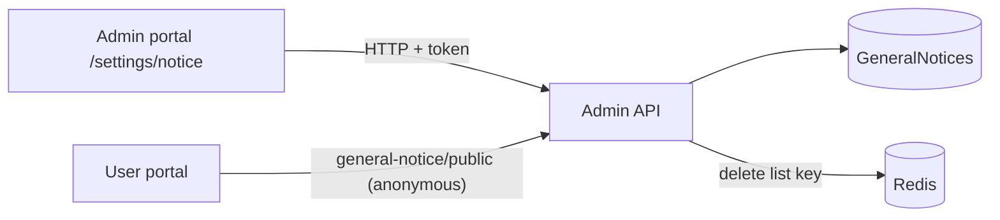

# A-31 · সাধারণ নোটিশ

> **Bangla name:** সাধারণ নোটিশ
>
> [← 10 · অ্যাডমিন পোর্টাল](README.md) · [সূচিপত্র](../README.md) · [ওপেন কোয়ারি](../99-open-queries.md)

## 1. নাম ও উদ্দেশ্য

**সাধারণ নোটিশ।** সংক্ষিপ্ত ঘোষণা (যেমন "গেট খুলবে বিকেল ২টায়"), যা পাবলিক পোর্টাল একটি শুরু ও শেষ সময়ের মধ্যে ব্যানার হিসেবে দেখায়। প্রতিটি নোটিশে একটি প্রোগ্রাম, সর্বোচ্চ ২৬০ অক্ষরের টেক্সট (সাধারণ HTML), একটি সময়সীমা এবং একটি publish ফ্ল্যাগ থাকে। এগুলোকে কনটেন্ট এডিটরের **Notice** এন্ট্রি ([A-29](A-29-content-editor.md))-এর সঙ্গে গুলিয়ে ফেলবেন না — সেগুলো অন্য একটি টেবিল।

## 2. ট্রিগার ও অ্যাক্টর

`/settings/notice`-এ কর্মীরা (`program-settings` মডিউল; **কোনো মেনু থেকে লিঙ্ক নেই**, শুধু URL দিয়ে পৌঁছানো যায়)। সার্ভার রোল `Admin`, `EventManager` (`GeneralNoticeController`); পাবলিক read অজ্ঞাতপরিচয়ের।

## 3. ব্যবসায়িক প্রবাহ

নোটিশ তালিকাভুক্ত করুন, একটি তৈরি করুন (প্রোগ্রাম, টেক্সট, শুরু, শেষ, publish), সম্পাদনা, মুছে ফেলা। গ্রাহকেরা সেই প্রকাশিত নোটিশগুলো দেখেন যেগুলোর শেষ সময় পেরিয়ে যায়নি, শুরুর সময় অনুযায়ী সাজানো।

## 4. প্রযুক্তিগত প্রবাহ

1. **[HTTP + ইউজার টোকেন]** `GET /admin/api/v1/general-notice` (সব), `GET .../{id}`, `POST .../general-notice` (JSON `CreateOrUpdateGeneralNotice {programId, description, startDateTime, endDateTime, isPublished}`), `PUT .../{id}`, `DELETE .../{id}`। ফর্মটি প্রোগ্রাম ও প্রোগ্রাম সেটিংসও লোড করে (`GET /program`, `GET /program-settings/{programId}`)।
2. যাচাই: description আবশ্যক এবং সর্বোচ্চ ২৬০ অক্ষর ("Description should not be more than 260")। প্রতিটি তৈরি, হালনাগাদ ও মুছে ফেললে Redis key `general_notice_published:list` মুছে ফেলা হয়।
3. পাবলিক read `GET /admin/api/v1/general-notice/public` (**anonymous**, `[AllowAnonymous]`): `GetAllPublishedAsync` প্রকাশিত তালিকা Redis থেকে নেয় (`GetOrSetAsync`, না থাকলে ডেটাবেস থেকে আবার তৈরি হয়), **যেসব নোটিশের `EndDateTime` এখনের আগে পড়ে গেছে তা বাদ দেয়**, `StartDateTime` অনুযায়ী সাজায়, এবং টেক্সটে `<p>` ও `</p>`-কে `<span>` ও `</span>` দিয়ে প্রতিস্থাপন করে। ইউজার পোর্টাল এই URL Event সার্ভিসের base URL-এর মাধ্যমে কল করে (`event-api.service.ts`, [P-03](../20-user-portal/P-03-info-pages.md))।

## 5. কম্পোনেন্ট

| ধরন | কম্পোনেন্ট |
|---|---|
| ক্লায়েন্ট | `features/program-settings/pages/notice/*`, `services/notice.service.ts:19-43` |
| সার্ভিস | Admin (`GeneralNoticeController`, `GeneralNoticeManager`) |
| টেবিল | `GeneralNotices` |
| Redis | `general_notice_published:list` |

## 6. API কন্ট্রাক্ট

| Method | Path | Auth | Request | Response | Main errors |
|---|---|---|---|---|---|
| GET | `/admin/api/v1/general-notice`, `/{id}` | `Admin`, `EventManager` | | `GeneralNotice` | |
| POST | `/admin/api/v1/general-notice` | same | `CreateOrUpdateGeneralNotice` | `GeneralNotice` | 400 `Description is missing.`, `Description should not be more than 260` |
| PUT | `/admin/api/v1/general-notice/{id}` | same | same | `GeneralNotice` | |
| DELETE | `/admin/api/v1/general-notice/{id}` | same | path | `GeneralNotice` | |
| GET | `/admin/api/v1/general-notice/public` | **anonymous** | | `GeneralNoticePublic[]` | |

প্রধান নমুনা, `POST /admin/api/v1/general-notice` (নাম `CreateOrUpdateGeneralNotice` থেকে; মান শুধু উদাহরণ):

```json
{ "programId": 12, "description": "<p>Gates open at 2:00 pm.</p>",
  "startDateTime": "2026-12-10T00:00:00Z", "endDateTime": "2026-12-10T23:59:59Z", "isPublished": true }
```

## 7. ডেটা ও পার্শ্বপ্রতিক্রিয়া

`GeneralNotices` সারি, cache মুছে ফেলা, activity log ([X-24](../60-cross-cutting/X-24-activity-logging.md))।

## 8. কোড রেফারেন্স

| কী | কোথায় |
|---|---|
| Controller | `rvl-gobcb-backend/Services/Admin/ETP.Admin.Service/Api/GeneralNoticeController.cs:26-110` |
| Manager | `rvl-gobcb-backend/Services/Admin/ETP.Admin.Domain/Managers/GeneralNoticeManager.cs:26-110` |
| Portal | `rvl-gobcb-admin-portal/src/app/features/program-settings/services/notice.service.ts:19-43` |
| Customer read | `rvl-gobcb-user-portal/ETP-Web/src/app/modules/core/services/api/event-api.service.ts:20, 56` |

## 9. হ্যান্ডওভার নোট

1. **ব্যবস্থাপনার পর্দা মেনুতে নেই**, তাই কর্মীরা এর অস্তিত্বই জানেন না।
2. **ইউজার পোর্টাল এই নোটিশগুলো আনে কিন্তু কখনোই render করে না।** `EventApiService.getAllGeneralNotices` **home-events-page.component.ts:43** থেকে **সত্যিই** কল হয়, সারিগুলো মেমরিতে তারিখ দিয়ে ফিল্টার **হয়** এবং কম্পোনেন্টের `notices` অ্যারেতে বসে — কিন্তু **`notices` কখনোই `home-events-page.component.html`-এ bind করা হয় না**, আর `:40`-এ কোডের কমেন্ট স্পষ্ট জানিয়েই দেয়: `// Fetch notices but do not start the marquee`। তাই হোম পেজের প্রতিটি লোডে একটি অনুরোধ যায় যার ফলাফল ফেলে দেওয়া হয়, আর গ্রাহকরা সত্যিই দেখা স্ক্রলিং লাইনটি হলো কনটেন্ট এডিটরের `Notice` ধরন ([A-29](A-29-content-editor.md))। ইউজার অ্যাপ এগুলো render করে কি না তা দেখা যাচ্ছে না। **কর্মীরা "নোটিশ প্রকাশ করলাম, কিছুই হলো না" বলার সম্ভাবনা সবচেয়ে বেশি এই কারণেই।** `[UNCONFIRMED: Q-35]`
3. **পাবলিক তালিকা প্রোগ্রাম ফিল্টার ছাড়া cached হয়**; response-এ সব প্রোগ্রামের নোটিশ থাকে এবং গ্রাহকের ক্লায়েন্ট ফিল্টার করে — এখানে শুধু `startDateTime`/`endDateTime` দিয়ে ফিল্টার হয়, কখনোই প্রোগ্রাম দিয়ে নয়।
4. **টেক্সট HTML** এবং সেভ করার সময় sanitize হয় না; পড়ার সময় কেবল `<p>` পুনর্লেখন হয়, তাই টেক্সটে থাকা script বা অন্যান্য tag কীভাবে আচরণ করবে তা ক্লায়েন্টের rendering-এর ওপর নির্ভর করে `[UNCONFIRMED: Q-33]`।
5. **সময় শেষ হওয়া নোটিশ cached তালিকায় থেকে যায়** পরের পরিবর্তনের আগ পর্যন্ত, কিন্তু প্রতিটি read-এ ফিল্টার করে বাদ পড়ে, তাই cache রিফ্রেশ ছাড়াই সময়মতো হারিয়ে যায়। এখনো শুরু হওয়া নোটিশও ফেরত দেওয়া হয়; সেগুলো দেখাবে কি না তা ঠিক করে ক্লায়েন্ট।
6. **মুছে ফেলা হলো repository-র `DeleteByIdAsync`**; soft নাকি hard এখানে দেখা হয়নি।

## 10. কম্পোনেন্ট সম্পর্ক



**নির্ভর করে:** [A-02](A-02-programs.md)। **প্রভাব ফেলে:** [P-03](../20-user-portal/P-03-info-pages.md)।

## 11. ডেভেলপার টেস্ট গাইড

**লোকালভাবে পরীক্ষা: সম্পূর্ণ।**

| বিষয় | বিবরণ |
|---|---|
| টেস্ট ডেটা ও অ্যাকাউন্ট | Admin `…01` |
| ব্রাউজার | `http://localhost:4200/settings/notice` (URL টাইপ করুন; প্রোগ্রাম 0) |
| এমুলেটর | — |
| Postman | `postman/services/etp-admin.postman_collection.json`: "GET /api/v1/general-notice/public", "POST /api/v1/general-notice" |
| Visual Studio debug | `GeneralNoticeManager.GetAllPublishedAsync` |
| যাচাই | `redis-cli GET general_notice_published:list`; `GeneralNotices`-এ SQL |
