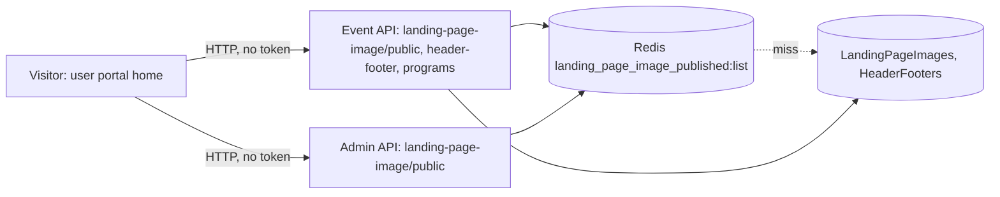

# P-01 · হোম পেজ কনটেন্ট (ব্যানার, স্পনসর, নোটিশ, হেডার ও ফুটার)

> **Bangla name:** হোম পেজের কনটেন্ট (ব্যানার, স্পনসর, নোটিশ, হেডার ও ফুটার)
>
> [← 20 · ইউজার পোর্টাল](README.md) · [সূচিপত্র](../README.md) · [ওপেন কোয়ারি](../99-open-queries.md)

## 1. নাম ও উদ্দেশ্য

**হোম পেজের কনটেন্ট।** ইভেন্ট বাছাই করার আগে গ্রাহক ওয়েব পোর্টালের প্রথম পেজে একজন দর্শক যা দেখেন: hero ব্যানার ক্যারোসেল, স্পনসর স্ট্রিপ, বিজ্ঞাপনের ব্যানার, গ্রাফিটি ব্যানার, স্ক্রল করা নোটিশের একটি লাইন, আসন্ন ইভেন্টের তালিকা ([P-02](P-02-browse-events.md)), এবং সব পেজে সাধারণ হেডার (ব্র্যান্ড লোগো, প্রোগ্রাম মেনু) ও ফুটার (সোশ্যাল লিংক, যোগাযোগের তথ্য)। পুরোটাই কর্মীরা অ্যাডমিন পোর্টালে কনফিগার করেন ([A-28](../10-admin-portal/A-28-media-configuration.md), [A-29](../10-admin-portal/A-29-content-editor.md), [A-30](../10-admin-portal/A-30-header-footer-social.md))।

## 2. ট্রিগার ও অ্যাক্টর

যেকোনো দর্শক, **সাইন-ইন ছাড়াই** (হোম রুটে কোনো guard নেই)। লোডিং শুরু হয় Angular অ্যাপ চালু হওয়ার সময়: `AppComponent` কল করে `commonStoreService.loadCommon()` (`app.component.ts:23`)।

## 3. ব্যবসায়িক প্রবাহ

1. দর্শক খোলেন `/{lang}` (`en` বা `bn`; root রিডাইরেক্ট করে `/en`-এ, দেখুন [P-13](P-13-language-switch.md))।
2. hero ক্যারোসেল, স্পনসর, বিজ্ঞাপন ও গ্রাফিটি ব্যানার দেখা যায় — প্রতিটিই নিজ নিজ টাইপের প্রকাশিত আইটেম থেকে নেওয়া।
3. এক লাইনের স্ক্রল করা **নোটিশ** দেখায় সেসব প্রকাশিত `Notice` আইটেম, যাদের শুরু/শেষ সময়ের পরিসরে বর্তমান সময় পড়ে।
4. হেডারে দেখা যায় ব্র্যান্ড লোগো ও প্রোগ্রামের তালিকা; ফুটারে সোশ্যাল লিংক ও যোগাযোগের ব্লক।

## 4. কারিগরি প্রবাহ

1. **[HTTP, no token]** অ্যাপ চালু হওয়া: `GET {services.events}/event/api/v1/landing-page-image/public` (`CommonApiService.fetchCommon`, Event সার্ভিস, `[AllowAnonymous]`)। উত্তর NgRx `common` স্টোর ভরে; reducer সেটিকে `type` অনুযায়ী Terms, Privacy, FAQ তালিকা ও Notice তালিকায় ভাগ করে (`common.reducer.ts:35-38`); গ্রাফিটি ব্যানার ও গ্যালারি ([P-03](P-03-info-pages.md)) একই তালিকা থেকে নির্বাচিত হয়।
2. **[HTTP, no token]** `GET {services.events}/admin/api/v1/landing-page-image/public` (`ImageApiService.getAllBannerImages`, একই রিডের **Admin** কপি)। এটি ব্রাউজারে `shareReplay(1)` দিয়ে ক্যাশ হয়, `displayOrder` অনুযায়ী সাজানো হয়, এবং `Hero` ক্যারোসেল (`PrimaryBannerSectionComponent`), স্পনসর স্ট্রিপ (`HomepageSponsorsComponent`) ও `Advertisement` ব্যানার (`HomeEventsPageComponent`) ব্যবহার করে। কোনো এরর হলে খালি তালিকা ফেরে, তাই ব্যর্থতা নীরবে ঘাটায়।
3. **[HTTP, no token]** হেডার ও ফুটার: `GET {services.events}/event/api/v1/header-footer` (`FooterApiService.getSocialMediaUrls`, Event সার্ভিস)। ফেরত তালিকার প্রথম উপাদান স্টোরে `HeaderFooterData` হয়: ব্র্যান্ড ইমেজ, "powered by" ইমেজ, টাইটেল, চারটি সোশ্যাল লিংক, ফোন নম্বর, ইমেইল ও অফিস ঠিকানা।
4. **[HTTP, no token]** হেডার মেনুর প্রোগ্রাম: `GET .../event/api/v1/events/programs` (`ToolbarComponent` → `EventApiService.getAllPrograms`)।
5. নোটিশ লাইন: `HomeEventsPageComponent.fetchAllGeneralNotices` পড়ে `selectNotices` (ল্যান্ডিং-পেজের `Notice` আইটেমগুলো), রাখে সেগুলোকে যাদের `startDateTime`..`endDateTime`-এ এখন পড়ে (দুটো তারিখ না থাকা আইটেম সবসময় রাখা হয়) এবং একটি টাইমার দিয়ে স্ক্রল করে; লেখা বাঁধা হয় `[innerHTML]` দিয়ে (Angular-এর ডিফল্ট স্যানিটাইজার কাজ করে)।
6. সার্ভারে দুটো `landing-page-image/public` এন্ডপয়েন্টই পড়ে Redis তালিকা `landing_page_image_published:list` (`GetOrSetAsync`), যা Admin সার্ভিস প্রতিটি পরিবর্তনের পরে মুছে দেয় ([A-28](../10-admin-portal/A-28-media-configuration.md))।

## 5. কম্পোনেন্ট

| ধরন | কম্পোনেন্ট |
|---|---|
| ক্লায়েন্ট | `home-events-page`, `primary-banner-section`, `homepage-sponsors`, `layout/components/{toolbar,footer}`; স্টোর `core/modules/common/store/*` |
| সার্ভিস | Event (`LandingPageImageController`, `SiteSettingsManager`, `HeaderFooterController`, `ProgramController`); Admin (`LandingPageImageController`) |
| টেবিল | `LandingPageImages`, `HeaderFooters`, `Programs` |
| Redis | `landing_page_image_published:list` ([X-25](../60-cross-cutting/X-25-redis.md)) |
| স্টোরেজ | ছবিগুলো মিডিয়া বাকেটে পূর্ণ URL হিসেবে থাকে ([X-20](../60-cross-cutting/X-20-file-storage.md)) |

## 6. API কন্ট্রাক্ট

| মেথড | পথ (পোর্টাল যেভাবে কল করে) | অথ | রেসপন্স |
|---|---|---|---|
| GET | `/event/api/v1/landing-page-image/public` | anonymous | `LandingPageImagePublic[]` |
| GET | `/admin/api/v1/landing-page-image/public` | anonymous | একই তালিকা (`question` ছাড়া) |
| GET | `/event/api/v1/header-footer` | none | `HeaderFooter[]` |
| GET | `/event/api/v1/events/programs` | none | `Program[]` |

প্রধান নমুনা, `GET /event/api/v1/landing-page-image/public`-এর একটি উপাদান (প্রপার্টির নাম `LandingPageImagePublic` থেকে, ওয়্যারে camelCase; মানগুলো কাল্পনিক):

```json
{ "title": "Premier League 2026", "question": null, "description": "Book now",
  "actionUrl": "https://example.com/events", "imageUrl": "https://media.example.com/landing-page/Hero/7.jpg",
  "thumbnailUrl": null, "type": "Hero", "displayOrder": 1, "startDateTime": null, "endDateTime": null }
```

## 7. ডেটা ও পার্শ্বপ্রতিক্রিয়া

শুধু পড়া; কিছুই লেখা হয় না। Redis তালিকার বাইরে ব্রাউজার পেজ সেশনের জন্য Admin কপিটি ক্যাশ রাখে।

## 8. কোড রেফারেন্স

| কী | কোথায় |
|---|---|
| স্টার্টআপ লোড | `rvl-gobcb-user-portal/ETP-Web/src/app/app.component.ts:23` |
| API সার্ভিস | `rvl-gobcb-user-portal/ETP-Web/src/app/modules/core/services/api/{common-api,image-api,footer-api,event-api}.service.ts` |
| স্টোর | `rvl-gobcb-user-portal/ETP-Web/src/app/modules/core/modules/common/store/{common.effects,common.reducer,common.selectors}.ts` |
| পেজ | `rvl-gobcb-user-portal/ETP-Web/src/app/modules/featured/events/pages/home-events-page/home-events-page.component.ts:36-70`; `.../components/primary-banner-section/primary-banner-section.component.ts` |
| Event সার্ভিস | `rvl-gobcb-backend/Services/Event/ETP.Event.Service/Api/LandingPageImageController.cs:22`; `.../HeaderFooterController.cs:21` |

## 9. হ্যান্ডওভার নোট

1. **দুটো এন্ডপয়েন্ট, দুটো সার্ভিস, একটিই তালিকা।** পোর্টাল একই প্রকাশিত তালিকা একবার Event সার্ভিসের মাধ্যমে পড়ে (স্টোরে: গ্রাফিটি, FAQ, terms, notices, gallery) আর একবার Admin সার্ভিসের মাধ্যমে (hero, sponsors, advertisement)। দুটোই একই Redis key পড়ে। তাই Admin রুটটি public ইন্টারনেট থেকে পৌঁছানো যাওয়ার কথা `[UNCONFIRMED: Q-04]`।
2. **জেনারেল নোটিশ ([A-31](../10-admin-portal/A-31-general-notices.md)) আনা হয় কিন্তু কখনো দেখানো হয় না।** ব্যাপারটি "ব্যবহার হয় না"-র চেয়ে সূক্ষ্ম: `EventApiService.getAllGeneralNotices` **কোনোই কল করা হয়**, `selectNotices` **সাবস্ক্রাইব করা হয়**, সারিগুলো মেমরিতে তারিখ দিয়ে ফিল্টার করা হয় (`home-events-page.component.ts:43-60`) এবং কম্পোনেন্টের `notices` অ্যারেতে বসানো হয় — কিন্তু **`notices` কখনোই `home-events-page.component.html`-এ বাঁধা হয় না**। `:40`-এর কোড কমেন্ট তা সরাসরি বলে দেয়: `// Fetch notices but do not start the marquee`। ফলে প্রতিটি হোম-পেজ লোড এমন একটি রিকোয়েস্ট করে যার ফল ফেলে দেওয়া হয়, আর গ্রাহকরা যে স্ক্রল করা লাইনটি আসলে দেখেন সেটি কনটেন্ট এডিটরের `Notice` টাইপ ([A-29](../10-admin-portal/A-29-content-editor.md))। ইউজার অ্যাপ বা অন্য কোনো ক্লায়েন্ট `GeneralNotices` টেবিল পড়ে কি না তা দেখা যায় না `[UNCONFIRMED: Q-35]`।
3. **হেডার/ফুটার, সোশ্যাল-মিডিয়া সেটিংস নয়।** পোর্টাল সোশ্যাল লিংক ও যোগাযোগের তথ্য শুধু `HeaderFooters` রেকর্ড থেকে পড়ে ([A-30](../10-admin-portal/A-30-header-footer-social.md)); পুরোনো `SocialMediaSettings` রেকর্ডের এখানে কোনো পাঠক নেই (ইউজার অ্যাপে পার্থক্য থাকতে পারে `[UNCONFIRMED: Q-34]`)`।
4. **নীরব ব্যর্থতা।** ব্যানার কল ব্যর্থ হলে খালি তালিকা ফেরে এবং পেজে কোনো ব্যানার দেখায় না; হেডার/ফুটার কল ব্যর্থ হলে স্টোরে একটি এরর ফ্ল্যাগ বসে কিন্তু কোনো বার্তা দেখায় না।
5. **ক্যাশের কোনো মেয়াদ শেষ হয় না।** Admin-এর পরিবর্তন তালিকার key মুছে দেয়; ডেটাবেসে হাতে করা সম্পাদনা পরের পরিবর্তন পর্যন্ত অদৃশ্য থাকে।

## 10. কম্পোনেন্ট সম্পর্ক



**নির্ভর করে:** [A-28](../10-admin-portal/A-28-media-configuration.md), [A-29](../10-admin-portal/A-29-content-editor.md), [A-30](../10-admin-portal/A-30-header-footer-social.md)। **প্রভাব ফেলে:** [P-02](P-02-browse-events.md), [P-03](P-03-info-pages.md)।

## 11. ডেভেলপার টেস্ট গাইড

**লোকাল টেস্টযোগ্যতা: সম্পূর্ণ** (সিড করা hero, sponsors, notice ও FAQ সারি আছে, একটি অপ্রকাশিত; `docs/local-dev.md` সিড তালিকা)।

| আইটেম | বিবরণ |
|---|---|
| টেস্ট ডেটা ও অ্যাকাউন্ট | কোনো অ্যাকাউন্ট লাগে না; সিড `scripts/seed/01-catalog.sql` |
| ব্রাউজার | `http://localhost:4201/en`; DevTools → Network → `landing-page-image` ফিল্টার করুন: দুটো কল আসার কথা (একটি Event প্রক্সি দিয়ে, একটি Admin প্রক্সি দিয়ে) এবং একটি `header-footer` |
| এমুলেটর | — (অ্যাপটি [U-02](../30-user-app/U-02-home-browse-events.md)-এ) |
| Postman | `postman/services/etp-event.postman_collection.json`: "GET /api/v1/landing-page-image/public", "GET /api/v1/header-footer", "GET /api/v1/events/programs" |
| Visual Studio debug | `ETP.Event.Domain/Managers/SiteSettingsManager.cs` (`GetAllPublishedAsync`) |
| যাচাই | `redis-cli GET landing_page_image_published:list`; অ্যাডমিন পোর্টালে একটি ব্যানার বদলান ([A-28](../10-admin-portal/A-28-media-configuration.md)) এবং রিলোড করুন |
