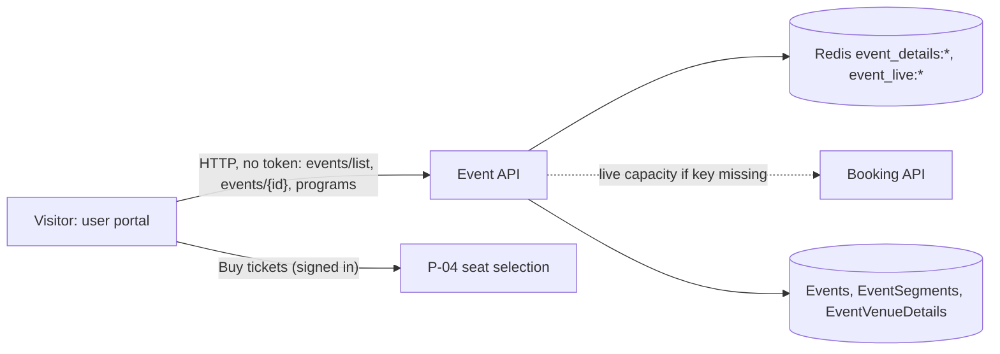

# P-02 · ইভেন্ট ব্রাউজ ও ইভেন্টের বিস্তারিত

> **Bangla name:** ইভেন্ট ব্রাউজ ও ইভেন্টের বিস্তারিত
>
> [← 20 · ইউজার পোর্টাল](README.md) · [সূচিপত্র](../README.md) · [ওপেন কোয়ারি](../99-open-queries.md)

## 1. নাম ও উদ্দেশ্য

**ইভেন্ট ব্রাউজ।** গ্রাহক হোম পেজে ও **Events** পেজে আসন্ন ম্যাচগুলো দেখেন (প্রোগ্রাম, দল, ভেন্যু ও তারিখ দিয়ে ফিল্টার; সাজানো), একটি ইভেন্ট খুলে তার সেগমেন্ট (যেমন একটি Test ম্যাচের কোনো দিন), ভেন্যু, টিকিট বিক্রির সময়সীমা ও একটি স্ট্যাটাস ব্যাজ (`Available`, `LimitedAvailability`, `SoldOut`, `ComingSoon`, `BookingClosed`) দেখেন, এবং **Buy tickets** চাপেন, যা সিট নির্বাচনে নিয়ে যায় ([P-04](P-04-seat-selection.md))। ডেটাটি কর্মীরা অ্যাডমিন পোর্টালে যা প্রকাশ করেছেন ([A-07](../10-admin-portal/A-07-events.md), [A-09](../10-admin-portal/A-09-event-level-pricing.md))।

## 2. ট্রিগার ও অ্যাক্টর

ব্রাউজ করা যেকোনো দর্শক (সাইন-ইন ছাড়া)। **Buy tickets** চাপতে হলে সাইন-ইন করা ও প্রোফাইল সম্পূর্ণ একজন গ্রাহক লাগবে।

## 3. ব্যবসায়িক প্রবাহ

1. হোম পেজ: প্রথম *n* টি ইভেন্ট (`environment.homePageSettings.homeTotalEvents`) কার্ড হিসেবে।
2. `/{lang}/events`: সব আসন্ন ইভেন্ট; হেডার মেনুতে বাছাই করা প্রোগ্রাম তালিকা সংকীর্ণ করে (বাছাইটি শুধু মেমরিতে থাকে, `ProgramSelectionService`); বাকি ফিল্টার (দল, ভেন্যু, তারিখ) ও সাজানো ব্রাউজারে চলে।
3. `/{lang}/events/{eventId}`: ইভেন্টের ব্যানার, তারিখ, ভেন্যু, সেগমেন্ট, সর্বনিম্ন দাম ও **Buy tickets** বোতাম। একটি প্রাইসিং পপ-আপ প্রোগ্রামের টিকিট দাম দেখায় (প্রাইসিং পেজের জন্য [P-03](P-03-info-pages.md) দেখুন)।
4. **Buy tickets:** `ComingSoon` ও `SoldOut`-এ কিছুই হয় না (বিক্রয়ের সময়সীমার বাইরে সার্ভারও প্রত্যাখ্যান করে, [P-06](P-06-booking-payment.md))। প্রোফাইল সম্পূর্ণ একজন সাইন-ইন গ্রাহক যান `/{lang}/tickets/{eventId}/seats`-এ। অ্যাননিমাস গ্রাহক, কিংবা প্রোফাইল অসম্পূর্ণ গ্রাহক পান **Secure ticket** পপ-আপ, যেখানে লগইন ([X-07](../60-cross-cutting/X-07-user-password-login.md)), রেজিস্ট্রেশন ([X-06](../60-cross-cutting/X-06-user-registration.md)) বা প্রোফাইল সম্পূর্ণ করার ([P-11](P-11-profile.md)) বোতাম থাকে।

## 4. কারিগরি প্রবাহ

1. **[HTTP, no token]** হোম: `GET {services.events}/event/api/v1/events/list?numberOfEvents={n}`; ইভেন্টস পেজ: `GET .../event/api/v1/events/list` (প্রোগ্রাম বাছাই করা থাকলে `programId`-সহ)। দুটোই NgRx ইভেন্ট স্টোরের মধ্য দিয়ে যায় (`event.effects.ts`)।
2. **[HTTP, no token]** বিস্তারিত: `GET .../event/api/v1/events/{eventId}`, যেখানে `eventId` হলো public GUID (`EventApiService.getEventById`)।
3. সার্ভার, তালিকা: `EventManager.GetEventsAsync` ক্যাশ করা তালিকা `event_details:list` পড়ে (অথবা প্রকাশিত, সক্রিয় ও শেষ না হওয়া ইভেন্ট থেকে তা তৈরি করে), শেষ হয়ে যাওয়া ইভেন্ট বাদ দেয় এবং **প্রতিটি রিকোয়েস্টে প্রতিটি ইভেন্টের জন্য** `AvailabilityStatus` আবার হিসাব করে (`DetermineAvailabilityStatus`): বিক্রয় শুরুর আগে `ComingSoon`, বিক্রয় বন্ধের পরে `BookingClosed`, অন্যথায় Redis-এর লাইভ ইভেন্ট ক্যাপাসিটি (`event_live:{id}`, না থাকলে Booking-এর মাধ্যমে পূরণ হয়) থেকে একটি থ্রেশহোল্ডের সাথে তুলনা করে: প্রোগ্রামের *লিমিটেড-অ্যাভেইলেবিলিটি পার্সেন্টেজ* সেট করা থাকলে (`GetLimitedAvailabilityThreshold`), নয়তে ডিফল্ট অনলাইন টিকিটের 9 % — ফলে `LimitedAvailability`, `SoldOut` বা `Available`।
4. সার্ভার, বিস্তারিত: `GetEventByEventIdAsync` পড়ে `event_details:{eventId}` (অথবা তৈরি করে; অপ্রকাশিত বা নিষ্ক্রিয় ইভেন্টে এরর দেয়) এবং একইভাবে স্ট্যাটাস আবার হিসাব করে। `minimumPrice` হলো ইভেন্টের ভেন্যু-ডিটেইল সারিগুলোর মধ্যে সবচেয়ে কম `PricePerSeat`।
5. প্রোগ্রাম মেনু ও ফিল্টার: `GET .../event/api/v1/events/programs` ([P-01](P-01-home-content.md))।
6. **Buy tickets** সম্পূর্ণ ক্লায়েন্ট-সাইড সিদ্ধান্ত: `buyTicketPage` যাচাই করে `availabilityStatus`, Cognito সেশন (`isAuthenticated$`) ও প্রোফাইল ফ্ল্যাগ `isProfileCompleted` (identity API থেকে লোড হয়, [P-11](P-11-profile.md)), তারপর নেভিগেট করে; `tickets/*` রুটে `AuthGuard` আছে (লোকাল ফ্ল্যাগ `rvl_cognito_auth`, [X-10](../60-cross-cutting/X-10-user-session.md))।

## 5. কম্পোনেন্ট

| ধরন | কম্পোনেন্ট |
|---|---|
| ক্লায়েন্ট | `events/pages/{home-events-page,all-event-list-page,event-detail-page,filter-events}`, `events/components/{home-event-list,event-card,event-card-homepage,event-overview,event-segments,event-segment-card,secure-ticket-modal}`; `core/modules/events/store/*` |
| সার্ভিস | Event (`EventsController`, `ProgramController`, `EventManager`); লাইভ ক্যাপাসিটির জন্য Booking কল করা হয় (`GetEventLiveCapacity`) |
| টেবিল | `Events`, `EventSegments`, `EventVenueDetails`, `Programs`, `EventSettings` (Admin টেবিলের রিড মডেল, দেখুন [00 primer](../00-platform-primer.md)) |
| Redis | `event_details:list`, `event_details:{id}`, `event_live:{id}` ([X-25](../60-cross-cutting/X-25-redis.md)) |

## 6. API কন্ট্রাক্ট

| মেথড | পথ | অথ | রিকোয়েস্ট | রেসপন্স |
|---|---|---|---|---|
| GET | `/event/api/v1/events/list` | none | `numberOfEvents?`, `programId?` | `Event[]` (`eventId`, `eventName`, `programId`, `bannerImage`, তারিখ, `minimumPrice`, `availabilityStatus`, `segments[]`, `venue`) |
| GET | `/event/api/v1/events/{eventId}` | none | public GUID | `Event` (এতে যোগ `vat`, `isVatInclusive`, `isVatPercentage`, `ticketAvailabilityStartDateTime`) |
| GET | `/event/api/v1/events/programs` | none | | `Program[]` |

প্রধান নমুনা, `GET /event/api/v1/events/list?numberOfEvents=2` (সংক্ষিপ্ত; প্রপার্টির নাম পোর্টাল মডেলের `HomeEvent` অনুযায়ী; মানগুলো কাল্পনিক):

```json
[{ "id": 2, "eventId": "9f0b2c1e-3b0e-4a43-9d5e-6f5f3d0c1a11", "eventName": "1st ODI, Mirpur",
   "programId": 1, "bannerImage": "https://media.example.com/eventcover/2.jpg",
   "eventStartDateTime": "2026-12-10T08:00:00Z", "eventEndDateTime": "2026-12-10T16:00:00Z",
   "ticketSellingStartDateTime": "2026-11-20T04:00:00Z", "ticketSellingStopDateTime": "2026-12-10T08:00:00Z",
   "minimumPrice": 300, "availabilityStatus": "Available",
   "segments": [{ "id": 3, "name": "BAN vs IND", "segmentType": "Sport", "team1": "Bangladesh", "team2": "India" }],
   "venue": { "id": 1, "name": "Sher-e-Bangla National Cricket Stadium", "location": "Mirpur" } }]
```

## 7. ডেটা ও পার্শ্বপ্রতিক্রিয়া

শুধু পড়া। key না থাকলে তালিকার রিকোয়েস্ট Redis-এ `event_live:{id}` পূরণ করতে পারে (Booking-এর একটি কল)। অন্য কোনো অবস্থার পরিবর্তন নেই।

## 8. কোড রেফারেন্স

| কী | কোথায় |
|---|---|
| পোর্টাল API | `rvl-gobcb-user-portal/ETP-Web/src/app/modules/core/services/api/event-api.service.ts:20-75` |
| পেজ | `rvl-gobcb-user-portal/ETP-Web/src/app/modules/featured/events/pages/all-event-list-page/all-event-list-page.component.ts:68-100`; `.../event-detail-page/event-detail-page.component.ts:21-27` |
| বাটন | `rvl-gobcb-user-portal/ETP-Web/src/app/modules/featured/events/components/event-overview/event-overview.component.ts:90-112` |
| কন্ট্রোলার | `rvl-gobcb-backend/Services/Event/ETP.Event.Service/Api/EventsController.cs:21, 83-100` |
| ম্যানেজার | `rvl-gobcb-backend/Services/Event/ETP.Event.Domain/Managers/EventManager.cs:41-80, 267-330` |

## 9. হ্যান্ডওভার নোট

1. **স্ট্যাটাস ব্যাজ প্রতিটি রিকোয়েস্টে আবার হিসাব হয়** Redis কাউন্টার থেকে, তাই এটি লাইভ; কিন্তু প্রতিটি `list` কলে প্রতি ইভেন্টে কয়েকটি Redis ও লুকআপ কল হয়; অনেক ইভেন্ট থাকলে এটি সিস্টেমের সবচেয়ে ব্যস্ত অ্যাননিমাস রিড।
2. **`numberOfEvents` `programId`-এর পরে প্রয়োগ হয়** এবং ক্যাশ করা ক্রমের প্রথম *n* টি নেয়, "তারিখ অনুযায়ী পরের *n*" নয়; ক্রম হলো ক্যাশ করা তালিকার ক্রম।
3. **তালিকা কর্মী কোনো ইভেন্ট বদলানো পর্যন্ত ক্যাশ থাকে।** ক্যাশ রিড শেষ হওয়া ইভেন্ট বাদ দেয়, কিন্তু সরাসরি ডেটাবেসে করা পরিবর্তন অদৃশ্য থাকে যতক্ষণ না কোনো Admin পরিবর্তন `event_details:*` মুছে দেয় ([A-07](../10-admin-portal/A-07-events.md) যে ক্যাশগুলো মোছে তার তালিকা দেয়)।
4. **"Buy tickets"-এর নিয়ম শুধু ক্লায়েন্ট-সাইড।** লুকানো বা বিক্রীত-আউট ইভেন্ট Booking API সরাসরি কল করে অর্ডার করা যায়; সার্ভার ব্যাজ নয়, বরং ইভেন্ট প্রকাশিত/সক্রিয়, বিক্রয়ের সময়সীমা, আসনের সীমা ও ক্যাপাসিটি প্রয়োগ করে ([P-06](P-06-booking-payment.md))।
5. **প্রোফাইল ফ্ল্যাগ না সম্পূর্ণ না অসম্পূর্ণ হলে (যেমন প্রোফাইল কল এখনো লোড হচ্ছে) বোতামটি কিছুই করে না** এবং কোনো বার্তা দেখায় না।
6. **দল ও ভেন্যু দিয়ে ইভেন্ট-তালিকা ফিল্টার করা ধরে নেয় প্রতিটি ইভেন্টের সেগমেন্ট ও ভেন্যু আছে** (`event.segments.filter(...)`, `event.venue.name`); ভেন্যু অবজেক্ট ছাড়া কোনো ইভেন্ট পেজটি ভেঙে দেবে `[UNCONFIRMED: Q-36]`।

## 10. কম্পোনেন্ট সম্পর্ক



**নির্ভর করে:** [A-07](../10-admin-portal/A-07-events.md), [A-09](../10-admin-portal/A-09-event-level-pricing.md), [S-02](../50-system-initiated/S-02-event-live-capacity.md)। **প্রভাব ফেলে:** [P-04](P-04-seat-selection.md)।

## 11. ডেভেলপার টেস্ট গাইড

**লোকাল টেস্টযোগ্যতা: সম্পূর্ণ** (দুটি প্রোগ্রামে সাতটি সিড করা ম্যাচ; মিরপুরের 1st ODI "আজ live")।

| আইটেম | বিবরণ |
|---|---|
| টেস্ট ডেটা ও অ্যাকাউন্ট | ব্রাউজের জন্য অ্যাননিমাস; বাটনের জন্য ইউজার `+8801700000011` / `Passw0rd!23` |
| ব্রাউজার | `http://localhost:4201/en/events`, একটি ম্যাচ খুলুন, **Buy tickets** চাপুন — সাইন-আউট অবস্থায় (পপ-আপ) ও সাইন-ইন অবস্থায় (সিটে যায়); Network: `events/list`, `events/{id}` |
| এমুলেটর | — (দেখুন [U-02](../30-user-app/U-02-home-browse-events.md)) |
| Postman | `postman/services/etp-event.postman_collection.json`: "GET /api/v1/events/list", "GET /api/v1/events/{eventId}", "GET /api/v1/events/programs" |
| Visual Studio debug | `EventManager.GetEventsAsync`, `DetermineAvailabilityStatus` (Aspire AppHost থেকে Event সার্ভিস চালু করুন) |
| যাচাই | `redis-cli KEYS 'event_details:*'`; `redis-cli GET event_live:2` |
