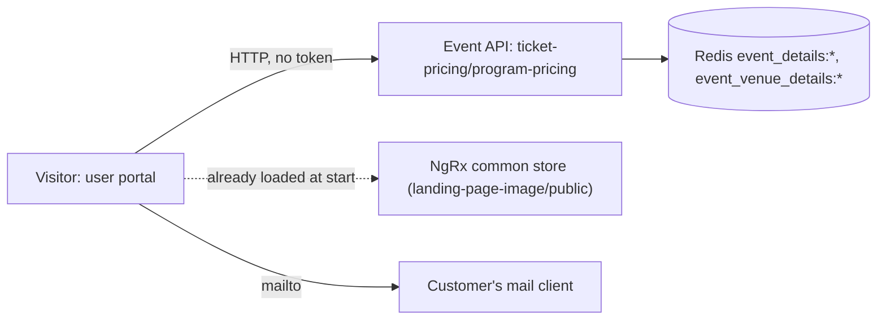

# P-03 · তথ্য পেজ (দাম, গ্যালারি, যোগাযোগ, নীতিমালা)

> **Bangla name:** তথ্য পাতা (মূল্য তালিকা, গ্যালারি, FAQ, শর্তাবলি, প্রাইভেসি, যোগাযোগ ও নীতিমালা)
>
> [← 20 · ইউজার পোর্টাল](README.md) · [সূচিপত্র](../README.md) · [ওপেন কোয়ারি](../99-open-queries.md)

## 1. নাম ও উদ্দেশ্য

**তথ্য পেজ।** পোর্টালের ফুটার ও মেনুতে থাকা দেখতে স্ট্যাটিক পাতাগুলো: **টিকিটের দাম**, **গ্যালারি**, **FAQ**, **শর্তাবলি**, **প্রাইভেসি পলিসি**, **যোগাযোগ**, **ICC অ্যান্টি-রেসিজম কোড** এবং **ICC অ্যান্টি-ডিসক্রিমিনেশন পলিসি**। এর বেশিরভাগই এমন লেখা বা ছবি দেখায় যা কর্মীরা অ্যাডমিন পোর্টালে সম্পাদনা করেন ([A-28](../10-admin-portal/A-28-media-configuration.md), [A-29](../10-admin-portal/A-29-content-editor.md)); দামের পেজটি ইভেন্টগুলো থেকেই হিসাব করা।

## 2. ট্রিগার ও অ্যাক্টর

যেকোনো দর্শক, সাইন-ইন ছাড়া। রুট (সবগুলোই `/{lang}/`-এর নিচে): `ticket-pricing`, `gallery`, `faq`, `terms`, `policy`, `contact`, `message-sent`, `icc-anti-racism-code`, `icc-anti-discrimination-code` (`event-routing.module.ts:17-28`)।

## 3. ব্যবসায়িক প্রবাহ

- **টিকিটের দাম:** প্রোগ্রাম প্রতি একটি ট্যাব; প্রতি ইভেন্টে ভেন্যুর প্রতিটি গ্যালারি/ব্লক/লেভেলের দাম (গ্রাহক যে দাম দেন ঠিক সেই, [A-09](../10-admin-portal/A-09-event-level-pricing.md))। ইভেন্ট পেজের একটি প্রাইসিং পপ-আপ ([P-02](P-02-browse-events.md)) একই ডেটা দেখায়।
- **গ্যালারি:** দুটি শিরোনামযুক্ত সেগমেন্টে ছবির গ্রুপ।
- **FAQ / শর্তাবলি / প্রাইভেসি:** প্রকাশিত এন্ট্রিগুলো; শর্তাবলি ও প্রাইভেসি ফর্ম্যাট করা লেখা হিসেবে।
- **যোগাযোগ:** ফুটার রেকর্ড থেকে যোগাযোগের ব্লক ([A-30](../10-admin-portal/A-30-header-footer-social.md)), একটি এমবেড করা ম্যাপ, এবং একটি ফর্ম যা গ্রাহকের ইমেইল প্রোগ্রাম খোলে।
- **অ্যান্টি-রেসিজম ও অ্যান্টি-ডিসক্রিমিনেশন:** পোর্টাল বিল্ডের ভেতরে স্থির লেখা।

## 4. কারিগরি প্রবাহ

1. **প্রাইসিং, [HTTP, no token]:** `GET {services.events}/event/api/v1/ticket-pricing/program-pricing` (NgRx ইভেন্ট স্টোরের মধ্য দিয়ে `EventApiService.getProgramPricing`, `loadProgramPricing`)। সার্ভার (`ProgramPricingManager.GetProgramPricingAsync`) সব সক্রিয় ও শেষ না হওয়া প্রোগ্রাম নেয়, প্রতিটি প্রোগ্রামের ক্যাশ করা ইভেন্ট পড়ে (`EventManager.GetEventsAsync(programId)`), প্রতিটি ইভেন্টের ভেন্যু গ্যালারি পড়ে (`GetEventVenueDetailsByEventIdAsync(.., includeZeroCapacity: true)`) এবং লেভেল প্রতি একটি সারি ফেরত দেয়, যেখানে থাকে ইভেন্ট, ভেন্যু, গ্যালারি, `ticketType` (`"N/A"`) ও `price`। পেজ URL-এর `?programId=` কোয়েরি প্যারামিটার কেবল ব্রাউজারে ট্যাব বাছাই করে।
2. **গ্যালারি, FAQ, শর্তাবলি, প্রাইভেসি:** কোনো অতিরিক্ত কল নেই। এরা পড়ে স্টার্টের সময় লোড করা প্রকাশিত ল্যান্ডিং-পেজ তালিকা ([P-01](P-01-home-content.md)): গ্যালারির ছবির টাইপ `Gallery_Page_Segment_1/_2` (টাইপ অনুযায়ী গ্রুপ করা, শিরোনাম = আন্ডারস্কোর বদলে দেওয়া টাইপ, সারি প্রতি দুটি ছবি); FAQ = টাইপ `FAQ`, প্রশ্ন = `title`, উত্তর = `description`, `displayOrder` অনুযায়ী সাজানো; শর্তাবলি = একমাত্র `Terms_Condition` আইটেম, প্রাইভেসি = একমাত্র `Privacy_Policy` আইটেম (`common.reducer.ts:35-38`)।
3. **শর্তাবলি ও প্রাইভেসি রেন্ডারিং:** `description` `DomSanitizer.bypassSecurityTrustHtml`-এর পরে `[innerHTML]` দিয়ে বাঁধা হয় ("rich text editor থেকে আসা inline style সম্পন্ন করতে"), তাই সংরক্ষিত HTML রেন্ডার হয় Angular-এর স্যানিটাইজিং ছাড়াই **বসানো হয়** (`terms-conditions.component.ts:30-33`, `privacy-policy.component.ts:30-33`)। FAQ ও নোটিশ লাইন Angular-এর স্বাভাবিক বাইন্ডিং ব্যবহার করে।
4. **যোগাযোগের ম্যাপ:** `Contact_Us` ল্যান্ডিং-পেজ আইটেমের `imageUrl` `bypassSecurityTrustResourceUrl`-এর মাধ্যমে একটি iframe-এর `src` হিসেবে ব্যবহৃত হয় (`contact-map.component.ts:43-70`), তাই কর্মীদের সেখানে ম্যাপ এমবেডের URL পেস্ট করার কথা। যোগাযোগের বিবরণ (ফোন, ইমেইল, ঠিকানা) আসে হেডার/ফুটার রেকর্ড থেকে (`selectContactInfo`)।
5. **যোগাযোগের ফর্ম:** `ContactFormComponent.onSubmit` একটি `mailto:contact@reliefvalidation.com.bd?...` লিংক তৈরি করে খোলে (`window.open(.., '_self')`)। **কোনো সার্ভারে কোনো রিকোয়েস্ট পাঠানো হয় না**; `message-sent` রুটটি একটি স্ট্যাটিক ধন্যবাদ পেজ।
6. দুটি ICC নীতিমালা পেজ পোর্টালের সোর্সে স্থির HTML।

## 5. কম্পোনেন্ট

| ধরন | কম্পোনেন্ট |
|---|---|
| ক্লায়েন্ট | `events/pages/{ticket-pricing,gallery,faq,terms-conditions,privacy-policy,contact,message-sent,anti-racism-code,anti-discrimination-policy}`, `events/components/{contact-form,contact-map}` |
| সার্ভিস | Event (`TicketPricingController`, `ProgramPricingManager`, `EventManager`, `LandingPageImageController`) |
| টেবিল | `Programs`, `Events`, `EventVenueDetails`, `LandingPageImages`, `HeaderFooters` |
| Redis | `event_details:*`, `event_venue_details:*`, `landing_page_image_published:list` |

## 6. API কন্ট্রাক্ট

| মেথড | পথ | অথ | রেসপন্স |
|---|---|---|---|
| GET | `/event/api/v1/ticket-pricing/program-pricing` | none | `ProgramPricingResponse[]` (প্রতি প্রোগ্রামে: গ্যালারি, ব্লক, লেভেল, `ticketType`, `price`-সহ ইভেন্ট) |
| GET | `/event/api/v1/landing-page-image/public` | anonymous | দেখুন [P-01](P-01-home-content.md) |

`program-pricing`-এ কোয়েরি প্যারামিটার `programId` ও `eventId` আছে কিন্তু পোর্টাল কোনোটিই পাঠায় না। প্রধান নমুনা, `GET /event/api/v1/ticket-pricing/program-pricing`-এর একটি প্রোগ্রামের ভেতরে একটি লেভেল সারি (নাম `EventPricingData` থেকে; মানগুলো কাল্পনিক):

```json
{ "eventId": 2, "eventName": "1st ODI, Mirpur", "venueId": 1, "venueName": "Sher-e-Bangla National Cricket Stadium",
  "galleryName": "Pavilion", "ticketType": "N/A", "price": 1500 }
```

## 7. ডেটা ও পার্শ্বপ্রতিক্রিয়া

শুধু পড়া। মেলের ফর্ম সিস্টেম ছেড়ে যায় (গ্রাহকের মেল ক্লায়েন্টে)।

## 8. কোড রেফারেন্স

| কী | কোথায় |
|---|---|
| রুট | `rvl-gobcb-user-portal/ETP-Web/src/app/modules/featured/events/event-routing.module.ts:17-28` |
| প্রাইসিং পেজ | `.../events/pages/ticket-pricing/ticket-pricing.component.ts:36-85`; স্টোর `core/modules/events/store/event.effects.ts:36-45` |
| শর্তাবলি / প্রাইভেসি | `.../events/pages/terms-conditions/terms-conditions.component.ts:20-36`; `.../privacy-policy/privacy-policy.component.ts` |
| যোগাযোগ | `.../events/components/contact-form/contact-form.component.ts:30-37`; `.../contact-map/contact-map.component.ts:36-75` |
| সার্ভার | `rvl-gobcb-backend/Services/Event/ETP.Event.Service/Api/TicketPricingController.cs:27-52`; `.../ETP.Event.Domain/Managers/ProgramPricingManager.cs:25-120` |

## 9. হ্যান্ডওভার নোট

1. **প্রাইসিং পেজ [A-14](../10-admin-portal/A-14-ticket-pricing-content.md)-এ কর্মীদের সম্পাদনা করা "টিকিট প্রাইসিং কনটেন্ট" ব্যবহার করে না।** পোর্টাল `program-pricing` কল করে (ইভেন্ট থেকে লাইভ দাম)। `EventApiService.getTicketPricingList` (A-14-এর Redis তালিকা পড়া `ticket-pricing/list` কল) পোর্টালে কোনো কলার নেই। ইউজার অ্যাপ A-14-এর কনটেন্ট পড়ে কি না তা [U-03](../30-user-app/U-03-info-pages.md)-এ দেখা হয়েছে `[UNCONFIRMED: Q-35]`।
2. **সংরক্ষিত HTML-কে বিশ্বাস করা হয়।** শর্তাবলি ও প্রাইভেসি `bypassSecurityTrustHtml` দিয়ে রেন্ডার হয়; Admin সার্ভিস সেভ করার সময় লেখা স্যানিটাইজ করে না ([A-29](../10-admin-portal/A-29-content-editor.md) নোট 3)। তাই যে কেউ `LandingPageImages` সারিতে লিখতে পারে (admin ও event-manager রোল) সে প্রতিটি দর্শকের ব্রাউজারে স্ক্রিপ্ট চালাতে পারে `[UNCONFIRMED: Q-33]`।
3. **ম্যাপের URL-ও বিশ্বাস করা হয়।** `Contact_Us.imageUrl` `bypassSecurityTrustResourceUrl`-এর মাধ্যমে iframe `src` হয়, তাই এটি যেকোনো সাইটে নির্দেশ করতে পারে।
4. **যোগাযোগের ফর্ম দর্শকের কাছে মেল প্রোগ্রাম থাকার ওপর নির্ভর করে** (`mailto:`); সার্ভার-সাইডে কোনো যোগাযোগ বার্তা নেই এবং কোনো প্রকৃত সাবমিশন থেকে "message-sent" নিশ্চিতকরণও নেই (পেজটি কেবল একটি স্ট্যাটিক রুট)।
5. **`program-pricing` প্রতি রিকোয়েস্টে ভারী কাজ করে:** প্রতি প্রোগ্রাম, ইভেন্ট ও লেভেলের জন্য এটি ক্যাশ করা ম্যানেজার কল করে; এর নিজস্ব কোনো রেসপন্স ক্যাশ নেই। এটি প্রতিটি লেভেলের জন্যই `ticketType: "N/A"` বলে।
6. **এখানে দেখানো লেভেলের দাম venue-detail-এর দাম**, অর্থাৎ সিস্টেম ডিসকাউন্ট, প্রোমো কোড ও VAT/সার্ভিস চার্জের আগের দাম, যা [P-04](P-04-seat-selection.md) ও [P-06](P-06-booking-payment.md)-এ যোগ হয়।
7. **অনুবাদ:** পেজের চেহারা `ngx-translate` দিয়ে অনূদিত হয়, কিন্তু কর্মীদের সম্পাদিত লেখা (FAQ, শর্তাবলি, প্রাইভেসি, নোটিশ) একবারই তৈরি হয় এবং প্রতিটি ভাষায় একইভাবে দেখায় ([P-13](P-13-language-switch.md))।

## 10. কম্পোনেন্ট সম্পর্ক



**নির্ভর করে:** [P-01](P-01-home-content.md), [A-09](../10-admin-portal/A-09-event-level-pricing.md), [A-28](../10-admin-portal/A-28-media-configuration.md), [A-29](../10-admin-portal/A-29-content-editor.md), [A-30](../10-admin-portal/A-30-header-footer-social.md)। **প্রভাব ফেলে:** পরবর্তী কোনোটিতে নয়।

## 11. ডেভেলপার টেস্ট গাইড

**লোকাল টেস্টযোগ্যতা: সম্পূর্ণ।**

| আইটেম | বিবরণ |
|---|---|
| টেস্ট ডেটা ও অ্যাকাউন্ট | অ্যাননিমাস; সিড করা FAQ, notice, hero ও sponsors সারি (সিড তালিকায় Terms/Privacy সারির উল্লেখ নেই, [A-29](../10-admin-portal/A-29-content-editor.md)-এ একটি তৈরি করুন) |
| ব্রাউজার | `http://localhost:4201/en/ticket-pricing`, `/en/faq`, `/en/terms`, `/en/policy`, `/en/gallery`, `/en/contact` |
| এমুলেটর | — (দেখুন [U-03](../30-user-app/U-03-info-pages.md)) |
| Postman | `postman/services/etp-event.postman_collection.json`: "GET /api/v1/ticket-pricing/program-pricing", "GET /api/v1/ticket-pricing/list", "GET /api/v1/landing-page-image/public" |
| Visual Studio debug | `ProgramPricingManager.GetProgramPricingAsync` |
| যাচাই | [A-29](../10-admin-portal/A-29-content-editor.md)-এ একটি FAQ এন্ট্রি সম্পাদনা করে `/en/faq` রিলোড করুন; প্রাইসিং পেজের তুলনা করুন `EventVenueDetails`-এর দামের সাথে |
