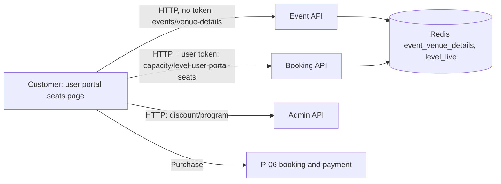

# P-04 · সিট নির্বাচন

> **Bangla name:** আসন ও টিকিট নির্বাচন
>
> [← 20 · ইউজার পোর্টাল](README.md) · [সূচিপত্র](../README.md) · [ওপেন কোয়ারি](../99-open-queries.md)

## 1. নাম ও উদ্দেশ্য

**সিট নির্বাচন।** **Buy tickets** চাপার পর ([P-02](P-02-browse-events.md)) সাইন-ইন করা গ্রাহক বাছাই করেন *কোথায়* বসবেন এবং *কতটি* টিকিট কিনবেন: গ্যালারি → ব্লক → লেভেল (বা সারি), একটি স্টেডিয়াম SVG ম্যাপে; টিকিটের সংখ্যা; নম্বরযুক্ত আসন থাকলে সঠিক আসনগুলো; ঐচ্ছিকভাবে প্রতিটি টিকিট ধারকের নাম ও ফোন; এবং VAT, সার্ভিস চার্জ, সিস্টেম ডিসকাউন্ট ও প্রোমো কোডসহ লাইভ দামের প্রিভিউ দেখেন ([P-05](P-05-apply-promo-code.md))। পেজটি শেষ হয় **Purchase** বোতামে, যা [P-06](P-06-booking-payment.md)-এর শুরু।

## 2. ট্রিগার ও অ্যাক্টর

সাইন-ইন করা গ্রাহক (User pool)। রুট `/{lang}/tickets/{eventId}/seats`, সুরক্ষিত `AuthGuard`-এ (শুধু লোকাল ফ্ল্যাগ, [X-10](../60-cross-cutting/X-10-user-session.md)) এবং একটি রুট রিজলভার দিয়ে (`VenueDetailsResolverService`)।

## 3. ব্যবসায়িক প্রবাহ

1. পেজটি ভেন্যু ম্যাপ দিয়ে খোলে। কেবল যেসব ইভেন্টের স্ট্যাটাস `Available` বা `LimitedAvailability` সেগুলোই খোলে; অন্য যেকোনো স্ট্যাটাস গ্রাহককে হোম পেজে ফেরত পাঠায়।
2. গ্রাহক একটি গ্যালারি, তারপর একটি ব্লক, তারপর একটি লেভেল (সিটযুক্ত লেভেলের জন্য একটি সারি) বাছাই করেন। ম্যাপটি বাছাইটি হাইলাইট করে; আসন-ম্যাপ করা প্রথম ব্লক ও লেভেল আগেই নির্বাচিত থাকে।
3. গ্রাহক টিকিটের সংখ্যা বাছাই করেন (১ থেকে লেভেলের লাইভ ক্যাপাসিটি পর্যন্ত)। সিটযুক্ত লেভেলের জন্য পোর্টাল আসনের ক্রমে প্রথম *n* টি খালি আসন প্রস্তাব করে এবং একটি আসন ডায়ালগে গ্রাহককে সেগুলো বদলাতে দেয় (*n* টির বেশি বা কম বেছে নেওয়া যায় না)।
4. ঐচ্ছিকভাবে প্রতিটি টিকিটের জন্য ধারকের নাম (অক্ষর ও স্পেস, সর্বোচ্চ ১৭ অক্ষর) ও ১১ সংখ্যার ফোন নম্বর।
5. দামের বাক্সে দেখা যায় সাবটোটাল, VAT, সার্ভিস চার্জ, সিস্টেম ডিসকাউন্ট, প্রোমো ডিসকাউন্ট ও মোট। গ্যালারি, ব্লক বা লেভেল বদলালে প্রোমো কোড ও ডিসকাউন্ট রিসেট হয়।
6. **Purchase** খুলে [P-06](P-06-booking-payment.md)-এর নিশ্চিতকরণের পপ-আপ।

## 4. কারিগরি প্রবাহ

1. **[HTTP, no token]** রুট রিজলভার: `GET {services.events}/event/api/v1/events/venue-details/{eventId}` (`EventApiService.getVenueDetailsByEventId`, Event সার্ভিস)। উত্তর হলো ইভেন্টটি তার ভেন্যু, SVG ফাইল, গ্যালারি → ব্লক → লেভেল (প্রতিটির সাথে `pricePerSeat`, `svgKey`, `isSeatMapped`, `hasSeats`, লাইভ `availableCapacity`) এবং `eventSettings` (VAT, সার্ভিস চার্জ, VAT-inclusive ফ্ল্যাগ, সীমা) সহ। যদি `availabilityStatus` `Available`/`LimitedAvailability` না হয় তাহলে রিজলভার হোমে নেভিগেট করে; সেশন চলে গেলে (`No current user`) সাইন-আউট করে লগইনে যায়। সার্ভার এটি ক্যাশ করা `event_venue_details:{id}` থেকে তৈরি করে এবং প্রতিটি লেভেলের ক্যাপাসিটি Redis-এর লাইভ মান দিয়ে বদলে দেয় (`GetLevelLiveCapacity`)।
2. ভেন্যু SVG লোড ও আঁকা হয় `SvgRenderService` দিয়ে; `updateView(key)` নির্বাচিত key-কে `_` দিয়ে ভাগ করে (১ থেকে ৩টি অংশে) ম্যাপটি রঙ করে।
3. **[HTTP + user token]** সিটযুক্ত লেভেলের জন্য: `GET {services.bookings}/booking/api/v1/capacity/level-user-portal-seats?eventId={Events.Id}&galleryId=&blockId=&levelId=` (`BookingApiService.getAvailableSeats`)। সার্ভার (`CapacityManager.GetLevelUserPortalSeats`) কমা-দিয়ে-আলাদা দুটি স্ট্রিং ফেরত দেয়: `total` (লেভেলের সব আসনের নাম) ও `available` (লাইভ খালি আসন, Redis hash `level_live:*`/আসন সেট, [X-25](../60-cross-cutting/X-25-redis.md))। পোর্টাল অক্ষর অনুযায়ী তারপর সংখ্যা অনুযায়ী সাজায় এবং অপ্রাপ্য আসন চিহ্নিত করে।
4. **[HTTP, no token]** সিস্টেম ডিসকাউন্ট: `GET {services.tickets}/admin/api/v1/discount/program/{programId}/{eventId}/{galleryId}` (`BookingApiService.getDiscount`, Admin সার্ভিস, `[AllowAnonymous]`); `discountValue` ও `discountType` (`Percentage` বা fixed) থাকা ফল প্রিভিউতে প্রয়োগ হয়। অর্ডার তৈরির সময় সার্ভার নিজের ডিসকাউন্ট আবার প্রয়োগ করে ([P-06](P-06-booking-payment.md))।
5. প্রিভিউ দাম (শুধু ব্রাউজার): `calculateTotal = subtotal + previewVat + serviceCharge − systemDiscount − promoDiscount` (`stadium-seat-page.component.ts`); VAT ও সার্ভিস চার্জ ইভেন্ট সেটিংস অনুযায়ী (টিকিটপ্রতি শতাংশ বা fixed)।
6. **Purchase** তৈরি করে `TicketPurchase { eventId, galleryId, blockId, levelId, numberOfSeats, pricePerSeat, hasSeats, seats ("A1,A2"), promoCode, totalCharge, vat, bookedUserDetails[] }` এবং খোলে `CompletePaymentModalComponent`।

## 5. কম্পোনেন্ট

| ধরন | কম্পোনেন্ট |
|---|---|
| ক্লায়েন্ট | `tickets/pages/stadium-seat-page`, `tickets/resolvers/venue-details.resolver.service.ts`, `shared` `SvgRenderService`, আসন ডায়ালগের টেমপ্লেট |
| সার্ভিস | Event (`EventsController.GetEventVenueDetailsAsync`); Booking (`CapacityController`); Admin (`DiscountController`) |
| টেবিল | `EventVenueDetails`, `Capacities`, `Discounts` |
| Redis | `event_venue_details:{id}`; hash `capacity`-এর ফিল্ড `level_live:*`, `level_live_seats:*`, key `level_database_seats:*` ([X-25](../60-cross-cutting/X-25-redis.md)) |

## 6. API কন্ট্রাক্ট

| মেথড | পথ | অথ | রিকোয়েস্ট | রেসপন্স |
|---|---|---|---|---|
| GET | `/event/api/v1/events/venue-details/{eventId}` | none | public GUID | `venue.venueGalleries[].galleryBlocks[].blockLevels[]`, `eventSettings`-সহ `Event` |
| GET | `/booking/api/v1/capacity/level-user-portal-seats` | none on the server (portal sends the token) | `eventId` (long), `galleryId`, `blockId`, `levelId` | `{ total, available }` |
| GET | `/admin/api/v1/discount/program/{programId}/{eventId}/{galleryId}` | anonymous | path | ডিসকাউন্ট বা ফাঁকা |

প্রধান নমুনা, `GET /booking/api/v1/capacity/level-user-portal-seats?eventId=2&galleryId=5&blockId=11&levelId=31` (মানগুলো কাল্পনিক):

```json
{ "total": "A1,A2,A3,A4,B1,B2", "available": "A1,A3,A4,B2" }
```

## 7. ডেটা ও পার্শ্বপ্রতিক্রিয়া

শুধু পড়া। গ্রাহক যখন বাছাই করেন তখন **কিছুই রিজার্ভ হয় না**; আসন যাচাই ও লক হয় কেবল অর্ডার তৈরির সময় ([P-06](P-06-booking-payment.md))।

## 8. কোড রেফারেন্স

| কী | কোথায় |
|---|---|
| পেজ | `rvl-gobcb-user-portal/ETP-Web/src/app/modules/featured/tickets/pages/stadium-seat-page/stadium-seat-page.component.ts:78-135, 300-395, 470-545` |
| রিজলভার | `rvl-gobcb-user-portal/ETP-Web/src/app/modules/featured/tickets/resolvers/venue-details.resolver.service.ts:18-48` |
| API | `rvl-gobcb-user-portal/ETP-Web/src/app/modules/core/services/api/booking-api.service.ts:63-80, 137-140, 176-185` |
| সার্ভার | `rvl-gobcb-backend/Services/Booking/ETP.Booking.Service/Api/CapacityController.cs:54-66`; `.../ETP.Booking.Domain/Managers/CapacityManager.cs:352-362`; `rvl-gobcb-backend/Services/Event/ETP.Event.Domain/Managers/EventManager.cs:391-470` |

## 9. হ্যান্ডওভার নোট

1. **পেজে দেখানো দাম একটি প্রিভিউ।** সার্ভার পোর্টাল পাঠানো `pricePerSeat`, `totalCharge` ও `vat` উপেক্ষা করে (শুধু ধনাত্মক হতে বাধ্য করে) এবং ইভেন্ট সেটিংস, লেভেলের দাম, সিস্টেম ডিসকাউন্ট ও প্রোমো কোড থেকে সব আবার হিসাব করে ([P-06](P-06-booking-payment.md))। পোর্টালের সূত্র ও সার্ভারের সূত্র আলাদা হলে গ্রাহক একটি পরিমাণ দেখবেন আর আরেকটি শরিফ করা হবে; VAT বা ডিসকাউন্টের নিয়ম বদলানোর সময় দুটোই তুলনা করুন।
2. **বাছাইয়ের সময় কোনো রিজার্ভেশন নেই।** দুই গ্রাহক একই আসন বাছাই করতে পারেন; পরের অর্ডারটি `Unavailable seats: ...` দিয়ে ব্যর্থ হয় ([P-06](P-06-booking-payment.md) নোট 4)।
3. **টিকিট-সংখ্যার তালিকা খুব লম্বা হতে পারে।** `seatOptions` ১ থেকে লেভেলের লাইভ ক্যাপাসিটি পর্যন্ত দেয়; সীমা `AllowableMaximumSeatPerOrder` শুধু সার্ভারই প্রয়োগ করে, তাই গ্রাহক এমন সংখ্যা বাছাই করতে পারেন যা কেনাকাটার সময় প্রত্যাখ্যাত হয়।
4. **আসন প্রস্তাব মাত্র প্রথম খালি আসনগুলো**, সেরা বা পরপর কোনো আসন নয়।
5. **আসনের তালিকা ও ডিসকাউন্ট লুকআপ অ্যাননিমাস এন্ডপয়েন্ট।** আসনের কল টোকন ইন্টারসেপ্টরের মধ্য দিয়ে যায় (URL `booking`-এর নিচে), ডিসকাউন্টের কল হোস্ট সেটিংসের ওপর নির্ভর করে টোকেন নাও বহন করতে পারে; দুটোই টোকেন ছাড়াই কাজ করে ([X-18](../60-cross-cutting/X-18-endpoints-without-auth.md))।
6. **ধারকের নাম ও ফোন শুধু ব্রাউজারে যাচাই হয়** (অক্ষর/স্পেস ≤ ১৭, ১১ সংখ্যা); সার্ভার যা পায় তাই `BookedUserRecords`-এ জমা করে। এই মানগুলো পরে টিকিটে লেখা হয়, এবং হোল্ডার জেনারেশনের আগে সেগুলো সম্পাদনা করতে পারে ([P-09](P-09-ticket-details-downloads.md))।
7. **`eventsVenueDetails/get-level` অপ্রয়োগ:** `BookingApiService.getGalleryInformation` এমন একটি Admin এন্ডপয়েন্ট কল করে যেটি কর্মীর রোল চায়, কিন্তু কোনো কিছুই মেথডটি কল করে না।

## 10. কম্পোনেন্ট সম্পর্ক



**নির্ভর করে:** [P-02](P-02-browse-events.md), [A-09](../10-admin-portal/A-09-event-level-pricing.md), [A-10](../10-admin-portal/A-10-capacity-adjustment.md), [A-11](../10-admin-portal/A-11-seat-reservation.md), [A-16](../10-admin-portal/A-16-discounts.md), [S-01](../50-system-initiated/S-01-level-capacity-update.md)। **প্রভাব ফেলে:** [P-05](P-05-apply-promo-code.md), [P-06](P-06-booking-payment.md)।

## 11. ডেভেলপার টেস্ট গাইড

**লোকাল টেস্টযোগ্যতা: সম্পূর্ণ** ব্রাউজ ও প্রিভিউয়ের জন্য; চূড়ান্ত পেমেন্ট লোকালে সম্ভব নয় ([P-06](P-06-booking-payment.md))।

| আইটেম | বিবরণ |
|---|---|
| টেস্ট ডেটা ও অ্যাকাউন্ট | ইউজার `+8801700000011` / `Passw0rd!23` (প্রোফাইল সম্পূর্ণ); **মিরপুরের 1st ODI** বিক্রয়ে; Pavilion-এ একটি সক্রিয় early-bird ডিসকাউন্ট (10 %) |
| ব্রাউজার | `http://localhost:4201/en/events` → 1st ODI → **Buy tickets**; Network: `venue-details`, `level-user-portal-seats`, `discount/program` |
| এমুলেটর | — (অ্যাপ একই কাজ করে [U-04](../30-user-app/U-04-seat-selection-promo.md)-এ; মোবাইল অ্যাপ লোকালে সাইন ইন করতে পারে না) |
| Postman | `postman/services/etp-event.postman_collection.json`: "GET /api/v1/events/venue-details/{eventId}"; `etp-booking`: "GET /api/v1/capacity/level-user-portal-seats"; `etp-admin`: "GET /api/v1/discount/program/{programId}/{eventId}/{galleryId}" |
| Visual Studio debug | `CapacityManager.GetLevelUserPortalSeats`, `EventManager.GetEventVenueDetailsByEventIdAsync` |
| যাচাই | `redis-cli HGETALL capacity` (ফিল্ড `level_live:{e}_{g}_{b}_{l}` ও `level_live_seats:{e}_{g}_{b}_{l}`); পেজের আসনের তালিকা `total`/`available` রেসপন্সের সাথে তুলনা করুন |
