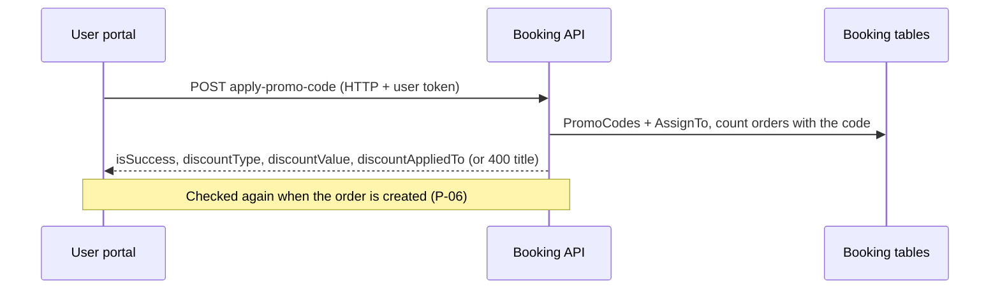

# P-05 · প্রোমো কোড প্রয়োগ

> **Bangla name:** প্রোমো কোড প্রয়োগ
>
> [← 20 · ইউজার পোর্টাল](README.md) · [সূচিপত্র](../README.md) · [ওপেন কোয়ারি](../99-open-queries.md)

## 1. নাম ও উদ্দেশ্য

**প্রোমো কোড প্রয়োগ।** সিট-নির্বাচন পেজে ([P-04](P-04-seat-selection.md)) গ্রাহক একটি প্রোমো কোড লিখে **Apply** চাপেন। সার্ভার যাচাই করে যে কোডটি এই গ্রাহক, প্রোগ্রাম, ইভেন্ট ও গ্যালারির জন্য বৈধ, এবং পেজটি দামের প্রিভিউয়ে ডিসকাউন্ট দেখায়। কোডগুলো নিজে কর্মীরা তৈরি করেন ([A-15](../10-admin-portal/A-15-promo-codes.md))।

## 2. ট্রিগার ও অ্যাক্টর

সাইন-ইন করা গ্রাহক `/{lang}/tickets/{eventId}/seats`-এ।

## 3. ব্যবসায়িক প্রবাহ

1. কোডটি টাইপ করুন (স্পেস টাইপ করা যায় না, `preventSpace`) এবং **Apply** চাপুন।
2. সফল: ডিসকাউন্ট (শতাংশ বা fixed পরিমাণ) দামের বাক্স থেকে বাদ যায় এবং কোডটি প্রয়োগ করা হয়েছে বলে দেখায়; **Remove** তা মুছে ফেলে।
3. ব্যর্থ: বাক্সের নিচে একটি বার্তা: "invalid", অথবা সার্ভার কোডটির মেয়াদ শেষ বললে "expired"। অন্য সব কারণ (শুরু হয়নি, ব্যবহারের সীমা, প্রতি-ব্যবহারকারী সীমা, ভুল প্রোগ্রাম/ইভেন্ট/গ্যালারি) একই "invalid" বার্তা দেখায়।
4. গ্যালারি, ব্লক বা লেভেল বদলালে কোডটি মুছে যায়।
5. কোডটি এখানে শুধু *যাচাই* হয়। অর্ডার পরিশোধিত হলেই এটি ব্যবহৃত হিসেবে গোনা হয় ([P-06](P-06-booking-payment.md))।

## 4. কারিগরি প্রবাহ

1. **[HTTP + user token]** `POST {services.bookings}/booking/api/v1/user-booking-order/apply-promo-code` শরীরে `{promoCode, programId, eventId (public GUID), galleryId}` (`BookingApiService.applyPromoCode`; সার্ভার `[Authorize(Policy = User)]`)।
2. `UserBookingOrderManager.ValidateApplyPromoCodeAsync`:
   1. ফাঁকা কোড → `Invalid promo code. Please enter a valid code.`;
   2. `promoCodeRepository.GetByCodeAsync(code.Trim(), eventId)` (মুছে-ফেলা নয় এমন সারিতে হুবহু, কেস-সেনসিটিভ কোড মিল; যেগুলো ইভেন্টে অ্যাসাইন করা)। কোনোটি না মিললে একই বার্তা;
   3. এখন `StartDateTime`-এর আগে → `This promo code is not active yet.`; `EndDateTime`-এর পরে → `This promo code has expired. Please use a valid code.`;
   4. ব্যবহার: কোডটি বহনকারী ও স্ট্যাটাস `Paid`, `Requested` বা `Generated` অর্ডার গোনা হয়; মোট ≥ `TotalUsageLimit` → `This code has reached its usage limit and is no longer valid.`; এই ব্যবহারকারীর গণনা ≥ `LimitPerUser` → `You have already used this promo code the maximum allowed times.`;
   5. `AssignTo` সারির মাধ্যমে যোগ্যতা: আগে প্রোগ্রাম অ্যাসাইন করা থাকতে হবে, তারপর ইভেন্ট (ফাঁকা ইভেন্ট তালিকা মানে সব ইভেন্ট), তারপর গ্যালারি (ফাঁকা গ্যালারি তালিকা মানে সব গ্যালারি) → `This promo code is not applicable to the selected program/event/gallery.`;
   6. সফলতায় ফেরত আসে `{ isSuccess: true, discountType, discountValue, discountAppliedTo }`।
3. প্রতিটি ব্যর্থতা একটি `ArgumentException`; এক্সেপশন ফিল্টার সেটিকে HTTP 400-এ পরিণত করে, যার problem-details বডির `title` হলো বার্তাটি। পোর্টাল `error.error.title` পড়ে এবং "not active" বা "expired" থাকা লেখাকে ট্রান্সলেশন key-তে মানচিহ্নিত করে (`stadium-seat-page.component.ts:545-565`)।
4. প্রিভিউ ডিসকাউন্ট `discountAppliedTo` ব্যবহার করে: `BasePrice` (বেস প্রাইসের শতাংশ) বা `DiscountedPrice` (সিস্টেম ডিসকাউন্টের পরের দামের শতাংশ); `discountType` হলো `Percentage` বা `FixedAmount`।
5. **Purchase পুরো যাচাইটি আবার করে।** `CreateAsync` আবার `ValidateApplyPromoCodeAsync` কল করে এবং নিজেই প্রোমো ডিসকাউন্ট হিসাব করে ([P-06](P-06-booking-payment.md)); কোডটি তখন আর বৈধ না থাকলে এক্সেপশন ধরা পড়ে না এবং একই বার্তায় অর্ডার প্রত্যাখ্যাত হয় (নোট 3 দেখুন)।

## 5. কম্পোনেন্ট

| ধরন | কম্পোনেন্ট |
|---|---|
| ক্লায়েন্ট | `tickets/pages/stadium-seat-page` (`applyPromoCode`, `removePromoCode`), `booking-api.service.ts:63-73` |
| সার্ভিস | Booking (`UserBookingOrderController.ApplyPromoCode`, `UserBookingOrderManager`, `PromoCodeRepository`) |
| টেবিল | `PromoCodes`, `PromoCodeAssignments` (events, galleries), `UserBookingOrders` (ব্যবহারের গণনা) |
| ক্যাশ | none |

## 6. API কন্ট্রাক্ট

| মেথড | পথ | অথ | রিকোয়েস্ট | রেসপন্স | প্রধান এরর |
|---|---|---|---|---|---|
| POST | `/booking/api/v1/user-booking-order/apply-promo-code` | User | `ApplyPromoCodeRequest` | `ApplyPromoCodeResponse` | উপরের বার্তাগুলোসহ 400 |

প্রধান নমুনা, রিকোয়েস্ট ও সফল রেসপন্স (নাম `ApplyPromoCodeRequest` / `ApplyPromoCodeResponse` থেকে; মান লোকাল সিড কোড `BCBWELCOME10`-এর জন্য, 2nd ODI Pavilion):

```json
{ "promoCode": "BCBWELCOME10", "programId": 1, "eventId": "9f0b2c1e-3b0e-4a43-9d5e-6f5f3d0c1a11", "galleryId": 5 }
```

```json
{ "isSuccess": true, "discountType": "Percentage", "discountValue": 10, "discountAppliedTo": "BasePrice" }
```

ব্যর্থতার উদাহরণ (HTTP 400): `{ "title": "This promo code has expired. Please use a valid code.", "status": 400 }`।

## 7. ডেটা ও পার্শ্বপ্রতিক্রিয়া

কোনোটিই নয়; শুধু একটি যাচাই। ব্যবহারের গণনা অর্ডার গুনে বের করা হয়, কোডের ওপর জমা রাখা হয় না ([S-16](../50-system-initiated/S-16-promo-code-status.md) গণনার নোট)।

## 8. কোড রেফারেন্স

| কী | কোথায় |
|---|---|
| পোর্টাল কল | `rvl-gobcb-user-portal/ETP-Web/src/app/modules/core/services/api/booking-api.service.ts:63-73` |
| পোর্টাল পেজ | `rvl-gobcb-user-portal/ETP-Web/src/app/modules/featured/tickets/pages/stadium-seat-page/stadium-seat-page.component.ts:519-566` |
| কন্ট্রোলার | `rvl-gobcb-backend/Services/Booking/ETP.Booking.Service/Api/UserBookingOrderController.cs:443-453` |
| ম্যানেজার | `rvl-gobcb-backend/Services/Booking/ETP.Booking.Domain/Managers/UserBookingOrderManager.cs:1135-1193` |
| রিপোজিটরি | `rvl-gobcb-backend/Services/Booking/ETP.Booking.Storage/Repositories/PromoCodeRepository.cs:13-35` |

## 9. হ্যান্ডওভার নোট

1. **কোড প্রয়োগের সময় "ব্যবহৃত" হয় না।** দুই গ্রাহক একসাথে শেষ ব্যবহারটি প্রয়োগ করতে পারে; যে আগে `Paid`/`Requested`/`Generated` হিসেবে গোনা হয় সে জিতে যায়, আর অন্যের কেনাকাটা দ্বিতীয় যাচাইয়ে প্রত্যাখ্যাত হয়।
2. **Pending অর্ডার গোনা হয় না।** এখনো `Pending` (অপরিশোধিত) অর্ডার সীমার বিরুদ্ধে গোনা হয় না, তাই পেমেন্ট চলাকালীন সীমা ছাড়িয়ে যেতে পারে।
3. **প্রত্যাখ্যাত কেনাকাটাও কিছুক্ষণ আসন ধরে রাখে।** `CreateAsync`-এ আসন Redis-এ লক হয় (`BookLevelCapacity`, ১২ মিনিটের লক) প্রোমো কোড যাচাইয়ের *আগে*; সেই মুহূর্তে কোডটি প্রত্যাখ্যাত হলে অর্ডার তৈরি হয় না কিন্তু লক ১২ মিনিট পরে মেয়াদোত্তীর্ণ হওয়ার আগ পর্যন্ত থেকে যায়, তাই ওই সময়ে ওই আসনগুলো অন্যদের কাছে অপ্রাপ্য মনে হয় `[UNCONFIRMED: Q-37]`। আবার হিসাব করা ডিসকাউন্ট প্রিভিউ থেকেও আলাদা হতে পারে ([P-04](P-04-seat-selection.md) নোট 1)।
4. **কেস-সেনসিটিভ, হুবহু মিল।** `bcbwelcome10` `BCBWELCOME10`-এর সাথে মেলে না।
5. **কোডের "active" ফ্ল্যাগ যাচাইয়ের অংশ নয়;** কেবল শুরু ও শেষের তারিখ ব্যবহার হয় ([S-16](../50-system-initiated/S-16-promo-code-status.md)); অ্যাডমিন পোর্টালে কর্মীরা যে প্রোমো কোড অপ্রকাশিত করেন সেটিও মুছে ফেলা বা মেয়াদোত্তীর্ণ না হওয়া পর্যন্ত কাজ করে `[UNCONFIRMED: Q-18]`।
6. **পোর্টাল কারণটি লুকায়।** ব্যবহারের সীমা ও প্রতি-ব্যবহারকারী সীমার প্রত্যাখ্যানের কারণ (সেগুলোর জন্যও সে "invalid" দেখায়), যদিও সার্ভার সুনির্দিষ্ট বার্তা ফেরত দেয়।

## 10. কম্পোনেন্ট সম্পর্ক



**নির্ভর করে:** [A-15](../10-admin-portal/A-15-promo-codes.md), [P-04](P-04-seat-selection.md)। **প্রভাব ফেলে:** [P-06](P-06-booking-payment.md), [A-22](../10-admin-portal/A-22-reports.md) (রিপোর্টে প্রোমোর ব্যবহার)।

## 11. ডেভেলপার টেস্ট গাইড

**লোকাল টেস্টযোগ্যতা: সম্পূর্ণ।**

| আইটেম | বিবরণ |
|---|---|
| টেস্ট ডেটা ও অ্যাকাউন্ট | ইউজার `+8801700000011` / `Passw0rd!23`; সিড করা কোড `BCBWELCOME10` (2nd ODI Pavilion), `BPLFLAT100`, `OLDCODE` (মেয়াদোত্তীর্ণ) |
| ব্রাউজার | `http://localhost:4201/en/events` → 2nd ODI → seats → Pavilion → কোড `BCBWELCOME10` → **Apply**; Network: `apply-promo-code` (200 বা 400) |
| এমুলেটর | — (দেখুন [U-04](../30-user-app/U-04-seat-selection-promo.md)) |
| Postman | `postman/services/etp-booking.postman_collection.json`: "POST /api/v1/user-booking-order/apply-promo-code" (টোকেন `{{access_token_user}}`, `etp-login-all-pools` থেকে) |
| Visual Studio debug | `UserBookingOrderManager.ValidateApplyPromoCodeAsync` (Aspire AppHost থেকে Booking সার্ভিস) |
| যাচাই | SQL: `select "Code","StartDateTime","EndDateTime","TotalUsageLimit","LimitPerUser" from etp."PromoCodes"`; গণনা: `select count(*) from etp."UserBookingOrders" where "PromoCode"='BCBWELCOME10' and "Status" in (...)` |
