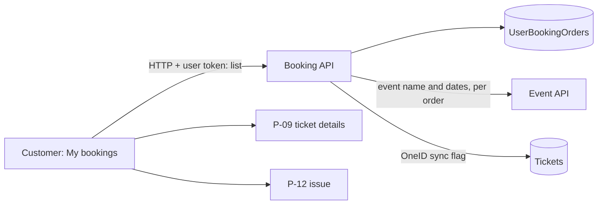

# P-07 · আমার বুকিং

> **Bangla name:** আমার বুকিং
>
> [← 20 · ইউজার পোর্টাল](README.md) · [সূচিপত্র](../README.md) · [ওপেন কোয়ারি](../99-open-queries.md)

## 1. নাম ও উদ্দেশ্য

**আমার বুকিং।** সাইন-ইন করা গ্রাহকের অর্ডারের তালিকা: ইভেন্ট, ইভেন্টের তারিখ, অর্ডার নম্বর, বুকিংয়ের তারিখ, স্ট্যাটাস (`Pending`, `Paid`, `Requested`, `Generated`, `Cancelled`), আসনের সংখ্যা এবং OneID গ্রাহকদের জন্য OneID সিঙ্কের অবস্থা ([P-10](P-10-oneid-ticket-sync.md))। কোনো সারি থেকে গ্রাহক টিকিট পেজ ([P-09](P-09-ticket-details-downloads.md)), পেমেন্ট ইনভয়েস, বা ইস্যু স্ক্রিন ([P-12](P-12-issues-chat.md)) খোলেন। পেমেন্টের পর এটিই ল্যান্ডিং পেজ ([P-06](P-06-booking-payment.md))।

## 2. ট্রিগার ও অ্যাক্টর

সাইন-ইন করা গ্রাহক। রুট `/{lang}/tickets` (`AllBookingsPageComponent`, `AuthGuard`)। হেডার মেনু থেকে এবং DgePay রিডাইরেক্টের পরে এখানে আসা যায়।

## 3. ব্যবসায়িক প্রবাহ

1. দুটি টেবিল (মোবাইলে কার্ড): **আসন্ন** (যেসব ইভেন্ট শেষ হয়নি) ও **সব**, দুটোই বুকিংয়ের তারিখ অনুযায়ী সাজানো, নতুন আগে, পেজিং ও কলাম সাজানো ব্রাউজারে।
2. `Paid`, `Requested` বা `Generated` অর্ডারে সক্রিয় **View details** বোতাম ও একটি **Invoice** বোতাম থাকে; `Cancelled` বা `Pending` অর্ডারে বোতামটি নিষ্ক্রিয় থাকে।
3. **Report an issue** যায় অর্ডারের ইস্যু স্ক্রিনে: আগে থেকেই ইস্যু থাকলে সেটি, নয়তে ফর্ম ([P-12](P-12-issues-chat.md))।

## 4. কারিগরি প্রবাহ

1. **[HTTP + user token]** `GET {services.bookings}/booking/api/v1/user-booking-order/list?page=0&pageSize=50&sortOrder=Descending` (`BookingApiService.getAllbookings`; পোর্টাল সবসময় প্রথম ৫০ চায়)। সার্ভার (`UserBookingOrderManager.GetAllByUser`) কলার অর্ডারগুলো পড়ে (`FindByUserId(User.GetId(), page, pageSize, sortOrder)`), তারপর **একটি একটি করে** Event সার্ভিস থেকে ইভেন্টের নাম ও তারিখ চায়, এবং টিকিট থেকে OneID সিঙ্ক ফ্ল্যাগ যোগ করে (`GetOneIdSyncStatusAsync`)।
2. ব্রাউজার প্রতিটি আইটেমকে একটি টেবিল সারিতে মানচিহ্নিত করে (`id` = অর্ডারের public id, `eventName`, `eventDate`, `bookingId` = অর্ডার নম্বর, `status`, `quantity`, `eventEndDate`, `oneIdSync`, `oneIdUserId`); **আসন্ন** টেবিলটি তাদের সারি যেগুলোর `eventEndDate` ভবিষ্যতে; কোনো সারিতে `oneIdUserId` থাকলে একটি **sync status** কলাম দেখা যায়।
3. View details → `/{lang}/tickets/ticket-details/{publicId}`; Invoice → `/{lang}/tickets/payment-invoice/{publicId}` (দুটোই `BookingDetailsComponent` ব্যবহার করে, যা `GET /ticketing/api/v1/booking-order-ticket/details?publicId=` লোড করে, [P-09](P-09-ticket-details-downloads.md))।
4. Report an issue → `GET /userissue/api/v1/user-issue/user-detail/{orderId}`; `User issue not found` টাইটেলসহ 400 মানে "এখনো কোনো ইস্যু নেই" এবং ফর্ম খোলে ([P-12](P-12-issues-chat.md))।

## 5. কম্পোনেন্ট

| ধরন | কম্পোনেন্ট |
|---|---|
| ক্লায়েন্ট | `tickets/pages/all-bookings-page`, `tickets/pages/booking-details`, `booking-api.service.ts:44-48` |
| সার্ভিস | Booking (`UserBookingOrderController.GetAllOrders`, `UserBookingOrderManager.GetAllByUser`); Event (ইভেন্টের নাম ও তারিখ) |
| টেবিল | `UserBookingOrders`, Ticketing `Tickets` (OneID ফ্ল্যাগ) |

## 6. API কন্ট্রাক্ট

| মেথড | পথ | অথ | রিকোয়েস্ট | রেসপন্স |
|---|---|---|---|---|
| GET | `/booking/api/v1/user-booking-order/list` | User | `page`, `pageSize`, `sortOrder` (`Ascending`/`Descending`) | পেজযুক্ত `UserBooking` (`items[]`, পেজিং ফিল্ড) |

প্রধান নমুনা (`items`-এর একটি আইটেম; প্রপার্টির নাম পোর্টালের `Booking` মডেল থেকে; মানগুলো কাল্পনিক):

```json
{ "publicId": "5b1f7a64-6c1e-4c0a-8f6e-0f3d2f9a7b10", "orderNumber": "BDI7K2M9Q", "eventName": "1st ODI, Mirpur",
  "eventStartDateTime": "2026-12-10T08:00:00Z", "eventEndDateTime": "2026-12-10T16:00:00Z",
  "createdAt": "2026-12-01T09:30:00Z", "status": "Paid", "numberOfSeats": 2,
  "oneIdUserId": null, "oneIdSync": false }
```

## 7. ডেটা ও পার্শ্বপ্রতিক্রিয়া

শুধু পড়া।

## 8. কোড রেফারেন্স

| কী | কোথায় |
|---|---|
| পেজ | `rvl-gobcb-user-portal/ETP-Web/src/app/modules/featured/tickets/pages/all-bookings-page/all-bookings-page.component.ts:97-140, 200-235` |
| টেমপ্লেট | `.../all-bookings-page/all-bookings-page.component.html:61-130` |
| API | `rvl-gobcb-user-portal/ETP-Web/src/app/modules/core/services/api/booking-api.service.ts:44-48` |
| কন্ট্রোলার / ম্যানেজার | `rvl-gobcb-backend/Services/Booking/ETP.Booking.Service/Api/UserBookingOrderController.cs:298-306`; `.../UserBookingOrderManager.cs:764-809` |

## 9. হ্যান্ডওভার নোট

1. **শুধু সবচেয়ে নতুন ৫০টি অর্ডার দেখায়**, পেজিং কন্ট্রোল যা বলুক তা মিটিয়ে: পোর্টাল একবার `page=0&pageSize=50` চায় এবং ব্রাউজারে পেজ করে।
2. **অর্ডারপ্রতি একটি ইভেন্ট লুকআপ (৫০ কল পর্যন্ত)** একটির পর একটি চলে (সমান্তরাল সংস্করণটি `DbContext` থ্রেডিং সমস্যার কারণে কমেন্ট করা ছিল)। গ্রাহকের অর্ডার জমতে থাকলে তালিকা ধীর হয়।
3. **অর্ডারের স্ট্যাটাস দেখানো একটি কাঁচা স্ট্রিং।** স্ট্যাটাসের লেখা আসে সার্ভারের enum থেকে; `Failed` একটি সার্ভার স্ট্যাটাস কিন্তু পোর্টালের মডেলে (`BookingStatus`) `Failed` নেই, তাই এমন সারিতে ডিফল্ট ধূসর ব্যাজ দেখায় এবং কোনো অ্যাকশন বোতাম থাকে না।
4. **`Pending` অর্ডারে "Pay now" নেই:** পেমেন্ট পুনরায় তৈরির এন্ডপয়েন্ট কমেন্ট করা ([P-06](P-06-booking-payment.md) নোট 7)।
5. **"আসন্ন" ফিল্টার ব্রাউজারের ঘড়ি ও ইভেন্টের শেষ সময় ব্যবহার করে।**
6. **OneID ফ্ল্যাগ দুটিবার হিসাব হয়** `GetAllByUser`-এ (`GetOneIdSyncStatusAsync`-এ দুটি অভিন্ন কল); ক্ষতিকর নয় কিন্তু অপচয়।

## 10. কম্পোনেন্ট সম্পর্ক



**নির্ভর করে:** [P-06](P-06-booking-payment.md)। **প্রভাব ফেলে:** [P-09](P-09-ticket-details-downloads.md), [P-10](P-10-oneid-ticket-sync.md), [P-12](P-12-issues-chat.md)।

## 11. ডেভেলপার টেস্ট গাইড

**লোকাল টেস্টযোগ্যতা: সম্পূর্ণ** (`+8801700000011`-এর জন্য নয়টি সিড করা অর্ডার)।

| আইটেম | বিবরণ |
|---|---|
| টেস্ট ডেটা ও অ্যাকাউন্ট | ইউজার `+8801700000011` / `Passw0rd!23`; স্ট্যাটাস Paid ×৬, Pending, Failed, Cancelled |
| ব্রাউজার | `http://localhost:4201/en/tickets`; Network: `user-booking-order/list` |
| এমুলেটর | — (দেখুন [U-06](../30-user-app/U-06-my-bookings-tickets.md)) |
| Postman | `postman/services/etp-booking.postman_collection.json`: "GET /api/v1/user-booking-order/list" (টোকেন `{{access_token_user}}`) |
| Visual Studio debug | `UserBookingOrderManager.GetAllByUser` |
| যাচাই | SQL: `select "OrderNumber","Status","NumberOfSeats","CreatedAt" from etp."UserBookingOrders" where "UserId"=...` |
