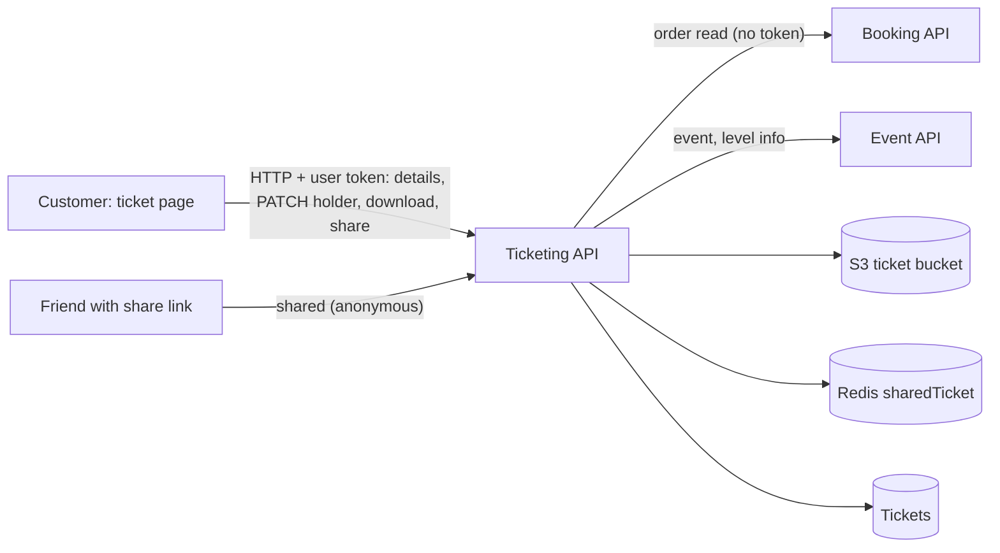

# P-09 · টিকিটের বিস্তারিত, ধারকের তথ্য, ডাউনলোড, শেয়ার ও ইনভয়েস

> **Bangla name:** টিকিটের বিস্তারিত, ধারকের তথ্য, ডাউনলোড, শেয়ার ও ইনভয়েস
>
> [← 20 · ইউজার পোর্টাল](README.md) · [সূচিপত্র](../README.md) · [ওপেন কোয়ারি](../99-open-queries.md)

## 1. নাম ও উদ্দেশ্য

**টিকিট পেজ।** পরিশোধিত অর্ডারের জন্য গ্রাহক দেখেন ইভেন্ট, ভেন্যু ও আসনের বিস্তারিত, প্রতিটি টিকিটের একটি কার্ড এবং পেমেন্টের সারসংক্ষেপ; প্রতিটি টিকিট ধারকের নাম ও ফোন পূরণ করেন; এবং টিকিট তৈরি হওয়ার পর ([P-08](P-08-ticket-generation-request.md)) একটি টিকিট PDF **ডাউনলোড** করেন (বা সব ZIP হিসেবে), টিকিটের লিংক **শেয়ার** করেন, বা **পেমেন্ট ইনভয়েস** ডাউনলোড করেন।

## 2. ট্রিগার ও অ্যাক্টর

যে গ্রাহক সাইন-ইন করে ও অর্ডারের মালিক। রুট `/{lang}/tickets/ticket-details/{publicId}` ও `/{lang}/tickets/payment-invoice/{publicId}` (দুটোই `BookingDetailsComponent`; ইনভয়েস রুট কেবল ভিউ মোড বদলায়)।

## 3. ব্যবসায়িক প্রবাহ

1. [P-07](P-07-my-bookings.md) থেকে একটি অর্ডার খুলুন: ইভেন্টের নাম ও সময়, ভেন্যু, গ্যালারি/ব্লক/লেভেল, এন্ট্রি গেট, টিকিট নম্বর ও আসনসহ টিকিট কার্ড এবং ধারকের ফর্ম।
2. তৈরির আগে: প্রতিটি টিকিটের জন্য ধারকের নাম ও ফোন লিখে সেভ চাপুন (অর্ডার `Paid` ও টিকিট `Active` থাকা অবস্থায় অনুমোদিত)।
3. তৈরির পরে: **Download** (একক PDF, লেআউটে ব্যাক-পেজ থাকলে সেটি যুক্ত করা হয়), **Download all** (ZIP, একাধিক টিকিট হলে দেখা যায়), **Share** (একটি লিংক, ফোনের শেয়ার শিট বা WhatsApp-এ পাঠানো হয়), OneID গ্রাহকদের জন্য **Sync with OneID** ([P-10](P-10-oneid-ticket-sync.md))।
4. **ইনভয়েস:** অর্ডারের জন্য একটি PDF "Ticket Invoice"।

## 4. কারিগরি প্রবাহ

1. **[HTTP + user token]** বিস্তারিত: `GET {services.tickets}/ticketing/api/v1/booking-order-ticket/details?publicId={id}` (`BookingApiService.getBookedTicketsById`, `[Authorize(User)]`)। `TicketManager.GetTicketsInfo`: Booking থেকে অর্ডার পড়ে (**[HTTP, no token]**), `userOrder.UserId == caller` হওয়া আবশ্যক (অন্যথায় `unauthorized_access`) এবং স্ট্যাটাস `Paid`, `Requested` বা `Generated`; যখন অর্ডারটি `Paid` এবং তার **কোনো টিকিট সারি নেই**, তখন সেগুলো এখনই তৈরি করে লক `create_user_ticket_{id}`-এর নিচে (দেখুন [P-08](P-08-ticket-generation-request.md) ধাপ 1); উত্তরে টিকিটের URL ফাঁকা করে দেয়; যোগ করে ইভেন্ট (`GetEventByIdForTicketing`, তাই শেষ বা নিষ্ক্রিয় হওয়া ইভেন্টও দেখায়), লেভেল/ভেন্যুর তথ্য, সংরক্ষিত পেমেন্ট টেক্সট থেকে পেমেন্ট পদ্ধতি ও ট্রানজেকশন আইডি, সাব-টোটাল, ডিসকাউন্ট এবং প্রোগ্রামের জন্য বেছে নেওয়া *টিকিট অ্যাট্রিবিউট* ([A-03](../10-admin-portal/A-03-program-settings.md))।
2. **ধারকের তথ্য:** `PATCH /ticketing/api/v1/booking-order-ticket` শরীরে `{id, ticketHolderName, ticketHolderIdentification}` (`updateTicketHoldersInfo`, `[Authorize(User)]`)। `TicketManager.UpdateTicket` টিকিটটি লোড করে এবং `ValidaUpdateTicket`-এর প্রয়োজন কলার অর্ডারের মালিক হওয়া, অর্ডার `Paid` হওয়া, টিকিট `Active` হওয়া (`not_eligible_to_update_ticket`); তারপর ছোট করা (trim) মানগুলো জমা করে।
3. **একটি ডাউনলোড:** `GET .../booking-order-ticket/download?ticketNumber=` (blob)। `GetUserTicketStreamAsync` টিকিটটি **কলার তৈরি করা** খোঁজে (`CreatedBy == userId`), `SignedTicketUrl` আবশ্যক, টিকিট বাকেট থেকে সই করা PDF পড়ে এবং টিকিটের ব্যাক-পেজ URL থাকলে ব্যাক-পেজ PDF যুক্ত করে (`MergePdfs`)।
4. **সব ডাউনলোড:** `GET .../booking-order-ticket/download-all/{orderPublicId}` (ইভেন্টের নামে ZIP)। ম্যানেজার অর্ডারের প্রতিটি টিকিট নেয়, প্রতিটিকে (ব্যাক-পেজসহ) মেমরিতে একটি ZIP-এ যোগ করে; কোনো টিকিট তৈরি না হলে `Ticket is not generated yet.` দিয়ে ব্যর্থ হয়।
5. **শেয়ার:** `GET .../booking-order-ticket/share?ticketNumber=` (টেক্সট)। `ShareTicketAsync` (শুধু নিজের টিকিট) `ShareExpiryMinutes`-এর মেয়াদের একটি প্রি-সাইন করা S3 URL বানায়, সেটিকে একই সময়ের জন্য Redis-এ `sharedTicket:{ticketNumber}_{signature}`-এ রাখে এবং `{ShareBase}?ticketNumber=...&signature=...` ফেরত দেয়। প্রাপক সেই লিংক খোলে, যা **anonymous** `GET .../booking-order-ticket/shared?ticketNumber&signature` কল করে: ম্যানেজার Redis key খোঁজে, প্রি-সাইন করা URL-এর মাধ্যমে PDF আনে, ব্যাক-পেজ যুক্ত করে এবং ফেরত দেয়। পোর্টাল লিংকটি `navigator.share`-এর কাছে দেয়, অথবা ব্রাউজারে শেয়ার শিট না থাকলে `https://api.whatsapp.com/send?text=...` খোলে।
6. **ইনভয়েস:** `GET .../booking-order-ticket/download-invoice/{publicId}` (blob)। `DownloadInvoiceByPublicId` `GetTicketsInfo` কল করে (তাই একই মালিক যাচাই প্রযোজ্য), প্রোফাইল (identity API) ও প্রোগ্রাম লোড করে এবং PdfSharp দিয়ে PDF আঁকে।
7. **অপেক্ষা করার সময় রিফ্রেশ:** অর্ডার `Requested` থাকা অবস্থায় পেজটি প্রতি ৩০ সে বিস্তারিত আবার পড়ে ([P-08](P-08-ticket-generation-request.md))।

## 5. কম্পোনেন্ট

| ধরন | কম্পোনেন্ট |
|---|---|
| ক্লায়েন্ট | `tickets/pages/booking-details`, `components/{ticket-preview,tickekt-preview-details,ticket-event-details,payment-invoice}`; `booking-api.service.ts:56-135, 168-176` |
| সার্ভিস | Ticketing (`BookingOrderTicketController`, `TicketManager`, `TicketMediaManager`); Booking (অর্ডার পড়া); Event (টিকেটিংয়ের জন্য ইভেন্ট, লেভেলের তথ্য); identity API (ইনভয়েস) |
| টেবিল | `Tickets`, Booking `UserBookingOrders`, `BookedUserRecords` |
| স্টোরেজ | টিকিট বাকেটের `{SignedBase}` PDF; লেআউট ব্যাক-পেজ `back-page-ticekt-layout` ([X-20](../60-cross-cutting/X-20-file-storage.md)) |
| Redis | `sharedTicket:{ticketNumber}_{signature}` |

## 6. API কন্ট্রাক্ট

| মেথড | পথ | অথ | রিকোয়েস্ট | রেসপন্স | প্রধান এরর |
|---|---|---|---|---|---|
| GET | `/ticketing/api/v1/booking-order-ticket/details` | User | `publicId` | `UserBookingResponse` | `unauthorized_access` |
| PATCH | `/ticketing/api/v1/booking-order-ticket` | User | `TicketUpdateRequest {id, ticketHolderName, ticketHolderIdentification}` | একই | `not_eligible_to_update_ticket`, `unauthorized_access` |
| GET | `/ticketing/api/v1/booking-order-ticket/download` | User | `ticketNumber` | PDF | `Ticket is not generated yet.`, unauthorized |
| GET | `/ticketing/api/v1/booking-order-ticket/download-all/{orderPublicId}` | User | path | ZIP | `Ticket is not generated yet.` |
| GET | `/ticketing/api/v1/booking-order-ticket/share` | User | `ticketNumber` | লিংকের টেক্সট | `Ticket is not genetared yet.` |
| GET | `/ticketing/api/v1/booking-order-ticket/shared` | **anonymous** | `ticketNumber`, `signature` | PDF | `Unauthorized access` (মেয়াদোত্তীর্ণ বা অজানা) |
| GET | `/ticketing/api/v1/booking-order-ticket/download-invoice/{publicId}` | User | path | PDF | unauthorized |

প্রধান নমুনা, `PATCH /ticketing/api/v1/booking-order-ticket` (নাম `TicketUpdateRequest` থেকে; মানগুলো কাল্পনিক):

```json
{ "id": 301, "ticketHolderName": "Nadia Rahman", "ticketHolderIdentification": "1711111111" }
```

## 7. ডেটা ও পার্শ্বপ্রতিক্রিয়া

`Tickets`-এ ধারকের ফিল্ড; পরিশোধিত অর্ডার প্রথমবার দেখলে খসখসে টিকিট সারি তৈরি; Redis শেয়ার key; অন্য কোনো লেখা নেই। অ্যাক্টিভিটি লগ টিকিটের আপডেট রেকর্ড করে ([X-24](../60-cross-cutting/X-24-activity-logging.md))।

## 8. কোড রেফারেন্স

| কী | কোথায় |
|---|---|
| পোর্টাল | `rvl-gobcb-user-portal/ETP-Web/src/app/modules/featured/tickets/components/tickekt-preview-details/ticket-preview-details.component.ts:90-180`; `.../ticket-preview/ticket-preview.component.ts:140-200`; `.../pages/booking-details/booking-details.component.ts:25-42` |
| কন্ট্রোলার | `rvl-gobcb-backend/Services/Ticketing/ETP.Ticketing.Service/Api/BookingOrderTicketController.cs:71-108, 346-362, 380-425, 505-519` |
| ম্যানেজার | `rvl-gobcb-backend/Services/Ticketing/ETP.Ticketing.Domain/Managers/TicketManager.cs:146-257, 1890-1960, 2008-2200` এবং স্ট্রিম মেথডগুলো (`GetUserTicketStreamAsync`, `GetUserAllTicketStreamAsync`) |
| রিপোজিটরি | `rvl-gobcb-backend/Services/Ticketing/ETP.Ticketing.Storage/Repositories/TicketRepository.cs:41-55` |

## 9. হ্যান্ডওভার নোট

1. **Download-all-এ কোনো মালিক যাচাই নেই।** `GetUserAllTicketStreamAsync` কেবল অর্ডারের id দিয়ে টিকিট পড়ে; কন্ট্রোলারে ইউজার টোকেন লাগে কিন্তু মালিক লাগে না। যে কোনো সাইন-ইন করা গ্রাহক অন্য অর্ডারের public id জানলে সেই অর্ডারের সই করা টিকিট ডাউনলোড করতে পারে (`download`-এর সাথে তুলনা করুন, যেখানে `CreatedBy` দিয়ে ফিল্টার হয়)। মালিক যাচাই যোগ করুন ([X-18](../60-cross-cutting/X-18-endpoints-without-auth.md)) `[UNCONFIRMED: Q-41]`।
2. **ধারকের ফিল্ডে সার্ভার-সাইড যাচাই দুর্বল।** `ValidaUpdateTicket` যাচাই করে *সংরক্ষিত* টিকিটের মান (নাম ও ফোন ২০ অক্ষর পর্যন্ত), যা সেভ হওয়া মান নয়; রিকোয়েস্টের মানগুলো শুধু trim করা হয়। সীমাগুলো ব্রাউজারে (নামে অক্ষর/স্পেস ≤ ১৭; বিস্তারিতের ফর্মে প্রথমে ০ ছাড়া **১০ সংখ্যা** নেয় অথচ সিট পেজে ১১ সংখ্যা চায়, [P-04](P-04-seat-selection.md) নোট 6)।
3. **দেখলেই ডেটা তৈরি হয়।** পরিশোধিত অর্ডারের প্রথম বিস্তারিত কল সারি না থাকলে টিকিট সারি তৈরি করে, তাই একটি রিড পথ ডেটাবেসে লেখে (Redis লক দিয়ে সুরক্ষিত)।
4. **শেয়ার করা লিংক মেয়াদ শেষ না হওয়া পর্যন্ত সবার জন্য কাজ করে**; এতে কোনো লগইন থাকে না, আর প্রি-সাইন করা URL সিগনেচার দিয়ে Redis-এ থাকে। Redis ফ্লাশ হলে সব শেয়ার করা লিংক মৃত হয়।
5. **শেয়ার টেক্সটে বাগ।** পোর্টাল শেয়ার টেক্সটে একটি HTML `<a href>` স্ট্রিং বসায়; নেটিভ শেয়ার শিট ও WhatsApp সেটিকে URL-এর চারপাশে কাঁচা লেখা হিসেবে দেখায়।
6. **একটি এরর টেক্সটে বানানভুল:** `Ticket is not genetared yet.` (শেয়ার) — ক্লায়েন্টরা এটিই পায়।
7. **ZIP তৈরি হয় মেমরিতে** পুরো অর্ডারের জন্য; খুব বড় অর্ডারে Ticketing সার্ভিসের অনেক মেমরি ব্যবহৃত হতে পারে।
8. **ব্যাক-পেজ প্রতিটি ডাউনলোডেই মার্জ হয়** (কোনো ক্যাশ নেই), যা প্রতি রিকোয়েস্টে একটি লেআউট-বাকেট রিড ও একটি PDF মার্জের খরচ বাড়ায় ([A-13](../10-admin-portal/A-13-ticket-layouts.md))।
9. **টিকিট বাকেটের নামকরণ ও সাইন করা কুকি** (`ticekt` বানান, CloudFront) কর্মীদের স্ক্রিনের জন্য প্রযোজ্য, এই গ্রাহক-ডাউনলোডগুলোর জন্য নয় — যেগুলো Ticketing সার্ভিসের মধ্য দিয়ে স্ট্রিম হয় ([X-20](../60-cross-cutting/X-20-file-storage.md))।

## 10. কম্পোনেন্ট সম্পর্ক



**নির্ভর করে:** [P-06](P-06-booking-payment.md), [P-08](P-08-ticket-generation-request.md), [S-08](../50-system-initiated/S-08-ticket-signing.md)। **প্রভাব ফেলে:** [P-10](P-10-oneid-ticket-sync.md), [C-02](../40-checker-app/C-02-offline-ticket-download.md) (চেকার এই টিকিটগুলো যাচাই করে)।

## 11. ডেভেলপার টেস্ট গাইড

**লোকাল টেস্টযোগ্যতা: আংশিক।** সিড করা অর্ডারে টিকিট সারি আছে, কিন্তু TSP সই করা ডামি, তাই সই-করা PDF ডাউনলোড সিডের ওপর নির্ভর করে (`docs/local-dev.md`: "সিড *ফলাফল* দেয়"); ধারকের সম্পাদনা, বিস্তারিত ও ইনভয়েস কাজ করে।

| আইটেম | বিবরণ |
|---|---|
| টেস্ট ডেটা ও অ্যাকাউন্ট | ইউজার `+8801700000011` / `Passw0rd!23`; একটি সিড করা `Paid` অর্ডার |
| ব্রাউজার | `http://localhost:4201/en/tickets` → **View details**; একজন ধারক সম্পাদনা করুন; Network: `details`, `booking-order-ticket` PATCH, `download`, `share`, `download-invoice` |
| এমুলেটর | — ([U-06](../30-user-app/U-06-my-bookings-tickets.md)) |
| Postman | `postman/services/etp-ticketing.postman_collection.json`: "GET /api/v1/booking-order-ticket/details", "PATCH /api/v1/booking-order-ticket", "GET /api/v1/booking-order-ticket/download", "GET /api/v1/booking-order-ticket/download-all/{orderPublicId}", "GET /api/v1/booking-order-ticket/share", "GET /api/v1/booking-order-ticket/shared", "GET /api/v1/booking-order-ticket/download-invoice/{publicId}" |
| Visual Studio debug | `TicketManager.GetTicketsInfo`, `UpdateTicket`, `ShareTicketAsync`, `DownloadSharedTicketAsync` |
| যাচাই | SQL: `select "TicketNumber","Status","TicketHolderName","TicketHolderIdentification","SignedTicketUrl" from etp."Tickets" where "BookingOrderPublicId"=...`; `redis-cli KEYS 'sharedTicket:*'` |
