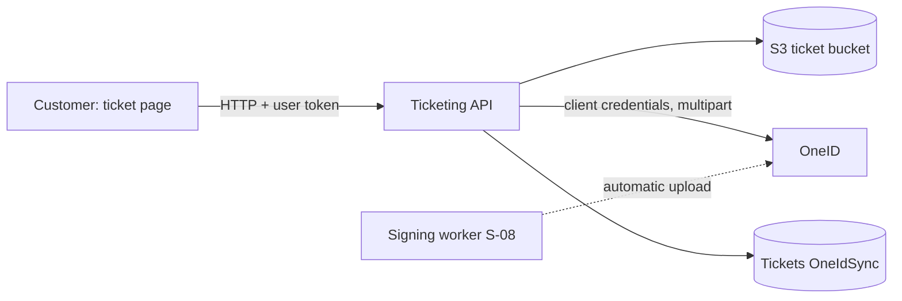

# P-10 · OneID ওয়ালেটে টিকিট সিঙ্ক

> **Bangla name:** OneID টিকিট সিঙ্ক
>
> [← 20 · ইউজার পোর্টাল](README.md) · [সূচিপত্র](../README.md) · [ওপেন কোয়ারি](../99-open-queries.md)

## 1. নাম ও উদ্দেশ্য

**OneID টিকিট সিঙ্ক।** যে গ্রাহকরা OneID দিয়ে সাইন ইন করেছেন ([X-08](../60-cross-cutting/X-08-oneid-sso.md)) তারা তাদের সই করা টিকিট PDF নিজের OneID ওয়ালেটে জমা রাখতে পারেন। টিকিট সই হওয়ার সময় প্ল্যাটফর্ম এটি স্বয়ংক্রিয়ভাবে করে ([S-08](../50-system-initiated/S-08-ticket-signing.md)); স্বয়ংক্রিয় আপলোড ব্যর্থ হলে গ্রাহক **Sync with OneID** দিয়ে হাতে পুনরায় করতে পারেন।

## 2. ট্রিগার ও অ্যাক্টর

সাইন-ইন করা গ্রাহক যার প্রোফাইলের `sso_provider` হলো `oneid`, একটি `Generated` অর্ডারের টিকিট পেজে ([P-09](P-09-ticket-details-downloads.md)); সব টিকিট সিঙ্ক না হওয়া পর্যন্ত বোতামটি দেখা যায়।

## 3. ব্যবসায়িক প্রবাহ

গ্রাহক **Sync with OneID** চাপেন; পেজটি রিলোড হয় এবং আমার বুকিং তালিকা ([P-07](P-07-my-bookings.md)) অর্ডরভিত্তিক সিঙ্কের অবস্থা দেখায়।

## 4. কারিগরি প্রবাহ

1. **[HTTP + user token]** `POST {services.tickets}/ticketing/api/v1/booking-order-ticket/sync-order-to-oneid/{orderPublicId}` (কোনো শরীর নেই; `BookingApiService.syncOrderToOneId`)। `[Authorize(User)]`, কিন্তু `SyncOrderTicketsToOneIdAsync` কলার সাথে অর্ডারের মালিক তুলনা করে না।
2. অর্ডারের প্রতিটি টিকিটের জন্য `SyncTicketToOneIdAsync(ticketNumber)`: আগেই সিঙ্ক হলে সফল "already synced"; `SignedTicketUrl` না থাকলে ব্যর্থ "Ticket has not been generated yet"; অর্ডারে `OneIdUserId` না থাকলে ব্যর্থ; অন্যথায় টিকিট বাকেট থেকে সই করা PDF পড়ে এবং `OneIdManager.SyncDocumentWithVdsQrAsync` কল করে।
3. **[HTTP, static credentials] → OneID:** `POST {OneIdSettings:TokenUrl}` দিয়ে টোকেন (client credentials, Basic `AuthorizationToken`), Redis-এ `OneId:AuthToken`-এ ক্যাশ করা; ডকুমেন্ট multipart `POST {OneIdSettings:DocumentSyncUrl}`-এ `one_id`, `document_type=pdf`, `document_id` (টিকিট নম্বর), `file`, এবং শুধু উপস্থিত থাকলেই `vds_qr`। 401 হলে টোকেন একবার রিফ্রেশ করে আবার চেষ্টা করে। VDS QR-এর মান হার্ড-কোড করা `null` (TODO চিহ্নিত), তাই কখনো পাঠানো হয় না।
4. সফলতায় টিকিট পায় `OneIdSync = true` ও `OneIdSyncedAt`। উত্তর হলো `OneIdOrderSyncResponse {success, message, totalTickets, syncedTickets, failedTickets, alreadySyncedTickets, results[]}` (`success` মিথ্যা হলেও HTTP 200)।
5. পোর্টাল `success` উপেক্ষা করে: যেকোনো HTTP সফলতায় বিস্তারিত রিলোড করে; HTTP এররে শুধু analytics-এ লগ করে।
6. একক টিকিটের এন্ডপয়েন্ট `POST .../sync-to-oneid/{ticketNumber}` আছে যার কোনো পোর্টাল কলার নেই।

## 5. কম্পোনেন্ট

| ধরন | কম্পোনেন্ট |
|---|---|
| ক্লায়েন্ট | `tickets/components/ticket-preview` (`syncWithOneId`), `booking-api.service.ts:254-259` |
| সার্ভিস | Ticketing (`BookingOrderTicketController`, `TicketManager`, `OneIdManager`) |
| টেবিল / Redis | `Tickets` (`OneIdSync`, `OneIdSyncedAt`); `OneId:AuthToken` |
| বাহ্যিক | OneID-এর টোকেন ও ডকুমেন্ট-সিঙ্ক API |

## 6. API কন্ট্রাক্ট

| মেথড | পথ | অথ | রেসপন্স |
|---|---|---|---|
| POST | `/ticketing/api/v1/booking-order-ticket/sync-order-to-oneid/{orderPublicId}` | User | `OneIdOrderSyncResponse` |
| POST | `/ticketing/api/v1/booking-order-ticket/sync-to-oneid/{ticketNumber}` | User | `OneIdSyncResponse` (404 `Ticket not found`) |

প্রধান নমুনা, রেসপন্স (মানগুলো কাল্পনিক):

```json
{ "success": true, "message": "Successfully synced 2 ticket(s). 0 ticket(s) were already synced.",
  "totalTickets": 2, "syncedTickets": 2, "failedTickets": 0, "alreadySyncedTickets": 0, "results": [] }
```

## 7. ডেটা ও পার্শ্বপ্রতিক্রিয়া

`Tickets.OneIdSync`, OneID-তে জমা একটি PDF, একটি Redis টোকেন।

## 8. কোড রেফারেন্স

| কী | কোথায় |
|---|---|
| পোর্টাল | `rvl-gobcb-user-portal/ETP-Web/src/app/modules/featured/tickets/components/ticket-preview/ticket-preview.component.ts:260-285` |
| কন্ট্রোলার | `rvl-gobcb-backend/Services/Ticketing/ETP.Ticketing.Service/Api/BookingOrderTicketController.cs:534-565` |
| ম্যানেজার | `.../ETP.Ticketing.Domain/Managers/TicketManager.cs:2575-2800`; `.../OneIdManager.cs:36-330` |

## 9. হ্যান্ডওভার নোট

1. **মালিক যাচাই নেই:** যে কোনো সাইন-ইন করা গ্রাহক তার জানা যেকোনো অর্ডার বা টিকিট আইডির সিঙ্ক চালু করতে পারে; তবু PDF সেই অর্ডারের নিজ OneID অ্যাকাউন্টেই যায়, তাই প্রভাব সীমাবদ্ধ — অনিচ্ছাকৃত আপলোড `[UNCONFIRMED: Q-41]`।
2. **ব্যর্থতা গ্রাহকের কাছে নীরব** (HTTP 200 সহ `success: false`)।
3. **কোনো VDS QR পাঠানো হয় না** (কোডে TODO), যদিও কলটি তা সমর্থন করে।
4. **OneID-এর এন্ডপয়েন্ট ও ক্রেডেনশিয়াল রিপোজিটরিতে নেই** (`[see User Secrets]`); লোকালে OneID ডামি, তাই প্রকৃত সিঙ্ক পরীক্ষা করা যায় না `[UNCONFIRMED: Q-06]`।

## 10. কম্পোনেন্ট সম্পর্ক



**নির্ভর করে:** [X-08](../60-cross-cutting/X-08-oneid-sso.md), [P-08](P-08-ticket-generation-request.md), [S-08](../50-system-initiated/S-08-ticket-signing.md)। **প্রভাব ফেলে:** [P-07](P-07-my-bookings.md)।

## 11. ডেভেলপার টেস্ট গাইড

**লোকাল টেস্টযোগ্যতা: লোকালে সম্ভব নয়** (OneID ডামি; `/p/oneid`-এর ফেক OneID কেবল লগইন কভার করে, `docs/user-portal-local.md`)।

| আইটেম | বিবরণ |
|---|---|
| টেস্ট ডেটা ও অ্যাকাউন্ট | `+8801700000011`-এর জন্য ফেক OneID লগইন |
| ব্রাউজার | একটি `Generated` অর্ডারের টিকিট পেজ; OneID ব্যবহারকারীদের জন্য বোতাম দৃশ্যমান |
| এমুলেটর | — |
| Postman | `postman/services/etp-ticketing.postman_collection.json`: "POST /api/v1/booking-order-ticket/sync-order-to-oneid/{orderPublicId}", "POST /api/v1/booking-order-ticket/sync-to-oneid/{ticketNumber}" |
| Visual Studio debug | `TicketManager.SyncTicketToOneIdAsync`, `OneIdManager.ExecuteWithRetryAsync` |
| যাচাই | `Tickets."OneIdSync"`-এ SQL; `redis-cli GET OneId:AuthToken` |
