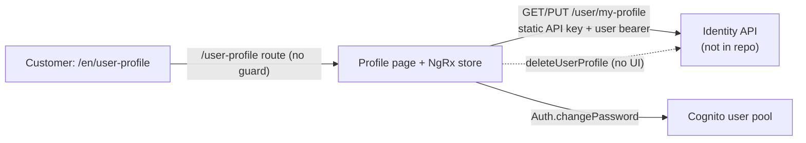

# P-11 · প্রোফাইল

> **Bangla name:** প্রোফাইল দেখা ও আপডেট
>
> [← 20 · ইউজার পোর্টাল](README.md) · [সূচিপত্র](../README.md) · [ওপেন কোয়ারি](../99-open-queries.md)

## 1. নাম ও উদ্দেশ্য

**প্রোফাইল দেখা ও আপডেট।** সাইন-ইন করা গ্রাহক তার জন্য সংরক্ষিত ব্যক্তিগত তথ্য দেখেন, এবং প্ল্যাটফর্ম যে ফিল্ডগুলো সম্পাদনা করতে দেয় সেগুলো ঠিক করতে পারেন: জন্ম তারিখ, পরিচয়পত্র এবং ঠিকানা। নাম, ফোন ও ইমেইল শুধু পড়ার জন্য দেখানো হয়। একই পেজে **Change password** ফর্মও আছে ([X-09](../60-cross-cutting/X-09-user-forgot-password.md) পাসওয়ার্ড ভুলে যাওয়ার পথটি বর্ণনা করে; এখানকার change-password হলো Cognito কল)।

প্রোফাইলটি নিজে থাকে **identity API**-তে, যা এই রিপোজিটরিতে নেই ([X-06](../60-cross-cutting/X-06-user-registration.md) বিভাজনটি ব্যাখ্যা করে) `[UNCONFIRMED: Q-01]`।

## 2. ট্রিগার ও অ্যাক্টর

গ্রাহক `/en/user-profile`-এ (একটি `:lang` অংশ সবসময় থাকে, [P-13](P-13-language-switch.md))। রুটে **কোনো AuthGuard নেই** — `app-routing.module.ts:41-46`-এ `tickets` ও `issues`-এর জন্য `canActivate` আছে কিন্তু `user-profile`-এর জন্য নেই। বাস্তবে পেজটির এখনো বৈধ সেশন লাগে, কারণ কম্পোনেন্টটি সরাসরি NgRx স্টোর থেকে `user_data.name` রেন্ডার করে; অ্যাননিমাস ভিজিটে টেমপ্লেটে এরর ছুঁড়ে দেয়, রিডাইরেক্ট করে না।

## 3. ব্যবসায়িক প্রবাহ

1. পেজটি **Profile** ট্যাবে খোলে: নাম, ফোন, ইমেইল (পড়ার জন্য) এবং সম্পাদনাযোগ্য ফিল্ডগুলো।
2. একটি OneID গ্রাহকের (`sso_provider === 'oneid'`) ক্ষেত্রে DOB, পরিচয়পত্র ও ঠিকানার ফিল্ডগুলো লুকানো থাকে ও যাচাই হয় না, কারণ OneID এই তথ্যই দিয়ে দেয়।
3. DOB / পরিচয়পত্র / ঠিকানা সম্পাদনা করে সেভ করলে আপডেট পাঠানো হয়; পেজটি সবুজ ব্যানার `user_updated_and_verified` দেখায়, অথবা সার্ভারের স্ট্যাটাস কোড থেকে মানচিহ্নিত লাল ব্যানার।
4. **Change password** ট্যাব (OneID ব্যবহারকারীদের জন্য লুকানো) পুরোনো ও নতুন পাসওয়ার্ড চায় এবং সরাসরি Cognito কল করে।

## 4. কারিগরি প্রবাহ

1. **[HTTP + user token] → identity API:** `GET {services.identity}/user/my-profile` (`IdentityApiService.fetchUserProfile`, `identity-api.service.ts:66-71`)। দুটি হেডার প্রযোজ্য: `environment.headerkey` থেকে static API key (সার্ভিসে একবার সেট করা, `:30-32`) এবং `TokenInterceptor` কর্তৃক যোগ করা Cognito bearer। রেসপন্স `UserProfile { user_data }`।
2. কম্পোনেন্টটি `user_data`-কে একটি reactive form-এ মানচিহ্নিত করে (`user-profile-pages.component.ts:78-86`)। কন্ট্রোলসমূহ: `fullName`, `phoneNumber`, `email`, `dob`, `verification_type`, `verification_id`, `address`।
3. **[HTTP + user token] → identity API:** `PUT {services.identity}/user/my-profile` (`updateUserProfile`, `:100-105`) শরীরে `UpdateProfile { verification_id, verification_type, address, dob }` — কেবল এই চারটি। নাম, ফোন ও ইমেইল এখান থেকে বদলানো যায় না। NgRx-এর মাধ্যমে ছাড়া হয়: `updateUserProfileInit` → effect `updateUserProfile$` (`identity.effects.ts:346-371`)।
4. PUT-এ **কোনো সুস্পষ্ট হেডার অবজেক্ট পাঠানো হয় না**; এটি সম্পূর্ণভাবে `TokenInterceptor`-এর ওপর নির্ভর করে, যার allow-list সাবস্ট্রিং `/user/my-profile` মিলিয়ে দেখে (`token.interceptor.ts:152, 189-193`)। ফলে GET-এ থাকা static `headerkey` PUT-এ *প্রয়োগ* হয় না `[UNCONFIRMED: Q-42]`।
5. **পাসওয়ার্ড পরিবর্তন:** `CognitoService.changePassword(old, new)` (`user-profile-pages.component.ts:319`) → Amplify `Auth.changePassword(cognitoUser, oldPassword, newPassword)` (`cognito.service.ts:182-198`)। কোনো GoBCB সার্ভিস জড়িত নয়, তাই ফল কখনো প্ল্যাটফর্মের নিজস্ব টেবিলে পৌঁছায় না।
6. **পোর্টালে অ্যাকাউন্ট মুছে ফেলার কোনো UI নেই।** `deleteUserProfile()` (`identity-api.service.ts:91-98`) ও `deleteProfile$` effect (`identity.effects.ts:514-543`) আছে কিন্তু কোনো কম্পোনেন্ট সেগুলো ছাড়ে না; অ্যাকশনটি কেবল ইউজার অ্যাপ থেকে পৌঁছানো যায় ([X-11](../60-cross-cutting/X-11-delete-account-force-update.md))।

## 5. কম্পোনেন্ট

| ধরন | কম্পোনেন্ট |
|---|---|
| ক্লায়েন্ট | `featured/profile/pages/user-profile-pages.component.ts` + `.html`, `featured/profile/profile-routing.module.ts` |
| ক্লায়েন্ট সার্ভিস | `core/services/api/identity-api.service.ts`, `shared/services/cognito.service.ts`, `core/services/identity-store.service.ts`, NgRx `identity.effects.ts` |
| সার্ভিস | প্রোফাইলের জন্য Identity API (এই রিপোজিটরিতে নেই); পাসওয়ার্ডের জন্য Cognito user pool |
| টেবিল | Identity API-এর নিজস্ব ইউজার টেবিল (এই রিপোজিটরিতে নেই) |
| Redis | none |

## 6. API কন্ট্রাক্ট

| মেথড | পথ | অথ | রিকোয়েস্ট | রেসপন্স / এরর |
|---|---|---|---|---|
| GET | `{services.identity}/user/my-profile` | Static API key + user bearer | — | `UserProfile`; 404 `user_not_found` |
| PUT | `{services.identity}/user/my-profile` | User bearer (ইন্টারসেপ্টরের মাধ্যমে) | `UpdateProfile` | `user_updated_and_verified`, `user_update_and_verification_failed`, `invalid_request`, `server_error` |
| DELETE | `{services.identity}/user/delete-my-profile` | User bearer | — | পোর্টাল থেকে পৌঁছানো যায় না |
| — | Cognito `ChangePassword` | user pool সেশন | `oldPassword`, `newPassword` | `IncorrectUsernameOrPasswordException`, `PasswordResetRequiredException`, … (মানচিহ্নিত, §9 দেখুন) |

নমুনা, GET রেসপন্স (মানগুলো কাল্পনিক; আকর্ষণের বিষয় `UserProfile.user_data`):

```json
{
  "user_data": {
    "registration_datetime": "2026-03-14T09:22:31Z",
    "address": "House 42, Road 7, Dhanmondi, Dhaka-1209",
    "email": "rafiq.hasan@example.com",
    "name": "Rafiq Hasan",
    "user_id": "a1c9f0de-6b2e-4a71-9f30-2c9d5b8e77aa",
    "role": "user",
    "dob": "1994-07-21T00:00:00Z",
    "temp_user_id": "b7e31044-2f5a-4c9d-8e11-77a0b3c1d902",
    "phone": "+8801700000011",
    "verified": true,
    "isProfileCompleted": true,
    "sso_provider": "oneid",
    "one_id": "8812345678901234",
    "nonsensitive_data": { "verification": { "verification_id": "1994567890123", "verification_type": "nid" } },
    "sensitive_data": null
  }
}
```

নমুনা, PUT রিকোয়েস্টের শরীর — হুবহু সম্পাদনাযোগ্য চারটি ফিল্ড:

```json
{ "verification_id": "1994567890123", "verification_type": "nid", "address": "House 42, Road 7, Dhanmondi, Dhaka-1209", "dob": "1994-07-21T00:00:00" }
```

## 7. ডেটা ও পার্শ্বপ্রতিক্রিয়া

শুধু identity API-এর ইউজার সারি স্পর্শ হয় (`dob`, ঠিকানা, যাচাইকরণ ফিল্ড)। পাসওয়ার্ড পরিবর্তনের কল Cognito pool-এর পাসওয়ার্ড লেখে। `etp` স্কিমায় কিছুই লেখা হয় না, কোনো কিউ বার্তা প্রকাশ হয় না, কোনো ফাইল জমা হয় না।

## 8. কোড রেফারেন্স

| কী | কোথায় |
|---|---|
| রুট | `rvl-gobcb-user-portal/ETP-Web/src/app/app-routing.module.ts:41-46`, `:67-71` |
| কম্পোনেন্ট | `rvl-gobcb-user-portal/ETP-Web/src/app/modules/featured/profile/pages/user-profile-pages.component.ts:36-370` |
| টেমপ্লেট | `.../user-profile-pages.component.html:11, 80-95, 187-286, 328-329, 410` |
| API সার্ভিস | `rvl-gobcb-user-portal/ETP-Web/src/app/core/services/api/identity-api.service.ts:23-152` |
| মডেল | `rvl-gobcb-user-portal/ETP-Web/src/app/core/models/user-profile.ts:3-68` |
| NgRx | `.../core/services/identity-store.service.ts:99-101`, `.../store/identity.effects.ts:346-371, 514-543` |
| ইন্টারসেপ্টর | `.../core/interceptors/token.interceptor.ts:152, 189-193` |
| Cognito | `.../shared/services/cognito.service.ts:182-198` |

## 9. হ্যান্ডওভার নোট

1. **`/user-profile`-এ কোনো AuthGuard নেই।** অ্যাননিমাস ভিজিট রিডাইরেক্ট হয় না; এটি রেন্ডার হয় ও খালি স্টোরে এরর ছুঁড়ে দেয়। [X-17](../60-cross-cutting/X-17-authz-client-side.md) নোট 1-এর সাথে সামঞ্জস্যপূর্ণ।
2. **নাম, ফোন ও ইমেইল শুধু পড়ার।** UI সেগুলো নিষ্ক্রিয় করে রেন্ডার করে এবং PUT শরীরে এসব ফিল্ড নেই, তাই গ্রাহক পোর্টাল থেকে ভুল টাইপ করা ফোন নম্বর ঠিক করতে পারেন না `[UNCONFIRMED: Q-43]`।
3. **Static API key হেডারের অসমতা।** GET `environment.headerkey` পাঠায়; PUT পাঠায় না (শুধু ইন্টারসেপ্টর)। আজ এটি কাজ করে কারণ allow-list মেলে, কিন্তু কড়া identity API আপডেটটি ভেঙে দিত `[UNCONFIRMED: Q-42]`।
4. **পরিচয়পত্রের যাচাই কাস্টম।** `nid`-এ ১০, ১৩ বা ১৭ সংখ্যার অঙ্ক লাগে; `passport` অবশ্যই অক্ষর-সংখ্যা হতে হবে (`user-profile-pages.component.ts:215-237`)। কোনো ফিল্ডের সর্বোচ্চ দৈর্ঘ্য নেই।
5. **সর্বনিম্ন বয়স ১২** ক্লায়েন্ট-সাইডে date picker-এর `[max]` দিয়ে প্রয়োগ হয় (`:209-213`); identity API আবার যাচাই করে কি না জানা নেই `[UNCONFIRMED: Q-01]`।
6. **OneID গ্রাহকরা DOB / ঠিকানা / যাচাইকরণ সম্পূর্ণ বাদ দেয়** (ভ্যালিডেটর মুছে দেওয়া ও ফিল্ড লুকানো, `:122-128` ও `html:94`)।
7. **কাঁচা স্ট্যাটাস স্ট্রিং মিলিয়ে দেখা হয়, দেখানো হয় না।** effect পড়ে `success.status_message` / `error.error.status_message` কিন্তু টেমপ্লেট অনূদিত key রেন্ডার করে (`MESSAGES.SOMETHING_WRONG`), তাই সার্ভারের নতুন স্ট্যাটাস কোড নীরবে সাধারণ বার্তা দেয়। পাসওয়ার্ড ট্যাব `{{ error | translate }}` করে, তাই মানচিহ্নিত নয় এমন একটি Cognito এরর কাঁচা key স্ট্রিং হিসেবে দেখায় (`html:410`)।
8. **দ্বিতীয়, পুরোনো `User`/`UserData` ইন্টারফেস** রয়েছে `featured/profile/models/user.ts:1-30`-এ (`ekyc` ও `payment` ফিল্ডসহ) এবং Issues মডিউল ব্যবহার করে; এটি প্রোফাইল মডেলের কন্ট্রাক্ট নয়।

## 10. কম্পোনেন্ট সম্পর্ক



**নির্ভর করে:** [X-06](../60-cross-cutting/X-06-user-registration.md) (অ্যাকাউন্ট থাকতে হবে), [X-07](../60-cross-cutting/X-07-user-password-login.md) (সেশন), [P-13](P-13-language-switch.md) (`/en` অংশ)। **প্রভাব ফেলে:** পরবর্তী কোনোটিতে নয় — কোনো প্ল্যাটফর্ম টেবিল প্রোফাইল থেকে পড়া হয় না, তাই DOB বা ঠিকানার পরিবর্তন কখনো টিকিট ধারকের ডেটায় পৌঁছায় না ([P-09](P-09-ticket-details-downloads.md) নিজস্ব কপি রাখে)।

## 11. ডেভেলপার টেস্ট গাইড

**লোকাল টেস্টযোগ্যতা: আংশিক।** পেজটি `/p/identity`-এর লোকাল identity stub-এর বিপরীতে (`docs/user-portal-local.md`) সম্পূর্ণভাবে চলে; OTP `123456` দিয়ে স্টাব করা।

| আইটেম | বিবরণ |
|---|---|
| টেস্ট ডেটা ও অ্যাকাউন্ট | সিড করা ইউজার `+8801700000011`; `/p/identity` stub একটি নির্দিষ্ট `user_data` ফেরত দেয় — DOB/ঠিকানা সম্পাদনা করে DevTools-এ নিশ্চিত করুন যে PUT শরীরে হুবহু চারটি ফিল্ড আছে |
| ব্রাউজার | `http://localhost:4200/en/user-profile`; Network ট্যাবে: `GET` তারপর `PUT /user/my-profile`, `Authorization` ও static key দেখুন; বৈধ NID (১০/১৩/১৭ সংখ্যা) দিয়ে সফলের ব্যানার ও ৫ সংখ্যার একটি দিয়ে এররের ব্যানার নিশ্চিত করুন |
| এমুলেটর | — |
| Postman | কোনো কালেকশনে নেই — `services.identity` একটি বাহ্যিক API, যার কোনো GoBCB Postman কালেকশন নেই `[UNCONFIRMED: Q-01]` |
| Visual Studio debug | লোকাল ব্রেকপয়েন্ট লক্ষ্য নেই: identity API এই সলিউশনে নেই। পোর্টালের HTTP ট্রাফিক দেখতে কেবল Aspire AppHost ব্যবহার করুন (`docs/local-dev.md` §6) |
| যাচাই | Floci কনসোল লগে stub পাওয়া PUT শরীর; Cognito user pool কনসোলে পাসওয়ার্ড পরিবর্তন |
