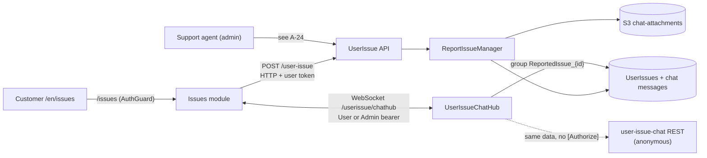

# P-12 · ইস্যু রিপোর্ট ও সাপোর্টের সাথে চ্যাট

> **Bangla name:** ইস্যু রিপোর্ট ও সাপোর্টের সাথে চ্যাট
>
> [← 20 · ইউজার পোর্টাল](README.md) · [সূচিপত্র](../README.md) · [ওপেন কোয়ারি](../99-open-queries.md)

## 1. নাম ও উদ্দেশ্য

**ইস্যু রিপোর্ট ও সাপোর্টের সাথে চ্যাট।** গ্রাহক তার একটি অর্ডরের বিরুদ্ধে একটি সমস্যা তোলেন। বিবরণটিই হয় **প্রথম চ্যাট বার্তা**, তাই ইস্যু তোলা আর সাপোর্টের সাথে চ্যাট করা আসলে একটিই ধারাবাহিক কথোপকথন: গ্রাহকের লেখা থ্রেডটি খোলে, সাপোর্ট SignalR-এর মাধ্যমে উত্তর দেয়, এবং থ্রেডে ছবি বা PDF সংযুক্তি থাকতে পারে। একই কথোপকথনের অ্যাডমিন দিক হলো [A-24](../10-admin-portal/A-24-user-issues-admin.md)।

প্ল্যাটফর্ম যে নিয়মগুলো প্রয়োগ করে: **অর্ডরপ্রতি একটি ইস্যু** এবং **বিবরণে ৬০০ অক্ষর**।

## 2. ট্রিগার ও অ্যাক্টর

গ্রাহক `/en/issues`-এ, একটি রুট যেখানে **`AuthGuard` আছে** (`app-routing.module.ts:25-31`)। তিনটি চাইল্ড স্ক্রিন (`featured/Issues/issue-routing.module.ts:6-8`):

| রুট | স্ক্রিন | URL-এ আইডি |
|---|---|---|
| `/issues` | আমার ইস্যু তালিকা | — |
| `/issues/issue/:id` | নতুন ইস্যু রিপোর্ট করুন | booking order id |
| `/issues/issue-details/:id` | একটি ইস্যুর চ্যাট থ্রেড | `publicOrderId` |

## 3. ব্যবসায়িক প্রবাহ

1. **আমার বুকিং** ([P-07](P-07-my-bookings.md)) থেকে গ্রাহক কোনো অর্ডারের জন্য *Report an issue* খোলেন; পোর্টাল প্রোফাইল ও অর্ডার আগেই নিয়ে নেয়, তারপর ৬০০ অক্ষরের টেক্সট এরিয়া ও একটি ঐচ্ছিক ফাইল দেখায়।
2. সাবমিট করলে বিবরণটি চ্যাটের বার্তা ১ হয়, ইস্যু নম্বর তৈরি হয়, স্ট্যাটাস `Open` হয়, এবং গ্রাহককে চ্যাট স্ক্রিনে নিয়ে যাওয়া হয়।
3. চ্যাট থ্রেডে গ্রাহক SignalR hub-এর মাধ্যমে লেখা পাঠান, অথবা REST (multipart) দিয়ে লেখা ও ফাইল পাঠান, এবং সাপোর্টের উত্তর, টাইপিং ইন্ডিকেটর ও পঠিত অবস্থা দেখেন।
4. তালিকায় প্রতিটি ইস্যুর স্ট্যাটাস দেখায়। সাপোর্ট অ্যাডমিন দিকে সমাধান করে; স্ট্যাটাস `Resolved` হয় এবং সমাধানের সময় দেখায়। `Resolved` না হওয়া যেকোনো কিছু `Open` হিসেবে দেখায়।

## 4. কারিগরি প্রবাহ

1. **[HTTP + user token]** `POST {services.userissue}/userissue/api/v1/user-issue` (`BookingApiService.createReportIssue`, `booking-api.service.ts:143-148`) শরীরে `CreateReportIssue { publicOrderId, programId, description }`। `[Authorize(Policy = AuthScheme.User)]` (`ReportIssueController.cs:32`)।
2. `ReportIssueManager.CreateAsync` (`ReportIssueManager.cs:62-66`) যাচাই করে **ম্যানেজারে, অ্যাট্রিবিউটে নয়**: বিবরণ ৬০০ অক্ষরের বেশি হলে `ArgumentException("Description character should not be more than 600")`; তারপর `GetByOrderIdAsync` ঐতিহাসিকভাবে অর্ডারে ইস্যু থাকলে `ArgumentException("You cannot create multiple issues per order")` ছুঁড়ে দেয়।
3. ম্যানেজার একটি retry লুপে `IssueNumber` তৈরি করে (`:71-78`), `Status = "Open"` বসায় (`:87`) এবং চ্যাট বার্তা ১ তৈরি করে `SenderType = "USER"` ও `Message = request.Description` দিয়ে (`:97-109`)। রেসপন্স `ReportedUserIssue`।
4. **[HTTP + user token]** তালিকা: `GET …/user-issue/user/{userId}` (`booking-api.service.ts:150-154`) → `ReportIssue[]`। বিস্তারিত: `GET …/user-issue/user-detail/{orderId}` → `IssueDetails`, যেটি `eventName` ও `paymentInfo` যোগ করে।
5. **[SignalR]** চ্যাট। পোর্টাল সার্ভিস `SignalRChatService` (`core/services/signalr-chat.service.ts:11`) তৈরি করে URL `{services.userissuehub}/userissue/chathub` `https→wss` / `http→ws` দিয়ে (`:73`), একটি Cognito `accessTokenFactory` দিয়ে প্রমাণীকরণ করে (`:80-87`), এবং যুক্ত হয় **`skipNegotiation: true` + শুধু WebSockets** দিয়ে (`:88-89`) ও `withAutomaticReconnect([0,2000,10000,30000])` সহ (`:91`)। সংযোগের সময় এটি `invoke('JoinUserIssueChat', issueId.toString())` কল করে (`:101`)।
6. হাব `UserIssueChatHub` (`Services/UserIssue/ETP.UserIssue.Service/Hubs/UserIssueChatHub.cs:14`) হলো `[Authorize(AuthenticationSchemes = AuthScheme.User + "," + AuthScheme.Admin)]` (`:13`)। `JoinUserIssueChat` SignalR গ্রুপ `ReportedIssue_{id}`-এ যোগ দেয় (`:103`) এবং `username` claim সহ `"UserJoined"` সম্প্রচার করে (`:107`)। `"NewMessage"` **শুধু সার্ভার থেকে ক্লায়েন্টে** — এটি `Clients.Group(...).SendAsync("NewMessage", savedMessage)` দিয়ে পাঠানো হয় (`:37`, `:52`), ব্রাউজার কখনো এটি invoke করে না। কলযোগ্য মেথডগুলো হলো `SendMessage(CreateChatMessage)` (`:28`), `BroadcastNewMessage(object, string)` (`:49`), `LeaveUserIssueChat` (`:115`), `SendTypingIndicator` (`:132`) ও `StopTyping` (`:150`)। পোর্টাল `UserLeft`, `UserTyping` ও `UserStoppedTyping`-ও সামলায় (`signalr-chat.service.ts:133-155`)।
7. **পাঠানো কনটেন্ট অনুযায়ী বিভক্ত।** শুধু লেখা → হাব, `sendMessage` (`:212`), **PascalCase** ফিল্ডের নাম ব্যবহার করে কারণ সেগুলো C# DTO-তে বাঁধে: `UserIssueId`, `Message`, `SenderType`, `SenderId`, `SenderName` (`:205-211`)। সংযুক্তিসহ → REST `sendChatMessage()` এবং তারপর `broadcastNewMessage()` (`:174-190`), কারণ হাব কলে ফাইল নিয়ে যাওয়া যায় না।
8. **[HTTP, no auth] → চ্যাট REST** (`ReportIssueChatController`, `[Route("api/v1/user-issue-chat")]`, `ReportIssueChatController.cs:12`): পোর্টাল ব্যবহার করে `…/user-issue-chat/{issueId}/messages`, `…/user-issue-chat/send` (multipart) এবং `…/user-issue-chat/message/{messageId}/attachment/download` (`booking-api.service.ts:192-193, 234-236, 246-248`)। **এই কন্ট্রোলারে ক্লাস বা কোনো অ্যাকশনে কোনো `[Authorize]` নেই**, হাবের বিপরীতে, এবং `senderId`, `senderName` ও `senderType` ক্লায়েন্ট-সরবরাহ করা ফর্ম ফিল্ড — §9 নোট 1 দেখুন।
9. সংযুক্তি: multipart ফিল্ড `UserIssueId`, `SenderType`, `Message`, `SenderId`, `SenderName`, `AttachmentFile` (`booking-api.service.ts:215-232`; `CreateChatMessage.cs`)। S3-এ ফোল্ডার `chat-attachments`-এ `ReportedIssueId`-কে key অংশ হিসেবে রেখে জমা হয় (`ReportIssueChatManager.cs:212`), `AttachmentFileSize = file.Length` সহ (`:218`)।

## 5. কম্পোনেন্ট

| ধরন | কম্পোনেন্ট |
|---|---|
| ক্লায়েন্ট | `featured/Issues/pages/report-issue-list`, `report-issue`, `report-issue-details` (`.ts` + `.html`), `core/services/signalr-chat.service.ts` |
| ক্লায়েন্ট API | `booking-api.service.ts:143-154, 192-248`, `featured/Issues/models/report-issue.ts`, `.../chat-message.ts`, `.../issue-details.ts` |
| সার্ভিস | UserIssue (`ReportIssueController`, `ReportIssueChatController`, `UserIssueChatHub`, `ReportIssueManager`, `ReportIssueChatManager`) |
| টেবিল | `UserIssues` (`UserIssueDbContext`), চ্যাট বার্তা |
| S3 | `chat-attachments/{reportedIssueId}/…` |
| বাহ্যিক | none |

## 6. API কন্ট্রাক্ট

| মেথড | পথ | অথ | রিকোয়েস্ট → রেসপন্স |
|---|---|---|---|
| POST | `/userissue/api/v1/user-issue` | User | `CreateReportIssue { publicOrderId, programId, description }` → `ReportedUserIssue`; >৬০০ অক্ষর বা দ্বিতীয় ইস্যুতে `ArgumentException` |
| GET | `/userissue/api/v1/user-issue/user/{userId}` | User | — → `ReportIssue[]` |
| GET | `/userissue/api/v1/user-issue/user-detail/{orderId}` | User | — → `IssueDetails` (`eventName`, `paymentInfo` যোগ) |
| WS | `/userissue/chathub` | User বা Admin bearer | ক্লায়েন্ট → `JoinUserIssueChat`, `SendMessage`, `BroadcastNewMessage`, `LeaveUserIssueChat`, `SendTypingIndicator`, `StopTyping`; সার্ভার → `NewMessage`, `UserJoined`, `UserLeft`, `UserTyping`, `UserStoppedTyping` |
| GET | `/userissue/api/v1/user-issue-chat/{id}/messages` | **none** | — → `ChatMessagesListResponse { totalCount, items[], message }` |
| POST | `/userissue/api/v1/user-issue-chat/send` | **none** | multipart `UserIssueId`, `SenderType`, `Message`, `SenderId`, `SenderName`, `AttachmentFile` → `ChatMessage` |
| GET | `/userissue/api/v1/user-issue-chat/message/{messageId}/attachment/download` | **none** | — → ফাইল স্ট্রিম |
| GET | `/userissue/api/v1/user-issue-chat/{id}/unread-count`, `/unread`, `/last`, `/recent` | **none** | পোর্টাল কল করে না |

নমুনা, POST তৈরি (প্রধান):

```json
{ "publicOrderId": "3f9a1c77-52e8-4b16-9d70-8a41c2f0b6d3", "programId": 12, "description": "Two seats in Block C, Row 4 were booked but the ticket shows a different row. Please check." }
```

নমুনা, সংরক্ষিত ও রেন্ডার করা চ্যাট বার্তা (`ChatMessage`, মানগুলো কাল্পনিক):

```json
{ "userIssueId": 47, "senderId": "a1c9f0de-6b2e-4a71-9f30-2c9d5b8e77aa", "senderName": "Rafiq Hasan",
  "senderType": "USER", "message": "Attaching the screenshot of the booking confirmation.",
  "isRead": false, "attachmentContentType": "image/png", "attachmentFileName": "confirmation.png",
  "attachmentFileSize": 284113, "attachmentFilePath": "chat-attachments/47/47-x1a2b3.png",
  "createdAt": "2026-09-02T06:41:12Z", "isDeleted": false }
```

## 7. ডেটা ও পার্শ্বপ্রতিক্রিয়া

`UserIssues` সারি (স্ট্যাটাস, `IssueNumber`, সাপোর্ট বন্ধ করলে `ResolvedAt`/`ResolvedBy`), চ্যাট বার্তার সারি (তৈরির সময় বার্তা ১ সিড হয়, পরেরগুলো REST বা হাব দিয়ে যোগ হয়), প্রতি সংযুক্তির জন্য একটি S3 অবজেক্ট, এবং একটি SignalR গ্রুপ সদস্যপদ। কোনো কিউ বার্তা, ইমেইল বা পুশ নেই।

## 8. কোড রেফারেন্স

| কী | কোথায় |
|---|---|
| রুট | `rvl-gobcb-user-portal/ETP-Web/src/app/app-routing.module.ts:25-31`; `.../modules/featured/Issues/issue-routing.module.ts:6-8` |
| কম্পোনেন্ট | `.../modules/featured/Issues/pages/report-issue-list/report-issue-list.component.ts:62-90, 166-188`, `report-issue.component.ts:57, 85-89`, `report-issue-details.component.ts:126-127, 174-190` |
| পোর্টাল API | `rvl-gobcb-user-portal/ETP-Web/src/app/core/services/api/booking-api.service.ts:28, 143-154, 192-248` |
| SignalR ক্লায়েন্ট | `rvl-gobcb-user-portal/ETP-Web/src/app/core/services/signalr-chat.service.ts:11-155, 174-212` |
| মডেল | `.../modules/featured/Issues/models/report-issue.ts:1-24`, `chat-message.ts`, `issue-details.ts` |
| কন্ট্রোলার | `rvl-gobcb-backend/Services/UserIssue/ETP.UserIssue.Service/Api/ReportIssueController.cs:14-72` |
| চ্যাট কন্ট্রোলার | `.../ETP.UserIssue.Service/Api/ReportIssueChatController.cs:12-168` |
| হাব | `.../ETP.UserIssue.Service/Hubs/UserIssueChatHub.cs:13-150` |
| ম্যানেজার | `.../ETP.UserIssue.Domain/Managers/ReportIssueManager.cs:62-111`; `ReportIssueChatManager.cs:185-218` |
| DTO / enum | `.../ETP.UserIssue.Domain/Models/CreateUserIssue.cs`, `CreateChatMessage.cs`, `.../Enums/Enums.cs:5-9` |
| DbContext | `.../ETP.UserIssue.Data/UserIssueDbContext.cs:90, 105` |

## 9. হ্যান্ডওভার নোট

1. **চ্যাট REST API পুরোপুরি অপ্রমাণীকৃত।** `ReportIssueChatController`-এ ক্লাস বা অ্যাকশন লেভেলে কোনো `[Authorize]` নেই, তাই `POST /user-issue-chat/send`, `GET /…/messages` এবং `GET /…/attachment/download` টোকেন ছাড়াই পৌঁছানো যায়। `senderId`, `senderName` ও `senderType` **ক্লায়েন্ট-সরবরাহ করা ফর্ম ফিল্ড** হওয়ায় একজন অ্যাননিমাস কলার যেকোনো ইস্যু থ্রেডে বার্তা পোস্ট করে সেটিকে `ADMIN` হিসেবে চিহ্নিত করতে পারে। একই ডেটার SignalR জোড়া *প্রমাণীকৃত*, তাই এটি ইচ্ছাকৃত নকশা নয়, অসামঞ্জস্য। **লিগ্যাসি `Admin/UserIssueChatController` — একই রুট, একই আটটি এন্ডপয়েন্ট — একই ফাঁপ আছে**, তাই শুধু চালু কপিটি নয়, দুটোই ঠিক করতে হবে (দেখুন [Appendix A](../90-appendix-a-legacy.md)) `[UNCONFIRMED: Q-46]`।
2. **যেকোনো প্রমাণীকৃত ব্যবহারকারী যেকোনো ইস্যুর চ্যাট গ্রুপে যোগ দিতে পারে।** `JoinUserIssueChat` ইস্যু আইডিটি স্ট্রিং হিসেবে নেয় এবং কলার ইস্যুর সাথে তুলনা করে না (`UserIssueChatHub.cs:98-108`); একমাত্র বাধা হলো আইডিটি না জানা।
3. **"অর্ডরপ্রতি একটি ইস্যু" একটি ম্যানেজার পরীক্ষা, ডেটাবেসের constraint নয়।** `UserIssueDbContext.cs:105`-এ `HasIndex(p => p.PublicOrderId)` আছে **`IsUnique()` ছাড়া**, এবং `ReportIssueManager.cs:64-66`-এর check-then-act-এ একটি দৌড়: একসাথে দুটি সাবমিট দুটোই পাস করে `[UNCONFIRMED: Q-47]`।
4. **৬০০ অক্ষরের সীমাও কেবল ম্যানেজারে**, অথচ কলামটি `HasMaxLength(2000)` (`:90`)। অন্য কোনো পথে ঢোকানো দীর্ঘ মান জমা হয়; পোর্টালের নিজস্ব ভ্যালিডেটর ৬০০-এ মেলে (`report-issue.component.ts:57`)।
5. **সংযুক্তির সাইজ সীমায় অমিল: সার্ভারে ১০ MB, পোর্টালে ৫ MB** (`ReportIssueChatManager.cs:185-186` বনাম `report-issue-details.component.ts:127`)। ক্লায়েন্ট MIME-ও সীমাবদ্ধ করে `image/jpeg`, `image/png`, `image/jpg`, `application/pdf`, আর পর্যালোচিত কোডে সার্ভার-সাইড কোনো MIME allowlist পাওয়া যায়নি `[UNCONFIRMED: Q-48]`।
6. **`skipNegotiation: true` মানে শুধু WebSockets।** WebSocket upgrade ফরোয়ার্ড না করে এমন প্রক্সি বা গেটওয়ের পিছনে চ্যাট একেবারে যুক্ত হতে পারে না; Server-Sent Events বা long polling-এ ফলব্য ফলবাক ওই ফ্ল্যাগ দ্বারা বন্ধ `[UNCONFIRMED: Q-49]`।
7. **চ্যাটের ব্যর্থতা নীরবে নেমে আসে।** `signalr-chat.service.ts:84, 120, 180, 189` এরর চেপে ফেলে — দুটি আসলেই ফাঁকা `catch` ব্লক — এবং সার্ভিসটি একটি "basic mode"-এ নামে (`:105`)। সংযোগ ব্যর্থ হলে গ্রাহক কোনো বার্তা দেখেন না।
8. **প্রিফেচ কল এরর উপেক্ষা করে:** `report-issue.component.ts:85, 89` প্রোফাইল ও অর্ডার লুকআপের জন্য ফাঁকা এরর কলব্যাক ব্যবহার করে, তাই পেজটি তথ্য অনুপস্থিত থেকে রেন্ডার হয়, এরর দিয়ে নয়।
9. **স্ট্যাটাসের মান কেবল `Open` ও `Resolved`** (`Enums.cs:5-9`), এবং UI অন্য যেকোনো কিছুকে `Open` করে দেয় (`report-issue-list.component.ts:169-177`)। তাই `getStatusColor`-এ অবশিষ্ট `'Pending'` ব্রাঞ্চ (`:181-182`) কখনো ট্রিগার হতে পারে না।
10. **পাঠানোর সময় PascalCase key ব্যবহার করা হয়।** হাবের বার্তা অবজেক্টে `UserIssueId`/`Message`/`SenderType`/… থাকে যাতে সেটি C# DTO-তে বাঁধে, কিন্তু রেন্ডার করা `ChatMessage` মডেল camelCase। একই ফাইলে দুটো রূপই আছে; দুই প্রান্ত দেখা ছাড়া সেগুলো এক রূপে আনবেন না।
11. **ইস্যু সমাধানের নোটিফিকেশন বাস্তবায়িত নয়।** সমাধানিত ইস্যুর পুশ শুধু লিগ্যাসি Admin-সার্ভিস কপিতে আছে ([A-24](../10-admin-portal/A-24-user-issues-admin.md) নোট), তাই সাপোর্ট উত্তর দিয়েছে তা গ্রাহক কখনো জানেন না `[UNCONFIRMED: Q-50]`।

## 10. কম্পোনেন্ট সম্পর্ক



**নির্ভর করে:** [P-07](P-07-my-bookings.md) (যে অর্ডারের বিরুদ্ধে অভিযোগ), [P-11](P-11-profile.md) (প্রিফেচ করা ব্যবহারকারী), [A-02](../10-admin-portal/A-02-programs.md) (`programId`)। **প্রভাব ফেলে:** [A-24](../10-admin-portal/A-24-user-issues-admin.md), যা একই থ্রেডের অপর প্রান্ত।

## 11. ডেভেলপার টেস্ট গাইড

**লোকাল টেস্টযোগ্যতা: ইস্যু ও REST চ্যাটে সম্পূর্ণ; SignalR হাবে আংশিক** — হাবের জন্য UserIssue সার্ভিসের WebSocket রুট পৌঁছানো থাকতে হবে, এবং `skipNegotiation` long-polling-এর ফলবাক সরিয়ে দেয়।

| আইটেম | বিবরণ |
|---|---|
| টেস্ট ডেটা ও অ্যাকাউন্ট | সিড করা ইউজার `+8801700000011`, `scripts/seed/*.sql` থেকে অন্তত একটি পরিশোধিত অর্ডার সহ; পোর্টাল প্রোফাইল ও অর্ডার প্রিফেচ করে, তাই দুটোই থাকতে হবে |
| ব্রাউজার | `http://localhost:4200/en/issues`; DevTools → Network → WS-এ `/userissue/chathub` ফ্রেম দেখুন (`JoinUserIssueChat`, তারপর `NewMessage`); ৬০১ অক্ষরের বিবরণ পরীক্ষা করুন (৬০০-এর এরর আসার কথা), একই অর্ডারে দ্বিতীয় ইস্যু ("multiple issues" এরর আসার কথা), ১১ MB ফাইল (৫ MB ক্লায়েন্ট-সাইড প্রত্যাখ্যান আসার কথা) |
| এমুলেটর | — (ইউজার অ্যাপে এই প্রবাহের নিজস্ব কপি আছে, [U-08](../30-user-app/U-08-issues-chat.md)) |
| Postman | `postman/services/etp-userissue.postman_collection.json`: "POST /api/v1/user-issue", "GET /api/v1/user-issue/user/{userId}", "GET /api/v1/user-issue/user-detail/{orderId}", "GET /api/v1/user-issue-chat/{reportedIssueId}/messages", "POST /api/v1/user-issue-chat/send"; `{{access_token_user}}` সেট করুন |
| Visual Studio debug | `ReportIssueManager.CreateAsync` (৬০০ অক্ষর ও ডুপ্লিকেট ব্রাঞ্চে ব্রেক), `ReportIssueChatManager.SendMessageAsync`, `UserIssueChatHub.JoinUserIssueChat`; ব্রাউজার ছাড়া হাব পরীক্ষা করতে সার্ভিস চালু করে user-pool টোকেন দিয়ে SignalR ক্লায়েন্ট টুল থেকে কানেক্ট করুন |
| যাচাই | SQL `SELECT "IssueNumber","Status","Description" FROM etp."UserIssues"`; একই ডেটাবেসে চ্যাট সারিগুলো; Floci-তে `chat-attachments/{id}/`-এর নিচে S3 অবজেক্ট; হাব জয়েনের জন্য UserIssue সার্ভিসের Aspire লগ লাইন |
