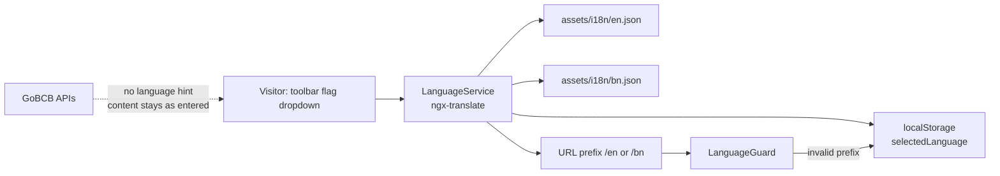

# P-13 · ভাষা পরিবর্তন (EN / BN)

> **Bangla name:** ভাষা পরিবর্তন (EN / BN)
>
> [← 20 · ইউজার পোর্টাল](README.md) · [সূচিপত্র](../README.md) · [ওপেন কোয়ারি](../99-open-queries.md)

## 1. নাম ও উদ্দেশ্য

**ভাষা পরিবর্তন (EN / BN)।** ইউজার পোর্টালের প্রতিটি URL-এ একটি ভাষা প্রিফিক্স থাকে — `/en/…` বা `/bn/…` — এবং টুলবারে একটি ভাষা ড্রপডাউন থাকে যা পুরো ইন্টারফেস বদলে দেয়। বাছাইটি ব্রাউজারে মনে রাখা হয় এবং এটি **সম্পূর্ণ ক্লায়েন্ট-সাইড**: সার্ভারে কিছু জমা হয় না এবং কোনো রিকোয়েস্টে ভাষার সংকেত থাকে না, তাই বাছাই অ্যাকাউন্ট নয়, ব্রাউজার অনুসরণ করে।

## 2. ট্রিগার ও অ্যাক্টর

যেকোনো দর্শক, সাইন-ইন করা বা না। কন্ট্রোল: টুলবারের ফ্ল্যাগ ড্রপডাউন, ডেস্কটপ ও মোবাইল উভয় লেআউটেই পাওয়া যায় (`layout/components/toolbar/toolbar.component.html`, `toolbar.component.ts:61-63, 92-93, 126-127, 283-289`)।

## 3. ব্যবসায়িক প্রবাহ

1. গ্রাহক টুলবারের ড্রপডাউন থেকে একটি ফ্ল্যাগ বাছাই করেন।
2. দৃশ্যমান সব লেখা সঙ্গে সঙ্গে বদলায়, একটি snackbar পরিবর্তন নিশ্চিত করে, `<html lang>` অ্যাট্রিবিউট হালনাগাদ হয়, এবং URL প্রিফিক্স নতুন করে লেখা হয় যাতে লিংকটি সেই ভাষায় শেয়ার করা যায়।
3. পরের ভিজিটে সংরক্ষিত ভাষা প্রয়োগ হয়: URL প্রিফিক্সই ঠিক করে, আর URL-এ বৈধ প্রিফিক্স না থাকলে `LanguageGuard` সংরক্ষিত ভাষায় রিডাইরেক্ট করে।

## 4. কারিগরি প্রবাহ

1. ভাষা হলো `:lang` **প্যারেন্ট রুট অংশ**: `{ path: ':lang', component: DefaultLayoutComponent, canActivate: [LanguageGuard], children: appRoutes }` (`app-routing.module.ts:67-71`)। `''` রিডাইরেক্ট করে `/en`-এ (`:53`) এবং ওয়াইল্ডকার্ড `**`-ও `/en`-এ রিডাইরেক্ট করে (`:75`)।
2. `LanguageGuard` কেবল `en` বা `bn` গ্রহণ করে; অন্য কিছু `/${selectedLanguage}${currentPath}`-এ রিডাইরেক্ট করে (`language.guard.ts:16-28`)।
3. `LanguageService.switchLanguage(lang, showConfirmation = true, updateUrl = true)` (`:55-86`) কল করে `translate.use(lang)`, `MESSAGES.LANGUAGE_SWITCHED` snackbar দেখায় (`:61-67`), `document.documentElement.setAttribute('lang', lang)` বসায় (`:76`) এবং URL নতুন করে লেখে (`:88-102`)। `translate.setDefaultLang('en')` কনস্ট্রাকশনে একবার সেট হয় (`:34`)।
4. URL-এর ভাষাও পর্যবেক্ষণ করা হয়, তাই হাতে সম্পাদিত প্রিফিক্স বা পেস্ট করা লিংক `NavigationEnd`-এ ইন্টারফেস বদলে দেয় (`:38-47`)।
5. **একমাত্র স্থায়িত্ব হলো `localStorage['selectedLanguage']`**, `:73`-এ লেখা এবং `:31` ও `language.guard.ts:24`-এ পড়া হয়, ডিফল্ট `en`।
6. পেমেন্ট-ফেরত পথটিই একমাত্র জায়গা যেখানে সার্ভিসের বদলে সরাসরি key পড়া হয়: `app-routing.module.ts:60` সেটি দিয়ে পেমেন্টের পরের URL সঠিক প্রিফিক্স দিয়ে তৈরি করে।

## 5. কম্পোনেন্ট

| ধরন | কম্পোনেন্ট |
|---|---|
| ক্লায়েন্ট | `shared/services/language.service.ts`, `shared/guards/language.guard.ts`, `layout/components/toolbar/toolbar.component.ts` + `.html` |
| রাউটার | `app-routing.module.ts` (`:lang` প্যারেন্ট রুট) |
| অ্যাসেট | `src/assets/i18n/en.json`, `src/assets/i18n/bn.json` (`CommonModule` সহ `ngx-translate` দ্বারা লোড করা) |
| সার্ভিস / টেবিল / Redis | none — কোনো ব্যাকএন্ড কল ভাষা-নির্ভর নয় |

## 6. API কন্ট্রাক্ট

কোনোটিই নেই। কোনো ব্যাকএন্ড এন্ডপয়েন্ট জড়িত নয়, এবং **কোনো রিকোয়েস্টে `Accept-Language` বা লোকেল ফিল্ড যায় না** — API সার্ভিস ও ইন্টারসেপ্টর কোনোটিই সেট করে না। ফলে ডেটাবেস থেকে আসা কনটেন্ট (ইভেন্টের নাম, বিবরণ, নোটিশ, প্রোমোর নাম) যে ভাষায় অ্যাডমিন পোর্টালে লেখা হয়েছিল সেই ভাষাতেই দেখানো হয়, পড়কার ভাষায় নয়। `[UNCONFIRMED: Q-44]`

## 7. ডেটা ও পার্শ্বপ্রতিক্রিয়া

`localStorage['selectedLanguage']`, `<html>`-এর `lang` অ্যাট্রিবিউট, এবং URL প্রিফিক্স। কোনো সার্ভার অবস্থা, কোনো `etp` টেবিল, কোনো কিউ বার্তা নেই।

## 8. কোড রেফারেন্স

| কী | কোথায় |
|---|---|
| সার্ভিস | `rvl-gobcb-user-portal/ETP-Web/src/app/shared/services/language.service.ts:11-102` |
| গার্ড | `rvl-gobcb-user-portal/ETP-Web/src/app/shared/guards/language.guard.ts:16-28` |
| রাউটিং | `rvl-gobcb-user-portal/ETP-Web/src/app/app-routing.module.ts:53-75` |
| টুলবার | `rvl-gobcb-user-portal/ETP-Web/src/app/layout/components/toolbar/toolbar.component.ts:61-63, 126-127, 283-289` এবং `.html` |
| অনুবাদ অ্যাসেট | `rvl-gobcb-user-portal/ETP-Web/src/assets/i18n/en.json`, `.../bn.json` |
| ভাষা-সচেতন ফরম্যাটিং | `.../modules/featured/Issues/pages/report-issue-list/report-issue-list.component.ts:62-90` (পেজিনেটর রেঞ্জ টেক্সট, বাংলা-নির্দিষ্ট ফরম্যাট) |

## 9. হ্যান্ডওভার নোট

1. **সমর্থিত ভাষা হার্ড-কোড করা** `LanguageService`-এ (`:15-18`) `en` ও `bn` হিসেবে। তৃতীয় ভাষা যোগ করতে এই তালিকা এবং একটি নতুন `assets/i18n/<code>.json` — দুটোই লাগবে।
2. **ইংরেজি হলো ফলব্য ভাষা** (`setDefaultLang('en')`, `:34`), তাই `bn.json`-এ না থাকা কোনো key কাঁচা key নয়, ইংরেজিতেই রেন্ডার হয় — এ কারণেই দুটি ফাইল হুবহু মিলে যাওয়ার দরকার নেই।
3. **Key-এর সংখ্যা আলাদা:** `en.json`-এ ৫৬০টি লিফ key, `bn.json`-এ ৫৮৭টি (উভয়ই একই ২৬টি টপ-লেভেল নেমস্পেসের ওপর)। `bn.json`-এ বাড়তি key আছে, তাই অল্প কিছু ইংরেজি লেখা অনূদিত হয়নি, আর অনূদিত না হওয়াগুলো নীরবে ফলব্য ভাষায় চলে যায় `[UNCONFIRMED: Q-45]`।
4. **বাছাই প্রতি ব্রাউজারে, প্রতি অ্যাকাউন্টে নয়।** একই গ্রাহকের জন্য দুটি ডিভাইস ভিন্ন ভাষা দেখাতে পারে, আর শেয়ার করা লিংক নিজের ভাষার প্রিফিক্স বহন করে।
5. **ডেটাবেস থেকে আসা কনটেন্ট কখনো অনূদিত হয় না** — শুধু পেজের চেহারা। বাংলা-প্রথম লঞ্চের জন্য এটিই সবচেয়ে বড় ঘাটতি এবং এতে BS23-এর সিদ্ধান্ত দরকার (প্রতি ভাষায় কলাম, একটি অনুবাদ টেবিল, নাকি প্রতি প্রোগ্রামে কনটেন্ট) `[UNCONFIRMED: Q-44]`।
6. **পেমেন্ট রিডাইরেক্ট সরাসরি `localStorage` পড়ে** (`app-routing.module.ts:60`) `LanguageService` ব্যবহার না করে। রিডাইরেক্ট ও পড়ার মধ্যে guard প্রিফিক্স বদলে দিলে গ্রাহক অন্য ভাষায় চলে পড়তে পারে `[UNCONFIRMED: Q-44]`।
7. **পেজিনেটরের লেবেল প্রতি ভাষায় আবার হিসাব হয়**, বাংলা রেঞ্জ ফরম্যাটসহ `` `${length} এর মধ্যে ${start}+1-${end}` `` (`report-issue-list.component.ts:62-90`) — এমন লেখার একটি উদাহরণ যা শব্দে-শব্দে নয়, সাবধানে অনুবাদ করতে হয়।

## 10. কম্পোনেন্ট সম্পর্ক

**নির্ভর করে:** ব্যাকএন্ডে কিছুই নয়। **প্রভাব ফেলে:** ইউজার পোর্টালের প্রতিটি ফিচারের প্রদর্শিত লেখা — [P-01](P-01-home-content.md), [P-02](P-02-browse-events.md), [P-03](P-03-info-pages.md), [P-04](P-04-seat-selection.md), [P-07](P-07-my-bookings.md), [P-11](P-11-profile.md), [P-12](P-12-issues-chat.md) — কারণ সবগুলোই `ngx-translate` দিয়ে রেন্ডার হয়। অ্যাডমিন-পোর্টাল ও অ্যাপ ক্লায়েন্টের নিজস্ব ভাষা ব্যবস্থা আছে এবং এখানে বিবেচনার বাইরে।

## 11. ডেভেলপার টেস্ট গাইড

**লোকাল টেস্টযোগ্যতা: সম্পূর্ণ।** এটি সম্পূর্ণ ক্লায়েন্ট-সাইড; কোনো stub জড়িত নয়।

| আইটেম | বিবরণ |
|---|---|
| টেস্ট ডেটা ও অ্যাকাউন্ট | none — সাইন-আউট অবস্থাতেও কাজ করে |
| ব্রাউজার | `http://localhost:4200/` `/en`-এ রিডাইরেক্ট হয়; টুলবার থেকে বাংলায় বদলান এবং নিশ্চিত করুন URL `/bn/...` হয়েছে, `localStorage.selectedLanguage === 'bn'`, এবং `<html lang="bn">`; রিলোড করে বাছাই টিকে আছে কি না দেখুন; তারপর `/fr/booking` খুলে guard-এর `/bn/booking`-এ রিডাইরেক্ট নিশ্চিত করুন |
| এমুলেটর | — |
| Postman | প্রযোজ্য নয় |
| Visual Studio debug | কোনো ব্যাকএন্ড জড়িত নয়; রিডাইরেক্ট ট্রেস করতে `LanguageService.switchLanguage`-এ ব্রেকপয়েন্ট |
| যাচাই | `localStorage.getItem('selectedLanguage')`; `bn.json`-এ ইচ্ছাকৃতভাবে ভাঙা একটি key দিয়ে ইংরেজি ফলব্য যাচাই; `en.json` ও `bn.json`-এর key সেট তুলনা (`jq '[paths(scalars)] \| length'`) |
