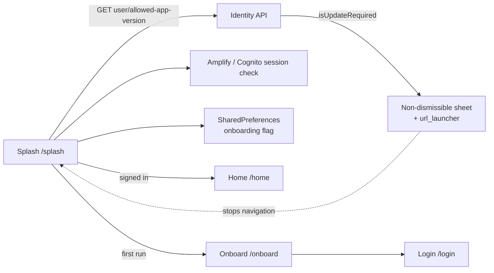

# U-01 · স্প্ল্যাশ, ভার্সন গেট ও অনবোর্ডিং

> **Bangla name:** স্প্ল্যাশ, ভার্সন গেট ও অনবোর্ডিং
>
> [← 30 · ইউজার অ্যাপ](README.md) · [সূচিপত্র](../README.md) · [ওপেন কোয়ারি](../99-open-queries.md)

## 1. নাম ও উদ্দেশ্য

**স্প্ল্যাশ, ভার্সন গেট ও অনবোর্ডিং।** চালু হওয়ার পরের প্রথম স্ক্রিন। এটি যাচাই করে যে ইনস্টল করা অ্যাপ ভার্সনটি এখনো অনুমোদিত কি না, সিদ্ধান্ত নেয় গ্রাহক আগে থেকেই সাইন-ইন করে আছেন কি না, প্রথমবারের ব্যবহারকারীকে অনবোর্ডিং ক্যারাউজেল দেখায়, এবং এরপর Home বা Login-এ নিয়ে যায়। এটি একইসাথে অ্যাপের force-update গেট — অ্যাপ চলতে অস্বীকার করতে পারে একমাত্র জায়গা।

## 2. ট্রিগার ও অ্যাক্টর

প্রতিটি কোল্ড স্টার্টে। রুট `/splash` (`RoutePath.splash`); splash `binding` DI কন্টেইনারের মাধ্যমে `SplashViewModel` তৈরি করে (`data/lib/di/data_module.dart`)।

## 3. ব্যবসায়িক প্রবাহ

1. স্প্ল্যাশ দেখা যায় এবং সঙ্গে সঙ্গে ব্যাকএন্ডকে জিজ্ঞেস করে যে এই অ্যাপ ভার্সনটি এখনো অনুমোদিত কি না।
2. আপডেট প্রয়োজন হলে একটি **বন্ধ করা যায় না** এমন bottom sheet আসে, যেখানে **Update now** বাটন `appInfo.appLink` ব্রাউজারে খোলে। নেভিগেশন এখানেই থেমে যায় — অ্যাপ Home বা Login-এ এগোয় না।
3. নইলে অ্যাপ দেখে নেয় একটি Cognito সেশন আছে কি না।
4. সাইন-ইন করা থাকলে → **Home**, আর একটি ব্যাকগ্রাউন্ড কল ব্যবহারকারীর তথ্য ক্যাশ করে।
5. সাইন-ইন না করা এবং অনবোর্ডিং সম্পন্ন না হলে → ১ সেকেন্ড বিলম্বের পর **Onboard**, তারপর **Login**।
6. সাইন-ইন না করা কিন্তু অনবোর্ডিং আগেই সম্পন্ন হলে → সঙ্গে সঙ্গে **Login**।

## 4. কারিগরি প্রবাহ

1. `SplashViewModel._onInit()` (`splash_view_model.dart:56-62`) তার ধাপগুলো ক্রমানুসারে চালায়: `_checkAppVersion()`, `_getLoginStatus()`, `_getOnboardingStatus()`, `analyticsRepository.setAnalyticsUser()`, তারপর `_navigateToNextScreen()`।
2. **[HTTP + থাকলে ইউজার টোকেন] → identity API:** `GET user/allowed-app-version` (`app_version_api_service_impl.dart:14`) → `AppInfo { isUpdateRequired, appLink, … }`।
3. `appInfo.isUpdateRequired == true` হলে এটি `_shouldUpdateApp` সেট করে এবং `isDismissible: false` দিয়ে একটি bottom sheet দেখায় (`:76-95`)। বাটনটি লিংকটি `url_launcher` দিয়ে খোলে, এবং কেবল `http`/`https` স্কিমের ক্ষেত্রে এবং কেবল ওয়েবে না থাকলেই (`:88-91`)। `_shouldUpdateApp` সেট থাকলে `_navigateToNextScreen()` সঙ্গে সঙ্গে ফিরে যায় (`:105`)।
4. `authRepository.isLoggedIn()` Amplify/Cognito সেশন দেখে; `appRepository.isOnBoardingCompleted()` লোকাল স্টোরেজ দেখে।
5. **[UNCONFIRMED: Q-51]** — ভার্সন যাচাইটি `try/catch`-এ মোড়ানো এবং সেটি **ত্রুটিটি গিলে ফেলে দেয়** (`:82-84`); ফলে চালু হওয়ার সময় নেটওয়ার্ক নেই এমন একজন গ্রাহক নীরবে গেট পার করে যান — বাধা পান না। এটিই কাঙ্ক্ষিত আচরণ, তবে এর মানে আউটডেটেড অ্যাপ অফলাইনেও চলতে পারে।
6. নেভিগেশন ব্যবহার করে `navigateToScreen(destination: …, isClearBackStack: true)` — Home (`:107-114`), `Future.delayed(const Duration(seconds: 1))`-এর পর Onboard (`:116-122`), অথবা Login।

## 5. কম্পোনেন্ট

| ধরন | কম্পোনেন্ট |
|---|---|
| ক্লায়েন্ট | `lib/presentation/feature/splash/splash_view_model.dart`, `splash_adaptive_ui.dart`, `screen/`, `binding/` |
| ক্লায়েন্ট | `lib/presentation/feature/onboard/onboard_view_model.dart`, `onboard_adaptive_ui.dart`, `screen/`, `widgets/` |
| ক্লায়েন্ট সার্ভিস | `data/lib/remote/api_service/app_version_api_service/`, `data/lib/repository/app_repository_impl.dart` |
| রাউটার | `lib/presentation/navigation/route_path.dart` (`splash`, `onboard`, `home`, `login`) |
| সার্ভিস | Identity API (`user/allowed-app-version`) |
| টেবিল / Redis | নেই |

## 6. API কন্ট্র্যাক্ট

| মেথড | পাথ | অথ | রিকোয়েস্ট → রেসপন্স |
|---|---|---|---|
| GET | `{AUTH_API_BASE_URL}/user/allowed-app-version` | সাইন-ইন করা থাকলে user bearer, নইলে কার্যত অ্যাননিমাস | — → `AppInfo { appVersion, isUpdateRequired, appLink, … }` |

এটি [X-06](../60-cross-cutting/X-06-user-registration.md) ও [P-11](../20-user-portal/P-11-profile.md)-এর একই identity API, শুধু ভিন্ন ক্লায়েন্টের মাধ্যমে পৌঁছানো হয় (`auth_api_client.dart:6`, base URL `dotenv.env['AUTH_API_BASE_URL']`) `[UNCONFIRMED: Q-01]`।

## 7. ডেটা ও পার্শ্বপ্রতিক্রিয়া

শুধু লোকাল স্টোরেজ: অনবোর্ডিং-সম্পন্নের ফ্ল্যাগ, `AppRepository`-এর পিছনে `SharedPreferences`-এর মাধ্যমে। কোনো `etp` টেবিল লেখা হয় না।

## 8. কোড রেফারেন্স

| কী | কোথায় |
|---|---|
| ভিউ মডেল | `rvl-gobcb-user-app/lib/presentation/feature/splash/splash_view_model.dart:56-124` |
| অনবোর্ডিং | `rvl-gobcb-user-app/lib/presentation/feature/onboard/onboard_view_model.dart:11-17` |
| ভার্সন API | `rvl-gobcb-user-app/data/lib/remote/api_service/app_version_api_service/app_version_api_service_impl.dart:14` |
| অথ ক্লায়েন্ট | `rvl-gobcb-user-app/data/lib/remote/api_client/auth_api_client.dart:6` |
| রুট | `rvl-gobcb-user-app/lib/presentation/navigation/route_path.dart` |
| অ্যাপ রিপোজিটরি | `rvl-gobcb-user-app/data/lib/repository/app_repository_impl.dart:15` |
| মডেল | `rvl-gobcb-user-app/domain/lib/model/app_info.dart` |

## 9. হ্যান্ডওভার নোট

1. **force-update গেটটি শুধুই ক্লায়েন্ট-সাইড।** এটি কোনো API যাচাইয়ে নয়, অ্যাপ নেভিগেট করতে অস্বীকার করার মাধ্যমে প্রয়োগ করা হয়, ফলে যে গ্রাহক অ্যাপটি আর কখনো খোলেন না তার কাছে পুরোনো ভার্সনই থেকে যায় `[UNCONFIRMED: Q-52]`।
2. **ব্যর্থ ভার্সন যাচাই গিলে ফেলা হয়**, ফলে অফলাইনে চালু হওয়া সবসময় গেট পার করে (§4 নোট ৫)।
3. **আপডেট bottom sheet বন্ধ করা যায় না** (`isDismissible: false`) — এটিই অভিসন্নত, তবে এর সাথে কোনো "পরে মনে করিয়ে দিব" সুবিধাও নেই, ফলে আপডেট না হওয়া পর্যন্ত অ্যাপ অব্যবহারযোগ্য থাকে না।
4. **লিংকটি কোনো স্টোর SDK নয়, `url_launcher` দিয়ে খোলা হয়**, এবং কেবল তখনই যখন স্কিম `http`/`https`। `appLink`-এ থাকা কোনো `market://` বা `itms-apps://` লিংক উপেক্ষা করা হয় `[UNCONFIRMED: Q-52]`।
5. **চেকগুলোর পরে অ্যানালিটিক্স ইনিশিয়ালাইজ হয়**, ফলে বাধা পাওয়া কোনো গ্রাহক অ্যানালিটিক্সে কখনো নিবন্ধিত হন না।
6. **অনবোর্ডিংয়ের আগের ১ সেকেন্ড বিলম্ব** একটি কসমেটিক বিরতি, কোনো লোডিং গেট নয়; অনবোর্ডিং প্রথম চালু হওয়ার পরেই একবারই দরকার।
7. **`AppInfo.appLink` অবশ্যই identity API দিয়ে সেট হতে হবে।** রিকোয়েস্টটি নিজে কোনো ভার্সন প্যারামিটার নেয় না — `app_version_api_service_impl.dart:14` একটি সাদা `get` পাঠায়, তাই ভার্সনটি `ApiClient` দিয়ে হেডার বা কোয়েরি হিসেবে পাঠাতে হবে; কোনটি তা যাচাই করুন, কারণ ভার্সনহীন যাচাই কাজ করতে পারে না `[UNCONFIRMED: Q-01]`।

## 10. কম্পোনেন্ট সম্পর্ক

**নির্ভর করে:** [X-11](../60-cross-cutting/X-11-delete-account-force-update.md) (একই force-update আচরণ, API-পাশ থেকে নথিভুক্ত)। **প্রভাব ফেলে:** সবকিছু — অন্য প্রতিটি U-xx অংশ এই স্ক্রিন যে সেশন তৈরি করে সেখান থেকেই শুরু হয়।

## 11. ডেভেলপার টেস্ট গাইড

**লোকালভাবে টেস্টযোগ্য: সম্পূর্ণ**, তবে ভার্সন যাচাইয়ের জন্য identity স্টাব দরকার। `allowed-app-version`-এর জন্য কোনো আলাদা স্টাব নেই, তাই `AUTH_API_BASE_URL` `/p/identity` স্টাব বা লোকাল Serverless ডিপ্লয়মেন্টের দিকে সেট করুন (`docs/mobile-local.md`)।

| আইটেম | বিস্তারিত |
|---|---|
| টেস্ট ডেটা ও অ্যাকাউন্ট | অনবোর্ডিংয়ের জন্য কিছু নেই; ভার্সন রেসপন্স স্টাব থেকে পড়া হয় |
| ব্রাউজার | — |
| এমুলেটর | অ্যাপ চালু করুন (`scripts/Setup-MobileApps.ps1`); লগে `Started Firebase Initialization` তারপর splash ট্রানজিশন দেখা যাবে; ব্লকিং শিট দেখতে স্টাব রেসপন্সে `isUpdateRequired: true` সেট করুন |
| Postman | "GET /user/allowed-app-version" কোনো GoBCB কালেকশনে নেই — এটি identity API-এর `[UNCONFIRMED: Q-01]` |
| Visual Studio ডিবাগ | কলটি আউট অফ প্রসেস; Flutter ডিবাগারে `SplashViewModel._checkAppVersion` ও `_navigateToNextScreen`-এ ব্রেক দিন |
| যাচাই | `.env`-এ `AUTH_API_BASE_URL`-এর মান; অনবোর্ডিং পথ আবার ট্রিগার করতে অ্যাপ স্টোরেজ মুছে দিন |