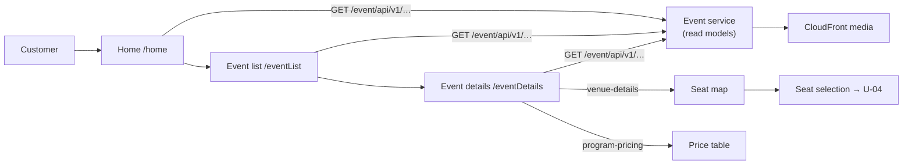

# U-02 · হোম ও ইভেন্ট ব্রাউজ

> **Bangla name:** হোম ও ইভেন্ট ব্রাউজ
>
> [← 30 · ইউজার অ্যাপ](README.md) · [সূচিপত্র](../README.md) · [ওপেন কোয়ারি](../99-open-queries.md)

## 1. নাম ও উদ্দেশ্য

**হোম ও ইভেন্ট ব্রাউজ।** গ্রাহকের ল্যান্ডিং স্ক্রিনে দেখায় তিনি কোন প্রোগ্রাম বুক করতে পারেন, হেডার/ফুটারের কনটেন্ট এবং ল্যান্ডিং-পেজের ব্যানার; সেখান থেকে তিনি ইভেন্ট তালিকা খোলেন, ইভেন্ট ব্রাউজ করেন এবং কোনো ইভেন্টের বিস্তারিত খোলেন। ব্যাকএন্ড হুবহু সেটাই যেটি ওয়েব পোর্টাল ব্যবহার করে ([P-01](../20-user-portal/P-01-home-content.md), [P-02](../20-user-portal/P-02-browse-events.md)) — এখানে পার্থক্য কন্ট্রাক্টে নয়, উপস্থাপনে।

## 2. ট্রিগার ও অ্যাক্টর

সাইন-ইন করা গ্রাহক। সেশন থাকলেই হোমে কেবল [U-01](U-01-splash-onboarding.md) থেকেই পৌঁছানো যায়। রুট `/home`, `/eventList`, `/eventDetails`।

## 3. ব্যবসায়িক প্রবাহ

1. হোম লোড করে পাবলিক ল্যান্ডিং-পেজের ছবি (ব্যানার), প্রোগ্রামের তালিকা এবং হেডার/ফুটারের কনটেন্ট, তারপর দেখায় গ্রাহকের প্রোগ্রামগুলো।
2. কোনো প্রোগ্রামে ট্যাপ করলে তার ইভেন্ট তালিকা খোলে।
3. ইভেন্ট তালিকাটি পেজযুক্ত এবং pull-to-refresh সমর্থন করে; প্রতিটি সারিতে ইভেন্টের ছবি, নাম, ভেন্যু, তারিখ ও শুরুর দাম দেখা যায়।
4. কোনো ইভেন্টে ট্যাপ করলে বিস্তারিত স্ক্রিন খোলে, যা ইভেন্ট, তার ভেন্যু ম্যাপ এবং তার মূল্য সংগ্রহ করে।

## 4. কারিগরি প্রবাহ

1. **[HTTP + ইউজার টোকেন]** `GET event/api/v1/landing-page-image/public` — **দুটোই** `EventApiServiceImpl:36` এবং `GalleryApiServiceImpl:13` এটি ব্যবহার করে, অর্থাৎ গ্যালারির নিজস্ব আলাদা এন্ডপয়েন্ট নেই; সেটি ল্যান্ডিং-পেজের এন্ডপয়েন্টই পুনর্ব্যবহার করে।
2. **[HTTP + ইউজার টোকেন]** `GET event/api/v1/events/programs` (`:46`) প্রোগ্রামের তালিকার জন্য।
3. **[HTTP + ইউজার টোকেন]** `GET event/api/v1/header-footer` (`:56`) হেডার/ফুটার কনটেন্টের জন্য।
4. **[HTTP + ইউজার টোকেন]** কোয়েরি প্যারামিটারসহ `GET event/api/v1/events/list` (`:16-19`) পেজযুক্ত ইভেন্ট তালিকার জন্য।
5. **[HTTP + ইউজার টোকেন]** `GET event/api/v1/events/{eventId}` (`:26`) ইভেন্টের বিস্তারিতের জন্য।
6. **[HTTP + ইউজার টোকেন]** `GET event/api/v1/events/venue-details/{eventId}` (`venue_details_api_service_impl.dart:16`) সিট ম্যাপের জন্য, যা বিস্তারিত স্ক্রিন গ্রাহক সিট নির্বাচনে যাওয়ার আগে রেন্ডার করে ([U-04](U-04-seat-selection-promo.md))।
7. **[HTTP + ইউজার টোকেন]** `GET event/api/v1/ticket-pricing/program-pricing` (`event_api_service_impl.dart:66`) বিস্তারিত স্ক্রিনে দেখানো মূল্য টেবিলের জন্য।
8. ছবি আসে CloudFront URL থেকে এবং `cached_network_image` দিয়ে ডিভাইসে ক্যাশ হয়; লোকাল ডেটাবেসে কিছু লেখা হয় না।

## 5. কম্পোনেন্ট

| ধরন | কম্পোনেন্ট |
|---|---|
| ক্লায়েন্ট | `lib/presentation/feature/home/`, `feature/event_list/`, `feature/event_details/` (প্রতিটিতে `route/`, `binding/`, `screen/`, `widgets/`, `*_view_model.dart`) |
| ক্লায়েন্ট সার্ভিস | `EventRepositoryImpl`, `GalleryRepositoryImpl`, `VenueDetailsRepositoryImpl`, `TicketPricingRepositoryImpl` (`data/lib/repository/`) |
| API সার্ভিস | `data/lib/remote/api_service/event_api_service/`, `gallery_api_service/`, `venue_details_api_service_impl.dart` |
| সার্ভিস | Event, Admin (read model) |
| বাহ্যিক | মিডিয়ার জন্য CloudFront |

## 6. API কন্ট্র্যাক্ট

| মেথড | পাথ | অথ | নোট |
|---|---|---|---|
| GET | `/event/api/v1/landing-page-image/public` | User | ব্যানার ও গ্যালারি আইটেম |
| GET | `/event/api/v1/events/programs` | User | প্রোগ্রামের তালিকা |
| GET | `/event/api/v1/header-footer` | User | হেডার/ফুটার |
| GET | `/event/api/v1/events/list` | User | পেজযুক্ত; কোয়েরি প্যারামিটার `programId`, page, size |
| GET | `/event/api/v1/events/{eventId}` | User | ইভেন্টের বিস্তারিত |
| GET | `/event/api/v1/events/venue-details/{eventId}` | User | [U-04](U-04-seat-selection-promo.md)-এর জন্য সিট ম্যাপ |
| GET | `/event/api/v1/ticket-pricing/program-pricing` | User | মূল্য টেবিল |

সবগুলোই **Event সার্ভিসের read model-এর বিপরীতে পড়া** (ক্যাশিং মডেলের জন্য [X-25](../60-cross-cutting/X-25-redis.md))। রিকোয়েস্ট/রেসপন্সের শেপ পোর্টালের সঙ্গে হুবহু এক — সম্পূর্ণ JSON-এর জন্য [P-02](../20-user-portal/P-02-browse-events.md) দেখুন।

## 7. ডেটা ও পার্শ্বপ্রতিক্রিয়া

ডিভাইস-লেভেলের ছবি ক্যাশ করা ছাড়া কিছু নেই। ক্লায়েন্ট থেকে কোনো `etp` টেবিল লেখা হয় না; ডেটার উৎস Admin সার্ভিস ([A-07](../10-admin-portal/A-07-events.md), [A-28](../10-admin-portal/A-28-media-configuration.md))।

## 8. কোড রেফারেন্স

| কী | কোথায় |
|---|---|
| Event API | `rvl-gobcb-user-app/data/lib/remote/api_service/event_api_service/event_api_service_impl.dart:16-66` |
| Gallery API | `rvl-gobcb-user-app/data/lib/remote/api_service/gallery_api_service/gallery_api_service_impl.dart:13` |
| Venue API | `rvl-gobcb-user-app/data/lib/remote/api_service/venue_details_api_service_impl.dart:16` |
| রিপোজিটরি | `rvl-gobcb-user-app/data/lib/repository/event_repository_impl.dart:10`, `gallery_repository_impl.dart:6`, `venue_details_repository_impl.dart:6`, `ticket_pricing_repository_impl.dart:6` |
| ফিচার | `rvl-gobcb-user-app/lib/presentation/feature/home/`, `feature/event_list/`, `feature/event_details/` |
| রুট | `rvl-gobcb-user-app/lib/presentation/navigation/route_path.dart` (`home`, `eventList`, `eventDetails`) |

## 9. হ্যান্ডওভার নোট

1. **গ্যালারি আর হোমের ব্যানার একই এন্ডপয়েন্ট কল করে।** `landing-page-image/public` দুটো সার্ভিস থেকে কল হয় (`event_api_service_impl.dart:36` ও `gallery_api_service_impl.dart:13`); গ্যালারি ছবির ধরন দিয়ে আলাদা হয়, তাই ভুল ফিল্টার হলে ব্যানারের ছবি গ্যালারিতে চলে আসত `[UNCONFIRMED: Q-53]`।
2. **অ্যাপ `ticket-pricing/list` নয়, `program-pricing` পড়ে** — পোর্টাল যে একই এন্ডপয়েন্ট ব্যবহার করে। এতে [A-14](../10-admin-portal/A-14-ticket-pricing-content.md)-এ সংশোধিত ফলাফল নিশ্চিত হয়: কোনো ক্লায়েন্টেই `ticket-pricing/list`-এর কোনো পাঠক নেই।
3. **ডিস্কে ইভেন্ট তালিকার কোনো ক্যাশিং নেই।** `cached_network_image` শুধু ছবি ক্যাশ করে; JSON তালিকা আবার ফেচ করা হয়, ফলে অফলাইনে ইভেন্ট তালিকা পাওয়া যায় না `[UNCONFIRMED: Q-54]`।
4. **পোর্টালের মতো একই "তালিকা ভেন্যু/সেগমেন্ট আছে ধরে নেয়" অনুমান** ([Q-36](../20-user-portal/P-02-browse-events.md)) — তালিকার মডেলটি ভেন্যু ও সেগমেন্ট অবজেক্ট উপস্থিত থাকার আশা করে।
5. **অ্যাপে অ্যাডমিন পোর্টালের মতো কোনো প্রোগ্রাম-সুইচ UI নেই**; প্রোগ্রামের তালিকা সরাসরি `events/programs` থেকে আসে, ফলে অনেক প্রোগ্রামযুক্ত গ্রাহক একটি সমতল তালিকা পান।

## 10. কম্পোনেন্ট সম্পর্ক

**নির্ভর করে:** [U-01](U-01-splash-onboarding.md) (সেশন), [A-07](../10-admin-portal/A-07-events.md) ও [A-28](../10-admin-portal/A-28-media-configuration.md) (যে কনটেন্ট দেখানো হয়), [A-09](../10-admin-portal/A-09-event-level-pricing.md) (দাম)। **প্রভাব ফেলে:** [U-04](U-04-seat-selection-promo.md), [U-05](U-05-booking-webview-payment.md)।

## 11. ডেভেলপার টেস্ট গাইড

**লোকালভাবে টেস্টযোগ্য: সম্পূর্ণ।** Event সার্ভিসটি Aspire-এর নিচে চলে এবং অ্যাপ পোর্টালের মতো একই এন্ডপয়েন্ট পড়ে।

| আইটেম | বিস্তারিত |
|---|---|
| টেস্ট ডেটা ও অ্যাকাউন্ট | seeded ইউজার `+8801700000011`; `scripts/seed/01-catalog.sql` প্রোগ্রাম, ইভেন্ট, ভেন্যু ও গ্যালারি তৈরি করে |
| ব্রাউজার | পোর্টালে `/en/`-এ সমতুর্য যাচাই — [P-02](../20-user-portal/P-02-browse-events.md) দেখুন |
| এমুলেটর | অ্যাপ চালু করুন (`scripts/Setup-MobileApps.ps1`); অ্যাপকে `scripts/mobile-gateway.js`-এর মাধ্যমে ব্যাকএন্ডে পৌঁছাতে হবে। অ্যাপ `dart-define` **ব্যবহার করে না** — base URL `.env`-এ সেট করুন (`env/README.md`) |
| Postman | `postman/services/etp-event.postman_collection.json`: "GET /api/v1/events/list", "GET /api/v1/events/{eventId}", "GET /api/v1/events/venue-details/{eventId}", "GET /api/v1/events/programs", "GET /api/v1/landing-page-image/public", "GET /api/v1/header-footer" |
| Visual Studio ডিবাগ | ক্লায়েন্ট: Flutter ডিবাগারে `EventRepositoryImpl`। সার্ভার: Event সার্ভিসে `EventController` |
| যাচাই | `Events`, `Programs` ও `LandingPageImages` টেবিল; অ্যাপের HTTP লগ লাইন |